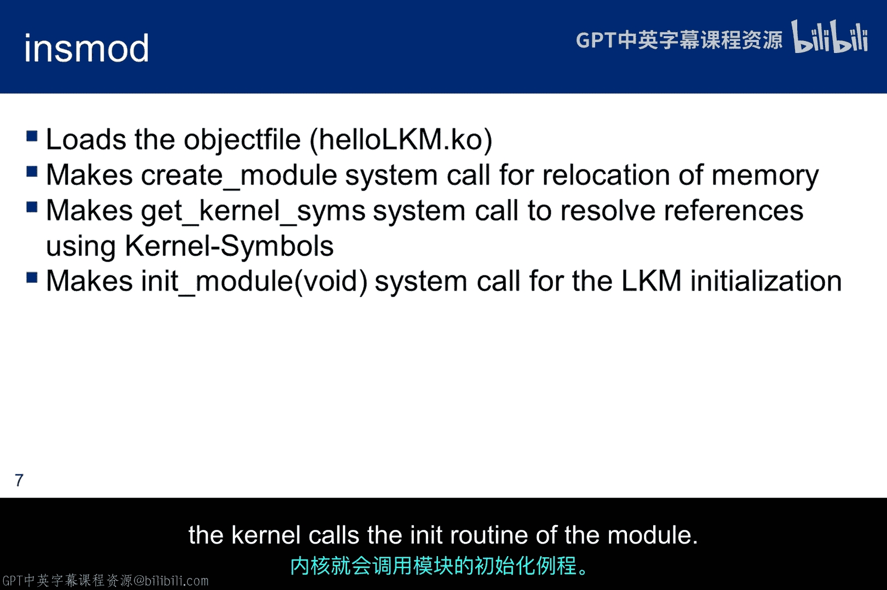
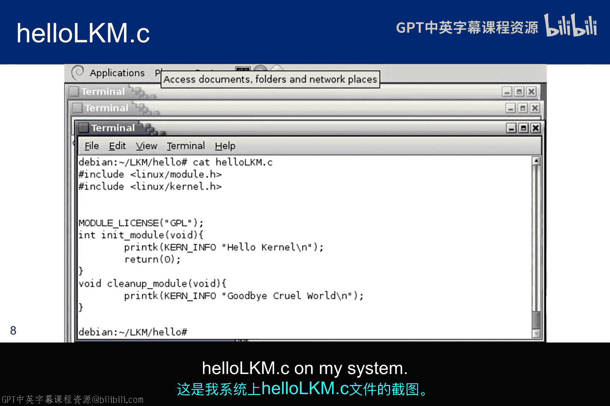
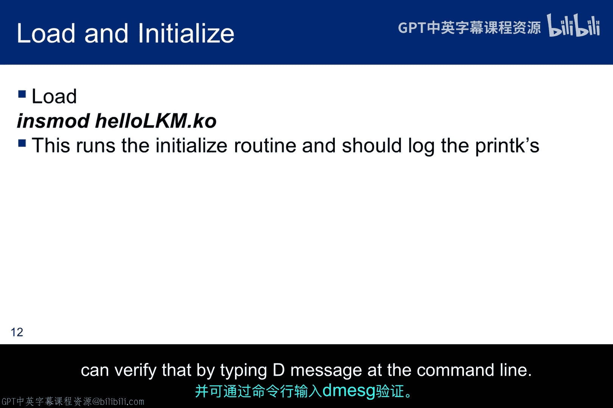
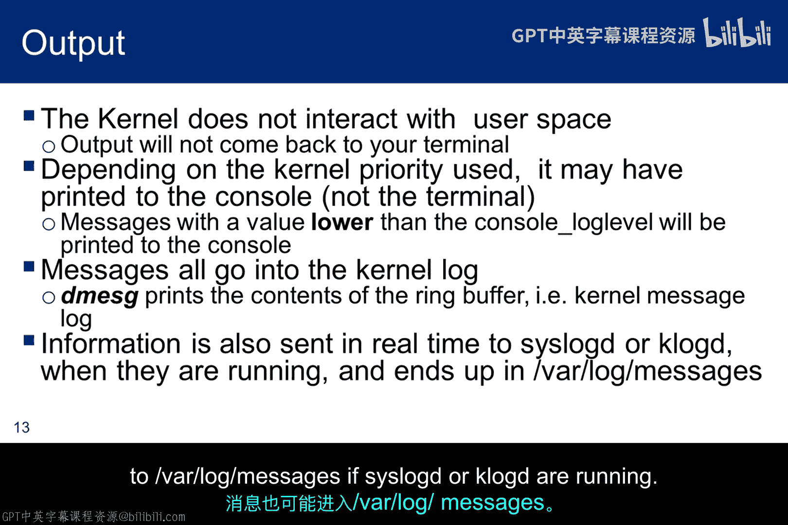
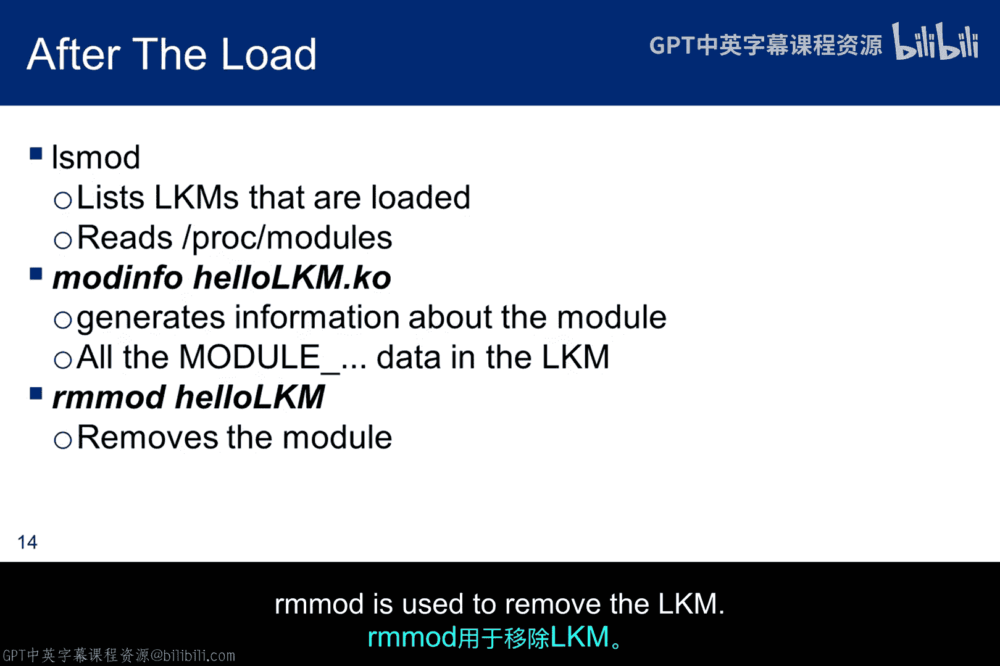
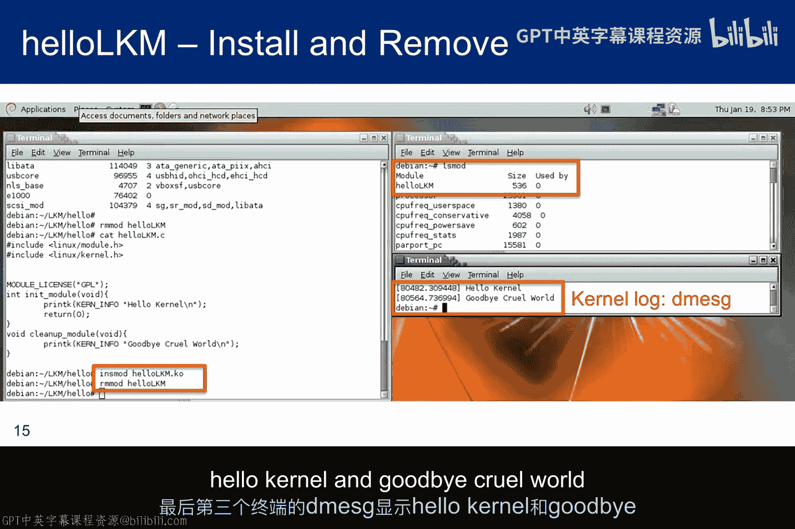
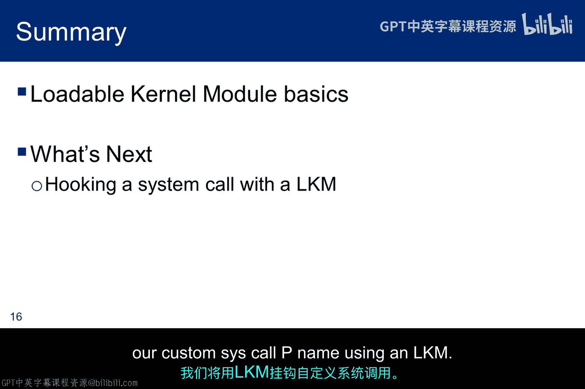

# 约翰霍普金斯大学《道德黑客入门｜Introduction to Ethical Hacking》中英字幕 p58 4_Linux内核模块(LKM).zh_en -BV1xgu1z1Eau_p58-

Loadable kernel modules， similar to Windows D L Ls are object files that contain code to extend the running kernel。

 L Kms sometimes add device driver functionality to support new hardware or file systems。

 and sometimes they add system calls when they are no longer needed L Kms can be unloaded in order to free memory。

 The key for this submodule is they extend the kernel， and we will leverage that for a root kit。

This is a list of L K M properties。 The fact that you can extend the kernel without recompiling is incredibly useful in Windows。

 it is not even possible to recompile the kernel。 So without the capability。

 you would have minimal flexibility。 and you would be constrained for the most part to what Microsoft provided。

 Linux is not as problematic as it is open source， but rebuilding the kernel doubles the risk when compared to just write in an L Km。

 Of course， L Kms are risky on their own if care is not taken。 For example， when developing one。

 a pointer mistake could wipe out the file system。 but the most important property is L Km's run in kernel space。

 So they have access， the user programs do not。 And if a bad actor has root privileges。

 it is possible to load an L K M and run code in kernel space。

I am going to discuss a loadable kernel module called Hello L K M dot C。

 Any L K M has a few mandatory components in order to qualify as a loadable module。 First of all。

 it must include the module headers in order to get everything to resolve when it compiles In our example。

 we also need the kernel headers， but only because we need support for the macro expansion of the kernel's print K function。

 The license line is required as well to avoid tainting the kernel when the module loads。

 This isn't critical， it when tainted， it means the kernel in that configuration with the L K M loaded。

 is not supported by the community， and you will not be able to get any support from kernel developers。

 L K Ms also need an initialization section and an exit section in it， underscore module。

 either registers a handler with the kernel， or it replaces a kernel function with the。Own code。

 and then in many cases， finishes initialization by calling the original kernel function。 At the end。

 the cleanup module is supposed to undo whatever the init module put into place so the module can be unloaded safely。

 And a reminder， you don't really run and L K M。 The code making up these functions executes when the module loads and unloads。

This is a very simple Lcam。 It has all the mandatory parts just mentioned。

 and the initialized function is simply a print statement， since it does nothing when it initializes。

 there is nothing for the exit function to clean up So we just add another print statement。

 A couple of comments， though， First， the print statement is print K。

 and it is only available to the kernel。 It accepts a format string like print F。

 which specifies how to render various data type parameters into a string。

 The string is then printed to the kernel log。 The second thing to notice is kernel info。

 which is a keyword for log level and specifies the type of message sent to the log。 In this case。

 simply some information。 There are8 log levels， which I will discuss in a minute。

 Suffice it to say for now， we are just printing information to the log。

 If we didn't specify kernel level in the print K statement。 It would default to a kernel warning。

 and notice the syntax。 There is no。punctuation between the kernel level and what we want to print。

 If we were to load this LKm， we could see， Hello kernelel in the kernel log by entering DmesG at the command line。

Once the kernel is ready to compile， this is what the make file would look like。 However。

 this is not a traditional make file， because loadable modules are more like the kernel and not so much like a user program。

 What that means is the kernel build system handles part of the module build。

 The first line states that there is one module to be built from the object file， Hello L K M dot O。

 Although not identified in the make file。 The resulting module is named hello Ltm dot K O。

 after being built from the object file。 In the second line。

 when the compilation starts The T C changes the directory to the kernel source tree。

 because the build system needs to find the kernel's top level make file。

 Then the M equal option causes the make file to move back to the module source directory before trying to build the module target。

 This target in turn， refers to the module found in the O Bjt M variable。Which is Ho L K M dot O。

 So it is pretty confusing if you haven't seen it before and don't work with it。

 But if you are interested and want additional detail。

 the files found in documentation slash K Bill directory in the Colonel Sorctry should help。

These are the commands for loading and unloading and L K M and pay attention to the fact that we load the dot K O kernel object file。

 not the dot O object file。I N S modd is considered to be a rather simple program that does not address dependencies or print out much in the way of useful error messages。

 but it does log kernel modules into kernel address space from user space。

 Mod probe is considered to be a better tool， but for our purposes inmodd is good enough Inmodd tries to link a module into the running kernel by resolving all symbols from the kernelel's exported symbol table。

 It also reloates memory in the event the kernelel does not have enough contiguous physical memory to accommodate everything in the module。

 Once the relevant sections are loaded in memory， The kernelel calls the init routine of the module。

 This is a screenshot of a listing of Ho L Km dot C on my system。

You are not stuck with names like anit module and cleanup module for the initialization and cleanup。

 You can name them anything you like。 You just have to provide module definitions to identify which function is for initialization and which is for cleanup。

 That is what the last two lines do。 This is just a short introduction to print K。

 the kernel utility that prints to the kernel log log levels are defined in Linux slash kernel levels dot H。

 and which log levels are printed is configured in the file S Y S C T L located at slashproc slash cis slash kernel slash print K。

The thing about log levels is some are printed to the console， in addition to the log。

 and some are only printed to the log， raising the log level to currentern alert。

 make sure it writes to the console。 If you don't specify a priority level。

 the default priority default message log level is used， which just writes to the kernel log。

This is a list of log levels and what their intended use is。 As I just noted。

 you have to set the log level to kernel alert to ensure it goes to the console， notifying the user。

 Otherwise， it will probably just go to the log， depending on your T L settings。

When Ho L K M is loaded and initialized， little happens。 Nothing shows up on the console。

 The L K M is basically loaded into kernel memory， awaiting a system call， but when loaded。

 the initialization routine does run。 So the print K should write to the colonel log。

 That means as soon as it loads， even though nothing else is happening。

 we should see Ho world in the log and can verify that by typing D message at the command line。

As noted earlier， print K does not interact with user space。 So nothing shows up on the terminal。

 If you change the print K statement to send an alert at kernel level 1。

 it would be printed to the console， but not to the terminal Actually。

 messages with a value lower than the console log level will be printed to the console。

 and you can determine your current console log level by entering cat slash proc slash cis slash kernel s print K and four integers will be returned。

 The first integer shows you your current console log level。

 while the second shows the default log level to change your current console log level。

 you would just echo 8 into slash pro slash cis slash kernel s print K at the root level command line and every kernel message will appear on the console。

 another way to change the console log level is to use D message with the tech N parameter。

Messages go to the kernelel log， and you can see them with the message。

 but they may also go to slash vr slash log， slash messages。 If cis log D or K log D are running。

Once the L K M is loaded， it is possible to see it and any other L Kms loaded using the list module command。

 Ls mod。 Two other interesting commands are mod info。

 which generates information from the module keyword in the L K M， for example， author description。

 license version and info， may all be provided via the module keyword。

 and R M mod is used to remove the L K M。

This screen shot shows four things。 First， I ran the inmod command。

 and then the L Smog command in a different terminal。

 which shows Ho L K M has been loaded along with several other L K Ms。 Next。

 I ran R M modd to unload Hello L K M。 And finally， the D message command in the third terminal。

 shows Hello Colonel and Good bye Cru world have both been logged to the Colonel log。

This has been an introduction to LKM Bass， and in the next submual。

 we will hook a call to our custom Sis call P name using an LKM。

