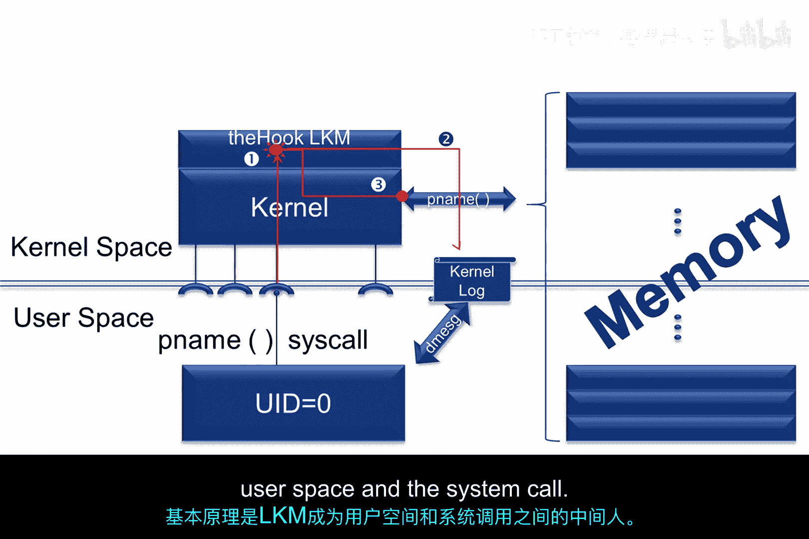
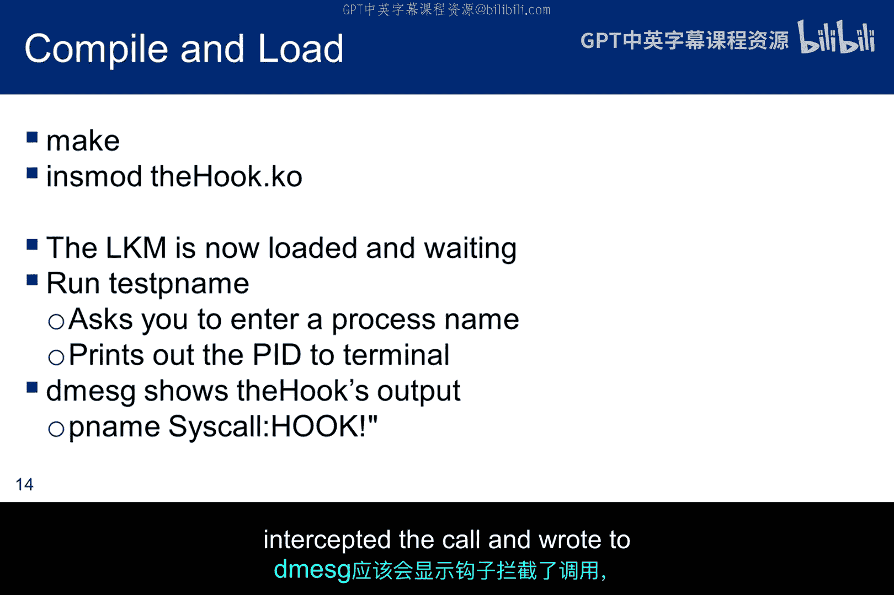
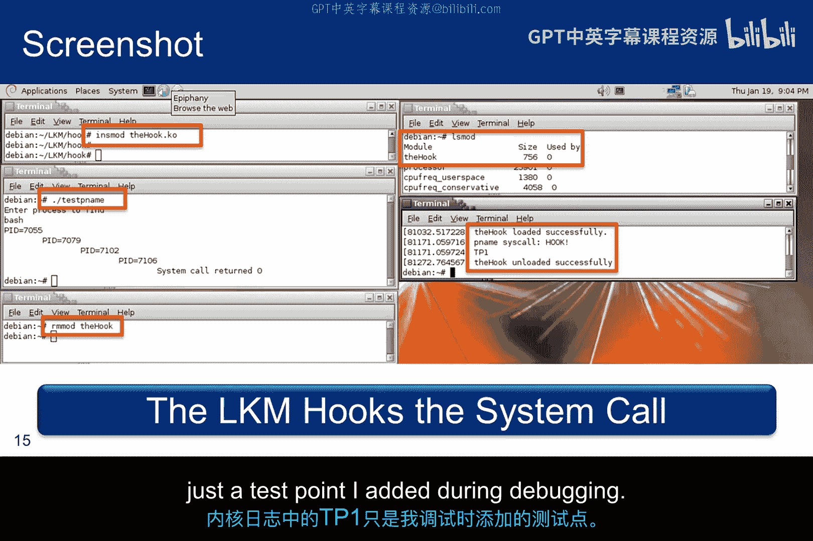
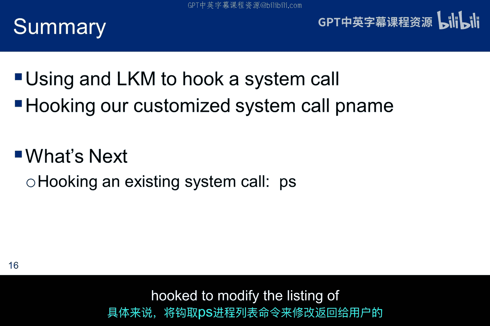

# 约翰霍普金斯大学《道德黑客入门｜Introduction to Ethical Hacking》中英字幕 p59 5_利用LKM实现钩子技术.zh_en -BV1xgu1z1Eau_p59-

So now we are going to build an L K M that will hook our custom system call P name with the final goal of being able to use the same approach to hook any system call that comes with the kernelel。

You've seen this diagram previously， but I've added two pieces。 First， I show P name。

 which is our kernel owned system call that has access to all of the kernel space and the entire machine memory。

 Second， I've added the kernel log or all kernel messages will be written。

 and users can read the log using D message。 Notice we can call P name from user space。

 just like we call any other system call exposed by the kernel。And expanding this picture。

 I have added the malicious L K M we want to construct in this sub module。

 It will run in kernel space and hook all calls from user space to P name。 Again。

 it will be running in kernel space。 So we do need route access to install the L K M。😊。

It works like this。 First， the L K M is loaded， and it is just sitting there waiting for a call to P name。

When Pen gets called from user space， the L K M intercepts the call and executes some malicious activity。

 In our case， it will simply write to the colonel log to demonstrate the hook。

Then the L K M makes the original cis call to P name， as originally requested from user space。

 So the fundamental concept is the L K M becomes a man in the middle between user space and the system call。

How do we create an L KM that can intercept a system call。

 The first step is to save P name in the LKm so that when the hook is finished。

 we can call P name and return the expected response to the user。

 We used a variable custom underscore Cis call to save the name of the system call we created。

 Then we change the system call table to point to the hook inside our LKm instead of the system call。

 That means when a user calls P name， the call will be diverted to the hook。

 And when the hook is finished with its malicious activity。

 it knows where to get the name of the original system call。

 because it is stored in custom underscore Cis call。

 Once the calling sequence has been modified the LKm just waits for a user to call P name。First。

 we want to get the address of the system call table so the LC cam can modify the call to P name。

 We will hard code this address into the LC cam for simplicity， But with some enhancements。

 the LC cam could be modified to determine the address on the fly。

The address in my 32 B Deian system is Hex 1，2，6， A2，8，0。 Yours will be different。

This header list is the first part of H dot C， the L K M that will intercept our system call P name。

This is the second part of the L K M。 It includes the module information。

 And there is a comment identifying the hard coded system call table address。 But for now。

 the variable is just declared as an uninitialized pointer。

 We also identify the system call prototype for the cis call the user requested that we want to call after the hook is finished。

The third snippet of code is the call to the malware function， which， for our purposes。

 just prints to the kernelel log so we can verify that the call to P name was hooked。

 but the program could have executed any code it wanted。 Then after the hook executed。

 the L K M makes the original call。 So the user is unaware of the hook。

This part of the L K M is a little tricky， as we are modifying the kernelel system call table permissions。

And you would need to understand the details of the page table entry structure to figure out how to do it。

 Well， it is unlikely that any of you are system programmers。 Given the code。

 it is easy to see the function make， underscore R W consumes the address of the Cis call table and changes the permissions to read。

 write。And this snippet just reverses the code on the previous slide and returns the cis call table to right protected state when we are finished。

The initialization code prints to the log when the L K M initializes。

 and then the hard coatd system called table address is set to match the hex value we determine from the system map。

Next， we save the call table information for P name in custom Cis call。 Finally。

 we disable page protection and replace the system call table entry for P name allowing us to execute the hook prototype defined in this L Km。

 We are really replacing the custom sis call defined when we built the kernel with a malicious cis call defined in the L Km。

 Once we make this change， the L Km just waits for a P name call to come in When it does。

 the call is intercepted because of the change to the call table and the user space request to run P name is diverted to the end of the hook malware section。

 The first thing the hook function does， is to print a message to the kernel log。

 which tells us the hook function ran。 after the hook function prints to the kernel log。

 it calls P name Thus returning to the user， the requested output of the system call。

This is the exit code。 So it runs when the L cam is unloaded。 First。

 it prints to the colonel log a notification that it has been unloaded。

 Then it restores the system call table to its original state with right protection。

The code may seem complex， but it is not critical that you understand every detail。

 On the other hand， good ethical hackers have to be able to roll up their sleeves and dig down far enough to understand the details when necessary。

 It is worth reviewing the code a couple of times if necessary as you won't find a much simpler example of Colonel Hooking code。

 This is the make file for the hook。 And it is exactly the same as the make file for Hello L K M。

 So I won't go over it again。The next step is to test it and see if it worked。 First。

 compile the L K M using the previous make file and load the L K M into the kernel。

 D message will tell you if it loaded successfully。 Now。

 the hooking L K M is loaded and waiting for a call to P name。 So let's make a call， run。

 test P name and enter a process name， you should get back the P I Ds in the terminal。

 But after the load， D message should show you that the hook intercepted the call and wrote to the kernel log before calling P name。

Here is a screenshot of a successful L K M hook。 It does not show the compile step。

 but it does show the L K M being loaded in the top left terminal。

 The top right terminal shows that the kernel recognizes the L K M in memory。

 The second terminal on the left shows the execution of test P name and the expected results being printed to the screen。

 The bottom left shows the L K M being unloaded and the bottom right is a look at the kernel log。

 which confirms the L K M was loaded that at hook the system called the P name and it was successfully unloaded。

 The T P1 in the kernel log is just a test point I added during debugging。

That finishes off the discussion of how to construct an L K M to hook a system call。 In this case。

 we modified a custom system call that we added to the kernel。 Now。

 we want to use the same technique to hook a standard system call。Specifically。

 the process listing called P。 S will be hooked to modify the listing of running processes provided back to the user。

