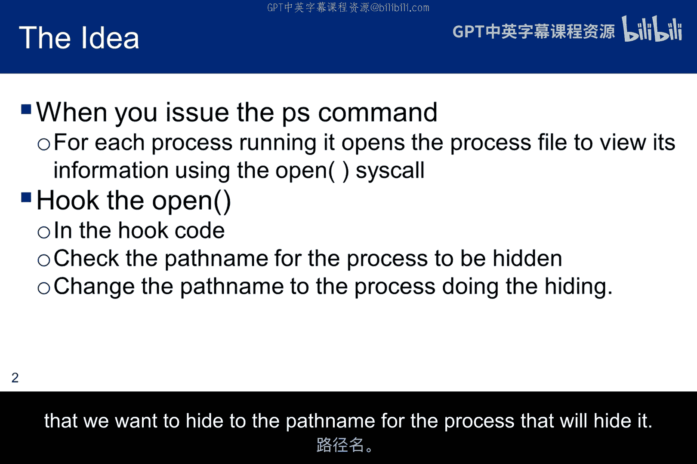
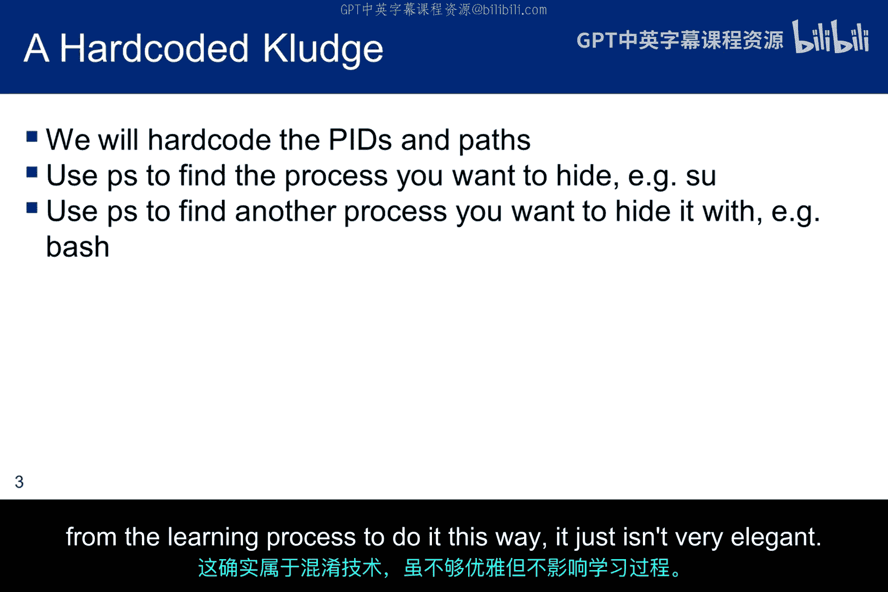
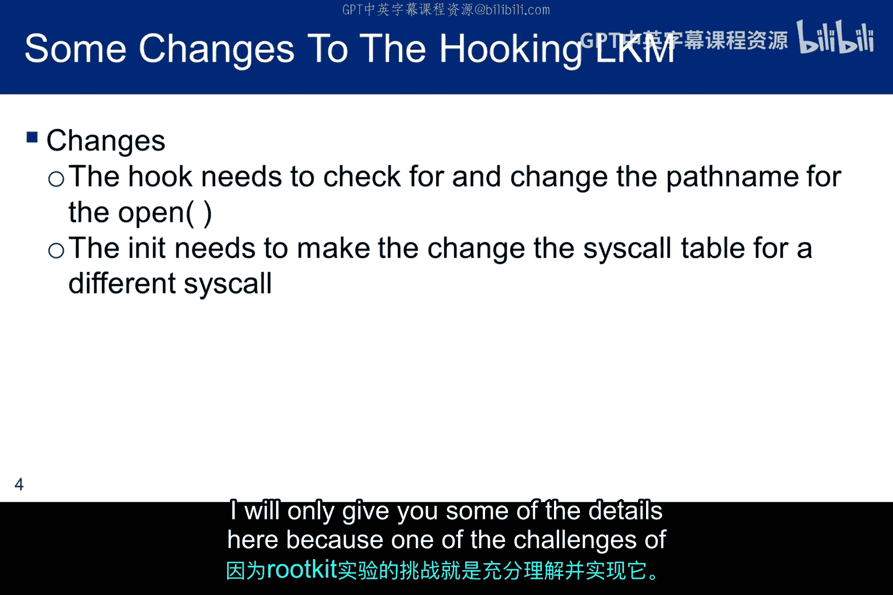
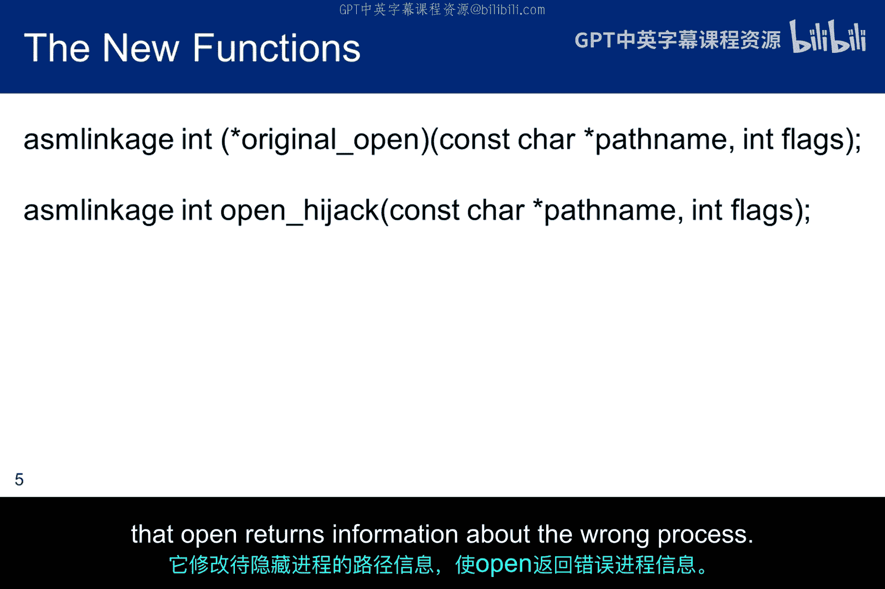
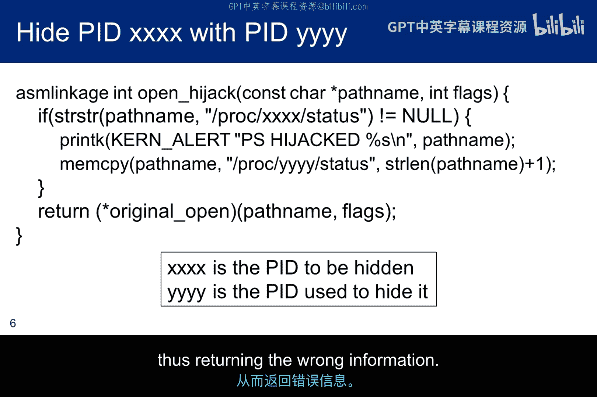
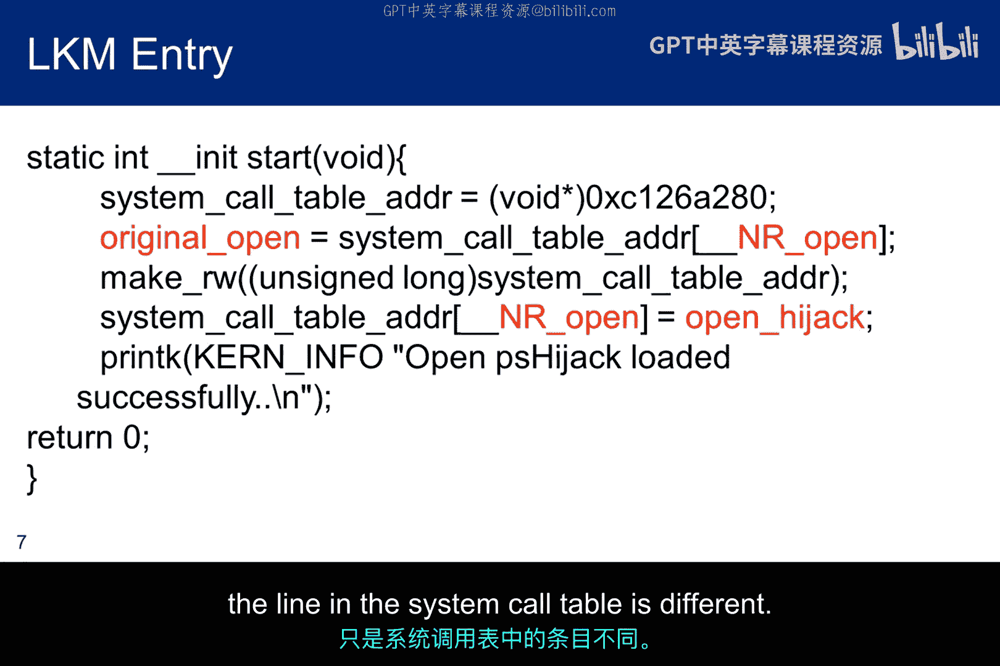
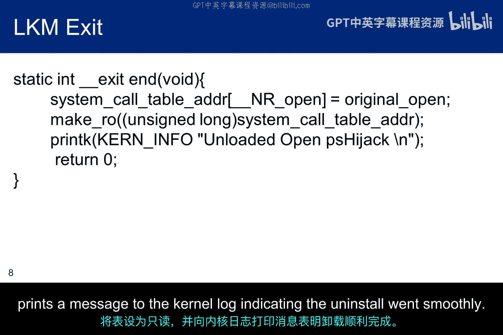
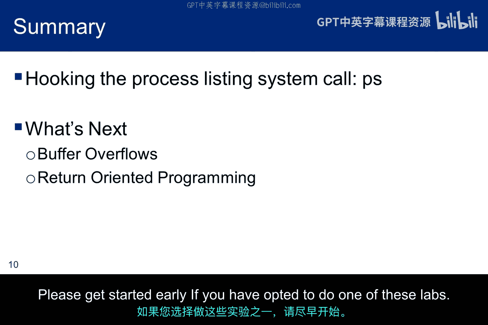

# 约翰霍普金斯大学《道德黑客入门｜Introduction to Ethical Hacking》中英字幕 p60 6_真实Rootkit案例研究.zh_en -BV1xgu1z1Eau_p60-

In this lecture， we will discuss how to modify the hook from the previous sub moduleule to intercept a user request for a process listing and return a slightly modified listing to make the process S U appear to be just another bash shell for simplicity。

 we are actually going to hard code the associated process I Ds into the L K M。

 But some system level programming could make this a dynamic determination as well。

The trick will be to use a hooking L K M， as discussed previously。

 to hook a request to the open function。 P S calls open because it needs to open the process file maintained by the kernel to provide the user with accurate information about running processes once the open is hooked the L K M will change the path name for the process that we want to hide to the path name for the process that will hide it。

Thus， the information return will be for the wrong process。In order to simplify the L K M code。

 we will hard code the information about processes of interest。 But again。

 these could be determined dynamically by a good system program。

 So we will use P S to get information about the SU process， which we want to hide。

 We will also use P。 S to get information about the bash process that we will use to hide the SU process。

 This does fit into the category of a clluge， but it should not detract from the learning process to do it this way。

 It just isn't very elegant。

These are the changes we need to make to the hook program to get it to work。

 The complexity of this task will depend on your understanding of the previous submodule。

 If that wasn't crystal clear， I recommend you go back and review the content again。

 If you did not understand the hook。 It is highly unlikely you will understand the changes we will make here for the new L K M。

 First， we need to change the path name that the open command we use to gather information on processes to provide it back to the user。

 Second， the L K M and knit routine needs to be modified to change the cis call table for a different system call。

 Open rather than P name。 So the L Km isn't really very different from what we have already discussed。

 I will only give you some of the details here。 because one of the challenges of the Roki lab is to understand this well enough to get it working。

These are the new kernel level function prototypes for the L K M defined system calls。

 The first function says information about the original call to open。 As before。

 the hooking component wants to return to this call when finished executing the process hiding routine。

Basically， the function original open replaces the custom Cis call function in the hook。

 The second function adds the hook's simple print to the kernel log。

 but then actually does something malicious。 It changes the path information for the process that is to be hidden so that open returns information about the wrong process。

The hijack basically replaces the hook。 It still prints to the kernelel log so we can verify the hook。

 but it also finds the path to the process to be hidden in the path name being passed to the open。

 the process to be hidden has its path name replaced with the path of the process we want to use to hide it。

 So the path name string path to open。 will no longer have the P I D for SU。

 It has been replaced with the path name and P I D for bash， Thus return the wrong information。

This is the L K M's initialization routine。 The important changes are highlighted in red。 First。

 we need to save the original call to the open routine so it can be used later。

 The second change is to redirect the open system call to the hijack system call defined in the L K M。

 The technique is exactly the same as used in redirecting P name。

 but the line in the system call table is different。

The exit routine restores the original open system call。

 makes a table read only and prints a message to the kernello。

 indicating the uninstall went smoothly。

Many details have been left to the reader， but this screenshot shows a successful hijack of the process listing information in the top left terminal at the before arrow。

 you see the P I Ds for bash and S U， which represent the processes at the beginning in the bottom left。

 you see how these will be hard coded into the L K M to hide the SU process。

 the red and green arrows show how those P I Ds match After making the change to the path name。

 bash's P I D gets passed to the open command instead of S's P I D。 And as a result。

 incorrect information is going to get returned to the user。Going back to the top left terminal。

 you see the results of running P S after the malicious L K M has been loaded。

 The S process is gone and in its place， we see the bash process。

 because we were not creative in our string manipulations。 We see the same P I D listed twice。

 The original and the one we copied to hide SU。 This could be tweak to render a different number for a different process。

 The fact that the same P I D was rendered twice one line after the other would make any user suspicious。

 But we should be able to fix that。 for us， the important idea is not the P I D value。

 but that we were able to modify the P S results sent back to the user by hooking open within L K M。

We have just finished developing a route kit that modifies the listing of running processes。

 The results presented to the user could be fine tune。

 but the foundational idea about hooking system calls to make changes should be clear。 L K Ms and D。

 L。 L can behave maliciously， and we probably wouldn't even know they were there。Next。

 I will discuss buffer overflow and return oriented programming。

 This is actually two to three lectures compressed into one。

 So the time involved and complexities may be even greater than usual。

 Please get started early if you have opted to do one of these labs。

