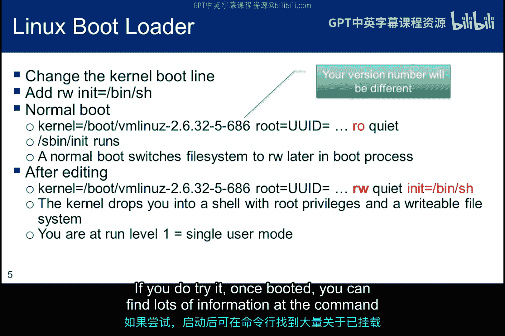
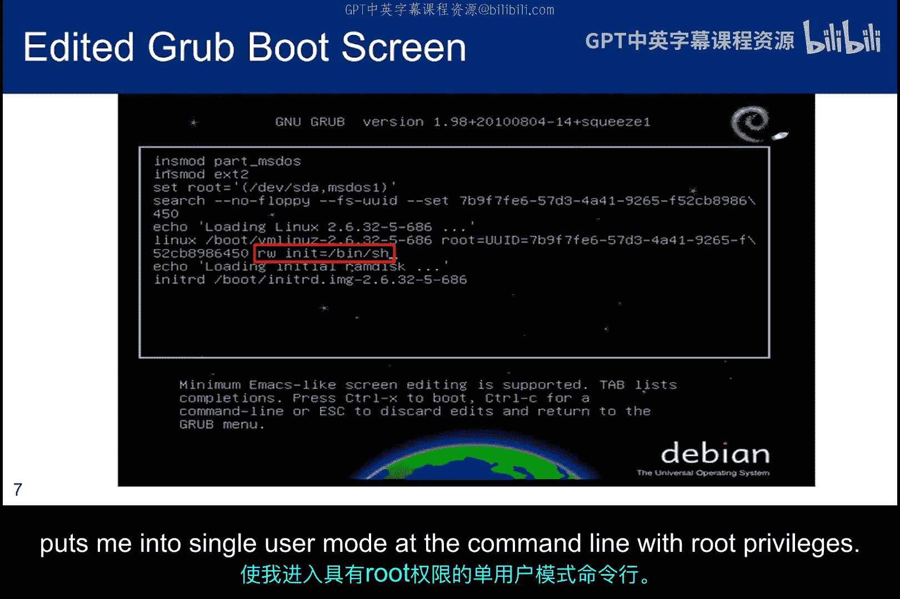
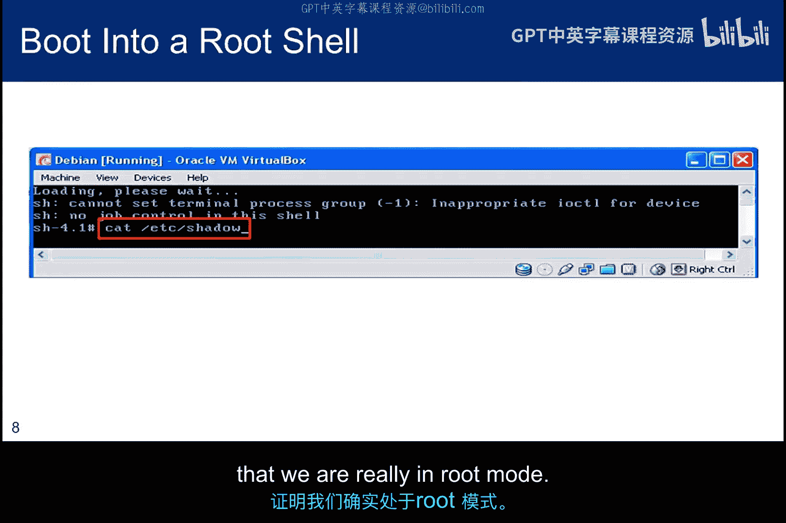
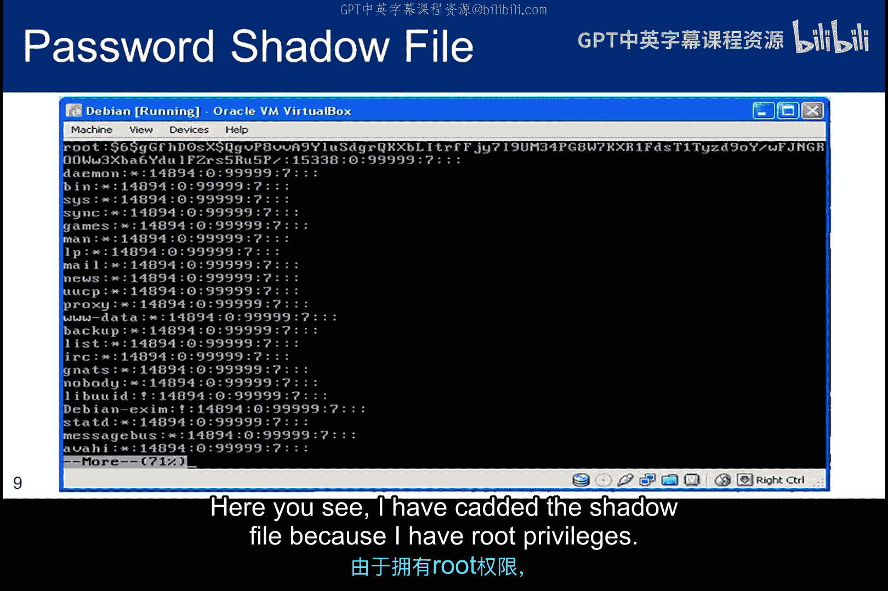
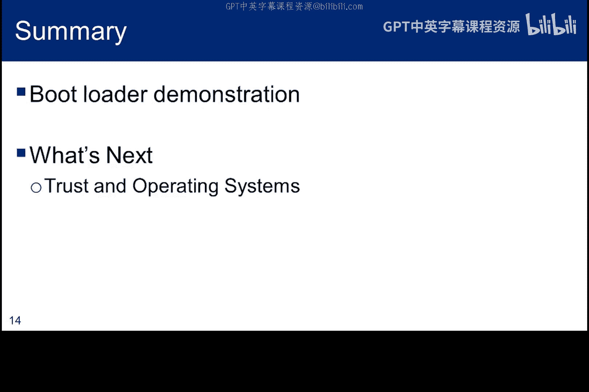

# 约翰霍普金斯大学《道德黑客入门｜Introduction to Ethical Hacking》中英字幕 p61 7_操作系统安全.zh_en -BV1xgu1z1Eau_p61-

This module and a subsequent module will discuss operating system security In this module。

 I will talk at a high level about some well known O S exploits。

 and then we will do some hands on examples exploring the issues around set U I D。

 The subsequent module will focus on buffer overflows。

 Mitigations and subsequent extensions of the exploits leading to a discussion of some current approaches。

The bootloader demo isn't using an exploit。 It leverages functionality built into all Oss in one form or another that can be exploited if you have physical access to the computer for Linux when a computer starts。

 It runs a program called inni。 usually found at slash bin or at slash S bin。

This program is responsible for the system startup and creating usable computing environment。However。

 we can change that and start with the program other than a knit。 For example。

 specifying a knit equals slash bin slash bash tells the kernel to run bash instead of a knit。

 At the same time， if we change the permissions from read only to read， write。

 we are killing the kernel to boot with the file system in read。

 write mode instead of read only mode。 Traditionally。

 the kernel starts with the disk and read only mode。 And later on。

 a process checks the integrity of the disk before switching to read， write mode。

When you initialize with Ben Bsh， the services that would normally be started by Anit are not running because the shell doesn't start any of those O S services。

 In some cases， normal file system mounting based on the entries in Etsy F S tab is bypassed。

 as well as any options listed in Etsy init tab， which include the systems default run level。

 what processes to start， and what actions to be taken when the system enters a new run level。

 If a it tab is not processed， single user mode is probably not secured。

Run levels determine which programs run when you enter that run level。

 These are the six run levels on a Linux system，0，1，2 and 6 are pretty standard， but levels 3。

4 and 5 may vary on some systems， they are identical to level 2， but on some systems。

 they differ The files that identify which programs will run are located in slash Etsy for each run level。

 there is a file named R C， X dot D， where x is the run level。

 So to see what programs execute on a normal boot to run level 2。Cant slash Esy slash R C 2 dot D。

This slide shows the steps you would go through to get a root shell using an unprotected grub boot loader。

 As mentioned earlier， since slash bin slash in it has not been run， you will be running at level1。

 where not all of the services have been started。 And in some situations。

 it may be only that the root file system is mounted。

 which means you may have to mount other parts of the file system， depending on your objectives。

 for example， you might have to mount slash proc。 If you don't change permissions and mount the file system as read only。

 you will also need to make the root directory editable by typing mount tack O remount comma R W slash。

If you try to unmount， followed by mount R W slash。

 you kick the latter out from under yourself on the first command。

 If you read about this functionality on the internet。

 you will find that many references to the file system being mounted as R O。

 But as you will see in the next screen， that is editable in some Linux versions。

 You should try this， if you installed Grub or lilo with any of your VMs。

 If you do try it once booted， you can find lots of information at the command line about what file systems are mounted。

This is how grub will normally present the boot line。 Notice your file system starts off Read only。

 and what is printed to standard out is minimal as denoted by the quiet command。

 More information will be printed If you do not use quiet。

 The directions for editing the boot script are at the bottom of the screen。 for my instance。

 pressing E puts me in the edit mode。 and I can edit the script。 In this screen。

 I have changed R O to R W deleted quiet and added ait equals slash bin slash S H as the initialization program。

 You could also set anit to slash bin slash bash。 But I have bash symbolically linked to S H。

 So the effect is the same。 Control X resumes the boot process and puts me into single user mode at the command line with root privileges。

This image shows a request to read the shadow file to demonstrate that we are really in root mode。

Here you see， I have catted the shadow file because I have root privileges。

Normally， slash bin slash in it executes scripts as needed。 and as run levels change。

 these scripts set up all the non operating system services to create a user environment。

 We forced slash bin slash S H to run instead of a knit， which left us in run level 1。

 but the R W entry mounted the file system as ridable。

 Now we can just type P A S S W D and change the route password to anything we like when we reboot and log in as route。

 we have normal root access。 For my instance of Deion slash proc is also mounted。

 But if it is not mounted in your instance， you may need to mount it yourself with a mount slash proc。

What is the slash pro directory and why is it important。

 Slashproc is very special in that it is also a virtual file system。

 It is sometimes referred to as a process information pseudo file system rooted at slash proc。

 It doesn't contain real files。 Rather， it has system runtime information for the kernel。

 sort of a control and information center for the kernel。

 Many system utilities are simply calls to files in this directory。

 because the proc file system exists only as a reflection of the inmeory kernel data structures。

 It displays most files and directories within slashproc as having zero bytes in size。

This summarizes the options for determining what file systems are mounted。

 but they all behave slightly differently and provide different information。

Slash Etsy slash F S tab is read by En and maintained by the system administrator。

 Since Enit does not run in our boot loader example， the contents of this file are not too useful。

 However， if the system booted normally， it provides a list of all file systems that should have been mounted when the system booted。

 slash Etsy s M tab shows what files are actually mounted。

 and it is updated by the mount and unmount commands。

Slash prox s mounts also lists all the mounted file systems。

 but it is controlled by the kernel and should really be the authoritative source。

 You should expect M tab and mounts to agree， but they could easily be different than F S tab。

Here is an example of why single user mode can be helpful。

 I was switching the symbolic link for slash bin slash S H from bash to the Z shell。

 which we will discuss in a subsequent submodel on set U I D。 But when I did that。

 I got myself into a fix by deleting S U。 when I meant to delete S H。 the symbolic link。 I was lucky。

 I had a copy of S U on my disk in my home directory。

 But I didn't have the privileges to change ownership or move it into slash bin。

 S user mode gave me route and save the day。 So a bootloader without a password can provide an attack vi。

 If you have physical access to the box。😊，Each OS has something similar to a single user mode。

 but the behavior and configurations are slightly different。On Mac O。

 single user mode will let you change the password。

 and it also gives you access to disk repair utilities and the password hash for offline cracking。

 That means you don't have to take any action that might alert the administrator like changing the route password in Mac O。

 this single user mode functionality can be protected with a password。

 You have seen an example of how you might abuse the Linux single user mode。

 but you can guard against that with a bootloader password。 Once you set a password。

 you cannot edit any grub entries or pass arguments to the kernel from the grub command line without entering the password。

The boot loader password solution for Debbion Sweei， which I am running。

 uses M5 encryption for confidentiality and requires editing the slash boot slash gr slash menu dot list file。

 Hopefully， more current versions of Debion use a stronger hash function。In Windows。

 an administrator using the recovery console gets read only access to all volumes。

 except for the boot volume， where he can write as well。 But even on the boot volume。

 he only gets right access to the route directory and to the Windows system directory。

 The grub configuration resides in slash boot slash gr s menu dot list and already contains documentation on how to set a password。

This submodule shows the importance of protecting access to single user mode because it includes root level privileges。

 The functionality is important because it provides a maintenance mode for multius environments where some admin tasks require access to shared resources。

 Since network services are not run， this mode eliminates any possible remote network access。

 providing some enhanced security at least temporarily。 However， with physical access。

 you can use this mechanism to recover or change a route password。

 Sometimes we need a single user capability， but at the same time。

 it introduces a security vulnerability。 In the next submod。

 we will discuss trust and the operating system。

