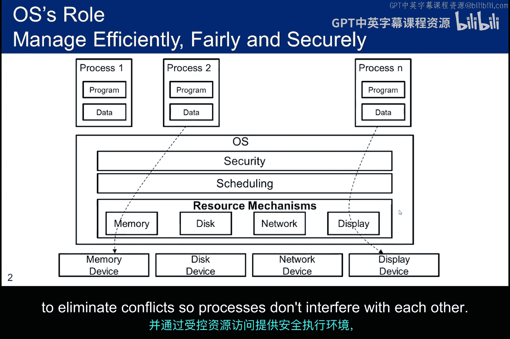
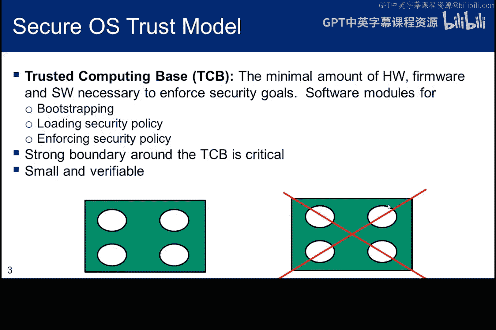
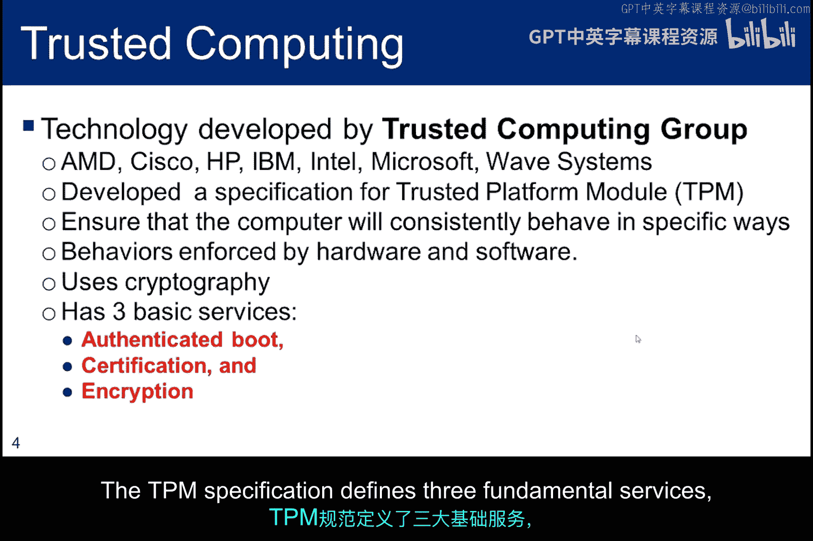
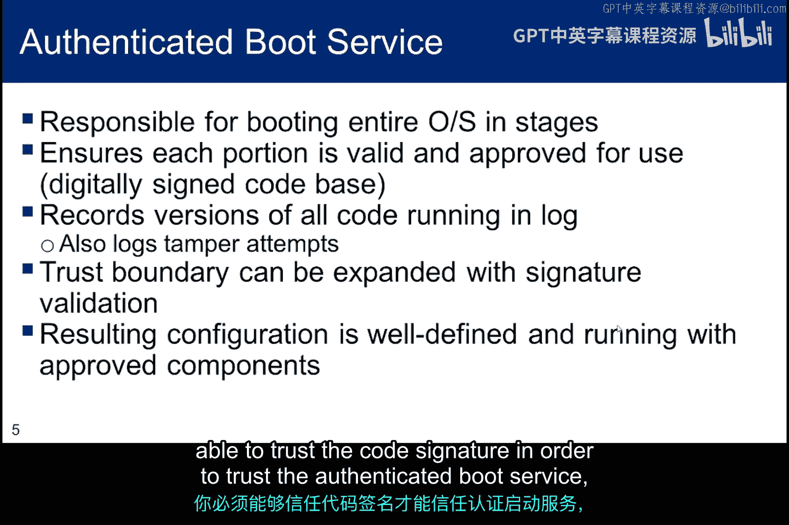
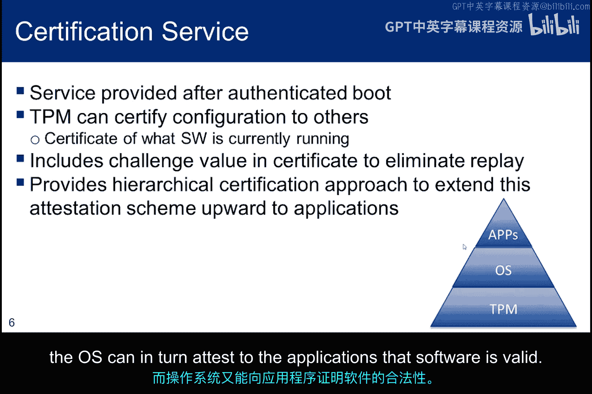
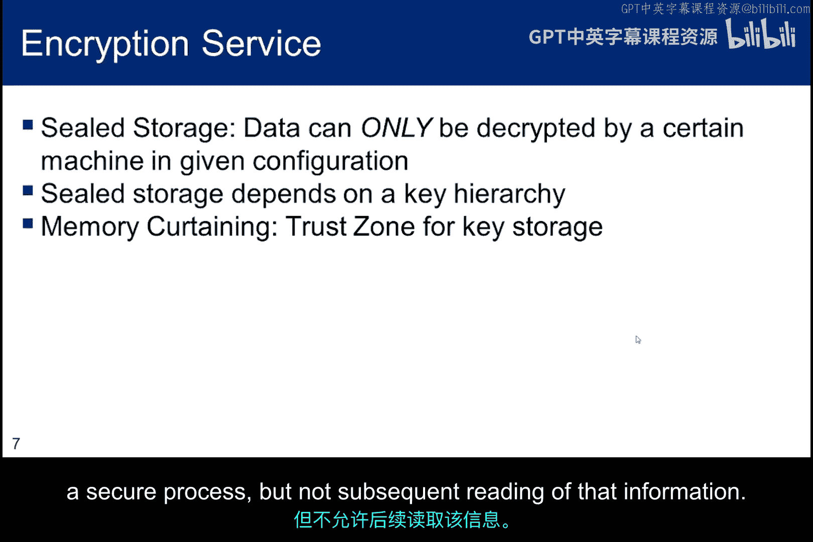
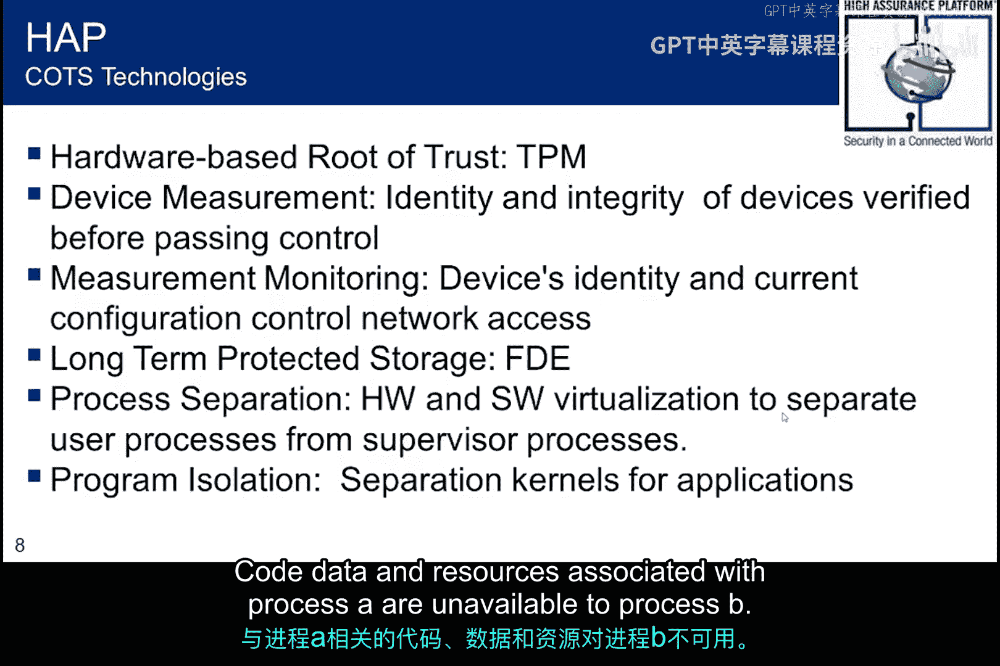
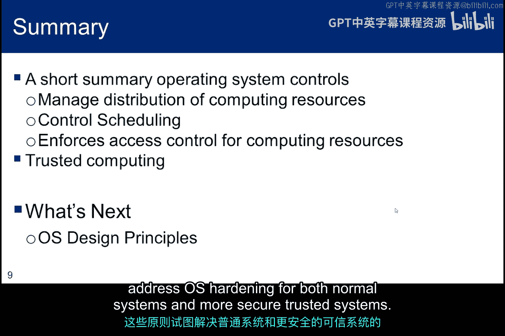

# 约翰霍普金斯大学《道德黑客入门｜Introduction to Ethical Hacking》中英字幕 p62 8_系统可信机制.zh_en -BV1xgu1z1Eau_p62-

In this sub module， we will talk about trust and the operating system。

 I debated about whether to use the title trusted computing or trusted system for this submod。

 but both have somewhat specific connotations。 Trust in the O S is a better description。 However。

 in this module， I will talk about trusted computing。

 as defined by the trusted computing group and a little about trusted system。

 which is a system that is relied upon to enforce a specific security policy。

This graphic provides a notional view of some of the protection mechanisms used by an O S。

 In this case， the O S is managing three processes。 It provides access to resources， schedules。

 access and enforces access control。 The O S provides processes with efficient resource access mechanisms for access to the file systems。

 memory management systems， network protocol stacks and system displays。

 It switches among the competing processes fairly to ensure that all processes get equal access to computer resources。

 and there is no starvation， and it provides secure execution so that the access to resources is controlled to eliminate conflicts so processes don't interfere with each other。

The old orange book or trusted computer system evaluation criteria define trusted computing base as the totality of protection mechanisms within a computer system including hardware。

 firmware and software， the combination of which is responsible for enforcing a security policy。

 Of course， that was written in 1985， but it is still relevant to day。

 The critical software modules trying to ensure a minimal approach are the modules to get the computer started in a secure way。

 and then maintain a secure posture by enforcing security policy to ensure movement from one secure state to another。

Once the trusted computing base or TCB has been identified。

 it must protect itself with a strong boundary represented by the green box。

Any code trusted by the T CB must become part of the T CB。

Any code in the T CB that gets corrupted and is untrusted causes the whole TCB to be corrupted。

The idea of trusted computing is now based on ideas and specifications put forth by a consortium of technology firms called the trusted Comping Group。

One of the specifications put forth was for the trusted platform module or T PM。

 and nearly every computer built to day comes with a hardware implementation of that specification。

 although it is seldom used。 The T PMM is a hardware based root of trust designed to ensure that a computer boot securely and stays secure after booting。

 the T PMM specification defines three fundamental services， which we will discuss next。

The authenticated Bo service uses digital signatures on the code base to ensure all the code comes from a legitimate software vendor with valid certificates。

The service also logs attempts to tamper with any part of the configuration or replace loaded modules so that the evidence can be reviewed as necessary to identify potentially malicious software。

 The trust boundary can only be expanded if the new code also has a validated signature。 Of course。

 the flame virus was spread because malicious code had a bogus signature that was verified。

 The bogus signature resulted from a compromise of the hash algorithm。 M D 5。

 M D 5 is definitely a wech algorithm， but N recommended in December 2013。

 that Shah 1 no longer be used for digital signature as well。

 Even though only theoretical attacks have been produced Vi handson practical attacks。

 The transition away from Shah1 has begun。 Do O D still used Shah 1 on the cac。

 but the upgrade to Sha2 is being planned。The point of this hash function discussion is that you have to be able to trust the code signature in order to trust the authenticated Bo service。

 trying to ensure integrity of the software。

When't you trust the code。That trust can be passed on to others。

 The certification service provides remote attestation。

 The objective is to ensure that only authorized code is running on a system。

 The idea of remote attestation is it allows changes to the user's computer to be detected by remote authorized parties。

 The service works by having the hardware generate a certificate identifying which software is currently running。

 and that information is stored securely in the TPM。 Basically。

 it creates a digital certificate associated with configuration information。

The computer can then present this certificate to a remote party to show that unaltered software is currently executing。

Digitalite managements provides a good example。 It might involve a user's music player software sending a song to the audio subsystem。

 but it will only be allowed if it can attest that it is running a secure copy of the music player software。

 The idea is， this provides a more secure path for the music transfer。

 because trusted software prevents the user from using an illegal player that is recording the music as it is transmitted to the audio subsystem。

 In a minute， we will talk about a couple of other TPM features like memory locking。

 which prevents the music from being dumped to regular disk files and sealed storage which curtails unauthorized access to it when saved to the hard drive。

 The hierarchical instantiation means that TPM can attest to the O S。 and the O S can， in turn。

 attest to the applications that software is valid。

Sealed storage means stored data can only be opened by certain software， hardware combinations。

 Reing to the music example， users who keep a song on their computer that has not been licensed to be listened to on that hardware will not be able to play it。

Using sealed storage， the song is securely encrypted using a key bound to the trusted platform module so that only the unmodified and untampered music player on the licensed computer can play it。

Sealed storage depends on an encryption key， unique to the configuration。

 which is based on an endorsement key， unique to the machine。

 The machine endorsement credential is a 2048 B RSA public private key pair。

 which is created randomly on the chip when manufactured， and it cannot be changed。

 It is burned into firmware。The private key never leaves the chip。

 while the public key is used for attestation and for encryption of sensitive data sent to the chip on the Apple commercial mobile devices。

 they do something similar by tangling the user passcode with the device key in support of encryption。

 Mem curtaining extends common memory protection techniques to provide full isolation of sensitive areas of memory。

 For example， locations containing cryptographic keys。

 Even the operating system does not have full access to curtained memory。 For example。

 a right only API might allow the storage of private keys via a secure process。

 but not subsequent reading of that information。

The high assurance platform or Hp is an NSA sponsored initiative to provide a commercial instantiation of trusted computing。

 The TPM is a hardware based route of trust that stores encryption keys and system measurements and protects against software based attacks。

The device measurement feature consists of the identity and integrity of each hardware and software system component being measured and verified at boot time and run time。

For measurement monitoring， verifiable reports of a device's identity and current configuration are transmitted to the network。

 where decisions are made governing network access and device disposition。

 Long term protected storage consist of hardware based full diskconption that ensures data is secure。

 even if drives are removed from the workstations。Process separation is based on hardware and software。

 secured virtualization to separate user processes from supervisor processes。

 Se domain separation enables the multiple security domains to be hosted on common computing platform base with no unintended interaction。

 program isolation is based on guest partitions like virtualization or separation kernels to separate applications from one another。

 code data and resources associated with process A are unavailable to process B。

 This submodule briefly discuss how the operating system manages resources。

 enforces access control on those resources and schedules Even。

 We also delved into trusted computing， which involves additional O S lockdown mechanisms to ensure it has not been modified and is consistently behaving in specific ways。

In the next sub module， we will discuss some design principles that try to address O S hardening for both normal systems and more secure trusted systems。

