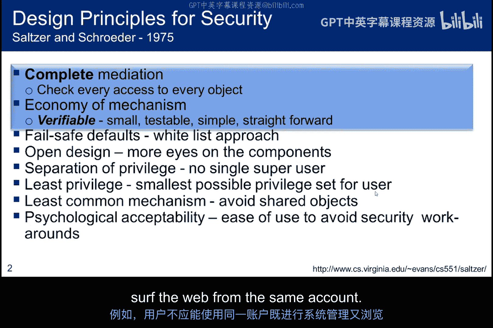
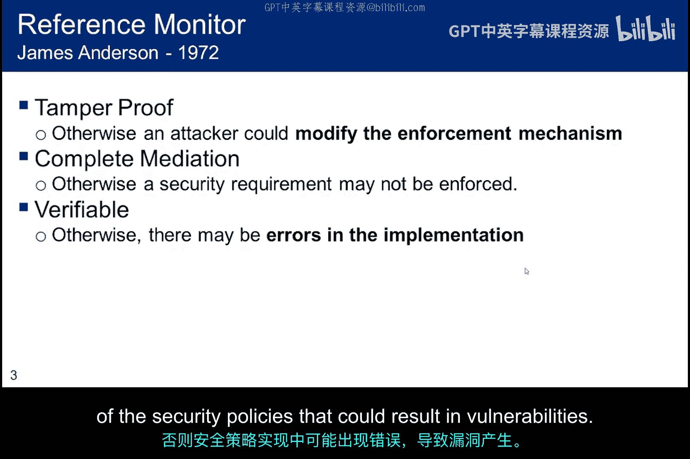
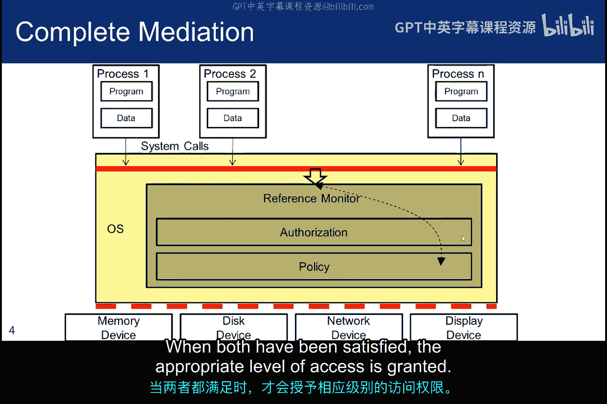
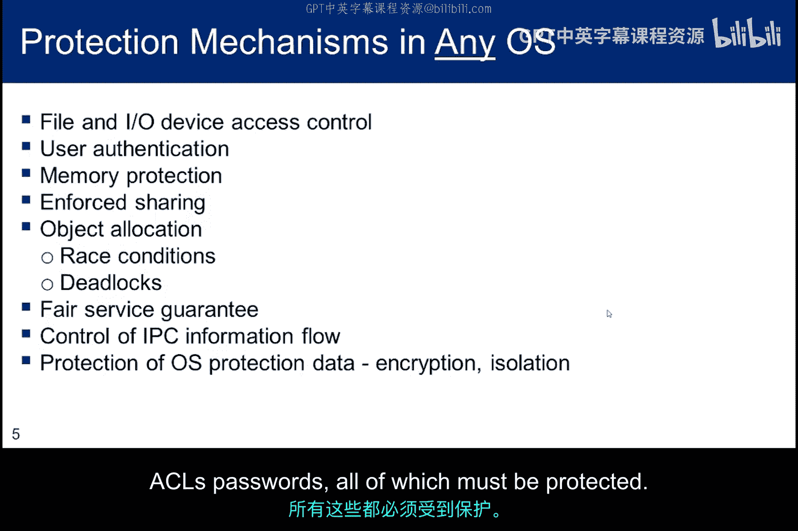
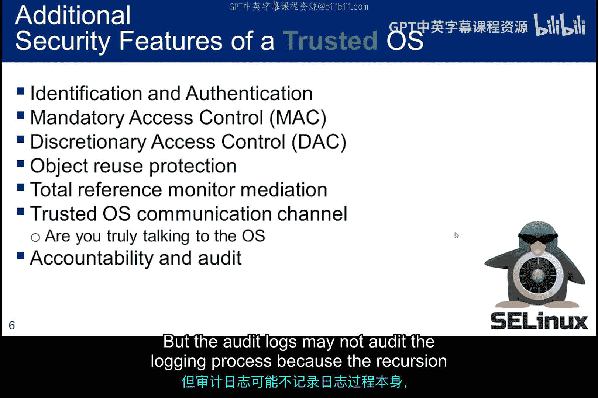
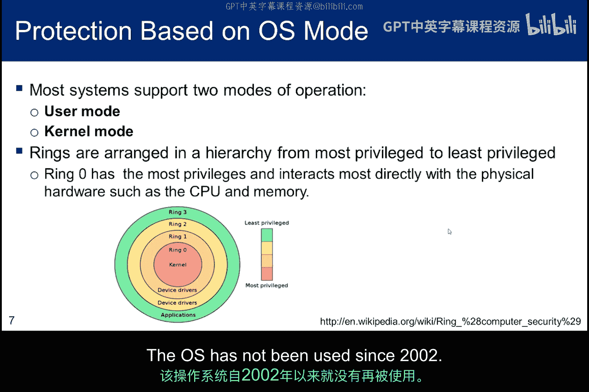
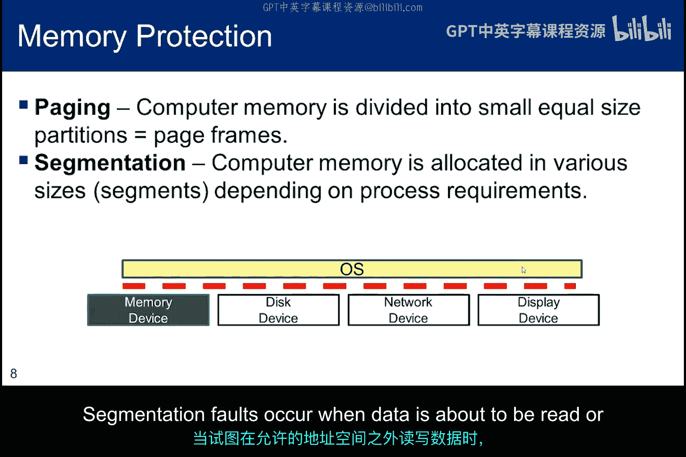
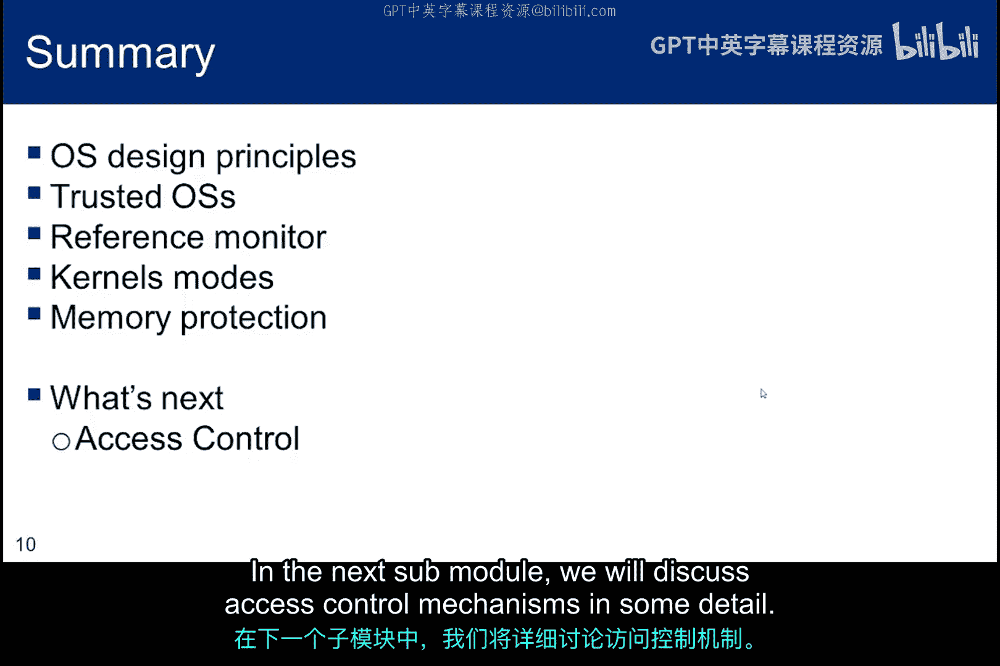

# 约翰霍普金斯大学《道德黑客入门｜Introduction to Ethical Hacking》中英字幕 p63 9_操作系统设计原理.zh_en -BV1xgu1z1Eau_p63-

This submodule will examine OS design principles for normal operating systems and then overlay some additional requirements for trusted operating systems。

 We will define a reference monitor briefly discuss system modes or rings designed to protect the kernel and some memory protection requirements。

Saltzer and Schroeder did foundational research on in security design principles in 1975。

 and the principles are relevant to day。 The notion of a reference monitor was one of the foundational principles。

Actually， the idea of a reference monitor was first published by James Anderson in 1972 in Comp security Technology planningning study for the Air Force。

 In that paper， he defined a reference monitor to be one tamper proof。

 two always invoked and complete。 and three small enough to be validated。

 The first requirement for a reference monitor requires a kernel that is tamper proof if it is not tamper proof。

 an attacker could modify the enforcement mechanism of the system circumventing its security。

The second requirement is the reference monitor must provide complete mediation of all security sensitive operations。

 If some of these operations are not mediated， then a security requirement may not be enforced。

 For example， a secret may be leaked or trusted data may be modified by an untrusted process。 and。

 of course， mediation must be continuously invoked， or it could be circumvented when not active。

The last requirement is the reference monitor must be small enough to verify the correct enforcement of system security goals。

 Otherwise， there may be errors in the implementation or the security policies that could result in vulnerabilities in their design principles。

 Salser and Schroeder included two of these properties， as highlighted in the blue box。

 They did not include the tamper proof property， although they spent a fair amount of time discussing access control lists which prevent tampering。

The concept of a reference monitor defines the necessary and sufficient requirements for access control in a secure operating system。

 However， as our cyber infrastructure has evolved， these properties have become more and more difficult to satisfy。

 as slot counts and features have grown， complexity has become the enemy of the reference monitor。

 The distributed nature of our computing environment。

 including the transition to the cloud may make the completeness property more complicated to satisfy as well。

 as the access points are often spread across the enterprise。

 making it impossible to be sure every access is being checked。

And as packets travel across the computing infrastructures， they are assessed by packet filters。

 I Ss， I P Ss and Ivirus systems， and they may even have to pass through a digital signature validation mechanism。

 All the enemies of completeness。The least privilege principle is important because it minimizes damage if there is a compromise。

 Seation of privilege ensures two person control is available when necessary。

 and that a user isn't mixing trusted tasks and untrusted tasks using the same account。 For example。

 a user should not be able to do system administration and surf the web from the same account。

The idea of a reference monitor was first defined by James Anderson in 1972 in computer security Technology planningning study for the Air Force。

 The paper defined a reference monitor to be an access control mechanism that is one tamper proof。2。

 always invoked and complete。 and three small enough to be validated。

 The first requirement for a reference monitor is a kernel that is tamper proof。

 If it is not an attacker could modify the enforcement mechanism of the system circumventing its security。

The second requirement is the reference monitor must provide complete mediation of all security sensitive operations。

 If all these operations are not mediated， then a security requirement may not be enforced。

 For example， a secret may be leased or trusted data may be modified by an untrusted process。And。

 of course， mediation must be continuously invoked or it could be circumvented when not active。

 Some authors break this into two requirements， completete and always invoked。

 The last requirement is the reference monitor must be small enough to verify the correct enforcement of system security goals。

 Otherwise， there may be errors in the implementation of the security policies that could result in vulnerabilities。

The top red line in this graphic shows complete mediation。

 Each and every request for a resource is blocked until the reference monitor checks the authorization mechanism and the security policy。

 When both have been satisfied， the appropriate level of access is granted。

This list of protection mechanisms would typically be found in any O S。

 not necessarily a trusted O S。 Some aren't necessarily security mechanisms。

 but they all work together to ensure the operating system behaves as expected and doesn't generate denialous service conditions。

Of course， all O Ss require an authentication mechanism to identify users and control access。

 A subsequent sub module will discuss access control in some detail， including as and C lists。

 access control for virtual memory is even more critical because it is a shared resource。

 While paging systems and segmentation systems work slightly differently。

 both must control access to memory by different processes。

Enfored sharing ensures all processes have access to resources。

 and the goal is to guarantee both data integrity and consistency。

 Object allocation includes both concurrency and synchronization。 to understand concurrency。

 Think about threads。 This is a property of systems in which several computations are executing simultaneously。

 and potentially interacting with each other。 Schronization refers to the coordination of simultaneous threads or processes to complete a task in order to obtain correct runtime order and avoid unexpected race conditions。

 A race condition occurs when two threads access a shared variable at the same time。 For example。

 the first thread may read the variable， and the second thread reads the same value from the variable。

 Then the first thread and second thread perform their operations on the value。

 and they race to see which thread can be the last to write the value to the shared variable。

 The value of the。Tread that writes its value last is preserved。

 while the value of the thread that wrote first is lost。

A deadlock occurs when two threads each lock a different variable at the same time and then try to lock the variable that the other thread already locked。

 As a result， each thread stops executing and waits for the other thread to release the variable because each thread is holding the variable that the other thread wants。

 nothing occurs， and that threads remain deadlock。 Fair service ensures no CPU requests。

 and no I O requests are ignored creating a starvation situation。

 Pro sometimes need to communicate with other processes or synchronize access to shared resources。

 And when that happens， the O S needs to control I PC information flow。

 This mediation is typically managed via the access control mechanism。

 O S protection data consists of items like audit data see less than as Passs。

 all of which must be protected。

If we narrow our focus to a trusted operating system。

 we see additional security requirements that must be built into the design。

 All objects become closely coupled to more fine grained object access control mechanisms。

 as opposed to the approach of grant and user access to most objects once they have access to the O S。

 The next submod will discuss Mac and Dac in more detail。

 But the key difference is that discretionary access is managed by the owner of the object and mandatory is based on security clearances。

 Security classifications assigned to objects。Most trusted systems will have a high br solution。

 Object reuse protection is most easily understood in terms of memory。

 When a user accesses an object in memory， the next user must not be able to access any of the content or metadata from the first user。

 Everything must be cleared。Total reference mediation means each and every transaction must be processed by the reference monitor。

 The trusted O S communicationic channel ensures the user he is talking to the O。

 and men in the middle attack vectors have been eliminated。

Accountability and audit functionality required trusted systems to keep an audit log of all security relevant actions that have been taken。

 but the audit logs may not audit the login process because the recursion would cause the logs to grow rapidly。

Most systems these days have a kernel mode and a user mode。

 The kernel mode protects the O S and the key tables。

 such as process control blocks from interference by user programs。 However。

 additional modes may have been implemented in some systems。 For example。

 O2 used three rings R0 for kernel code and device drivers R 2 for privilegeed code such as user programs with I O access permissions and Ring 3 for unprivileged code。

 which is the mode of nearly all user programs。 The original Maltics system had eight rings。

 It was a time sharing operating system developed in 1965 and used until 2000。

 The system was started as a joint project by M T as part of an Apa effort involving bell labs and general E。

 Bellll labs withdrew from the development effort in 1969， and in 1970。

 G E sold its computer business to Howell， which offered multits。As a commercial product。

 but only sold a few dozen systems。The O S has not been used since 2000。

Two common virtual memory schemes found in operating systems are paging and segmentation。

 The O S has to manage access to memory by processes。 And in the case of a trusted O。

 clear the memory when a process is finished using it。 with paging。

 the O S creates equal sized page frames and a process gets divided into pages which are， in turn。

 loaded into the frames。 This is all transparent to the programmer。With segmentmentation。

 the memory blocks are variable。 Sement table entries include length and base address。

 which are used to find a spot in memory。 The programmer， especially at the assembly level。

 has to manage memory， Although modern high level languages do a lot of memory management for the programmer。

 segmentmentation faults occur when data is about to be read or written outside the permitted address space。

 These are the key memory protection requirements， whether the system uses paging or segments。

 Access to memory by processes must be controlled。 For example。

 the O S must ensure that two different virtual addresses from two different processes do not point to the same physical address when both processes are running。

 Memory sharing is allowed among processes， but not simultaneously。 If both processes are active。

 different physical locations must be used， or else one processes may corrupt the area of memory being used by the other process。

This submitial has provided a brief introduction to properties of an operating system that may provide attack vectors。

 if not properly implemented， even if properly implemented。

 a regular O does not provide all the protection of a trusted O S。

The key ideas that we have discussed are a reference monitor should be complete， continuous。

 verifiable and tamper proof。An O needs at least two modes。

 a user mode and a kernel mode that protects the O and O tables。

 and memory protection must be independent of the virtual memory schema。In the next submod。

 we will discuss access control mechanisms in some detail。

