# 约翰霍普金斯大学《道德黑客入门｜Introduction to Ethical Hacking》中英字幕 p64 10_访问控制机制.zh_en -BV1xgu1z1Eau_p64-

In the field of information security， access control is the management mechanism of the O S that grants or restricts the availability and use of resources。

 Authororization is that permission granted to access a resource enforced by the access control mechanism。

 This submod will cover the common access control mechanisms found in systems today day。

 While you've discussed these in other classes， This quick review is included because of the close coupling to the operating system。

The O S manages the use of all system resources， and its access control mechanism provides the protection for all of the objects in the system。

 Typically， we think of these files as objects that need to be managed。

 but we should also include processes and users in that category。Read。

 write and execute rights need to be controlled。 And， of course。

 the O S has to manage the conflicts and consistency when writing is taking place。 For example。

 when an object is being modified。 the O S has to lock it for access by a single subject to eliminate race conditions and ensure consistency。

 Ident provides a process or mechanism to ensure the subject is who he claims to be。

 this step sometimes involves providing a picture identification in order to receive a credential necessary to authenticate to a system。

 authentication is the mechanism that actually confirms that the credential is valid and trust that the credential has been closely linked to an identity。

 For example， to receive a government personal identity verification or Pv card。

 you must have a form signed by a government official verifying that a background check has been completed。

 and you must also present two。

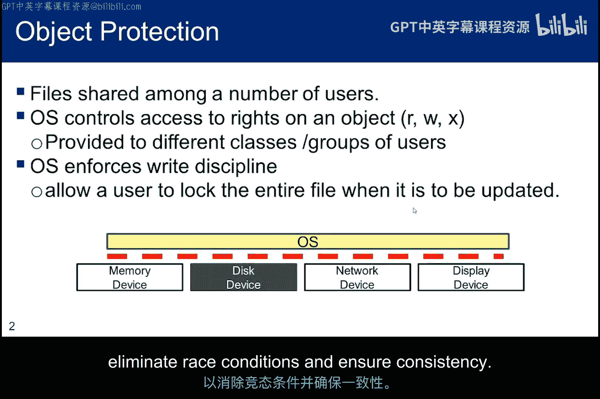

Photo Ids to prove you are the person identified on the form。

 the Piv is a smart card that contains asymmetric credentials that are accessed by a personal pin to authenticate using your smart card。

 you insert it into a card reader and the system will request your pin。 If the pin is correct。

 the credentials on the card such as your authentication certificate and associated private key can be used to guarantee your identity to the requesting authentication mechanism。

 Once your identity is known， access can be granted to system resources。

 Keep the words authenticate and author distinct in your mind。

 Authation mechanisms validate your identity。 And once your identity is confirmed。

 the authorization mechanism controls your access to the system resources based on your identity。

 The next submodule will discuss the three most common access control mechanisms。 Dc， Mac and Rrb。

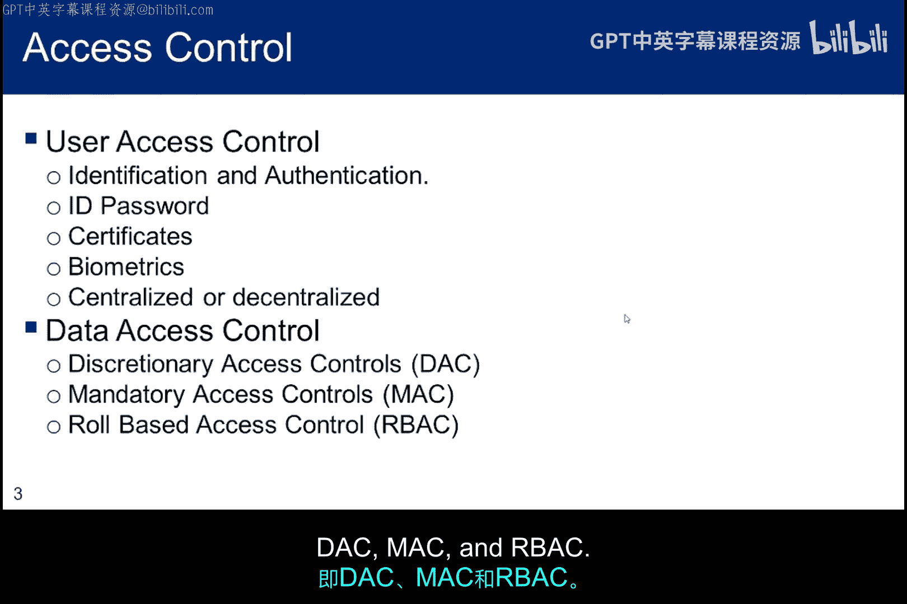

For discretionary access control， each object has a unique owner。

 possibly the creator of the object who is allowed to grant privileges to access the object to other users。

 The mechanism can be thought of as a matrix， Although it is never implemented that way。

 The rows of the matrix are subjects who want to access objects and the columns of the matrix or objects for which access is being managed。

 So think of an R in a cell of the matrix， The subject in that row is granted read access by the owner to the object in that column。

 Dak is usually implemented with access control lists or as。

 an A C L is basically a single column of the matrix which identifies all the subjects who have access to the associated object。

 as granted by the owner。 Dak may also be implemented with capability lists。

 which is subject oriented， and can be thought of as a row from the matrix for a given subject。

Identifies all the permissions on all the objects that have been granted by the various owners。

 because sea lists may be dispersed around the system。

 They present a greater security problem than as。 So the O S usually holds all C lists on behalf of the users in a region of memory。

 inaccessible to users in order to prevent the user from editing his own C list。

 These two implementations provide different administrative challenges。

 As are easy to administer when permissions on an object change。

 when a subject is deleted from the system or as permissions change。

 All the as have to be modified to check for that subject。Callesss are the opposite。

 They are easy to administer when a subject's permission changes。

 but not so easy from an object perspective， because the admin has to check every sealess to see which subject has access to the object。

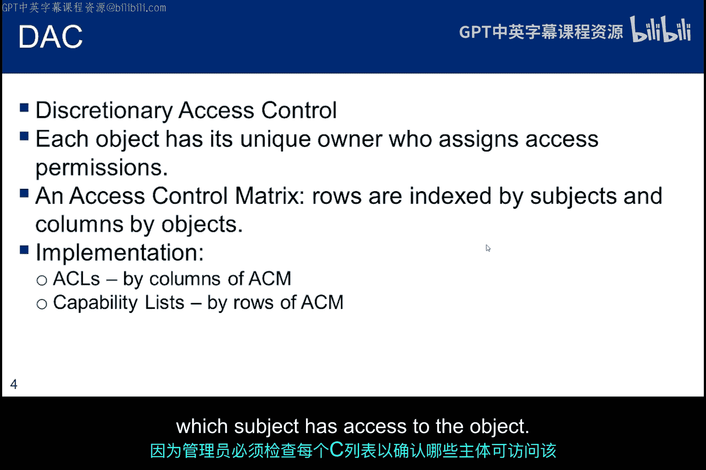

This slide shows a model of an access control matrix with subjects from the set S assigned to rows and objects from the set O assigned to columns。

 entries in cells grant permissions to subjects to access objects。

 Notice that the set of objects being controlled。 also includes the active processes from the set of subjects So a process can be granted rights to objects。

 And at the same time， another subject can be granted access to the process。 to say it another way。

 some of the subjects from the set S are also objects in the set O。 Again。

 the cells contain rights that a subject is granted on an object。

 but many of the cells will be empty indicating a subject has no rights on an object。

Because of the prevalence of empty cells， an AM is never implemented in an O S。

 Rather a compressed version like an a is used。 But the AM provides a useful model for understanding what D means and how it works。

Butler Lampson， in his seminal paper， titled Protection， first proposed this model in 1971。

 and it was refined by Denning and Graham a little later in protection， principles and practice。

These are foundation papers and worth reading for a cybersecurity professional。

 One of the weaknesses with discretionary access control is it doesn't provide protection from a Trojan horse that has been designed to abuse access privileges。

 In the example on this slide， we show two files。 fileile F1 has P I I regarding user A and is owned by a file F 2 has public information and is owned by user B。

 as the owner of file F1， A can read and write to the file。

 but a has not granted those privileges to anyone one else。

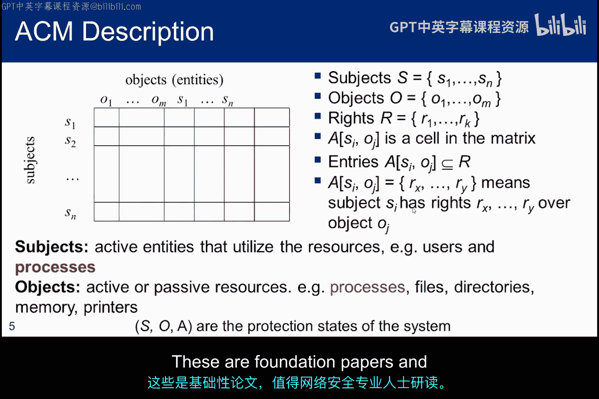

As the owner of file 2， B can read and write to that file， but in this case。

 B has also granted a the right to write to the file。Now。

 suppose user A runs a program to edit her personal file F1。

 and suppose that program contains a Trojan， which also runs with A's privileges。

 The Trojan will be able to read file A and write the contents to file B。

 because A has right privileges to B。 The Trojan has given B， access to A's personal information。

 If the file F1 were classified。 and F 2 were unclassified。

 This Trojan would be creating a covert channel to steal classified information。 The question is。

 how can the access control mechanism be modified to protect against this kind of a problem。

 The answer is to implement a mechanism called mandatory access control。

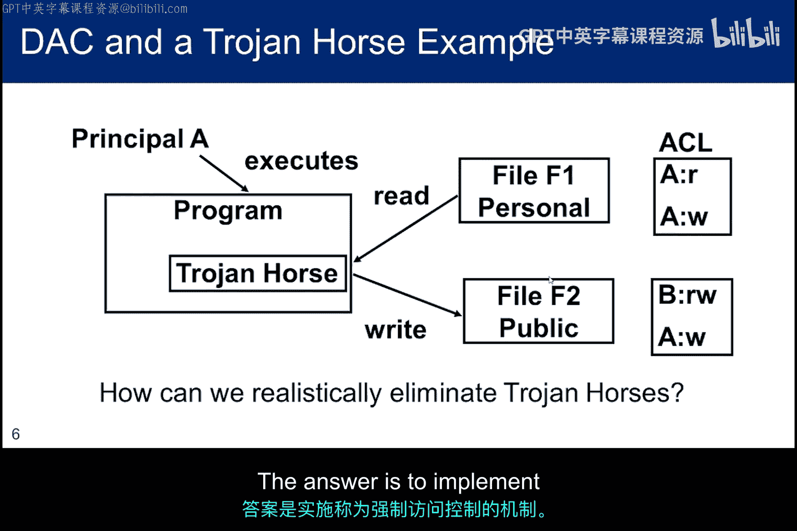

This slide is a short reminder of the properties of the Mac model。 By the way。

 mandatory access control is sometimes referred to as lattice based access control because of the important role played by a mathematical object called a lattice。

Mac has two properties that you have learned about in previous classes。

 Enforcement involves a comparison of security clearance levels of a users session and classification levels of objects。

 These are typically the totally ordered set， unclassified， confidential secret and top secret。

 However， the model is robust enough to handle compartments using a partially ordered mathematical relationship embedded in a lattice。

The model has two fundamental properties。 The first property is you aren't allowed to read documents classified at a higher level than your authorized session。

 For example， you may have A T S clearance， but if your session is S。

 you will not be allowed to access T S material。Second。

 you aren't allowed to write to documents that have a lower classification level than your authorized session。

 It is assumed soon that your session has been started at the level of your clearance。 But。

 of course， you may be able to start sessions at different levels。

We often describe this formal model developed by Bell Paula as the one that constrains you so you can't read up and you can't write down。

 but you can do the opposite。No read up is usually called the simple security property。

 and no write down is called the star property。The strict star property means you can only write at your own level。

 You are not allowed to write up or write down。 The model also assumes the presence of a discretionary access control matrix。

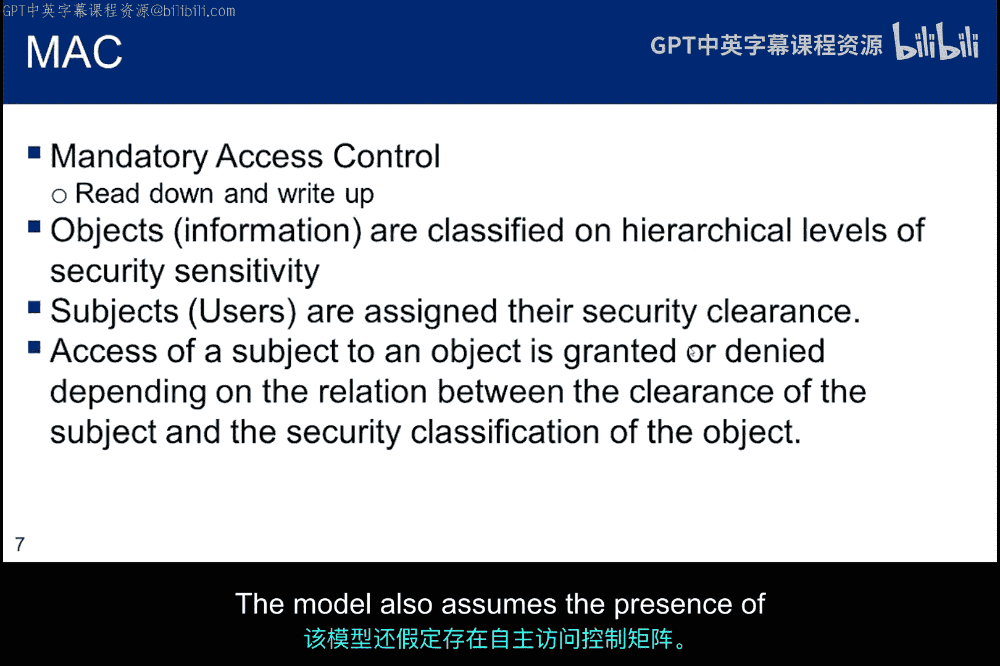

Let's return to the Trojan horse example。 But here we will switch from a concern about P I to a concern about the spillage of classified data。

 A still has discretionary right privileges to F2。 But because A's session was started at a higher security level than the classification level of F2。

 So Mac blocks a from writing any information to F2。 and the classified information is protected。

This control is provided by the reference monitor discussed previously。

 and now you can see the importance of complete mediation to ensure no access attempts are able to circumvent the reference monitor。

One of the keys to successfully implementing Mac is that an object's label must not be modifiable。

 If it is modifiable， a Trojan might be able to switch F 2 to a higher classification level。

 write classified data to it， and then change it back to the original classification level。

 So in addition to implementing the Mac model。 The mechanism has to block any attempts to modify object labels。

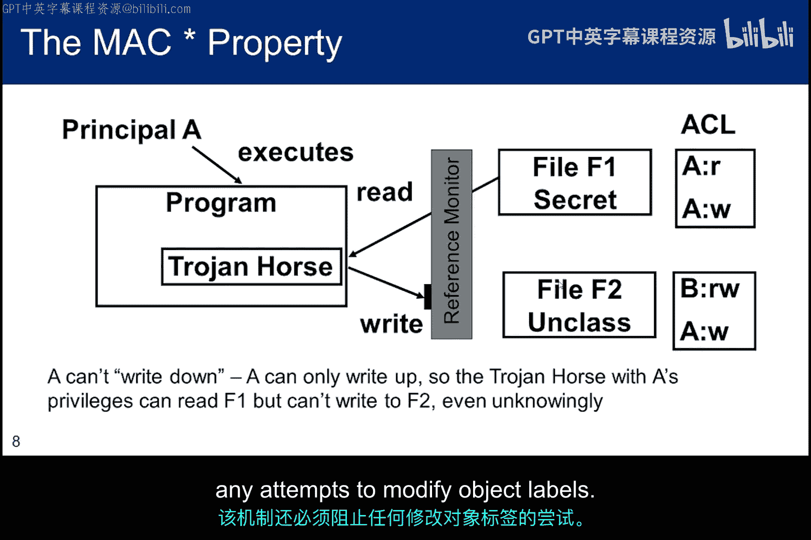

This is a different view of Mac。 It is pretty easy to understand the standard security levels。

 confidential secret and top secret。 from a mathematical perspective。

 this kind of linear relationship represents a totally ordered set。

 Every level is comparable to another。 However， the model for mandatory access control is based on a more general mathematical model involving partially ordered sets。

 In an example is shown on the right。 In both cases， we want the information to flow up。

 but for a partial order， there are multiple paths in individual elements of the set， for example。

 Army and crypto are not necessarily comparable。 This is a very important idea for security compartments that may not relate to each other。

 and there is not necessarily a need to know for members of individual compartments to have knowledge of other compartments。

 However， even when the compartments do not reside on the same。

The information may flow up to someone at the top who has access to everything。

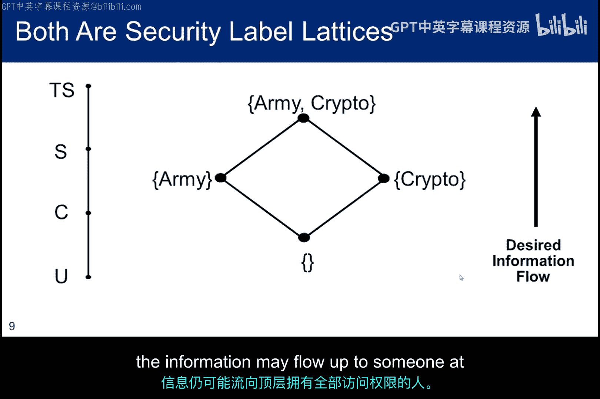

The resulting relationships that develop from using partially ordered sets is called a lattice。

The one shown here was developed for a university class project。

 and it is based on the standard totally ordered set， combined with a partially ordered set。

 describing security compartments in part of the Department of Def。

 The diagram shows that the identifiers U C， S and T S are not obfuscated。

 but the compartment names have been。 probably for security reasons。 This was not done in my class。

 So I don't know many of the details。 I do know this diagram is very old now。

 And I suspect it no longer applies。 but it is an interesting view of how complicated the Mac model can be。

 One important idea that many don't think about is there can be need to know compartments at the secret level。

 It doesn't always require a top secret clearance to be read into a compartment。

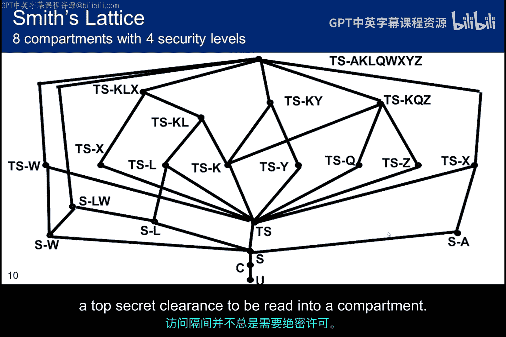

The third access control model we will discuss is role based access control。

The first paper describing Arrbch was written in 1992。

 and Sandu at G MU produced an Arrbch framework in 1995 to integrate ideas about sessions and role hierarchies。

 The key ideas to model the portion of the business logic of an organization。

 How do they do day to day operations using roles people have in the organization。

 So we have subjects in a certain role doing a certain job。

 and they need specific privileges to do that job。 I sessions。 It is a simple picture。

 There is a relationship between users and roles， and there is a relationship between permissions and roles。

 Both relations are many to many， and there is no direct connection between users and permissions。

This simplifies administration， and that was one of the motivating ideas。 If a new employee is hired。

 the S A can just give her the proper role and doesn't have to worry about assigning her a large set of individual permissions。

You can also separate the act of granting user assignments and granting permission assignments to different essays and or to different time frames。

 It allows the organization to customize applications and business logic without worrying about employees。

 In fact， it is a good way to implement separation of duties。 In assigning users to roles。

 the applications involved don't affect the assignment。 However。

 the nature of the permissions assigned to those roles does depend on the implementation。

 For example， and no less requires the allocation of read and write privileges。

A relational database management system requires the allocation of select and update privileges。

 and a transaction application might require the allocation of credit and debit privileges。

Suppose a user is assigned to a role of professor。 He should only be able to see grades as students in his class。

 But how do you distinguish among all the professors who have the same role。

This complexity is addressed by an extension to the framework。

 adding the concept of constraints on permissions。 It allows for the creation of context to sensitive permissions。

 So permissions and roles are the same for all users， but the actual objects viewed may be different。

The idea of a session is that a user may be assigned to multiple roles。

 but not all get activated when the user logs in。 It depends on the configuration file for the session。

 The session has an idea associated with it， and ruless can be added or removed from configuration files for the session。

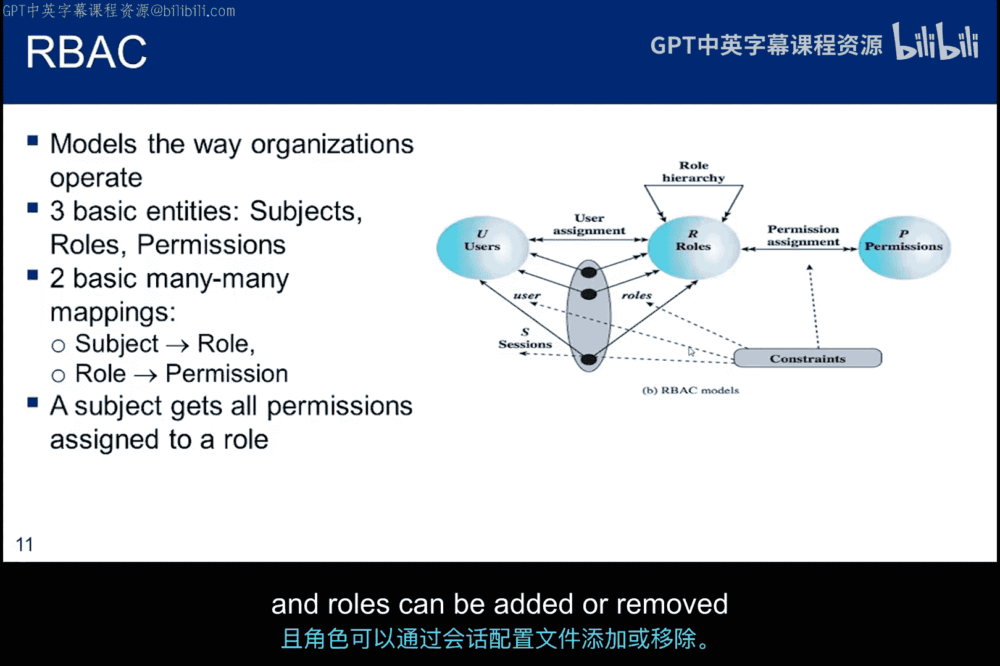

This slide shows the important properties of ArBO。 a user's permissions are determined by the role rather than an authenticated identity or clearance。

 and the extension to ArBO allows roles to encode arbitrary attributes。

 creating an attribute based access control mechanism。

Policy neutral means an Arrboc mechanism can be reconfigured to model and support both Dc and Mac。

 However， you cannot use Arrbok to do Mac if it doesn't include the abstraction of a session。

 and the use role relationships and the roll permission relationships are both many to many。

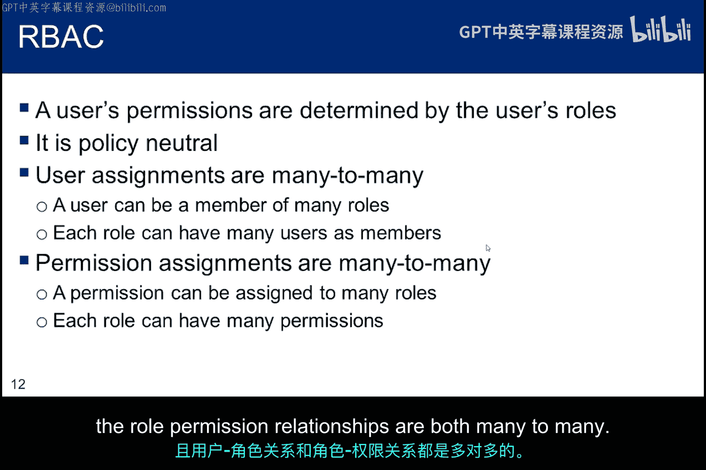

I have reviewed the three most common access control mechanisms， Disctionary。

 mandatory and role based access control。 Dca is identity based and the owner of an object manages permissions。

 Mac is based on the allocation and security or privacy levels to users and objects。

 and Arrbch is based on permissions assigned to user roles。

They are quite different models that represent an evolution in our understanding and security needs。

 Each has its benefits， but they have different security postures。 Often。

 we see a hybrid model that includes both D and Mac。

 and Arrbch mechanisms can be modified to model either。

The need to no constraint is often enforced using D overlaid on another mechanism。Finally。

 R buck can be extended to provide ABAC if additional access control complexity is a requirement。

In the next sub module， I will discuss some of the attacks that have leveraged vulnerabilities found in O S implementations。

 For the most part， these attacks are well understood and are no longer available to the attacker。

 but they haven't been eliminated entirely。 And for sure。

 many of the concepts involved are reused in attacks on more modern designs。

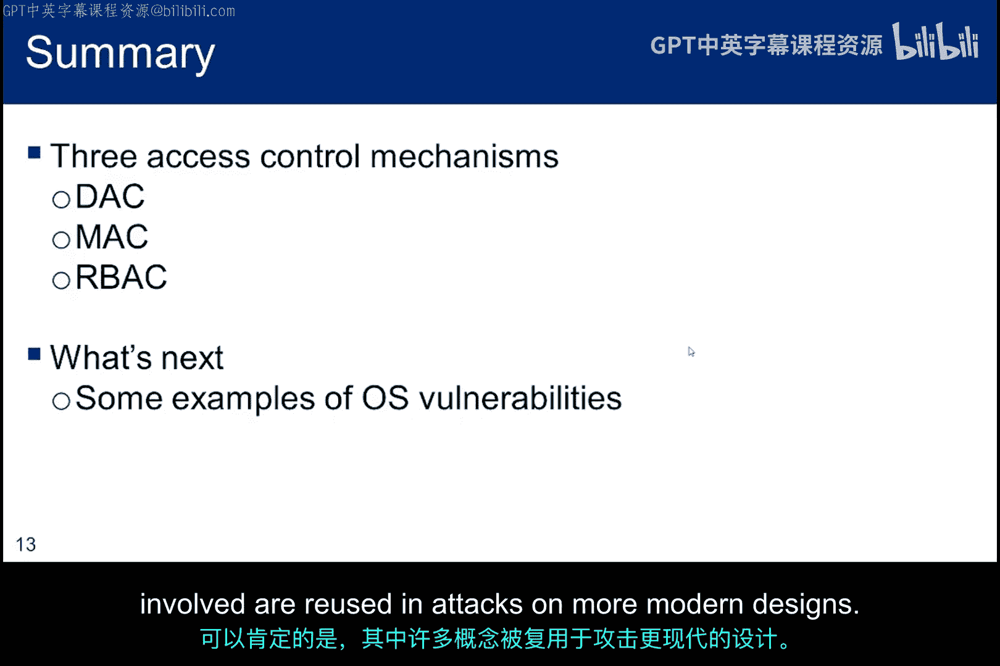