# 约翰霍普金斯大学《道德黑客入门｜Introduction to Ethical Hacking》中英字幕 p65 11_操作系统漏洞分析.zh_en -BV1xgu1z1Eau_p65-

This sub module will present some of the historical attacks on systems that were successful due to weaknesses in the O S。

 One of the key ideas that appears over and over is buffer overflow attack。

While we have implemented many changes in our implementations to address buffer overflows。

 we still see them on almost a daily basis that putting more information into a buffer than it can hold remains a common and successful attack approach。

 This is a very important concept to understand。 and we will pursue it in some depth。

This is a list of the attacks we will review in this sub module。

 Many of these examples are taken from operating system security by Trent Yeager。

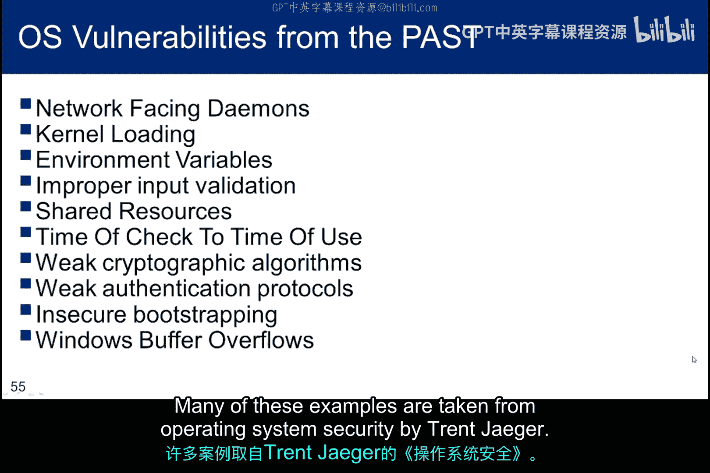

Examples of network facing demons in Linux that provide access via network ports are SSHD。

 FTPD and send mail processes that are network accessible and don't protect themselves from remote input。

 are susceptible to remote attack， especially buffer overflow attacks。

 Some of the remote login demons that have been too trusting R tnet， R login， FTPD and NFS。

 An example of excessive trust is insecure versions of FTPD that sends passwords in the clear。

 Another example is an insecure version of NFS that accepts any response from a remote file system as being from a legitimate server。

So one inference we can draw from these vulnerabilities is it is important to check remote input very carefully。

 Of course， this isn't a new message。 We saw it previously in the Web exploitation module。

 especially in preventing sequel injection attacks。The second message is not to trust the network。

 Aters may be sniffing packets or spoofing legitimate network nodes。

 This is another message we have seen previously in the network exploitation module。

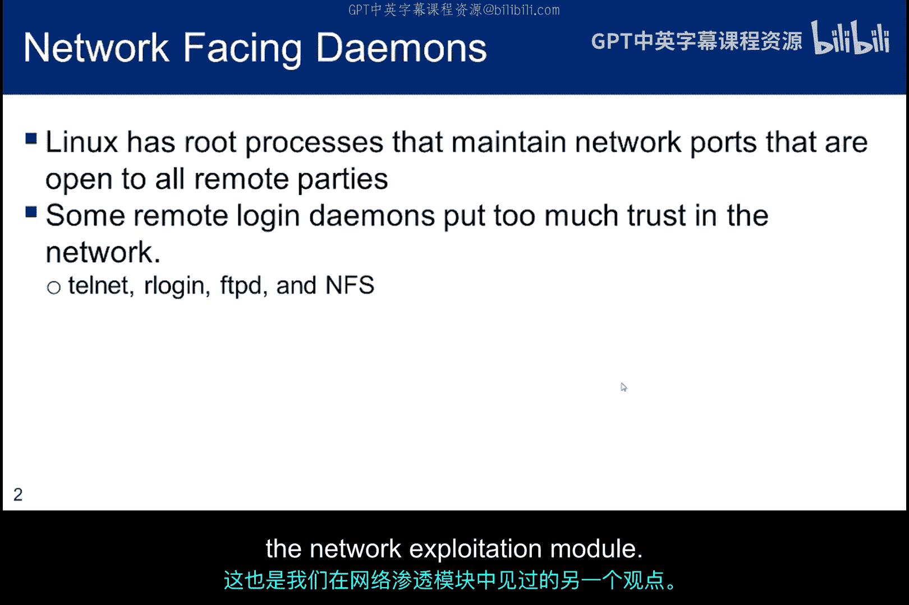

Windows calls kernel extensions kernel mode drivers。

 and Linux calls emloadable kernel modules or L K Ms。

 These are object files that contain code to dynamically extend the running kernel of an operating system without recompiling without L K Ms and operating system would have to include all possible future functionality compiled into the base kernel。

 Much of that functionality would be unused， but consume resources and memory。

L K Ms typically add support for new hardware or file systems。

 but they can also be used to add system calls。They may be unloaded in order to free memory and other resources when no longer needed。

 Both types may allow an attacker to execute code in the kernel with full system privileges。

 because the attacker takes advantage of root owned processes with access to the kernel。Of course。

 a kernel module cannot be loaded by just anyone。 Only a user with root privileges or the kernel itself may load or unload a kernel module。

 That means it can't be leveraged before you get root。 But once you have it。

 it is very useful for loading back doors and root kits by using a loadable kernel module。

 The attacker does not need to inject Trojans into system functionality Rather。

 he can subvert the functionality at kernel level without leaving a trace。

 This approach also subverts tools generating system fingerprint hashes。

 And attackers have learned how to make the L Kms invisible and unremovable。

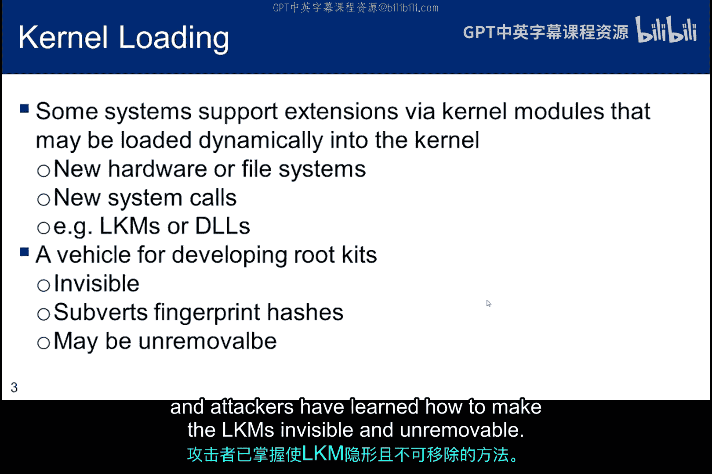

Environment variables allow processes to convey state。

 and the buffer overflow example we will explore in the following lectures will leverage this by creating a new environment variable to convey state。

 and the information passed will consist of shell code。

Another way an attacker can use environment variables is to change the live path so that the O checks for and runs malicious code instead of the expected code。

 In other words， a trusted process may invoke malicious code in the submodles to follow on set U ID。

 you will explore this idea by getting a normal process temporarily running as route to run privileged code because the live path has not been properly managed。

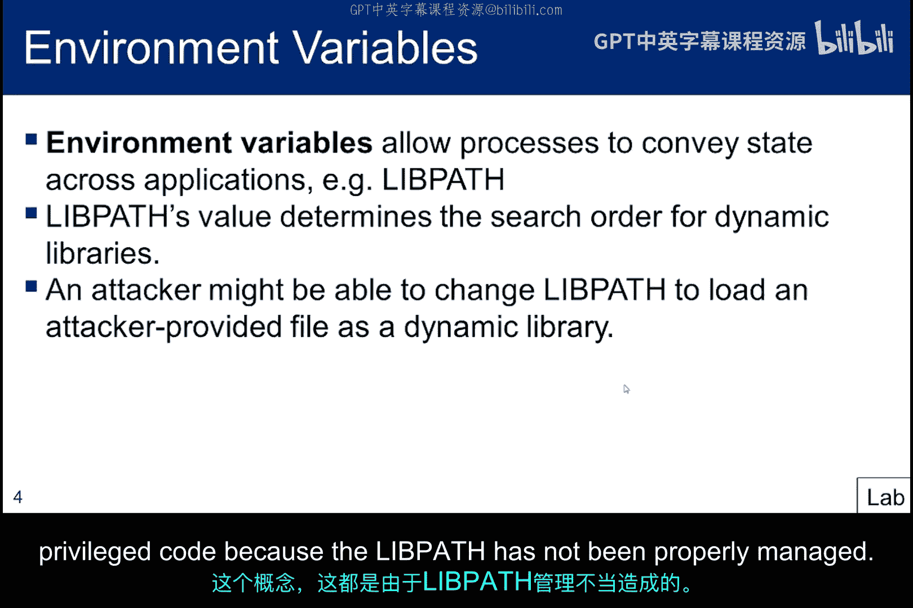

We have discussed the idea of input validation multiple times。

 but it is worth repeating because it represents a critical attack vector into systems that do not do an adequate job of checking。

One of the critical elements to control is the location of libraries and hostpaths。

 If validation is not done， directory traversal vulnerabilities may exist。

 This may create a vector for attackers to gain authorized access to restricted directories and files。

 These input validation problems are typically vulnerabilities in Web servers or application code allowing an aggressor to exploit the system in order to read or write files that are not intended to be accessible。

 In some situations， an attacker may be able to execute arbitrary code or system commands。

 The Last bullet on the list is also critical， because it prevents buffer overflows。

 The idea is to always make sure that any input of any kind received in an application it is never longer than the buffer it is supposed to fit into the heart bleed bug in open S L is a good example of weak input validation。

 although not strictly a buffer。Overflow attack during the T L S keep alive handshake。

 the attacker was able to request an extra 63 k of memory because it was assumed soon the protocol would be used properly。

 and there was no validation of the length of the string returned as the payload。 In some cases。

 the extra memory that was returned contained session cookies that allowed an active session to be hijacked。

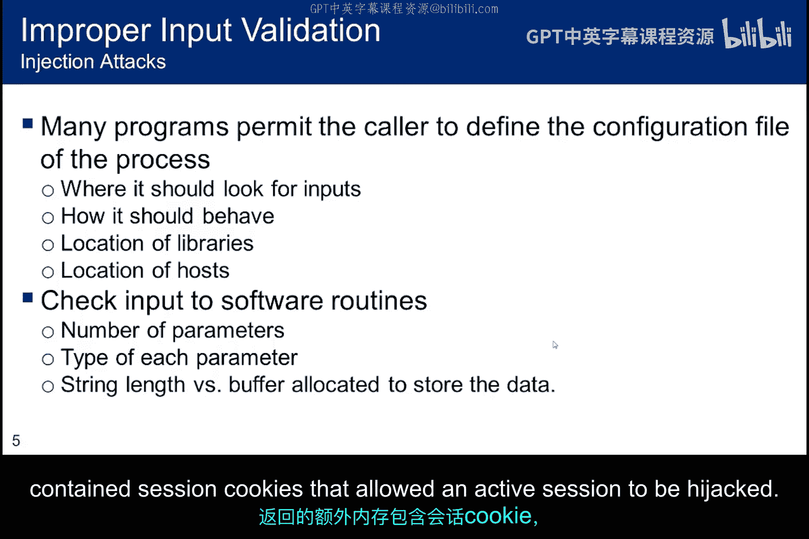

Suppose an untrusted process guesses the name that will be used as a trusted processes temp file in the slash temp directory。

Since any process trusted or untrusted can create files in s temp。

 the attacker creates his own file there， using the name just guessed for the trusted process。

 The attacker then grants access to the trusted process to access his untrusted temp file。 So now。

 in the trusted process creates a temp file， and will already exist。

 and the attacker has access to it since he created it。

 and he is able to read the trusted processs temp file。

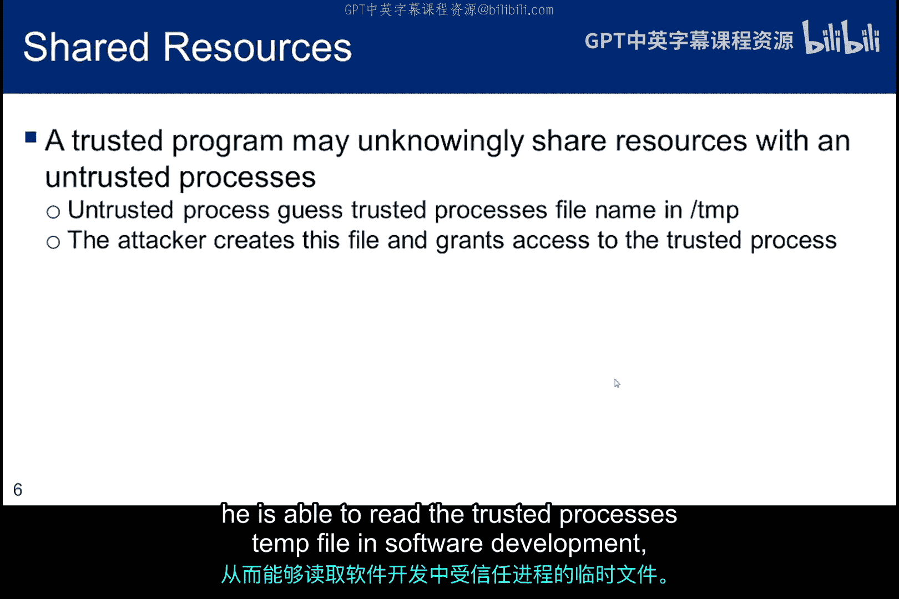

In software development， time of check to time of use or talk to is a class of software bug caused by changes in a system between the checking of a condition。

 such as a security credential and the use of the results of that check。

 It is a kind of race condition。An INote stores all the information about a regular file， directory。

 or other file system object。But it is loosely coupled to the file name。

 which creates an attack vector。 When an attacker requests access to a temp file。

 he passes the file name to the trusted process for an access control decision。 For example。

 he may say he wants access to his temp file slash temp slash X， which will be granted。

 the call to the access function behaves as expected， and grants the program。

 the necessary permissions to access the file。 However， both functions， access and F open。

 operate on file names rather than on file handles。

 That means there is no guarantee that the file name still refers to the same file on disk when it is passed to F open as it did when it was passed to the function access。

If an attacker replaces s temp/ X after the calls to the function access。

 but before calling F open with a symbolic link to a different file。

 the trusted process will open the file， even if it is a file that the attacker would otherwise be unable to access。

A reminder， a symbolic link is a reference to another file as an absolute path。

 which affects path name resolution。

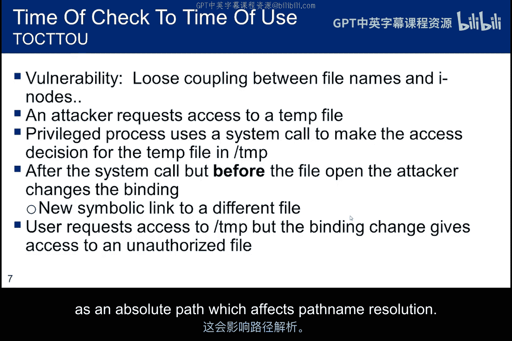

Passwords are not stored in the clear， Rather， they are typically salted and hashed before being written to the shadow file。

 However， there is no guarantee the cryptographic mechanisms can't be attacked。

Nonstandard and unveted algorithms are dangerous and should never be used。 For example。

 the use of a proprietary cryptographic algorithm is subject to reverse engineering。

 and if there is a weakness in the algorithm because it hasn't been reviewed properly。

 it provides an attack point。 Similarly， any modifications to the hash functions speed them up may create vulnerabilities。

 We know M5 is a weak hash function， and the flame virus leveraged this to create a fraudulent certificate to digitally signed some malicious software So it would appear as if it originated from Microsoft。

 The attack is called a chosen prefix collision attack， in which a new bogus certificate is created。

 and the hash of two different certificates。 One good and one bad produced the same result during signature validation。

 an important point in applying algorithms is that given the same seed。

 the pseudoran number generator always produces。the same random output stream。

 This is actually leveraged by some wireless protocols。

 but it also means two applications using the same seed are subject to crypt analysis。

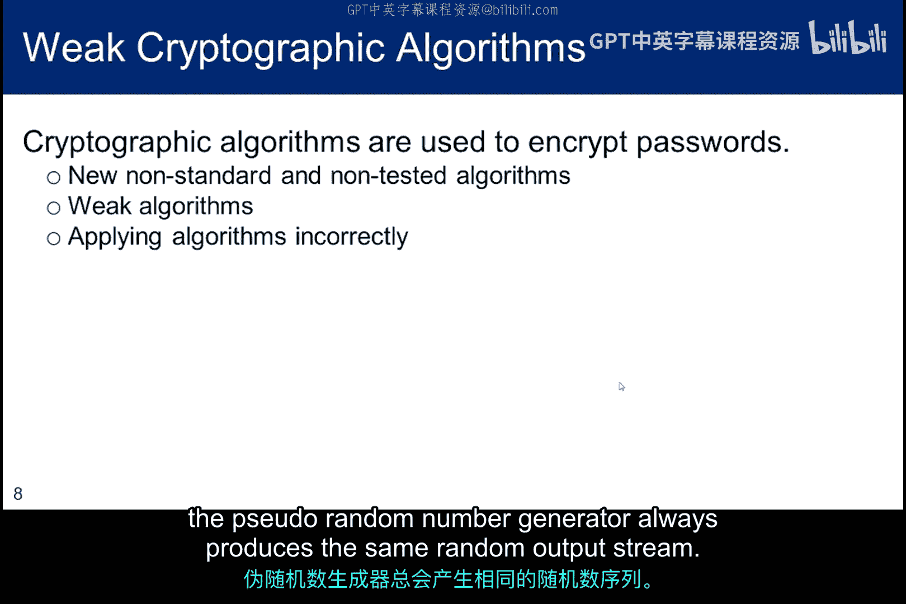

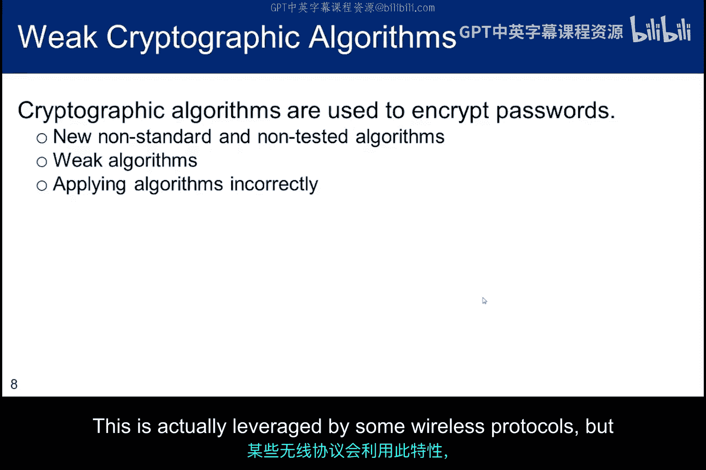

And an obvious problem in applying algorithms is still sometimes overlooked by programmers。

 The failure to destroy plain text after encryption。

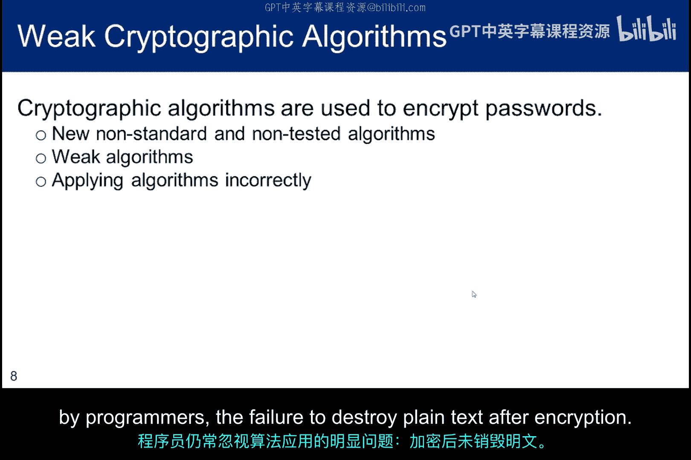

Land manager is a network operating system developed by Microsoft。

 but there are multiple issues with the authentication protocol。 Passwords are not case sensitive。

 so all passwords are converted into uppercase before generating the hash value。 In addition。

 password characters are limited to a subset of the ASII character set。

 Both of these issues reduce the attack surface significantly。

Password length is limited to maximum of 14 characters。

 but a 14 character password is broken into two halves of7 characters each。

 and the hash is calculated for the two halves separately。

 So the attacker only needs to brute force attack 7 characters twice instead of 17 characters。

 This makes the effective strength of the password equal to twice that of a 7 characters password。

 which is significantly lower complexity。 If the password is 7 characters are less than the second half of hash will always produce the same constant value。

 Therefore， if the length of the password is less than or equal to 7 characters。

 the password strength can be determined visually。The hash value is sent to the server on the network without salting。

 making it susceptible to man in the middle attacks， such as replay the hash。Wiffi protected setup。

 W P。 S is vulnerable because the specification did not require a timeout to eliminate brute force attacks。

 Some vendors implemented it。 Some did not。 In addition， W P。

 S has a weakness similar to land manager that speeds up the brute force attack。

 The pin is only 8 numbers。 And one of those is a checkum。

 reducing the brute force attack to 7 numbers。 The seven number string in the pin is divided into substrs of four numbers and three numbers for validation。

 reducing the attack surface from 10 to the 7 or 10 million attempts to 10 to the fourth plus 10 to the third or 11000 attempts。

BX works has a weak default hashing algorithm that is susceptible to collisions。

 So any string that produces the same hash is good enough to be authenticated。 For example。

 Y bracket， bracket， bracket， bracket， bracket， K， S hashes to the same string as password。

The result is， an attacker can brute force a correct password by guessing a string that produces the same hash and access the relevant service。

 Again， this reduces the attack surface。

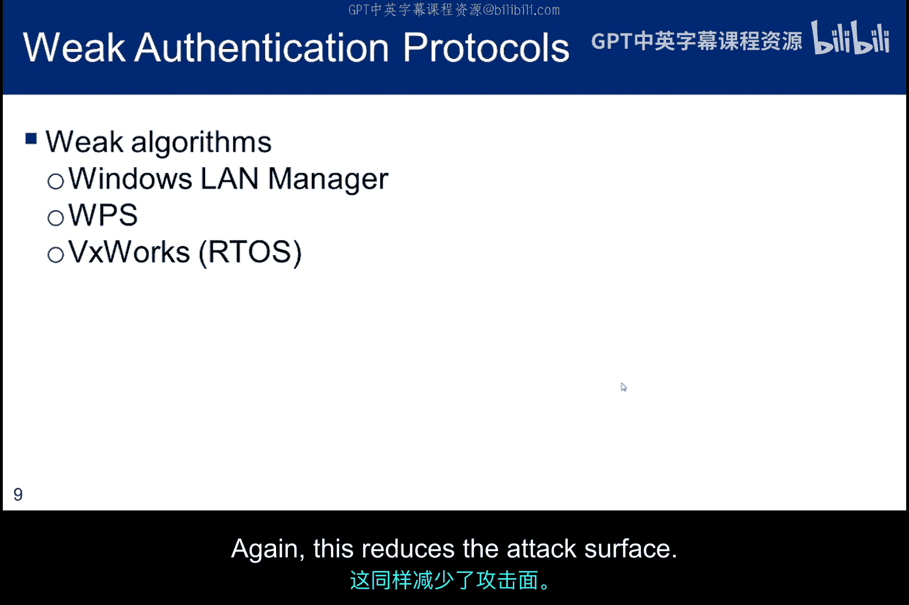

I demonstrated the vulnerability of a bootloader in the first submodule。

 but I have not talked about the other two bootstrap issues。

 Sun O S allowed booting into a single user mode And after getting privileges on the box。

 It was possible to extend those privileges to the server。 In other words。

 access was granted to the whole network。 If you have physical access。

 it is sometimes possible to boot from either a live C D or a USB stick and get access to the system disk。

 A Windows system executing on a PC can often be rebooted with a foreign operating system like Linux。

 Once the foreign system is booted， the NtF S volume may be mounted and accessed since the attacker has bypassed the access control mechanism and forced within Windows。

 This is a good way to steal a Windows password file。

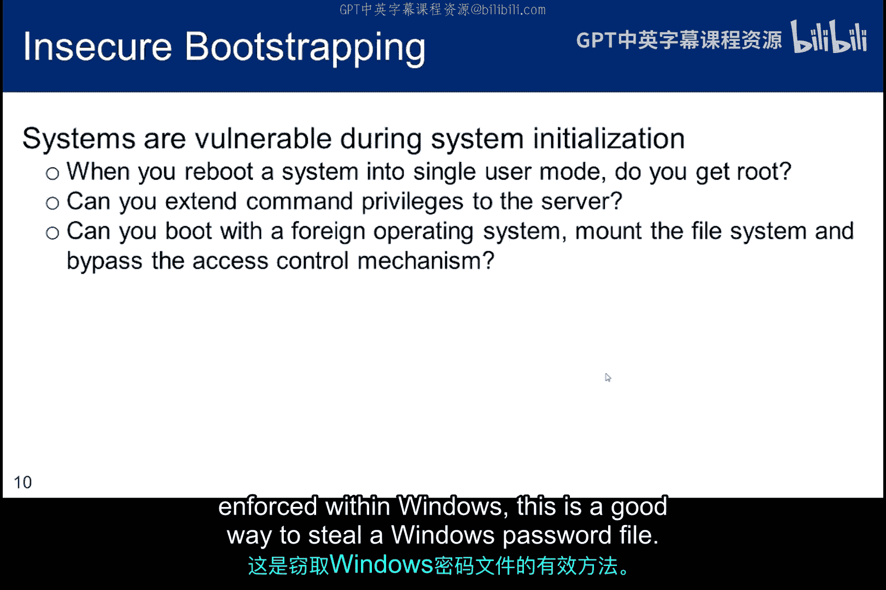

In the Department of Defense， security requirements。

 information guides provide guidelines for development of security technical implementation guides or Stigs。

 which contain lockdown information。 Stigs developed by the product vendors document applicable DoD policies and security requirements for specific technical products。

 as well as best practices and configuration guidelines。The Defense Information Systems Agency。

 Odisa， is in the process of replacing the SRG process by developing DoD appendices to the National Information Asance Partnership Protection profiles。

 although there are still a requirement for a product specific St。

 The result of the Nap common criteria evaluation will be used to formulate a STig。

Stigs will be published in XCCDF format to enable consumption by automated tools。

 where both compliance can be assessed and configuration remediation addressed with the addition of Oval code。

 Stig compliance may be assessed from across the enterprise usingas host based security system and a security content Auto protocol compliance Chater。

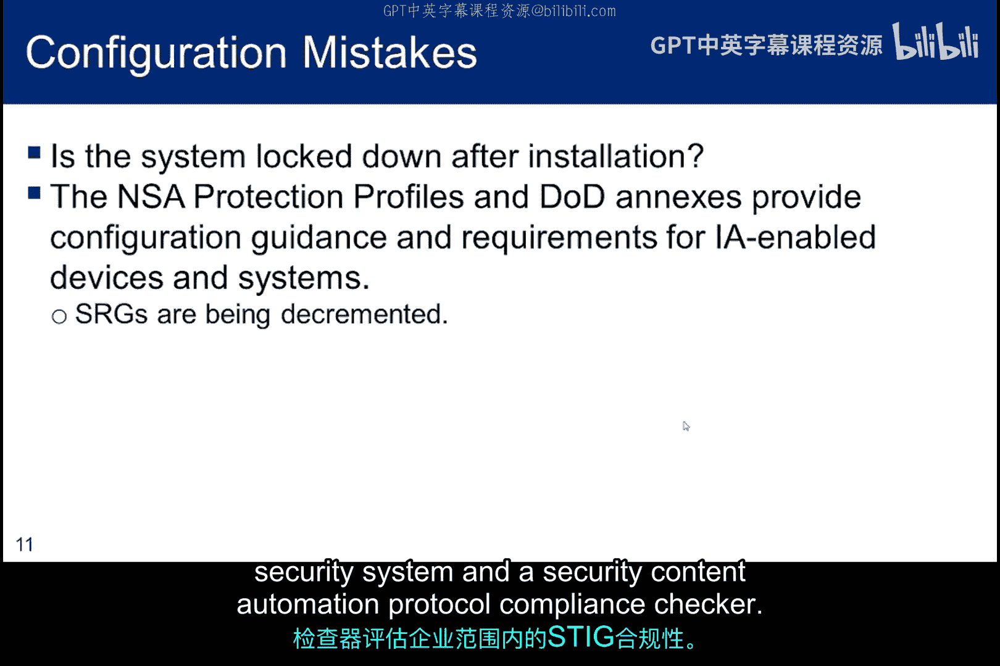

In Windows， registry entries may have a security context， and unfortunately。

 some programs leave the security context at any。 when this happens。

 any normal user can change the paths and use registry entries to gain administrative rights and compromise the system。

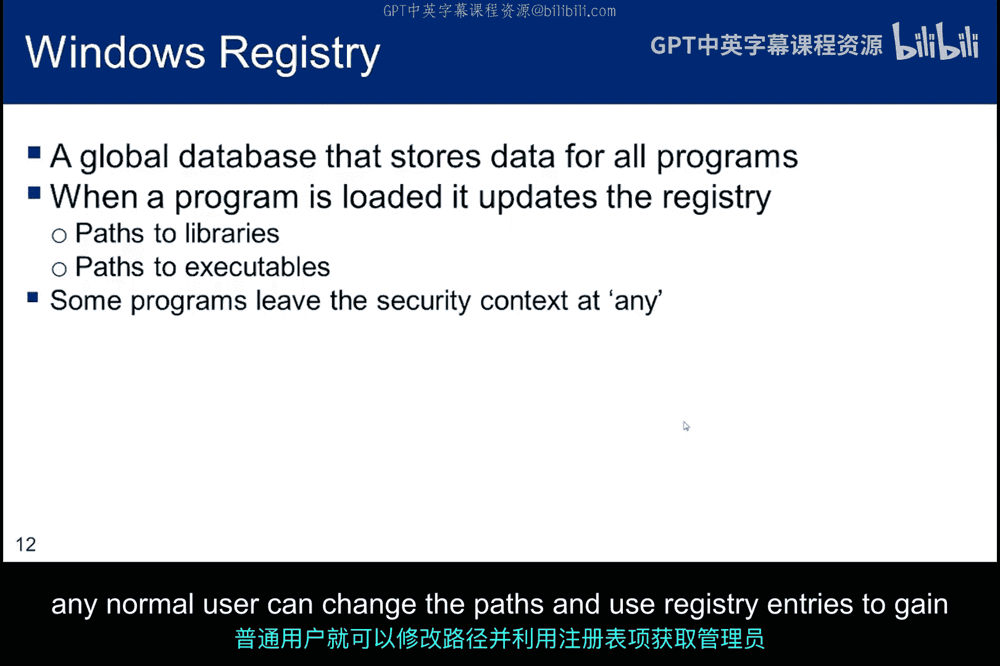

Windows users may have administrator privileges， but may not understand the significance of those privileges。

 Accounts are often configured that way， so software will install properly and execute。

 That means it is easy for an unknowledgeable or careless user to install malicious software with a single click。

Bit 9 is one product that provides tools to control the installation of software。

 but it is sometimes configured to be too strict， and users get totally frustrated trying to get their work done。

In the situation where users have administrator privileges。

 compromising any user account will give an attacker route in order to motivate our deep dive into buffer overflows。

 here are a couple of old but famous examples involving the Windows I I S Web server。

 the code red overflow vulnerability was magnified by the fact that the indexing service was enabled by default in Is。

Similarly， S Q L server came enabled by default， even though it may not have been running。

The code red worm leveraged a buffer overflow vulnerability in the indexing server that allowed instructions to execute to produce worm behavior。

 Basically， IIS mishandled the HTTP request and executed the included packet with full permissions。

Interestingly enough， a patch had been released for I I S about a month before the worm appeared。

Those systems that had been patched were not affected。

 This happened in 2001 before administrators were so vigilant about installing patches。 In fact。

 Microsoft had failed to patch their update server and some users got infected well trying to patch。

 A couple of years later， slamour leverage to buffer overflow in SQL server。

 which is bundled with Iis and was initially configured as enabled A side effect was a denial of service because the worm propagated so fast that it clog routers and shut down many sites Again。

 a patch had been released six months earlier。 in this submod。

 we have discussed several O S attack vectors。 These have all been well understood for some time But when new software is written。

 some of these get created anew。 So we need to think about them as both pen testers and system defenders as users of ethical hacking skills。

 we can use our knowledge to help improve system defense。

If you go to the National vulnerability database on the day you viewed this lecture and do a search on buffer overflow。

 you will most likely find at least one buffer overflow vulnerability identified within the last seven days of your search。

Before starting a deep dive into buffer overflows， we will spend some time on set U I。

 which is a necessary but sometimes vulnerable feature of operating systems。

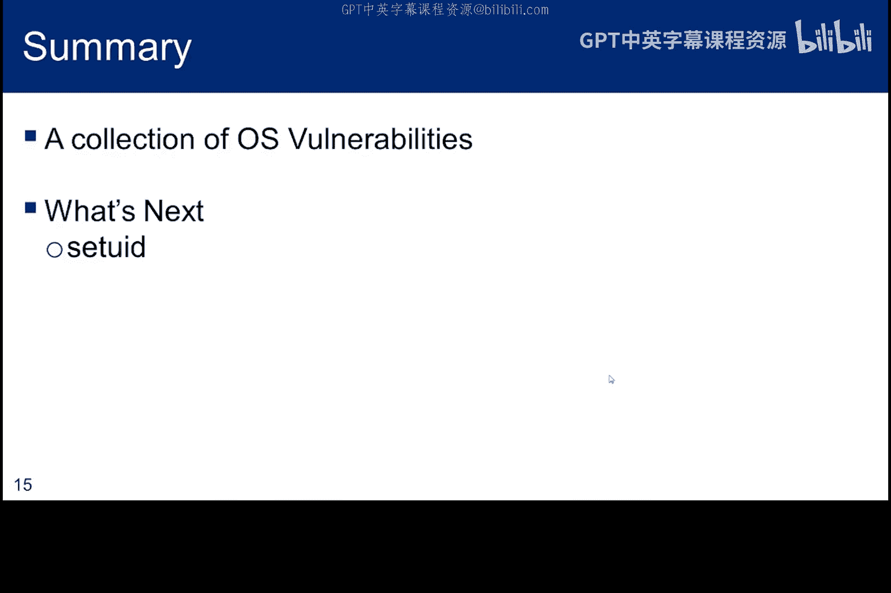