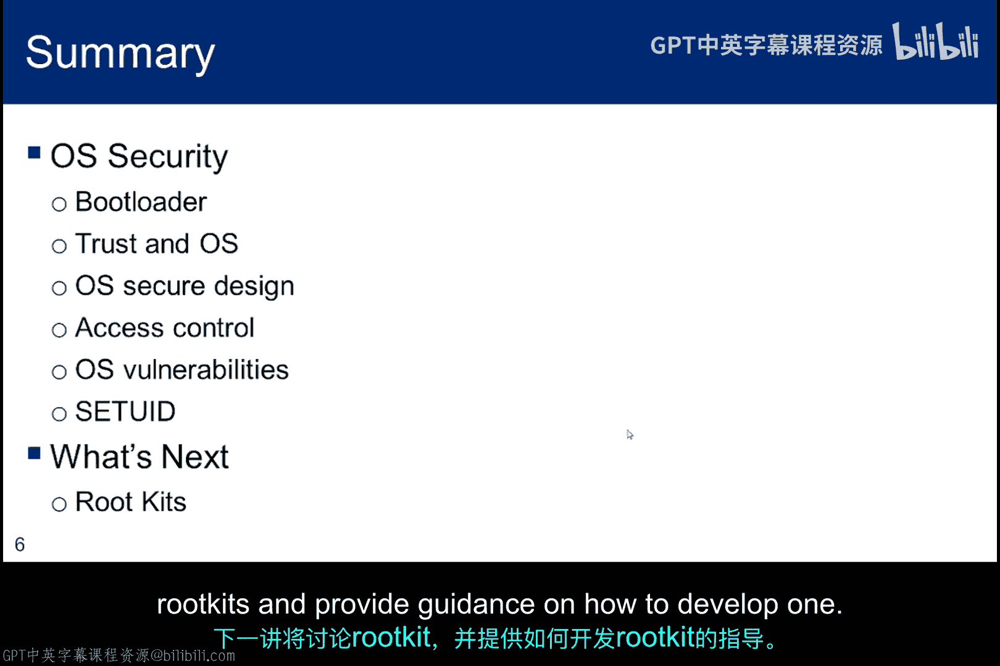
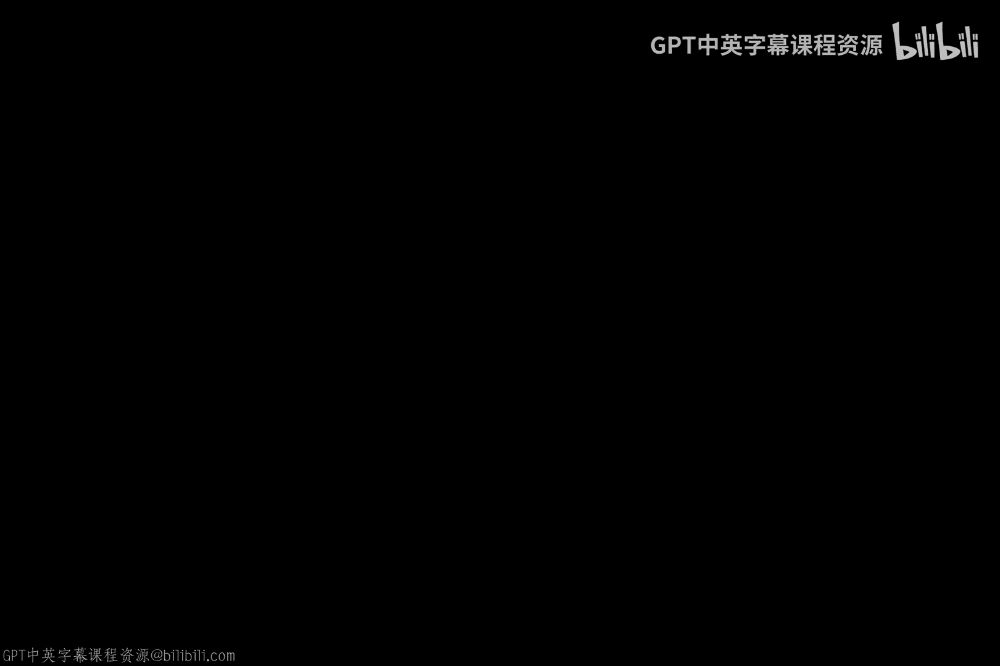

# 约翰霍普金斯大学《道德黑客入门｜Introduction to Ethical Hacking》中英字幕 p66 12_Setuid权限机制.zh_en -BV1xgu1z1Eau_p66-

Set user I D or set U I D as an object flag that allows users to run programs with temporarily elevated privileges in order to perform a specific task。

 If you can break out of the task when you have elevated privileges。

 you may gain access to objects that you are not supposed to have。

 This submodule will explore some examples of set U I D vulnerabilities。

Set UI as a flag that can be modified using C HMd。 As noted earlier。

 it allows users to run programs with temporarily elevated privileges in order to perform a specific task。

 It is needed for tasks that require higher privileges than those which common users have such is changing their login password。

 When the password is being changed， you temporarily have root privileges。 Here is an example。

 if you do an L S T L A in user slash bin， you will probably see the pseudo program。

 Look carefully at the permissions， and you will see it has the set Uid permission bit set on the executable。

 Some versions of Linux use color coding to identify set UI programs。 For example。

 on my deian system set UI programs are highlighted in red。

 This bit indicates to the kernel that the program should always be executed with the UI of the owner of the。

ableIn the case of pseudo， that is root。Once Su is running as route。

 it can do the necessary authentication and set U I D Cis call before the fort to invoke the requested command。

The internal field separator bug is a good example of how set U I D has been abused in the past。

 The attack idea is that a program with temporary route permissions can be fooled into executing user supplied code。

 to see this， suppose you set the I F S to forward slash。 instead of plank。 Next。

 the malicious code is created in the current directory。 and named Ben。

When the program makes a system call running the function system s bin/ Ls。

 rather than traversing the directory path to find the binary。

 the program bin would be run from the current directory， and it will be run with route permissions。

This bug has been fixed by making sure shells do not inherit the I FS variable。

 The change file mode or C H mod command lets you modify file permissions。

 The first digit selects the set user I D set group I D and restricted deletion or sticky attributes with values of 4。

2 and one respectively。 The second digit selects permissions for the user who owns the file。

 read is 4， write is 2 and execute as one。 The third selects permissions for other users in the files group without right privileges and the fourth for other users not in the files group without right privileges。

 to explore set U I D if you haven't done so already。

 you will need to build a V M using something like Deian Uuntu or another Linux version of your choice。

 It really doesn't matter which flavor you choose。 But Callli won't work because you are always running as root。

 When you should get the V M running。 Check to see if Z。

Shell is installed by trying to run it or looking for the executable install slash bin。

 If it is not present， install it。 You will also need to compile some simple C code。

 So check to see that the Gcc compiler is installed。

 you can just type Gcc without a file name and see if it tries to run or it is usually found in slash user slash bin。

 if it isn't on your VM install it。This sub module requires completion of a hands on lab designed to explore the set U I D flag to see how poor programming practices create vulnerabilities。

 In fact， due to potential security issues， many operating systems ignore the set U I D attribute when applied to executable shell scripts。

The lab has four parts， and I have provided a detailed lab sheet to provide you specific guidance on what needs to be completed and documented with screenshot。

 The first two parts involve a comparison of a binary's behavior when the setu I D bit is set and when it is not。

The last two parts require you to compile a C program， which I have provided。

 One program will investigate the vulnerabilities of relative direct repass。

 When the setui D bit is set， the other program will demonstrate that even a well written program can be leveraged when running with temporary route privileges。

We have discussed several aspects of O S security to include important design approaches and access control mechanisms that help secure Oss。

 We also looked at unsecured bootloaders and set U I D programming errors as possible attack vectors。

 Most of these problems have been around for a very long time。

 We understand them and our systems are getting better。

 but there are still techniques routinely discovered that compromise operating systems。

 The next lecture will be on root kits and provide guidance on how to develop one。

