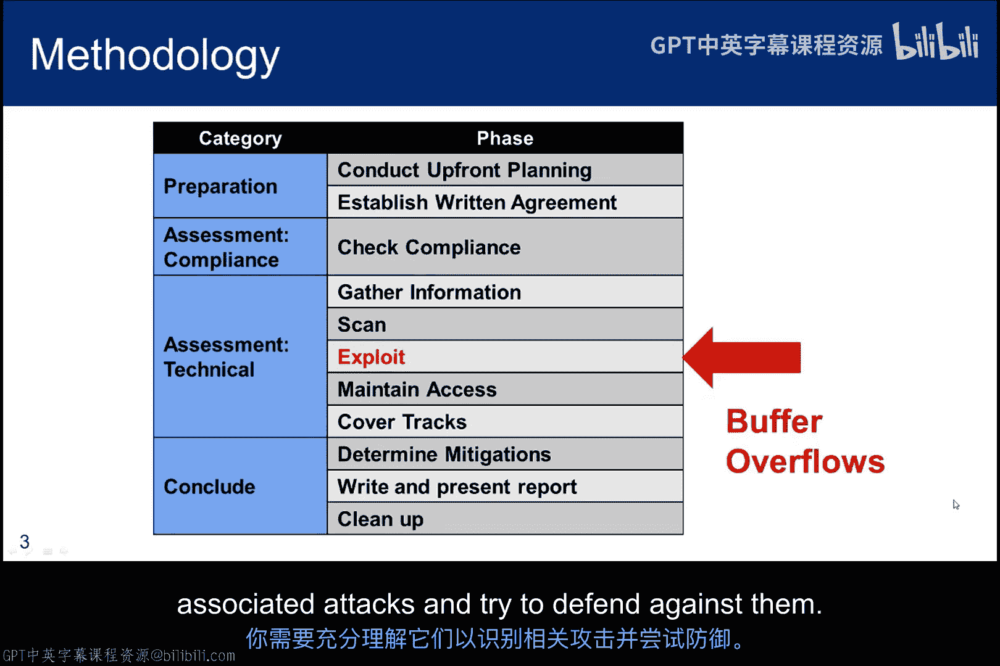
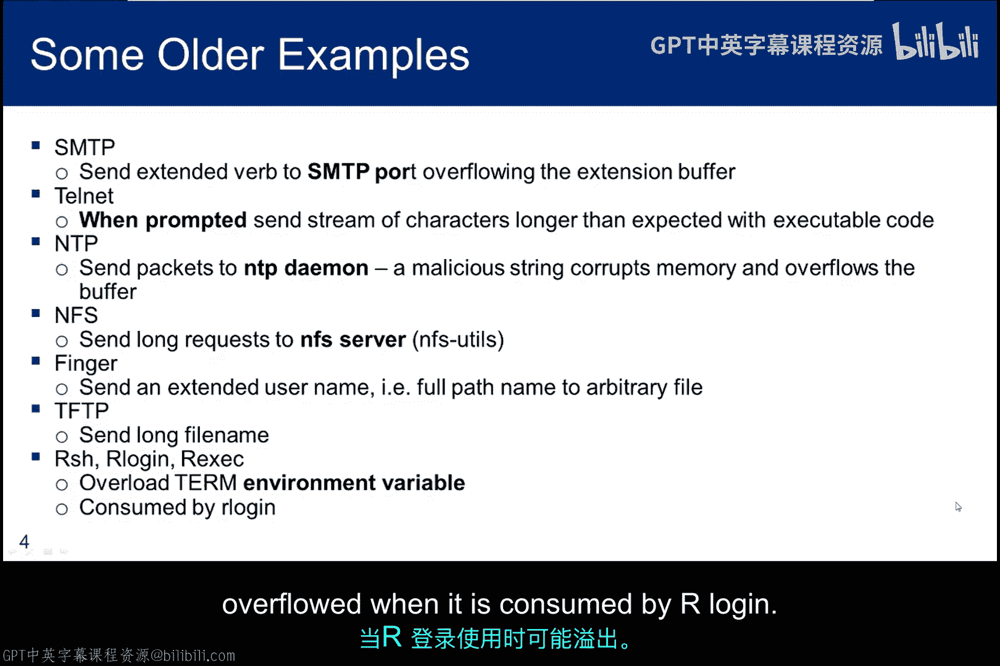
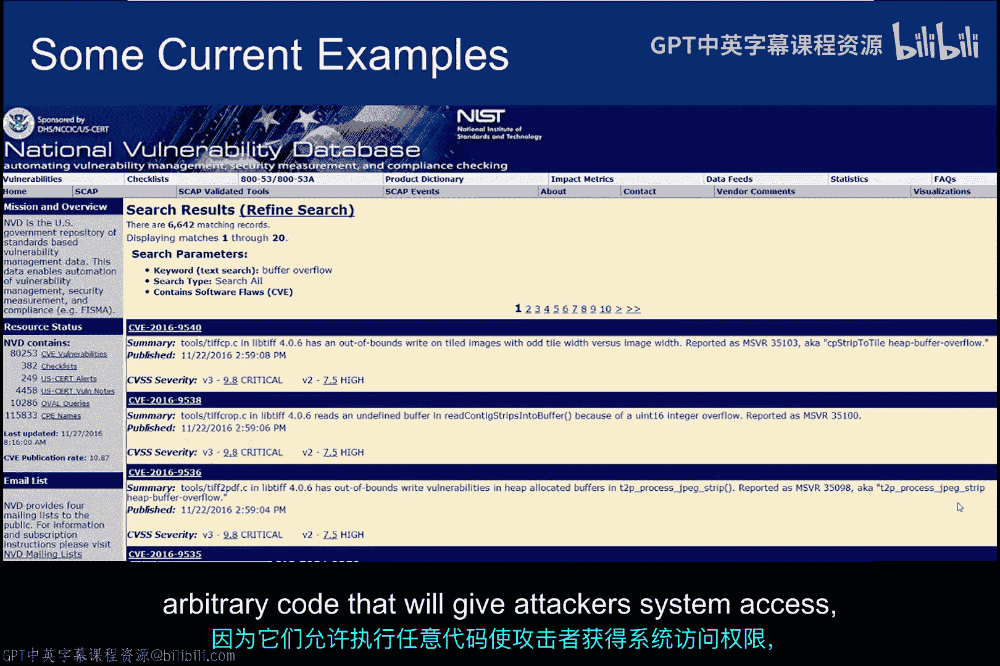
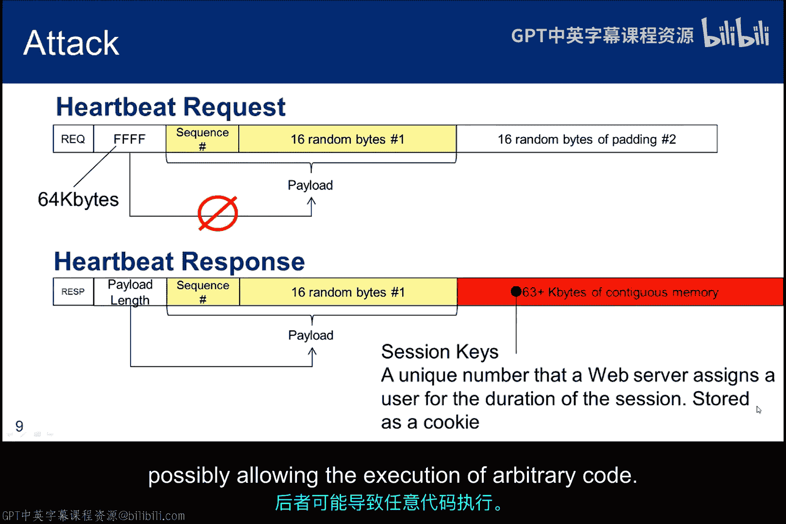
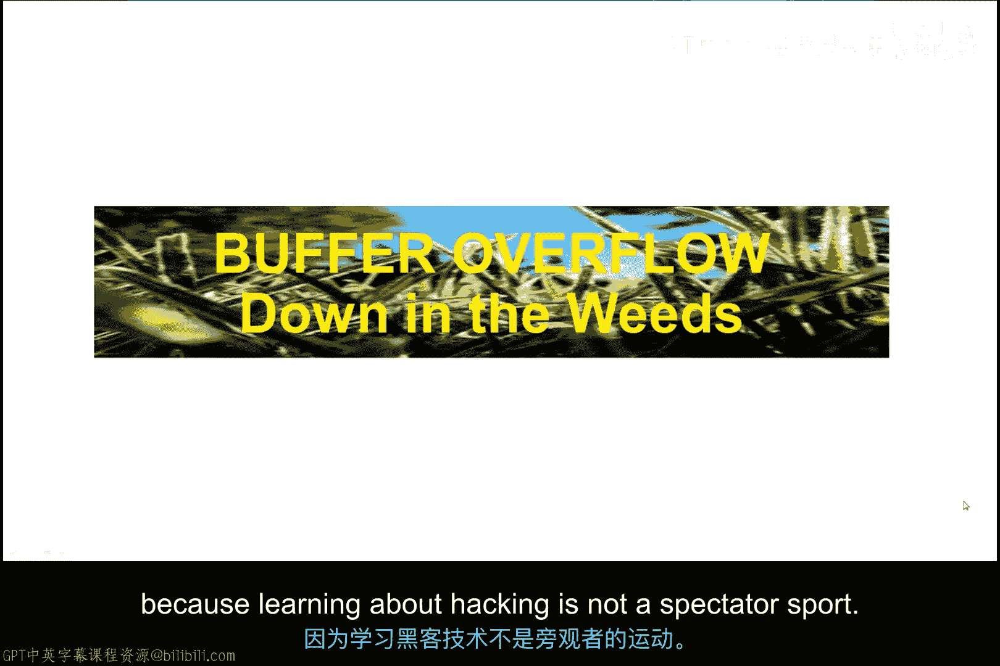
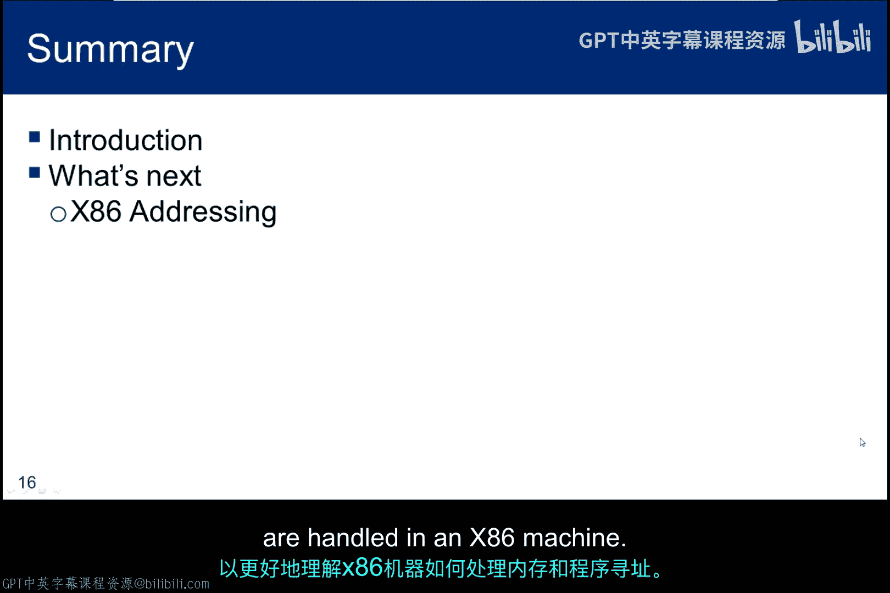

# 约翰霍普金斯大学《道德黑客入门｜Introduction to Ethical Hacking》中英字幕 p67 13_课程导论.zh_en -BV1xgu1z1Eau_p67-

Frarack is an easing written by and for hackers。 first published in 1985。

 It originally covered freaking and telephone system hacking。

 It is still around and open for contribution by anyone who desires to discuss original ideas on the topics of interest。

 Both hackers and security professionals use and contribute material。

 Allf1 wrote smashing the stack for fun and profit in 1996。 It was printed as an ASI file in frac。

 Vole 7 issueue 49， November 8，1996。 If you look at the other articles in volume 49。

 You will see that many of them at that time， dealt with telephone systems。 Today。

 you are able to find H T M L versions of this paper that are a little easier to read。

 but it is worth while to look at the original ASII version。

 Smashing the stack was a seminal paper on the subject of buffer overflows。

 And we are going to study it in detail in this module。

Both buffer overflow and return oriented programming are exploit techniques from our methodology。

 although these techniques in general are not used by ethical hackers。 However。

 they are leveraged by offensive actors。 be they good or bad。

 So you need to understand them well enough to identify associated attacks and try to defend against them。

This slide shows some old examples of programs that have succumbed to buffer overflow attacks。

For S MTTP， the attacker supplies a specially crafted。

 extended verb to the STP port that allows execution of arbitrary code for tnet。

 when prompted for the user name， The attacker provides a stream of characters longer than expected and includes executable code。

 The N TP demon was prone to stack based buffer overflow。 The N F S us on 64 B architecture machines。

 contains a stack based buffer overflow vulnerability。

 a remote attacker can view arbitrary files on the system via the finger demon。

 by putting the full path name to the file in place of the username in the finger request。

 A buffer overflow in the TFTP demon， allows execution of arbitrary code via a long file name argument for the R。

 or remote commands。 The attacker can copy the value of the term environment variables to an internal buffer。

 which can be overflowed when it is。

Td by our login。This search of the National vulnerability database shows almost 7000 records of vulnerabilities that mention buffer overflow。

1 vulnerability identified on the day I did the query。

 one the day before and one the day before that， what this tells us that in spite of all the mitigations we have put in place over the years to address these vulnerabilities。

 we continue to see them。If you do a search on the day you view this lecture。

 you will most likely see a buffer overflow vulnerability within the preceding week。

 And it's not just obscure software。 You can see the last C V E on the slide describes a Mozella Firefox heat based buffer overflow。

The point of this slide and the last slide is that we really need to understand these attacks。

 because they allow the execution of arbitrary code that will give attacker system access。

 and the attack surface does not seem to be getting much smaller。

Next， I want to quickly discuss the open SS S L vulnerability that facilitated the heartbleat attack。

 I have included it because too many engineers， even security engineers refer to it as a buffer overflow attack。

 It is not。 although it did involve a buffer。 It is really a buffer overread attack。

 I don't think this is a common terminology but you will see what I mean， when I explain it。

 More importantly， as we dig down into what a buffer overflow really is。

 Think about how different heartbleed is compared to an overflow。

 Some implementations of T L S could cause a connection to be dropped。

 If no data is sensed in the tunnel。 to circumvent this issue and keep the tunnel up。

 even when it is not in use， the idea of a heartbeat was introduced。

 This is a simple extension to SS S L that involves periodic requests and responses between the two ends of the tunnel when there is no traffic on the。

The way the heartbeat is implemented is shown here。 First。

 a heartbeat request is sent out with a sequence number and 16 random by of information。

 When it is received， the other end responds with the same information by reading it from memory。

 The problem arises because the responder uses the payload length field to determine how many by to return。

 the programmer did check that the request was sent with 16 B。

 but he did not check the payload length field to see if it requested that 16 B be returned。

The attack goes like this。 A typical S L tunnel only requires a server credential if mutual authentication is not enforced。

 That allows a bad actor to set up an S L tunnel。 Now。

 the attacker changes the payload length field in the heartbeat from 0，0，1。

0 to F F F F and sends the request。 The responder is only supposed to include 16 B in the return。

But the code reads the payload length field and thinks the payload is supposed to be 65535 bys。

 So the code reads that many bys for memory where the initial payload is residing。

So the response ends up including not only the 16 Bs。

 but the remainder of the 64 k in that area of memory， following the buffer。 the 16 Bs are stored in。

Who knows what is stored in that memory？ Sometimes it probably isn't useful information。

 but sometimes it contains session keys with a session key。 If a legitimate user is logged in。

 the attacker can hijack the session。 and that is exactly how the attack played out。

 as we go forward in this module。 Remember， this attack was about reading past the end of the buffer。

 not putting more information into the buffer than it could hold。

 possibly allowing the execution of arbitrary code。

So we are going to get down in the weeds on buffer overflows， studying assembly level code。

 counting and disassembling arbitrary bites and tracking the stack activities。

 The key is not to become a reverse engineer or an As level programmer。

 You just want to learn enough to understand the nitty gritty of buffer overflows。

 The work will get tedious and you will run into roadbs that you have to resolve。

 which are going to learn a lot。 By the end， you will be an expert on buffer overflows and have a detailed understanding of some of the mitigations that have been put in place。

 Just don't be afraid to dig in and get your hands dirty。

 because learning about hacking is not a spectator's sport。

 The risk of buffer overflows was first recognized in 1972 and discussed in a report entitled the Comp security technology planningning study written for E S D by James Anderson and Company。

 This seems quite insightful since there was no Internet and O PCcs and no one had observed an。

Example of this kind of an attack。 Then 16 years later， in 1988。

 Robert Morris released the first known computer worm on the Internet。

 and among the vulnerabilities it exploited to gain access was a buffer overflow flaw in the finger demonmon。

 A reminder that Morris was the first person indicted under the Comp fraud and Abuse Act。

And the whole episode was quite an embarrassment to his father， who。

 at the time served as chief scientist of the NSA's National Computer Security Center and was instrumental in the development of the Rainbow series of computer security standards。

After another seven years， Thomas Lopaock at the University of Munich published a stack overflow exploit for NCSA H T T P D on H P U X in 1995。

 NCSA H T T P D was one of the first web servers。 The attack was based on a stack overflow vulnerability in this early web server。

 which was being developed by the national Center for Supercommuting at the University of Illinois。

 As an aside when development stall on the Web server。

 The code was forked to start the Apache project， which， of course。

 was foundational as the Internet emerged。 It is unclear why Lopaock's work didn't achieve the kind of attention that smash in the stack for fund and profit received。

 I would guess it is because it is just an exploit against the server。

 While smashing the stack is more of a tutorial that tries to capture the concept of a buffer overflow。

Its goal is to generalize and explain the content of many different exploits with a single abstraction After the concepts of stack overflow were more well understood。

 and people began to think of mitigations， the next step was to heap overflows。

 The concepts were very similar， but it is more complicated to constrain the heap activity。

 because it is a more robust structure that has to be allowed to handle more freeform data。

 After many of the mitigations such as depth and A S L R， which well discuss later。

 were put into operating systems。 attackers looked for new techniques to control the stack and one of the more recent developments has been returned to Libib C。

 which we will also discuss in this series of modules。

 The return to Libib C attack is a modified approach that starts with a buffer overflow。

 but the return address on the call stack， is replaced by the address of a function that has already been loaded in the binary or via。

Shared library terminology may be confusing at this point。But don't worry。

 I will take you through it step by step。 These are some links to references that you may find useful。

 The subjects identified here are important to understanding the content of the lectures。

And I assume you will learn the details you need going forward。

 as I do not have time to cover this material in any depth in this module。 Don't try to learn at all。

 Just learn enough to work your way through the labs so you can understand what a buffer overflow is all about。

 and the standard caution， websites come and go。 So even though the links were available when the module is recorded。

 they may be dead now， just use your search engine to find even better resources on this subject。

 This simple graphic captures the high level idea of a buffer overflow attack。

Relative addressing is a fundamental property of an operating system that allocates memory and puts a process in that memory space to execute。

 The idea is the O S keeps track of a base address and is able to find all other instructions and memory locations relative to that base address by just adding offset information when a program calls a function。

 The gray stack on the left represents what happens。

 The stack is used to keep track of information beginning at the top。

 The instruction pointer for the return is the next instruction to be executed after the function ends。

 Then a bunch of important information is saved on the stack and at the bottom is a buffer allocated on the stack because it is defined in the function and memory needs to be allocated for it。

 The same stack on the right in red shows what the attacker does。 First。

 it creates a data set that has two parts。 One part is the shell code。 It is called shell code。

 because when it。It starts a shell for the attacker。

The second part of the dataset set will be the address pointing to the shell code。

 This address is copied over and over。 Given that dataset set。

 when the attacker is asked for an input destined for the buffer， he sends something else。

 He inputs his data set with shell code and address information as the graphic shows the shell code is put at the bottom of the buffer。

 Then the buffer is filled with the address of the shell code and all the important stuff is overwritten with the address of the shell code。

 Finally， if the data set is big enough， the instruction pointer will be overwritten。

 changing the return instruction for when the called process ends。 When that happens。

 the instruction pointer points to the shell code instead of the calling program。

 and the shell code gets executed。 The trick， which isn't part of the simple graphic is to correctly determine the starting address for the shell code。

 That is the address that is needed to fill out the data set and overwrite the stack。

 Given that high level description。Of a stack overflow。

 These are the questions that we need to answer。 Where is the buffer and how do we get our data set into it。

How big is the buffer？It could be so big that you don't add enough return addresses to get to the top of the stack。

 or it could be so small that the shell code doesn't fit。 Finally。

 how do we determine the address the shell code will have in the target's memory space so we can get it to execute。

This is a list of the topics that we will discuss in this submodule。

This has been an introduction to stack buffer overflow。

 The idea is to put some shell code in a buffer and then overflow the buffer with the address of the shell code。

 When the buffer is written to the stack， the shell code's address overwrites the return address for the calling function。

 The result is， the shell code gets executed。 Instead of returning to the next instruction in the calling function。

 As mentioned， the challenges are to one， figure out where the buffer is located on the stack。2。

 make sure the shell code fits into the buffer。 and3， get the shell code to execute。Next。

 we will take a very quick look at the X 86 architecture to get a better understanding of how memory and program addressing are handled in an X 86 machine。

