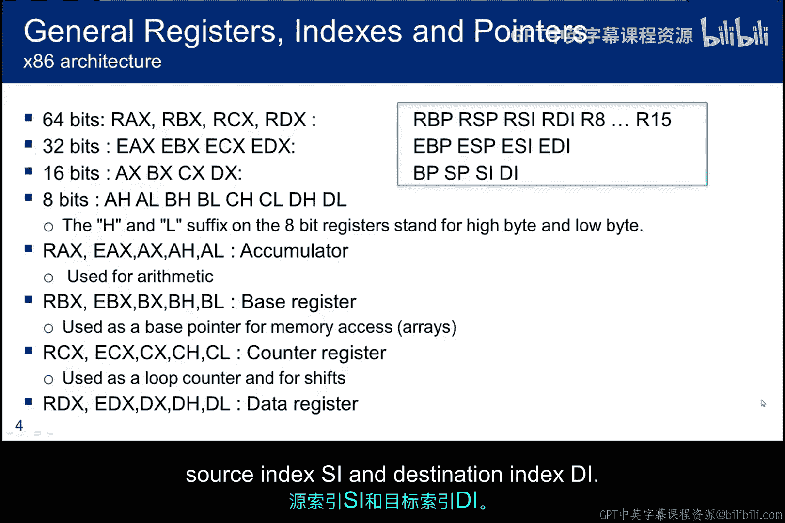
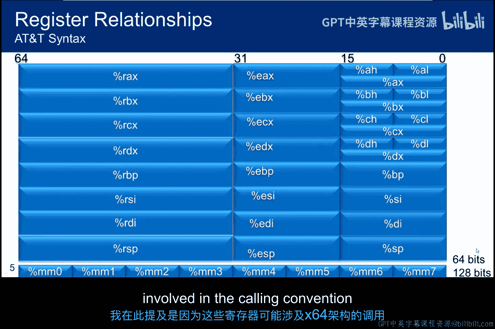
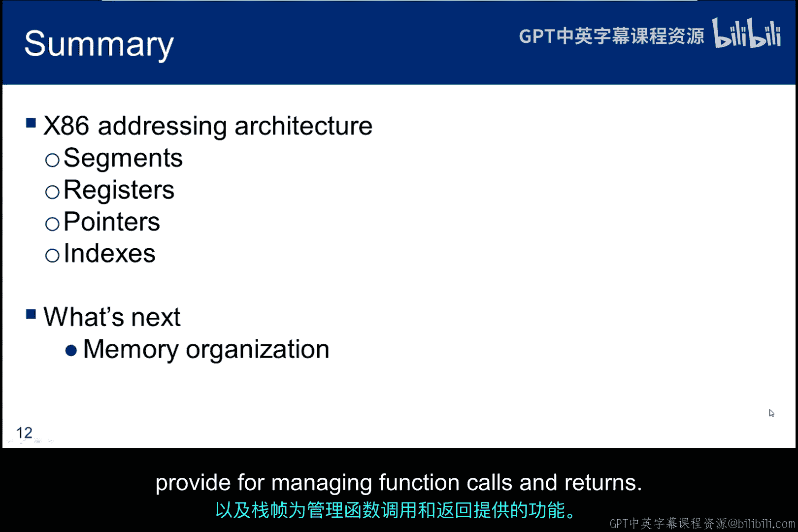

# 约翰霍普金斯大学《道德黑客入门｜Introduction to Ethical Hacking》中英字幕 p68 14_x86体系架构.zh_en -BV1xgu1z1Eau_p68-

This submodule will look at X 86 addressing。 an understanding of this is necessary in order to explain details of what is going on with the stack and how the shell code really works。

 I will briefly mention the 64 B architecture。 but focus on the 32 B architecture。

 which has been around since 1985。 The 64 B architecture since around 2000。

 These are three topics we need to discuss to be able to create and understand the behavior of shell code。

1， segment registers give us a way to keep track of code data in the stack。

 They also provide base address information for relative addressing。

2 general registers provide a location for manipulating data and moving it around。 and 3。

 the pointers and indexes provide the ability to manage offsets to base addresses and find things in memory。

 There are four segments。The code segment is where the process has been loaded for execution。

 It contains executable instructions and is read only so that code is not modified on the fly。

 The data segment is where global variables and static variables Iized by the programmer are stored。

 and it is read right memory because the variables need to be modified during execution。

 The stack segment is a last in first out structure where addresses are saved in order to manage changes in state when functions are called。

 and the extended segment provide access to a larger memory space。In a language like C。

 you can type a pointer as far。 And when you do that， it uses the X segment。

 This allows you to get addresses outside the current segment in the far segment。 Both D S and C。

 S are near segments。 These are the names and labels for the general registers。

 that will be used by debuggs and assmbbllers， disassemblers。

 This slide is focused on general registers。 But for completeness。

 I have included the names of the indexes and pointers as well。 base pointer B。

 P stack pointer S P source index S I and destination index D I。 But more on that in a few slides。

 This shows the physical relationships that have been maintained as the X 86 architecture evolved。

 For example， the least significant half of the 64 B R A X register。

 is the 32 B E A X register and the least significant half of the E A X register is the 16。

AX register and the AX register has a high byte AH and a low byte AL。

The other general registers are similar。 The subtitle A T and T syntax refers to the use of the percent sign to denote register names。

 We will discuss this more as we proceed with this module。

 But whenever we start up in as similar or debugger to look at low level code。

 The tool will use either this notation or a slightly different Intel notation and we need a basic understanding of each。

 The M M X registers， M M 0 through M M 7 are an extension of the Intel architecture that uses a single instruction。

 multiple data， S I M D execution module， allowing several data elements to be processed simultaneously。

 applications used these registers to do parallel computations using small integers for 2D3D graphics。

 image processing virtual reality， audio synthesis and data compression。

 And we mention them here because these registers may be involved。

In the calling convention for the X 64 architecture， Here is a short note on the 64 B architecture。

 I mention these notions because if you are using a 64 B VM。

 some of the examples may not work in your environment。

 And for sure they will work slightly different， an application binary interfaces。

 the interface between two program modules， one of which is often the operating system。

 it determines such details as how functions are called and in which binary format information should be passed from one program component to the next。

 or to the operating system in the case of a system call， an A B I determines the calling convention。

 which controls how functions， arguments are passed and return values retrieved。

 when a function is called the 32 B architecture passes all arguments on this stack。

 But that's not the case for 64 B， which only puts arguments on this stack if there are more than6。

 The first six integer or pointer。

Arguments are passed in registers， R D， I， R S， I， R D X， R C X， R 8 and R 9。

 While X M M 0 through X M M 7 are used for floating point arguments。

 Any additional arguments beyond 6 are passed on the stack， and the return value is stored in R X。

The addressing is also done slightly differently on a 64 B machine， and unfortunately。

 the full addressing capability is not used in current CPU designs， which have limited address bus。

Only 48 B of the 64 B address are used。 still providing 256  TB of address space。

 While that is a lot of memory。 The implementation leaves two unused null Bs in the address。

 This approach impacts buffer overflow examples because they typically use string operators and string operators usually terminate when they see nulls。

 as they signal the end of the string As a result， some of the code we will discuss in this module will not work properly on a 64 B V M。

With segment descripts， page directories and page tables， the X 86 memory module is very complex。

 and beyond the scope of this lecture。 But we will need to understand what we see in assembly codee。

 This picture shows the way effective addresses may be represented at the bottom are two specific examples。

 The first， using Intel syntax and the same expression using A T and T syntax。

 The argument offset is calculated by adding the base address to the scaled index plus the displacement in the first case using the Intel syntax。

 The effective address offset can be calculated as a mathematical equation read from left to right。

 The A T and T syntax is not so intuitive and the displacement is moved to the front。

 but the calculation is the same。 This shows the indexes and pointers typically used with different segment registers。

 and a common use case for each By the way， the E stands were extended。

And is a remnant of the extension of the 16 B architecture to 32 B。Although not technically accurate。

 I will sometimes drop the E when discussing pointers。

 but I will almost always mean the extended pointer。

 Not that the instruction pointer is read only as only the O S can modify an。 Also。

 the stack is a lios structure， and the stack pointer keeps track of that。

 The base pointer typically serves as a reference point for the stack pointer。

 But it changes when there is a new function call or when the function completes and returns to the calling program。

 And now， a few words about the differences between the Intel syntax and the A T N T syntax。 First。

 A T And T immediate operas are preceded by dollar sign。Intel immediate opera are undelimited。

 Second， A T N T register opera are preceded by percent sign。

 Intel register opera are Unlimited 3 AT N T and Intel syntax use the offset order for source and destination opera。

Intel syntax is right to left， and A T and T is left to right In A T and T syntax。

 The size of memory operas is determined from the last character of the op code name。

 Op code suffexes of B， W， L and Q specified byte 8 B Word 16 B long 32 B and quad 64 B。

 memorym references。 Intel syntax accomplishes this by prefixes to memory operas with byte pointer。

 word pointer， D word pointer and keyword pointer Mo without the directive can be used for either a byte or word and is inferred from the context。

 Fifth in AT N T Is are prefixed with a dollar sign and 0 X denotes hex in Intel syntax hexadecimal or binary immediate data are suffixed with H and B respectively。

Also， if the first hexadecimal digit is a letter， then the value must be preceded by a0 with respect to memory locations in Intel syntax。

 the base register is enclosed in square brackets， whereas in A T and T syntax。

 it is enclosed in parentheses。 This table summarizes how memory operas are handled in the two syntaxes。

 But more interesting are the statements in the subbus。

 The two relatively simple statements in Intel syntax achieve the same result as the two statements in the A T and T syntax。

 Yet they look quite different。 as you try to step through a program pay attention to what syntax is being used。

 So， you know， where a value is being moved from and to and what the constants are and what the offset is for a memory location。

 it can all be quite conceing when you haven't worked at this level previously。 in this subm。

 I have talked about segment registers。General registers， pointers and indexes。

 I have also introduced both the Intel and A T and T addressing syntax。 In the next submodule。

 I will discuss how memory is organized， focusing on the stack。

 how the stack works and what functionality stack frames provide for managing function calls and returns。

