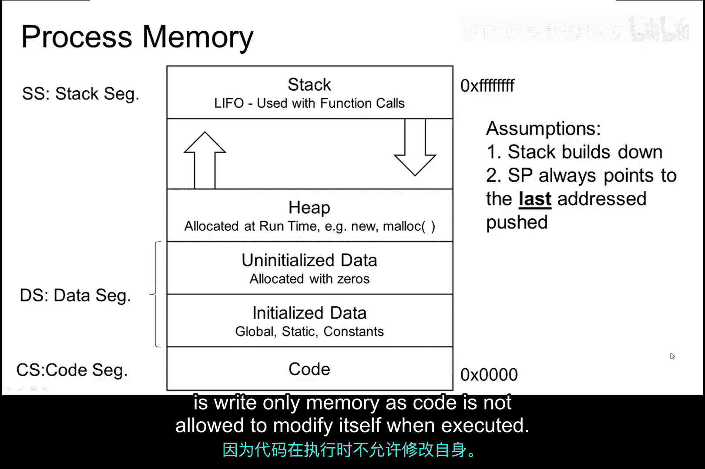
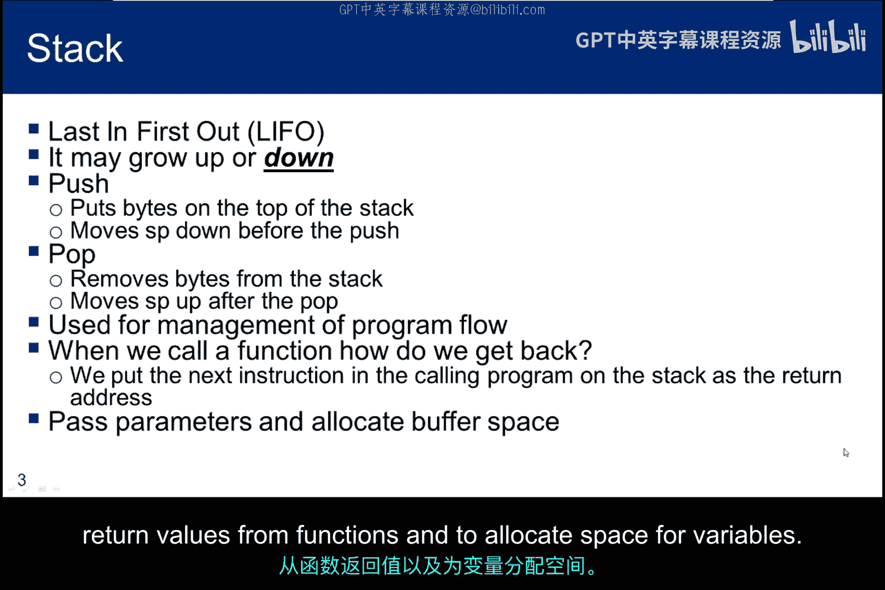
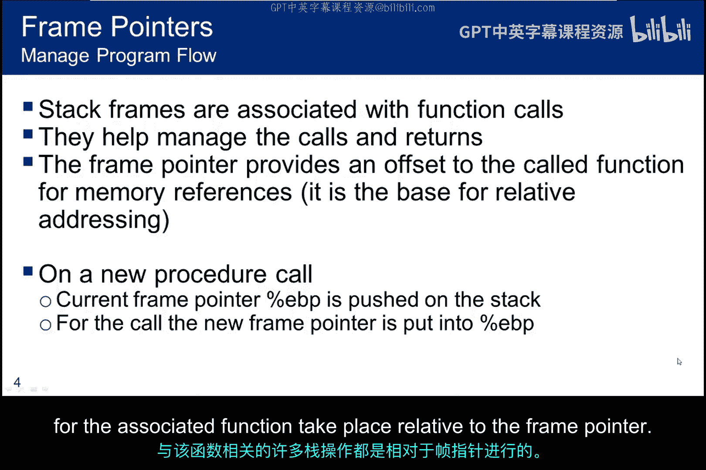
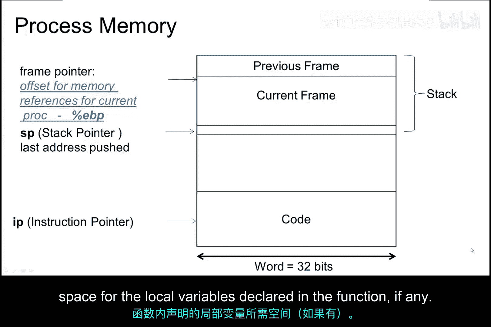
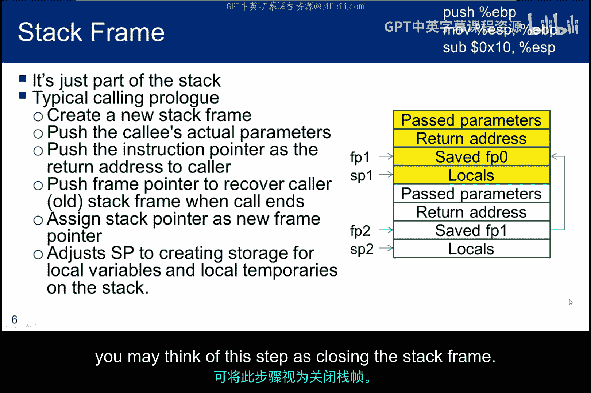
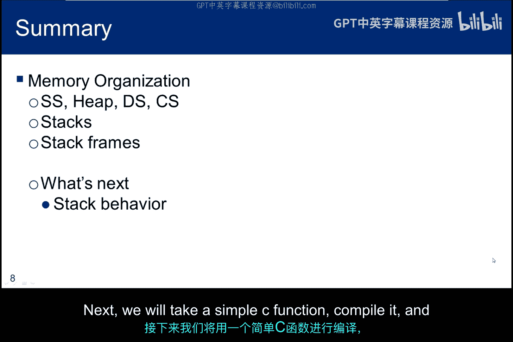

# 约翰霍普金斯大学《道德黑客入门｜Introduction to Ethical Hacking》中英字幕 p69 15_内存组织结构.zh_en -BV1xgu1z1Eau_p69-

This sub module will address how memory is used， where the various segments are located with respect to each other and how the Lost builds。

This is a picture of the 32 B process memory starting at the high memory location。

 we find the stack segment。 Each time data is pushed on the stack。 The stack pointer is decremented。

 and each time data is popped。 It is incrementmented for this class。

 we assume the stack builds down from high address to low address And the stack pointer always points to the last address pushed。

 not to the next one to be pushed。 This means the stack pointer is decremented before a push。

These are two important assumptions， as not all O Ss implement the stack in the same way。

 The memory used by the heap is allocated at run time。

 A heap sits in the stack segment and builds up toward the stack。

 You may have heard the term stack buffer overflow and heap buffer overflow。

 This picture shows us they are closely related At。 Heaps may be considered slightly more attractive。

 because there are fewer constraints on their behavior。

 The next segment down in memory is the data segment， which also has two basic components。

 data that is initialized by the programmer and data that has been allocated， but not initialized。

 for example， an array。 This， of course， is a read， write segment。

 which is necessary for updates as variable values change。 And lastly， we have the code segment。

 which contains the executable code， and is right only memory as code is not allowed to modify itself when execute。

Stack is always a last in first out structure。But as noted on the previous slide。

 you need to check to see how the stack behaves and when it is incremented for your operating system。

In all of our examples， the stack will grow down， which means the stack pointer gets decremented before the push。

 And when we pop something off the stack， the stack pointer gets incrementmented。

 When we call a function we usually want to return to the statement after the function call when the function ends。

 So the return address。 The instruction after the call gets pushed under the stack when the function is called。

 The stack is also used to pass parameters to and return values from functions and to allocate space for variables。

 The stack frame is part of the stack associated with a call to a subroutine。

 which is not yet terminated with a return。 This is the structure that manages the program flow into and out of the function and within the function itself。

 The frame pointer points to the beginning of the frame。

 and it is maintained in the base pointer register。

If function 1 calls function 2 before function 1 ends。

 the frame pointer for function 1 is pushed onto the stack from the base pointer register。

 and a new frame is created on the stack for function 2。

 The address of the new frame usually called the frame pointer is put into the base pointer register for use by function 2。

 When function 2 ends function 1s frame pointer will be popped from the stack into the base pointer for use by function 1。

The frame pointer is often used as a base address， and many of the stack operations for the associated function take place relative to the frame pointer。

 Here is a picture showing the frames which are associated with a function call。

 frames help manage the calls and returns for the current frame associated with the currently executing routine。

 The frame pointer is in E B，P。

The stack frame usually includes at least the following items。The arguments pass to the function。

 if there are any， the return address back to the function's collar。

And third space for the local variables declared in the function。 If any。

 here is a stat graphic for two functions。 function 1 is running and calls function 2 On the new call。

 you push the local variables for the existing function to close its stack frame before starting a new stack frame for the new call。

The first thing that goes into the new frame are the parameters that function 2 will need to do its job。

The parameters go on to the stack in reversed order。 Last parameter first。

 The second thing that goes into the frame is the return address for function 1。

 So the O S can find its way back to function 1 when function 2 terminates。

The third thing that goes into the frame is the old frame pointer for function 1。

 So it doesn't get lost when the new frame pointer gets put into the base pointer register。

The subsequent assignment of the current stack pointer to EBP sets the new frame pointer to this location where the old frame pointer is stored。

 finally。Local variable and temporaries are allocated。

 You may think of this step as closing the stack frame。

 This slide just shows the A T and T instructions for saving the old frame pointer。

 assigning the new frame pointer for the new process and recovering the old frame pointer once the process ends in this submod I have talked about how memory is organized。

 focusing on the stack。 how the stack works and what functionality stack frames provide for managing function calls and returns。

 Next， we will take a simple C function， compileile it and look at the stack to see exactly how it is behaving。

