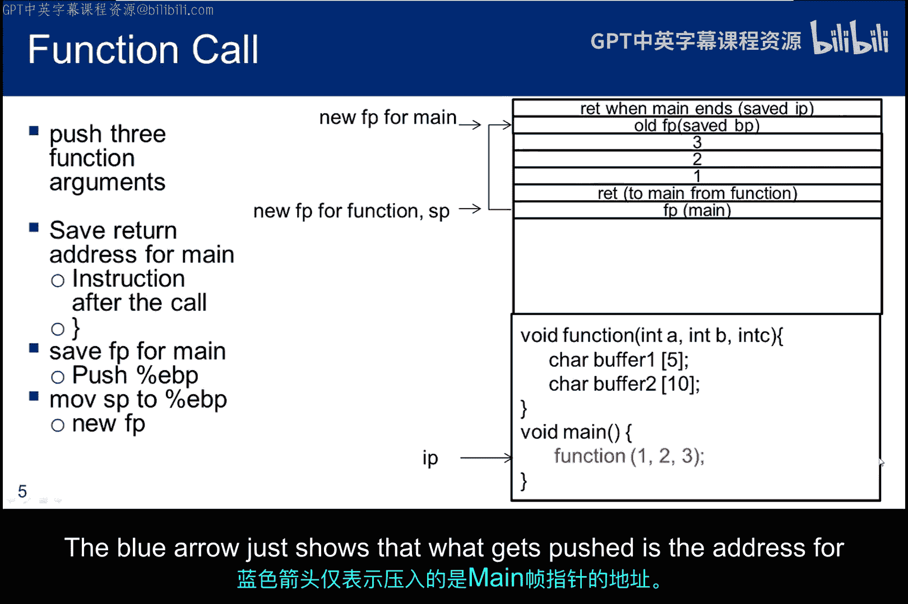
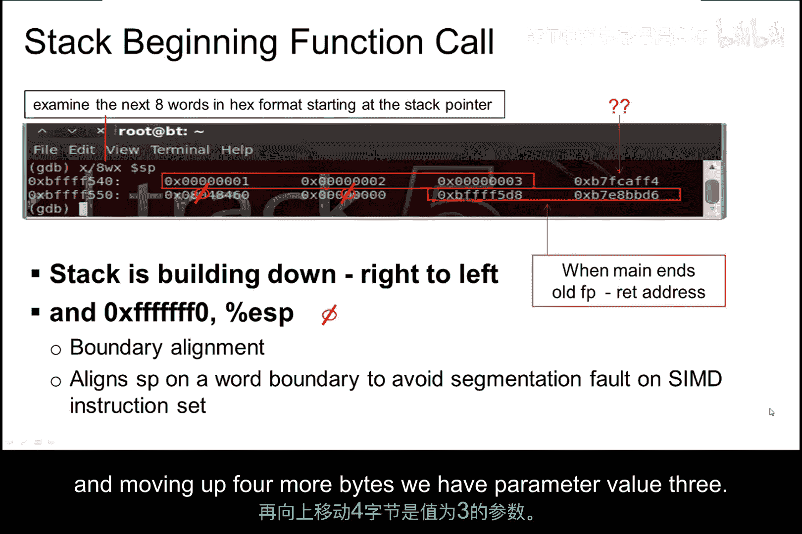
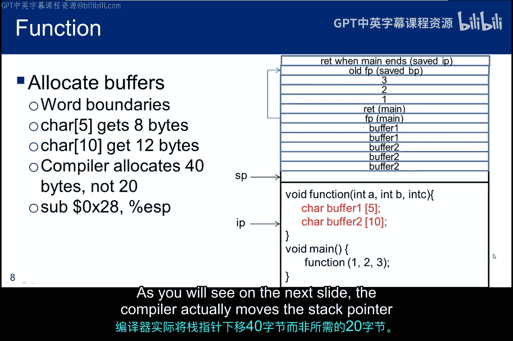
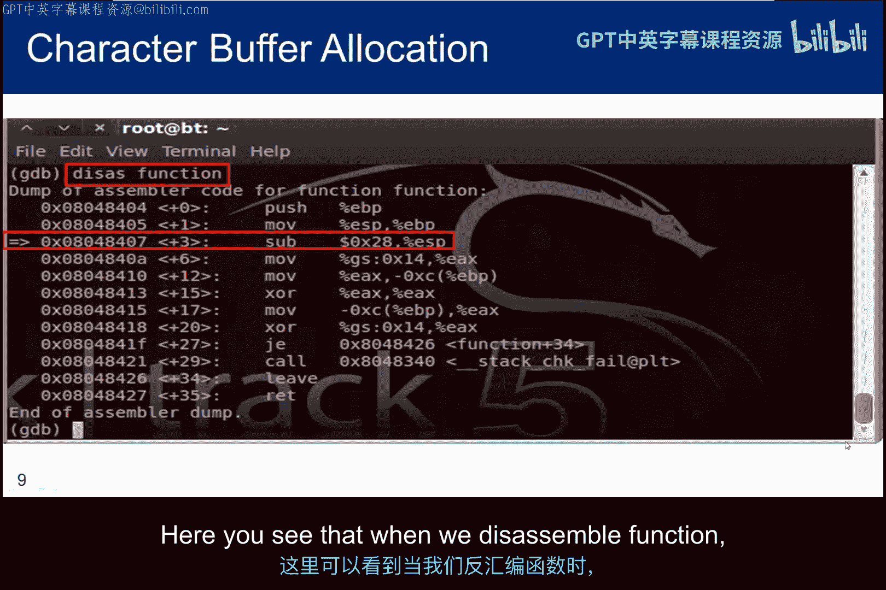
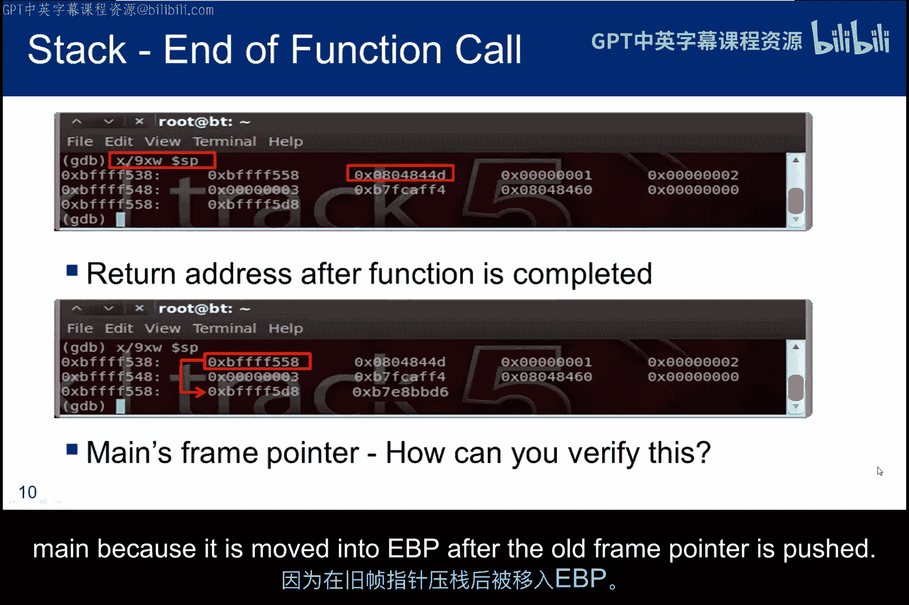
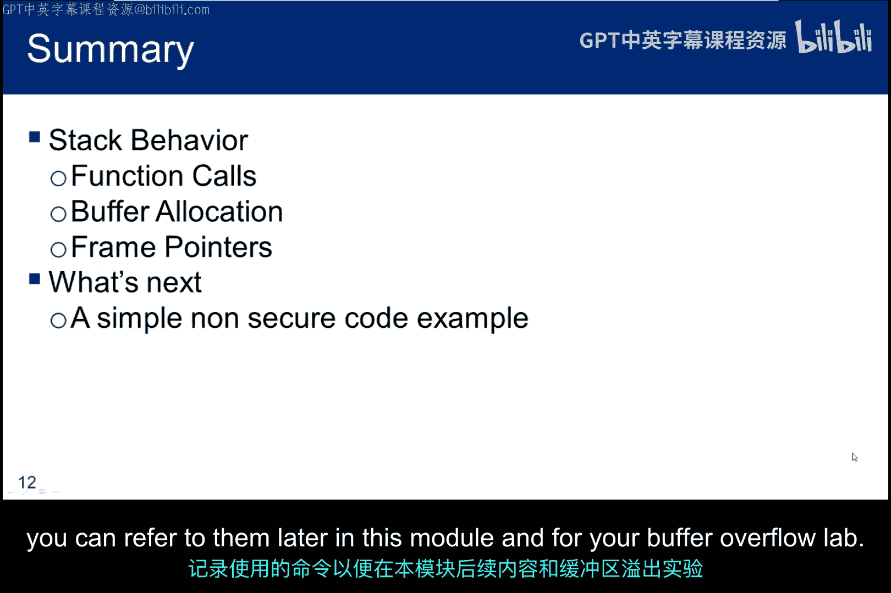

# 约翰霍普金斯大学《道德黑客入门｜Introduction to Ethical Hacking》中英字幕 p70 16_堆栈行为分析.zh_en -BV1xgu1z1Eau_p70-

In this submod， we will look at a simple function to see how the frames are built up and torn down when a function is called。

Specifically， we will see how parameters are passed on the stack when we make a function call。

 how the frame pointer is managed and how memory is allocated for local variables， including buffers。

 This is a simple C program that calls a function and passes at three parameters，1，2 and 3。

 When the function is called， it allocates two character buffers and returns to main。

I will call this program stack dot C throughout the sub module at the bottom is the syntax for compiling it using the new C compiler。

 The compiler provides over 100 switches， but we will keep it as simple as possible since we don't want to turn this into a programming class。

 There is one switch that we will use going forward。

Tack G produces debugging information in the operating systems native format to include symbol tables。

 The new debugger GB can work with this debugging information。 T G G D B is similar。

 but uses a more expressive format that will include G extensions。

 Most of our examples are pretty simple， So it shouldn't matter which you use。

 This slide shows the format I will use for much of this submodule。

 The bottom right shows the source code with the current instruction highlighted in red。

The top right shows the contents of the stack after the instruction executes。

 and the text on the left is commentary regarding what happens when the instruction executes。

When we type stack at the command line to execute stack do C。

 the O S's command line interface processes the command and starts execution。 So technically。

 the O S calls main， and the top of the stack gets the return address for the follow on instruction in the command line interface when main ends When main begins execution。

 the first thing it does， is push the current base pointer onto the stack。

 which is equivalent to saving the old frame pointer， since it was pushed under the stack。

 the stack pointer now points to the old frame pointer。

 So we move the stack pointer to the new EBP to create the new frame pointer here。

 I have started the new debugger on the executable name stack。 After the debugger starts。

 disassembling main shows the associated assembly code using AT and T syntax。 As noted earlier。

 the assembly code shows that the first instruction。

 a push says the old frame pointer on the stack and the second instruction。

Creates a new frame pointer at that location on the stack。 As highlighted in red。

 we move on to the second instruction in stack dot C。 First。

 the three function parameters get pushed on the stack in reverse order。

 Then the I P for the next instruction in the calling program， main， is pushed on the stack。

 In this case， the next instruction is a closed bracket， which will terminate main。Next。

 main's frame pointer is saved on the stack， and a new frame pointer is created for the function。

 The blue arrow just shows that what gets pushed is the address for main's frame pointer。

 This slide shows the functions parameters that will be pushed on the stack as literals。

 Notice that before pushing the parameters， The compiler allocates 16 B of stacks space， not 12。

It does this by moving a stack pointer down 16 B。 So there are  four extra B at stack pointer plus 12。

 Keep this in mind as we go forward。 Sometimes the compiler allocates more memory than the program actually requests。

 complicates the by counting process when we want to know the precise location of an address on the stack。

 Also， notice the address of the instruction after the call。 the leave instruction。

 We will find this address on the stack when we dump memory for the stack on the next slide。

 The GB command。 we invoke here。 X slash 8 W X based dollar sign S P。

 which is shorthand for Ex the next8 words in hex format starting at the stack pointer。 First。

 the stack pointer is currently the top left memory location in the screen shot。And remember。

 the stack is building down。 So to see what is going on here and to compare it to the picture on the previous slide。

 let's start at the top of the stack， which is memory location， Hex， B， F F， F F 5，5。

 C at the bottom right of the screen shot。 This is the instruction to return to the C。

 L I Coing program when main ends moving down the stack。Hex B F F。

 F F 5 D8 is the old frame pointer also associated with the C I call to main。

 The next 8 bys on the stack are covered with red empty set sign in the graphic。

 This is because these aren't used。 The compiler has to align the stack pointer on a word boundary to avoid a segmentation fault on a single instruction。

 multiple data or SMM I D class of parallel computers。

 This is what the mysterious and instruction does。 There is a compiler switch that can be used to eliminate these unused bytes on this stack。

 which we will use later。 The switch is T M preferred dash stack D boundary equals 2。

 moving down the stack。 The compiler allocated 16 B。 And remember。

 the four by at the memory location，5，4 C aren't used and just contain whatever was left over in that memory location。

 Then we see the three function parameters that have been pushed on the stack。 After they are pushed。

 the stack pointer is at。5，4，0， the memory address of the first function parameter with value 1。

 moving up 4 bys on the stack。 We have parameter value 2 and moving up four more bytes。

 We have parameter value 3， Re to stack dot C， the function call has been made。

 and the first and only task the function has to perform is to allocate the character buffers。

 The memory allocation has to be done on word boundaries。 Therefore。

 the five character buffer gets two words allocated or 8 bys。

 and the 10 character buffer gets3 words allocated or 12 bys。 As you will see on the next slide。

 the compiler actually moves the stack pointer down 40 Bs， rather than the 20 required。

 Here you see that when we disassemble function， the stack pointer is moved down X 28 or 40 B。

 So the program asks for 15 Bs。 The word boundary constraint increases that to 20 Bs。

 but the compiler allocates 40 Bs。 This slide shows an examination of a few words on the stack at the end of function。

 just before the frame。

Poiner is popped off the stack。 And before the return to Maine。

 we are able to do this by setting a break point in G。

 which stops execution at the instruction of our choice。 We see that the next instruction in Ma。

 which we return to after the call， will be 8，0，4，8，4，4D。

 which matches the address of the leave instruction， as shown on slide 7， which is what we expect。

 The frame pointer has the value Hex， B， F， F， F F 5，5，8， But how do we know that is， in fact。

 main's frame pointer。Here are a couple of ways to verify that。 If you look at slide 7。

 you can see the entry point into function is Hex 0，8，0，4，8，4，0，4。

 GB will allow us to set a break point there。 So the code will stop executing。

 and we can look at the register values。 load main into GB and enter break star Hex 0，80，4，84，0，4。

 Next， we start main running by typing run。Main will run， call function。

 and then halt and instruction Hex 0，8，0，4，8，4，0，4。 Once halted， we can type info registers。

 and G DB will print out all the register values。 recall that main's frame pointer is still in E BP。

 since no instructions have been executed by function， and the value of the register E BP is。

 in fact， Hex B F F F F 5，5， a。 We can see it is the frame pointer another way by looking at slide 8。

 That slide shows the C I's frame pointer was pushed when the stack pointer was at Hex B F F F F 55。

8。 So that address becomes the new frame pointer for main because it is moved into E B P after the old frame pointer is pushed。

 Since we have seen both leave and return instructions in the assembly code。

 I thought I should clarify the difference， Since we often see both instructions together shown are a couple of representations for leave and return。

 Both of which may be。

At the end of a function to return to the calling routine。They aren't the same。

 So it's important to understand the difference。 Leave empties the frame for the called function and restores the calling functions frame pointer。

Return actually takes the entry off the stack as the next instruction to be executed。

 So when the two are used together， leave prepares the stack for the return and return actually modifies the instruction pointer to get back to the calling process。

 We started with a simple C program compiled it and disassembled it in the new debugger。

 in the disassembled code we observed how function parameters were passed on the stack。

 how characters were allocated and how frame pointers are managed as subroutines are called。

 We also confirmed the value of a frame pointer by setting a break point。

 letting the program execute up to that break point and looking at some register values。

 If you had trouble with the assembly our G commands。

 Look at the references provided in the first submodule。

 You should also try this yourself in your ethical hacking environment to get some experience with a text editor。

 Gcc and G。 If you are unfamiliar with G。 Keep some notes on the command you used so you can refer to them later in this module and for。

Your buffer overflow land。