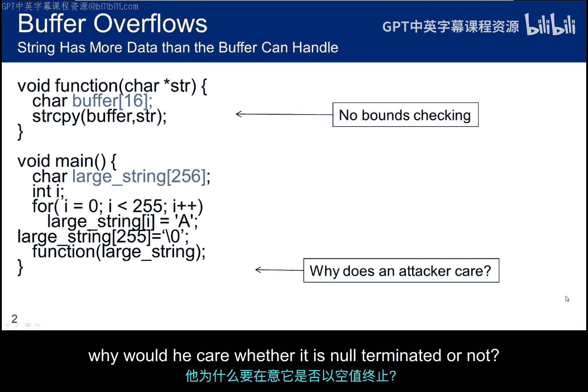
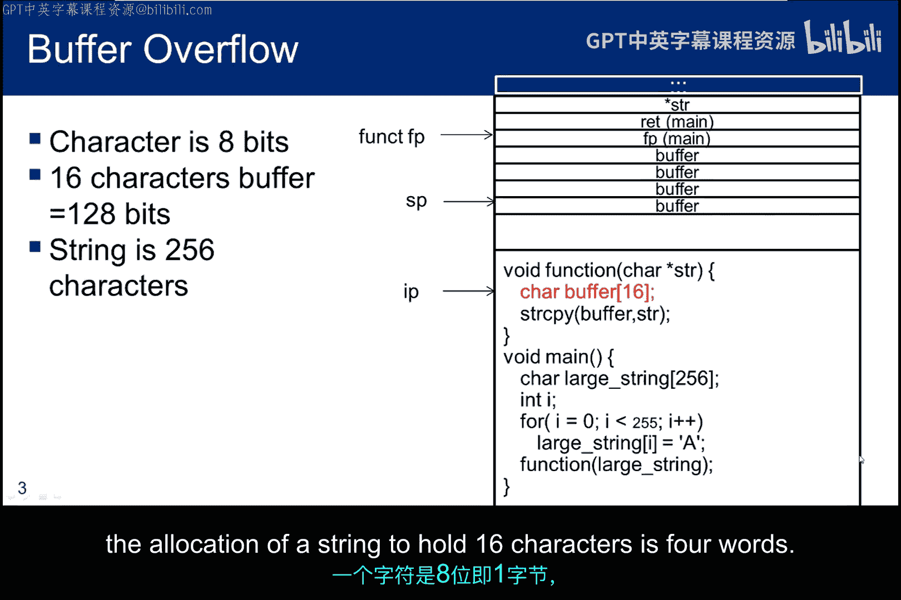
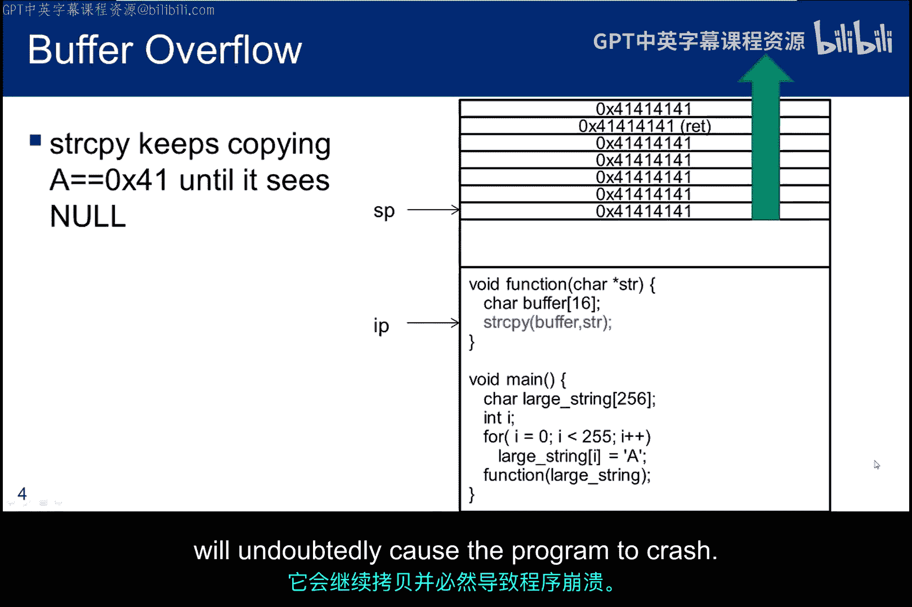
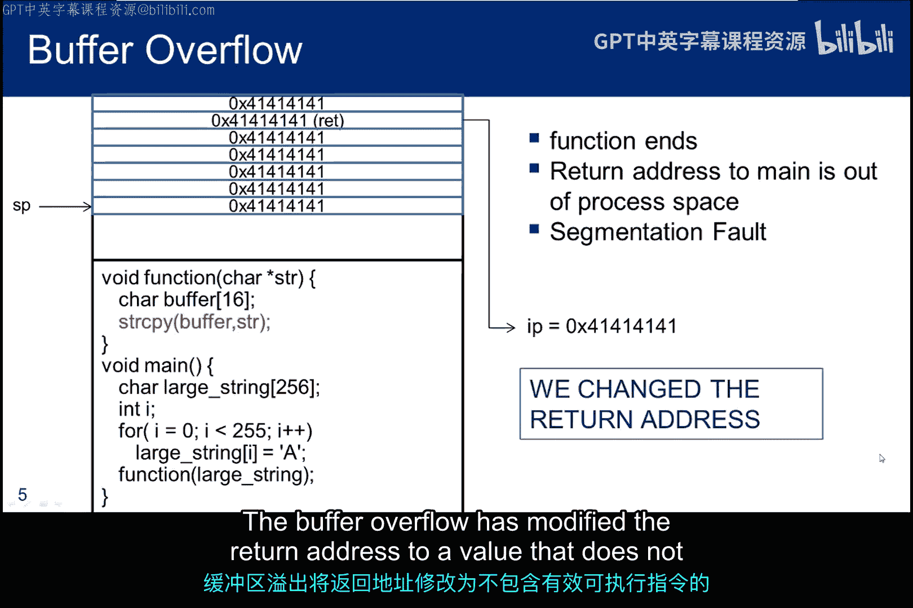
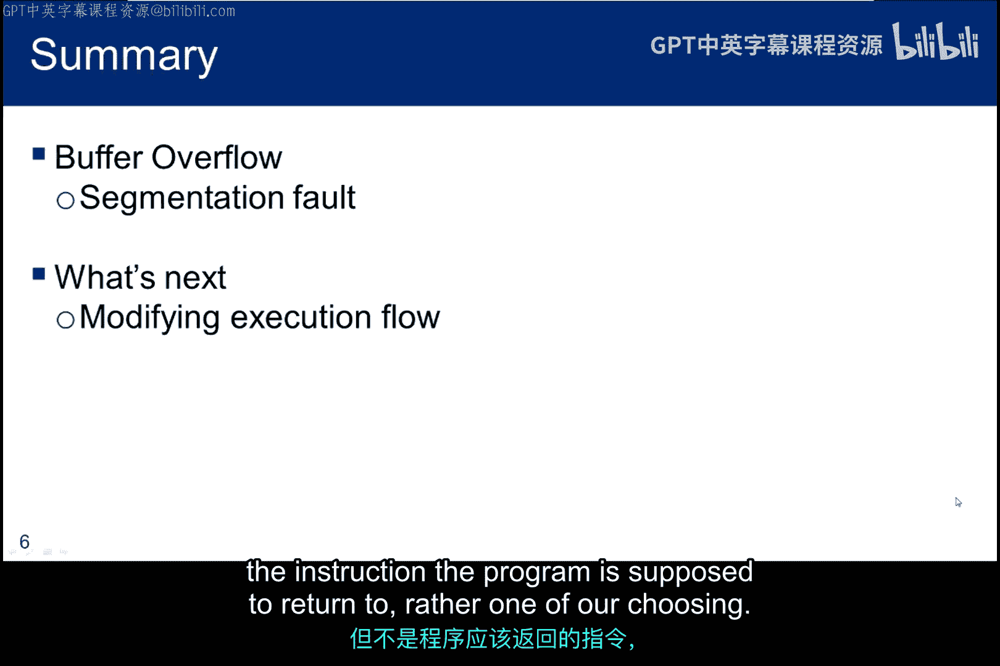

# 约翰霍普金斯大学《道德黑客入门｜Introduction to Ethical Hacking》中英字幕 p71 17_段错误诊断.zh_en -BV1xgu1z1Eau_p71-

This subm will be based on another simple C program that has a programming flaw that will allow us to overflow a buffer and create a segmentation fold。

 This will be a stepping stone to understanding programme flow modification in the next subm。

 This is a simple C program for this subm。 You can see that mainine has a 256 character string。

 which gets filled with the asked D character for capital A。And then is terminated with a null。

 like all strings in C。 Then the function is called。 The string is passed to it。

 and the function copies the 256 character string into a 16 character buffer。

 This simulates a buffer overflow and we can examine what happens on the stack into the executing programme main。

 First， though， think about the null terminated string If an attacker were injecting this long string。

 Why would he care whether it is null terminated or not。

 This is a status of the stack after main has executed and called function。

 A character is 8 bits or a B。 So the allocation of a string to hold 16 characters is four words。

In this slide， the string copy has started putting a 256 character string into a 16 character buffer。

 What you see is that when it gets to the end of the buffer， string copy keeps going。

 and it will keep going until it hits that null， signaling the end of the string。

 It continues copying capital A's into the stack and begins to overwrite elements of the stack that are important and shouldn't change。

 It overwrites a lot of stuff on the stack and beyond。 But in particular。

 it overwrites the return address to be used when main ends。

This gives you the answer to the question asked two slides ago。

 If the string copy doesn't see a null termination。

 it just keeps copying and will undoubtedly cause the program to crash。

 We don't usually want to crash the target。 We want to exploit it。

After the string is copied， the function ans and main ans and the program attempts to return to the address that was pushed onto the stack when the C L I called Main。

 However， that return address has been overwritten and corrupted。

 and the program attempts to return to an instruction at Hex 4141，41，41， which is an illegal address。

 So the O S throws a segmentation fault。The buffer overflow has modified the return address to a value that does not contain a valid。

 executable instruction In this sub module， we looked at a simple C programme with a buffer too small to hold a string of characters that is passed to it。

 As a result， part of the stacks overwritten， including the return address for the next instruction to be executed when main ends。

When main ends and the O S tries to return to that instruction， it finds it to be an illegal address。

 and the programme halt with a segmentation fault。 In the next sub module。

 we will leverage this overflow idea to modify execution flow rather than create a Seg fault。

The address returned to will be a legal executable instruction。

 but not the instruction the programme is supposed to return to。 rather， one of our choosing。

