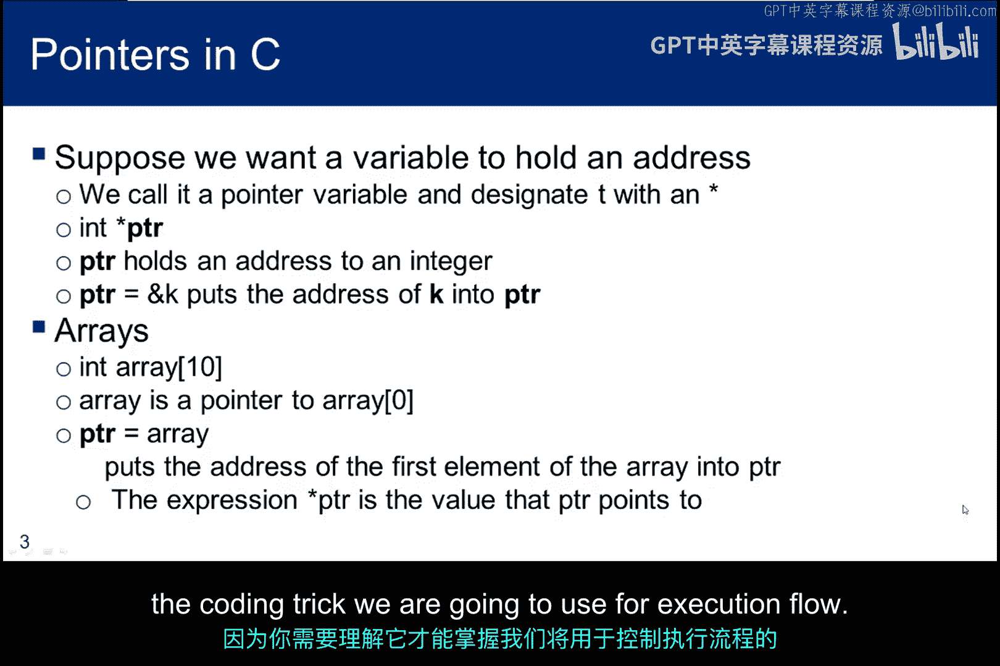
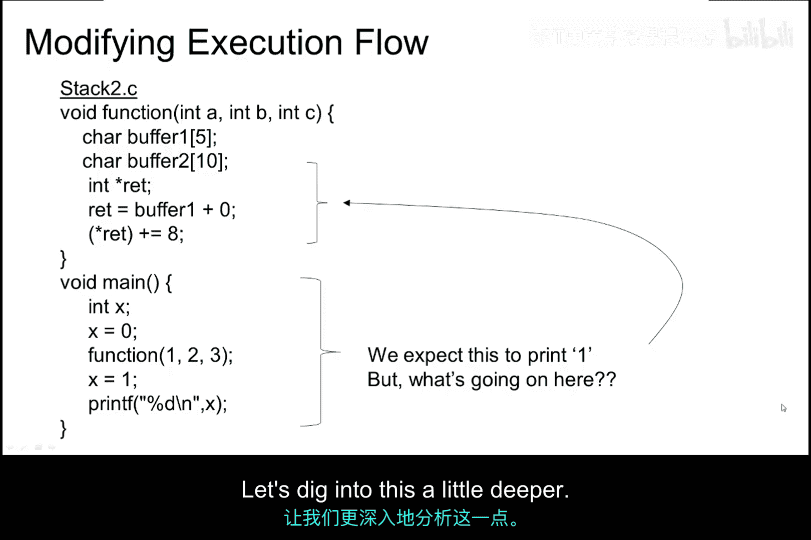
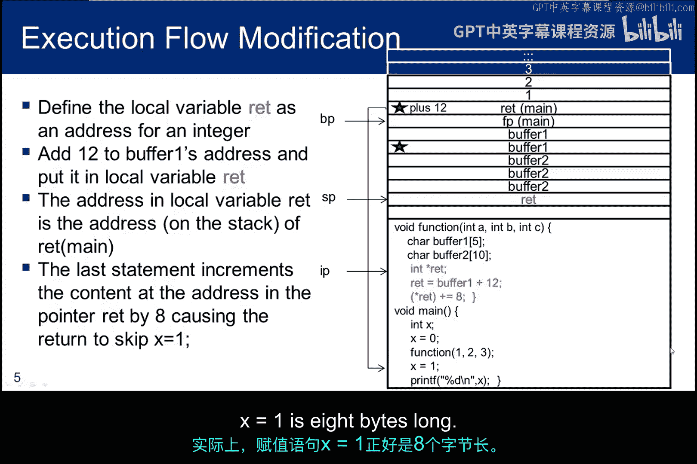
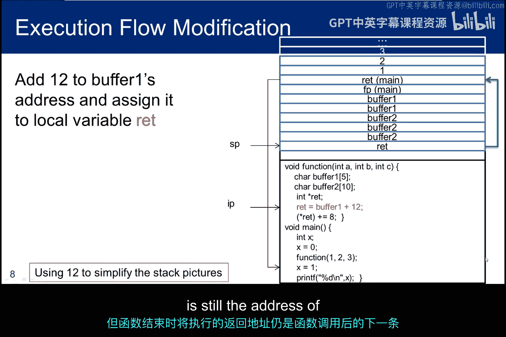
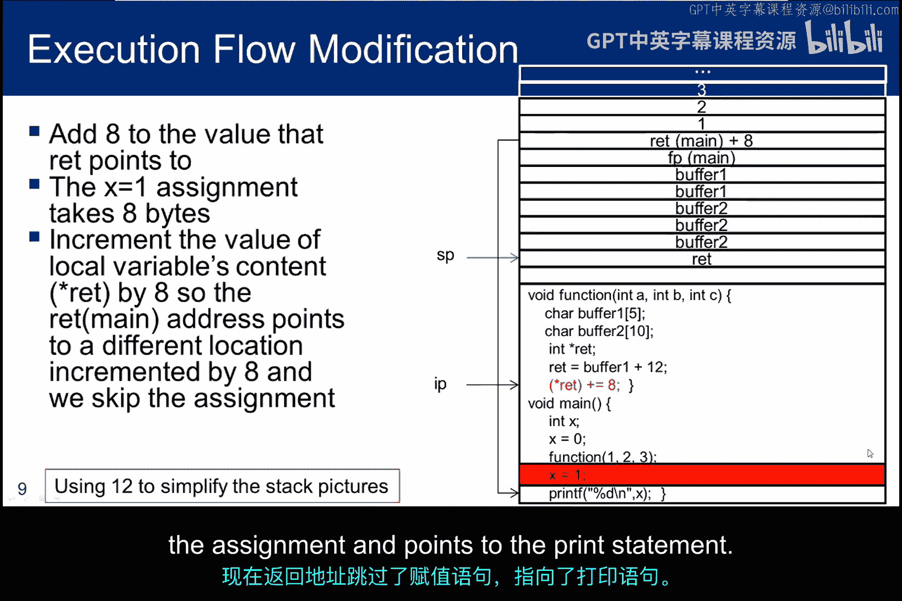
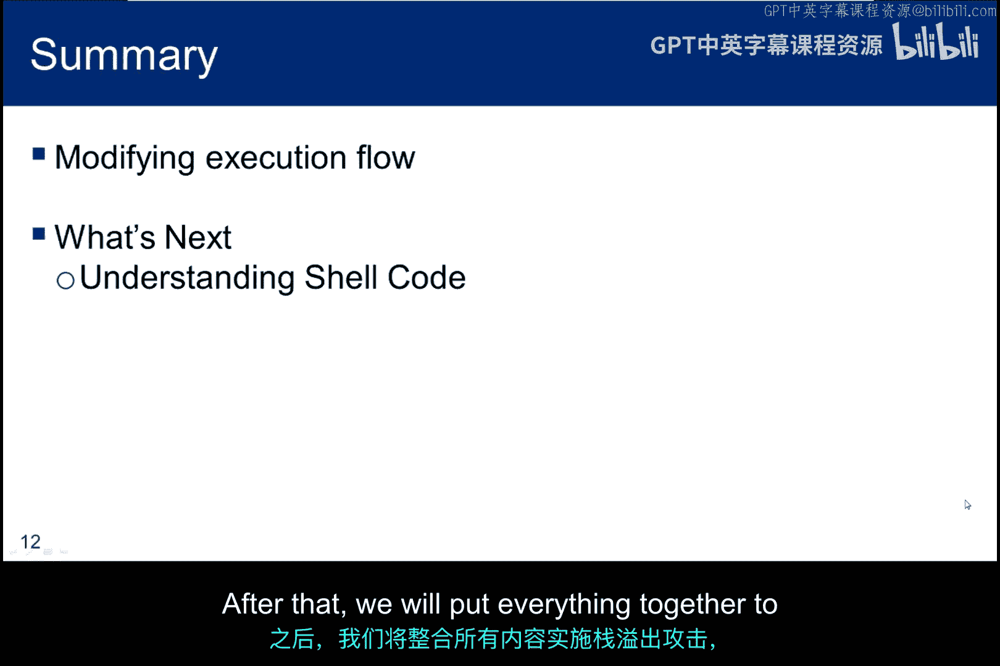

# 约翰霍普金斯大学《道德黑客入门｜Introduction to Ethical Hacking》中英字幕 p72 18_执行流篡改技术.zh_en -BV1xgu1z1Eau_p72-

In this submod， we overflow a buffer and control execution flow rather than create a Seg fault。

 The address returned to will be a legal executable instruction， but not the instruction。

 the program is supposed to return to。 rather one of our choosing。 Eventually。

 the idea will be to return to the first instruction of some shell code that we have created and passed to the target via the buffer before diving into how to change program flow with a buffer overflow We need to discuss pointers in C for those of you who haven't had a C programming class。

This slide shows two little snippets of C code。 The first one with two lines of code and the second one with4。

 In the first snippet， we have a variable K that has two values associated with it。

 The first is the value of the integer that is stored there。 In this case， the integer value is 2。

 The second value is the memory location。 where the value is stored。 In other words。

 the address of K。So the value2 is stored in the address of k。

The second snippet extends the first with the addition of a second variable and an assignment statement。

 The last instruction。 in this code， as with K， J has two interpretations in line 3。

 J is interpreted as the address of the variable J。

 and the compiler creates code to copy the value 7 to that address。

 in the assignment statement of line 4， J is interpreted differently。 It is now the integer value。

 The value stored at the memory location set aside for J。 In this case，7。

 So the7 is copied to the address for K。 So a rule of thumb is that on the left side of the assignment statement。

 we are talking about an address of a variable。 and on the right side of the assignment statement。

 we are talking about the value of the variable。 That was pretty simple。

 variables have addresses and values。 and how a variable is interpreted may change。

 but the interpretation is generally intuitive。 Now， suppose。

We want a variable to hold an address rather than an integer value。

Such a variable is called a pointer And we designate it as being a pointer by using the asterisk symbol。

 In the first line， we have a variable declaration where P R is the name of our variable。

 just as K was the name of our integer variable。 However。

 the asterisk informs the compiler that we want a pointer variable。

 An int indicates it will point to an integer。 So the compiler should set aside however many bytes are required to store an address of an integer in memory。

 which will be architecture dependent。 So from the first declaration。

 we know P R holds an address for an integer variable。Now that we know that。

 how can we manipulate such a pointer in the assignment statement。

 the Ampersan denotes the address of the variable K。

So this statement just says to put the address of K， which holds an integer into PTR。

 so PTR now contains the address of K and is said to point to the integer variable K。

If we examine that address， we find whatever integer value is stored in K。 For example。

 in the previous slide， we gave it a value of  two。 So pointers aren't really complicated either。

 Next， we extend the idea to an array。 Suppose we have 10 integer values。

 and we store those 10 values in the array named array。 So array 0 will have the first value。

 Ar 1 will have the second value。And array 9 will have the last value。

 If we just use the name array without any subscripts， it is treated as an integer pointer。

 It contains the address of the first element of the array。 In other words， it points to array 0。

So in the last assignment， we are assigning the address of the first element of the array to the pointer variable PR。

 The last bullet makes the point that from a syntax perspective。

 P R is the pointer and star P R is the value pointed to。

 This is all we need to understand about pointers in C to proceed。 But as you can see。

 it really isn't as complicated as some people suggest， However。

 if you've never learned the concept before， it probably is worth while reviewing these two slides one more time as you will need to understand it to grasp the coding trick we are going to use for execution flow。

 Here is a program called Sta 2 dot C that extends the program we studied earlier。

 when learning about stack behavior。

In main， the additions to the code are that we assign the value 0 to an integer variable X。

 call the function。 And when the function returns， we change the value of x to be one and printed out。

 We would expect the value of one to be printed out。 However。

 what is actually printed out is the value 0。 So what is going on in the function where we see the pointer notation。

 What causes the value to be something other than expected。

 It turns out that those three new lines of code in the function are modifying the execution flow。

 so that the assignment statement in main x equals one is ski。 Let's dig into this a little deeper。

This picture of the stack shows main has called the function。

 and the stack contains all the same information we learned about earlier。

As part of the calling prologue， the O has pushed the parameters 1，2， and 3。

Pushed the return address and the frame pointer and allocated buffer space exactly as discussed earlier。

Now， we want to delve into what the three new lines of code are doing。

 These are the lines highlighted in red。 First， we declare variable R A T to be a pointer to an integer。

 and that variable is local to function。 So it gets allocated on the stack。 Next。

 we want to assign an address to that variable。 we start with the address of the first element of the array buffer 1 and add 12 to it before making the assignment。

 The lower star in the stack picture shows the address of buffer one of 0。

 Since a 32 B architecture uses 4 by words。 The addition of 12 to the address moves us up 3 entries on the stack to the upper star。

So now the pointer variable R E T contains the address of the return address for main。

 Since variable R E T was an integer pointer， the return address of main is now treated as an integer。

 and we can increment it by the value 8。 summarizing first。

 we incremented the address in the pointer variable R T， Then once we had that address。

 we incremented the value at that location。 This means we have changed the value on the stack for the return address。

 So instead of returning to the statement after the call in main， it skips ahead 8 bys。 And in fact。

 the assignment statement X equals1 is 8 by its long。 So when the function returns。

 it skips over the second assignment statement。 In this picture。

 I have compiled stack 2 dot C and disassembled function。

 What you will see is the compiler doesn't work exactly as described in the theory on the previous slide to see what is going on here。

 I the code with。

TheSt with yellow brackets that represents a stat canary， which we will discuss later。

 It is not pertinent to this discussion。 As we have learned previously。

 the first two lines just save the old frame pointer and create a new frame pointer for function。

 What we see on line 7 is that the compiler has located buffer 1。 In relative terms。

 Hex 21 or 33 bys down from the base pointer。 So adding 12 bys was not enough to get us back to the return instruction。

 and the program printed out one。 How do we need to change the program。 As you can see in line 8。

 I had to add Hex 25 or 37 Bs。 The first 33 Bs got me back to the frame pointer。

 And then I needed to add  four more bys to get to the return address for main。

 Your instance of Cali may work like mine， or it may work differently。

 Your first homework assignment is to compile Stat 2 dot C in your environment and determine what you need to add to R E T to get the program to print。

0The next four slides step through how the stack changes in pictures。 First。

 when the local variable R E T and function is declared as an inger pointer。

 space gets allocated on the stack。We can't really see how the contents of the variable R E T changes when we make this assignment。

 For one thing， we don't know the value when memory is allocated。

 but after the instruction is executed， the blue arrow on the right shows that R E T points to the return address for main。

 At this point， only the value of the variable R E T has been assigned。

 but the return address that will be executed when the function ends is still the address of the next instruction after the function call。

 the return address was initially the instruction after the function call。

 The assignment of one to X。 after the instruction in red is executed。

 the integer value of the return address is incremented by 8。

 Since the assignment instruction x equals 1 is 8 bys long， Now。

 the return address skips over the assignment and points to the print statement。

 The print statement is executed printing a 0。 Main ends and the procedure epilogue clears a stack and。

Returns to the calling routine。 In this case， the C I。

 Our goal is to leverage this idea of modifying program flow。 However。

 instead of just skipping over an instruction， we want to jump to some special code that we have stored in the buffer within the program when this code begins to execute。

 it will spawn a shell and allow us to execute commands。 So we have two tasks。 One。

 get the shell code into the program and two modify the program flow to return to the shell code instead of the expected return address。

 I have provided a simple example of modifying execution flow。

 and you will experiment with it in your own ethical hacking environment as part of the homework for this module。

 The next submodule will provide an introduction to shell code。

 and we will write some shell code as the first step in implementing the exploit。 After that。

 we will put everything together to smash the stack and get the shell code to execute。

