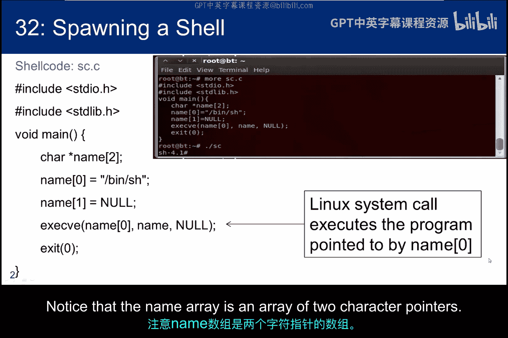
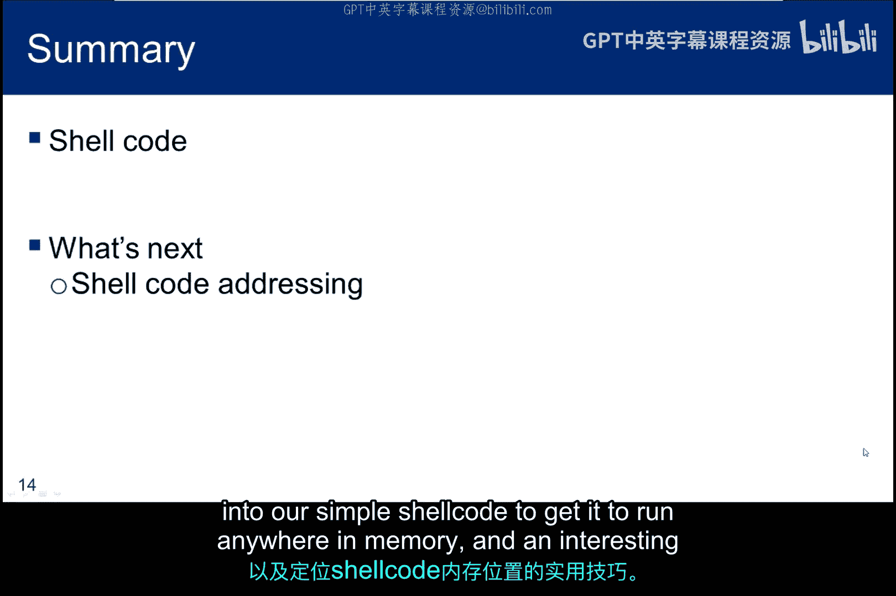

# 约翰霍普金斯大学《道德黑客入门｜Introduction to Ethical Hacking》中英字幕 p73 19_Shellcode原理剖析.zh_en -BV1xgu1z1Eau_p73-

Shell code is the code that will give us command line access to the target。

 If we could write a C program and run it， the task would be easy。

 but we need slickt code that we can pass to the target through a small buffer。

 Our goal in this submodule is to figure out how to do that。

 We start off with a C program called S C dot C that will use a system call。

 E Xve E to execute s bin s S H， which will create a standard Linux shell。

 If you compile this and execute it， You will get a shell， as shown in the screenshot。

 Notice that the name array is an array of two character pointers。

 Here is a much simpler example of E X EV E， but it is an ineleganant approach to calling it and may not always work。

 I have tried it as part of this module and had inconsistent results， especially in a 64 B VM。

 There are many examples on the web that argue this approach is fine。

 but it may result in a crash and is not necessarily。

consistentistent or repeatable。 I recommend the more methodical approach of putting the program information into an array。

 Next， a few words about command line arguments in C。

 The name of the variable Arg C stands for argument count。

 Arg C contains the number of arguments passed to the program。 The name of the variable。

 Arg V stands for argument vector。 A vector is a one dimensional array and Arg V is a one dimensional array of strings。

 Each string is one of the arguments that is passed to the program。

 EVP is a one dimensional array of string pointers that is passed third and contains environment information。

 For example， the command line， Gcc T O， My probe， My probe dot C。

 would result in the following values internal to Gcc。 Arg C would be 4。 Arg v sub 0 would be Gcc。

 Arg v sub 1 would be T O。 Arg v sub 2 would be my probe。In Arg V sub 3 would be my probe do C。

 Here is the syntax for the system call E X E V E。 Of course， there are many system calls。

 This is just one that can be used to execute a program。 The call involves three parameters。

 The first is a character pointer to the file name that is to be executed。

 The second is a character pointer to any arguments that were passed on the S C dot C command line to be used by the program executed by E X E E。

 The third is a character pointer to the program environment array。

 Standard environment variables provide information about the user's home directory terminal type。

 current locale and so on to explore the shell code in more detail。

 enter S C dot C into a text editor compile it and disassemble it。

 If the debugger has not been installed， you will need it。 Now。

 We will examine both main and the system call。 The disassembly using GB will generate A T and T syntax。

 Ref to the X 86。Architecture submual。 if you need to refresh your memory。

 These three slides show the disassembly for the C program that generates a shell。

 It is complex and messy and may give you a headache。

 but we just want to extract enough information to be able to create our own shell code。

 So be patient and work your way through the code。 the code starts out as usual。

 it manages the frame aligns to stack pointer boundary and moves the stack pointer down for the character array name and then some to simplify the picture。

 I show no alignment bys。 In other words， we will assume that the last 4 bits or 0，0，0，0。

 The literal in the fifth line is the address of the string s bin S H。

 which gets put onto the stack where the pointer name 0 has been allocated。

 Then a long null gets put onto the stack where the pointer name of one has been allocated。

 Once we have values inserted into the stack for the character pointer array name。

 The compiler starts to manipulate the extra stack。At the bottom of the stack。 first。

 it inserts a long null two instructions add the address of the array name to the stack location below the null。

 Then the address of slash bin slash S H is loaded below that。

 Then we make the system call and the return to main when E X E E Ns As an aside。

 according to the E X E CV E function definition。 stack pointer plus H should be the address of null。

 not the literal。 This is so because the third argument is also a pointer。

 This appears to be sloppy programming in the compiler。

 but apparently works O since it is null and doesn't contain environment info。 Also， at this point。

 EA X has the address of slash bin slash S H。 and E D X has the address of the name array。

 E X E CV E moves address is into registers for the system call X B。

 the function parameter gets put into EA X。 the address of the program string to execute goes into E B。

The address of the name array goes into ECX， a null goes into EDX， and finally the interrupt occurs。

The disassembled instruction set for E X E C V E goes on from this point。

 but we will skip that as we don't care about it。 We have already figured out all the steps to get the shell code to execute。

 This slide provides a pictorial representation of what is necessary to get the shell program slash bin slash S H to execute。

 but it adds a little more structure regarding how we will locate the information in memory。

 That is the information that needs to be put into the registers before the interrupt occurs。

 The idea is that we will put the string slash bin slash S H into memory。

 Then relative to the start of the string。 We will follow it with the null character to terminate the string。

 The address of the string and a long null。 The arrows at the top show that all the addressing we will use is relative to slash bin slash S H。

 and the arrows at the bottom show what addresses have to be passed into the register。

Before the interrupt is called， note that the key to developing successful shell code is figuring out where slash bin s S H is located because we are going to address everything else relative to that。

 This is the same picture， but we are using the long null twice。

 one with a name array consisting of the element slash bin slash S H and nu。And once。

 as the environment variable null required in the E X's CV E call。

 this is actually how we will set up the string before calling interrupt 80。

 It is not clear to me why Allf1 took this shortcut。

 but in staying aligned with the smash in the stack paper， we will implement it the same way。

So we know the steps needed to execute a shell。 but as we develop our code。 in order to do testing。

 we will add some simple exit code to get a graceful termination when the call fails。

 a graceful exit consists of another system interrupt with the function parameter set to hex1 and the exit code set to0。

 putting these pieces together。 This slide summarizes what we have learned about executing a shell。

 We know what strings need to be in memory and what the contents of the registers needs to be before we call the interrupt。

 In this submodule， we have learned the basic instructions that will be necessary to get a shell started。

 and we made this determination from our examination of the disassembled version of C code that provides the same functionality going forward。

 we will be able to use this knowledge to generate the shell code that we will pass to the target via a buffer and we will overflow the buffer to get that shell code to execute。

 Next， we will discuss the relative addressing elements that must be inserted。

into our simple shell code to get it to run anywhere in memory and an interesting trick for figuring out where the shell code is located so we can get it to run。

