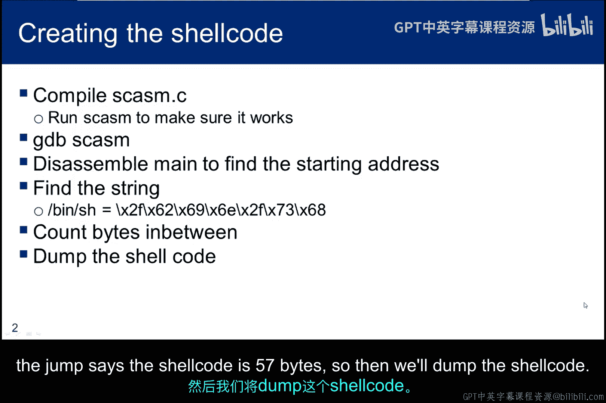
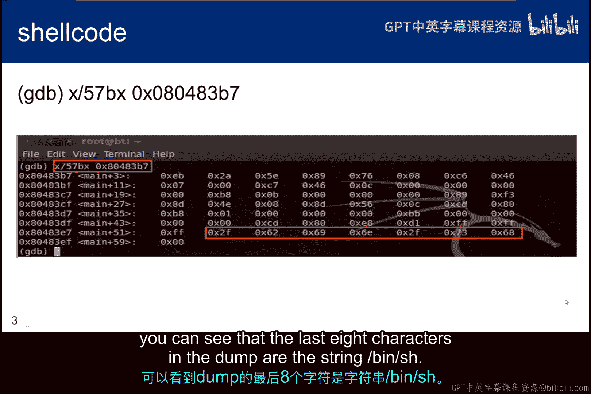
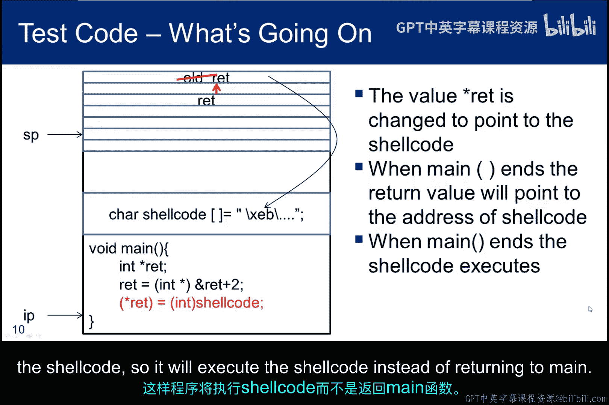
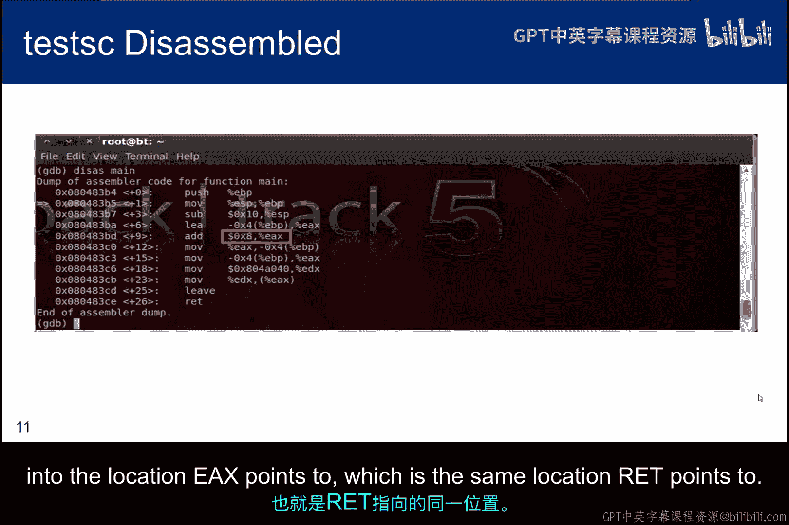
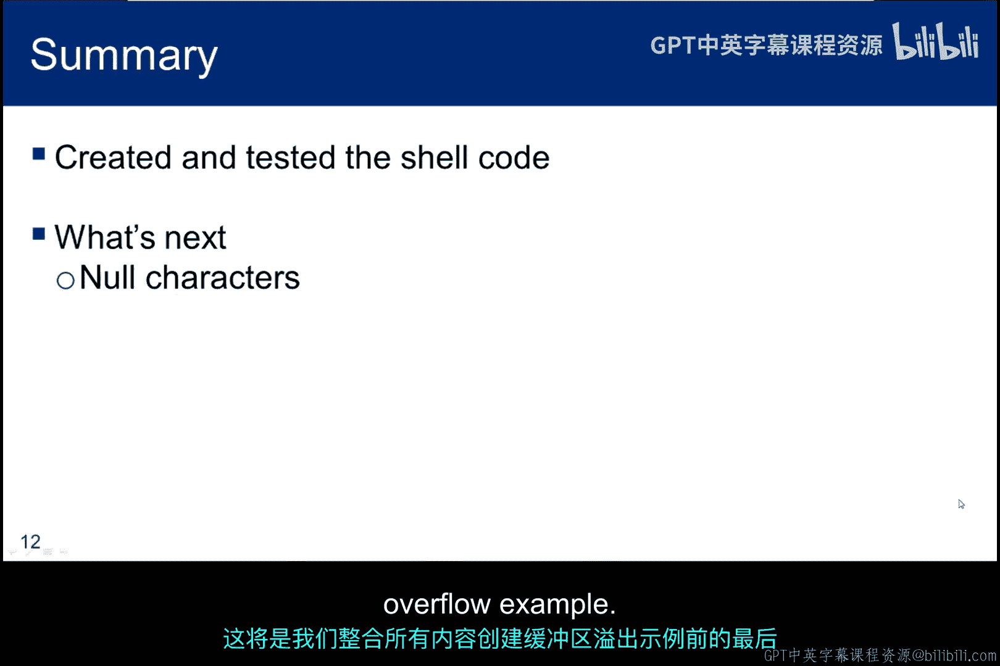

# 约翰霍普金斯大学《道德黑客入门｜Introduction to Ethical Hacking》中英字幕 p75 21_Shellcode构造方法.zh_en -BV1xgu1z1Eau_p75-

In this submodule， we are actually going to compile the shell code as an assembly routine and get it to execute。

 These are the steps to create the shell code。 First。

 you compile the inline assembly from the previous submodule。 I have been calling at S C A S M dot C。

 Next， start the debugger on the object code and disassemble main。

 Skip over the frame management instructions to the jump。

 and that will provide the first bys in our shell code to find the end of the shell code。

 We need to find the string。 The disassembler doesn't show it to us。 but we know the string is 7 B。

 so we can add 7 to the address of the next instruction after the call to get the end of the shell code。

 and one more by to get the null。 Calulate the difference between this address and the jump says the shell code is 57 Bs。

 So then we'll dump the shell code。 This debugger syntax says to display 57 Bs in Hex format。

Starting at address Hex 0，8，0，4，83B7， which is the address of the jump。

And if you look them up in the Hex ASI table， you can see that the last eight characters in the dump are the string slash bin slash S H here。

 I've taken those 57 Bs and formatted them as hex to initialize a character array called shell code for use in a C program。

 I will use this array in a piece of test code to demonstrate that it actually generates a shell。

 As I noted earlier， This is self modifying code because it is modifying its own string space。

 and operating systems don't allow this in the code segment。

 So we will put it on the stack instead of in the code segment to test it。

When we transfer control to it， we should get a shell。

 Here is the test code that gets the shell code to run by modifying the execution flow。

 using the same technique we learned about in the sub module on modifying execution flow。 First。

 we declare an integer pointer and then give it the address of its own location plus 2。

 which skips over the old frame pointer to the return address for when main ends。

 There is nothing on the stack but the frame pointer because no parameters are being passed。

If you have trouble seeing this， you should review the submodule on modifying execution flow。

 Once we have Maine's return address in R A T， we modify its value to point to the first element of the character array。

 So in main ends， the shell code will execute。 A final note。

 we will use this C pointer trick for testing。 but it will not play a role when we pass the shell code via a buffer。

 We use it here to make sure the shell code doesn't have a problem and really creates a shell。

 If we compile test dot C and run it on Cali， we will get a Seg fault。

 This is because the O S has data execution prevention depth turned on。

We will learn more about this later， but it is basically a mitigation technique that controls where code can execute。

 and it is prevented from executing on the stack。 So we will need to turn that off to test the shell code。

 We do that with a compiler switch。 Add tax exact stack to your compile line to get it to work。

 The second part of the buffer overflow lab will require you to create shell code that works in your environment。

 The next few slides just present a picture of what happens on the stack when the shell code executes。

 The shell code is put in string space。 and the first instruction executes。 Looking at the stack。

 The frame pointers are managed and the stack pointer is moved down Allocating stack space for the integer pointer R E T。

 The second instruction starts with the address on the stack of the local variable R E T and increments it by two。

 Since it is a pointer containing an address the。value that gets added in the assembly code is 8 to account for two4 byte addresses。

 After the instruction executes， the value in Rt is the address of main's return。

 The last instruction changes the value of the integer that R T points to。

 It assign it a value that is the same as the location of the first byte in the shell code。

 So it will execute the shell code instead of returning to main。 This is the disassembly of test S C。

 You can see here that the add instruction adds 8 instead of2。 Again。

 this is because R T is a pointer that contains an address。

 So incrementing the address by 2 means you have to add 8 bytes。

 The last instruction moves the address of the shell code now in E D X into the location E X points to。

 which is the same location R E T points to。 This module took the shell code written as inline assemblymb in the previous submodule and compiled it for。

Test the hex characters from the object code were dumped and loaded into a character array for testing。

 A simple test program was written using the C pointer gimmick to modify program flow。

 And when the test program was run， a new show was started。 Next， we will discuss null characters。

 These characters play a special role in buffer overflows。

 So special care must be taken with them to make sure everything works properly。

 That will be the last step before we put everything together to create a buffer overflow example。

