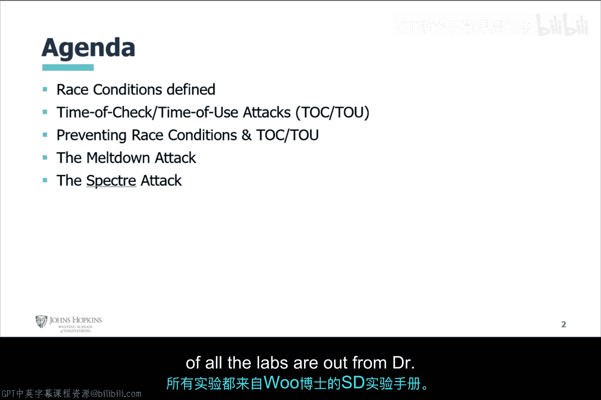
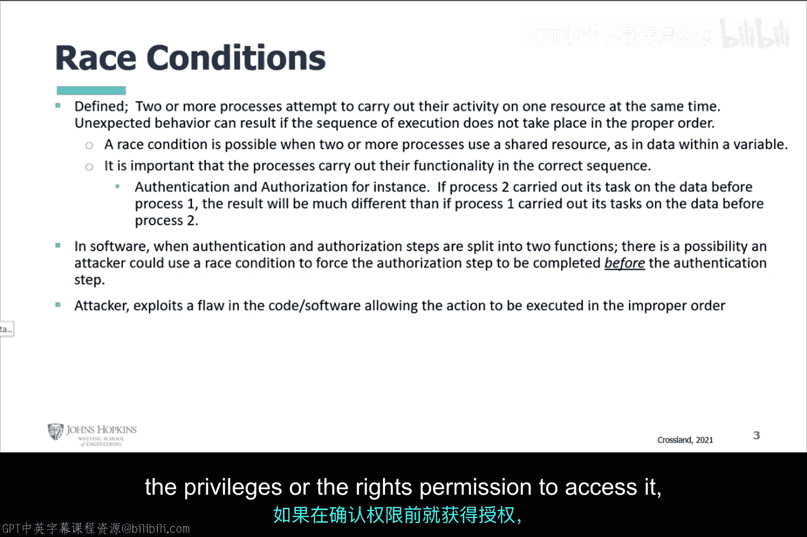
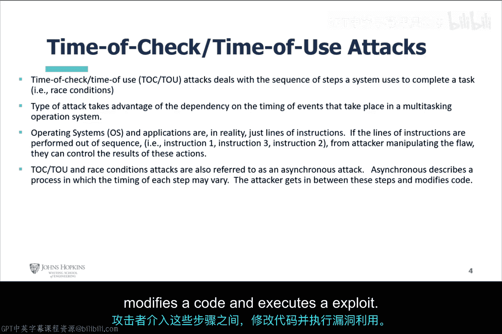
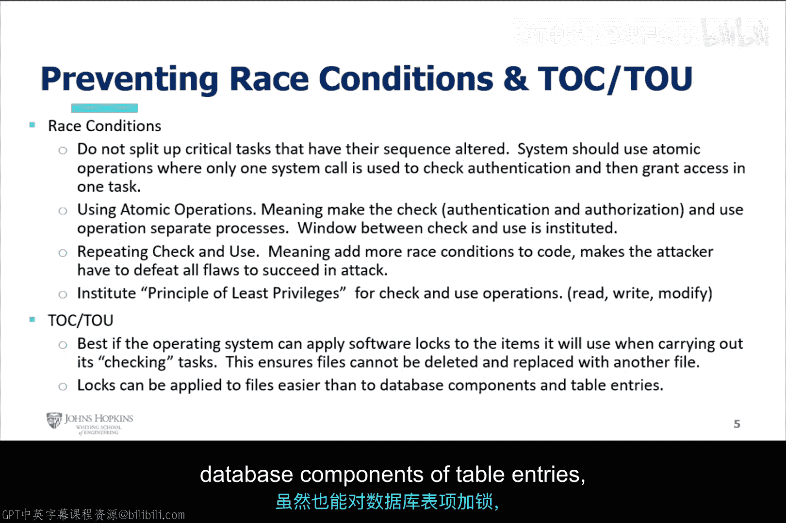
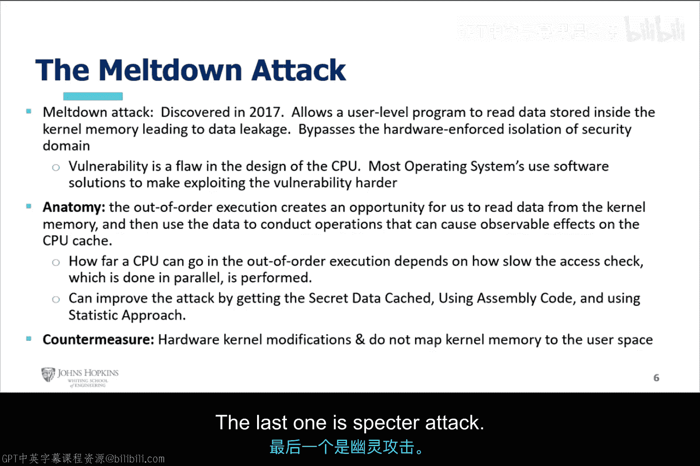
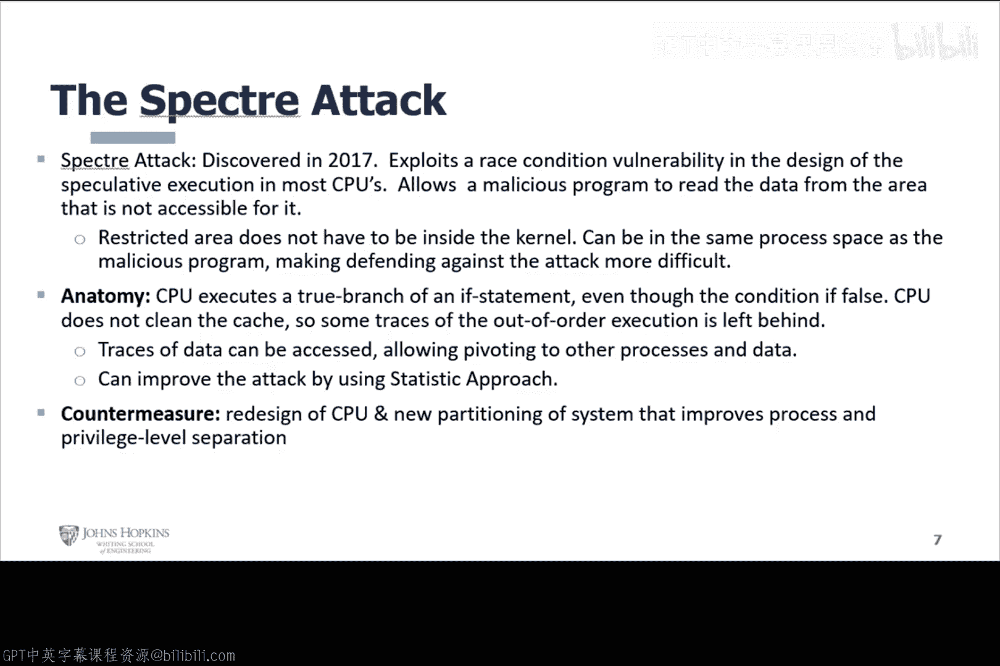

# 约翰霍普金斯大学《道德黑客入门｜Introduction to Ethical Hacking》中英字幕 p77 23_竞态条件基本原理.zh_en -BV1xgu1z1Eau_p77-

I just send me module 13， race conditions， video， be Pri two videos。

So what we're going to talk about is going to be。the raise conditions define time of check time of use。

Talk and Ta， preventing race conditions and preventing time of check time of use。

The meltdown attack and Spectrot and meltdown Spectro tax are both inside Dr。 W's book。

The computer in security book， one of the main books we're using to do the labs。

This course is one of the books also that was part of required reading that was very highly recommended to get。

That's being like I said use a majority of laps， all the laps are out from from seeds labs。

So risk conditions define two more processes attempting to carry out。

Or that processes attempt to carry out their activity on one resource at a time。Are at the same time。

 Ex me。 So two more processes attempt to carry out their activity on one resource at the same time。

 and that key at the same time。So unexpected behavior can result in the sequence of execution。

And does not take place in the proper order。 So usually you have unexpected behaviors cause not a sequence。

And the sequence of execution did not take place in the proper order。

 So a risk condition is possible into two or more processes used shared resource。

As in data within a variable。It's important that the processes carry out their functionality in the correct sequence。

 So authentication authorization， for example， or identification， authentication authorization。

Is a key example， and Clark Wilson， will we talk about security architectures and frameworks within that OA's security module。

better about biba。Bll plata and Clark Wilson， Sir Clark Wilson， authentication authorization。 So。

 for instance， if process 2， which is authorization。

 is carried out a task on a database for process 1 authentication。

 then that's going to be a much different response than process 1 being carried out a task on the database before process 2。

And so instance in software， when authentication and authorization steps are split into two functions。

So you can say check and use。There is a possibility of an attacker can use a race condition to force the authorization stop。

To be completed before the authentication stop。So attackers need to exploit a flaw on the code software allowing they actually be executed in the improper order。

So again， like think about going a bank or you log into a network， you log into a device。

 you access a share network chair or a folder or a drive。Those type of deals。

 if you have authorization before even know who's having any privileges or the。

The rights' permission to access it， then you have a problem。

So time of check time of use is another form of race conditions。

 and really what that does is kind of same sense in that tax deals with a sequence of steps in a system。

Use this to complete a task。So basically a Ta of attack takes advantage of the dependency on the timing of events that take place in a multitasking operating system。

So operating systems and applications are in reality lines of instructions， so just like code。

And are just selecting instructions of say read from top down left to right if lines of instructions are performed out of sequence。

 so you have instructions one through three or one through5 and you do  one，3，2 or you do 1，4，5，3，2。

Then they form from tacker manipulating the flaws how they would do that。

 They exploit their vulnerability。Then they can control the results of these actions。

So time and Jack， Tom of using race condition tax are also referred to as as synchronous。

Saness especially describes a process on which your timing of each step may vary。

So a attacker gets in between these steps and modifies a code and executes his exploit。

So preventing race conditions a talk or child， time of check time of use really is multiple ways of doing it about the main count few ways。

 but race conditions first off and do not split up critical tasks。That have their sequence altered。

 So systems should use atomic operations where only one system calls use to check authentication。

And then， grants access。In one task。So basically what's saying is atomic operations。

 the check and the use is that you have the say a check authentication， authorization use。

 you have operations， those operations of those processes separated。

And then you grant access in one task， so a window basically is your timeframe you won't call it between the check and the use and you institute a window or a period in between that check and use。

So that's what I was consider as atomic operations。

So you can repeat checks in use so you can add more race conditions codes。

Which is a little countertuitive。 But what its basically saying is you add more and more。

Hurdles are more and more obstacles where they have to defeat those race conditions or timema ch。

 timema use。And have to exploit busly all those flaws in order to succeed on their task or their objective。

And the last one is a principle of these privileges for race conditions。

And which basically is you basically for check and use operations and these privileges are something been for a very long time。

Just like escalation creeks same kind of deal， you're B allowing users and objects。

 subject object interactions to have your right modify。

 you only given permission that they're allowed to do their job and nothing beyond that so again establishing principle lease privileges。

And then time of check time use so best if the operating system can apply software locks。

To the items in it will use when carrying out its checking tasks。

This ensures that the files cannot not be deleted or replaced without another file。

 and locks can be applied to files easier than database components of table entries。

You can put a locks into database components do entries， but it's easier to do files。

The last few things I'll talk about is meltdown and spectras。

 So these are both the side that said Dr。 Woos。Computer Android security books。

 one of those books we've been doing the labs out of and kind of one of the main books I've been referencing in this entire course。

The Mel Den Spec both were discovered in 2017。And they are different kind of vulnerabilities related to how you can have race conditions or time track time use conditions or sequencequencs of events occurring out of order and proper sequencing。

So meltdown basically allows the user level program to readdo。

 store inside the kernel memory leading to data leakages。

So bypasses a hardware and force isolation of security domain is basically what it's doing。

 so bypasses a hardware and force isolation。So they give network segmentation price A。

Of security domain， so secured architecture domains。

 we kind of talked about those rings and OS security。

So the vulnerability is a flaw in the design of the CPU。

 so most operating systems use software solutions to make exploiting the vulnerability harder。

And that anatomy of it really is that out of order opera execution。

Or out of order operation execution creates an opportunity for us。

Or user to read data from the kernel。Memory， and then use the data to conduct operations a cause。

Observable effects on the cache on the CPU cache。So how far our CPU can get？

In the out of order execution depends on how slow the access check is performed。

Which is done in parallel the access and the check， so they give authorization， authentication。

So you can approve the attack and make the tag more efficient in terms of a red team perspective。

By getting the secret data cached using assembly code and using sta approach。Countermeasures。

Is hardware kernel modifications and do not map kernel member to use your space。

And the last one is Spectrot， so Spectro attack was also 2017。

For this one exploits a race condition with condition vulnerable in the design of the speculative execution of most CPUs。

Allows a malious program to read the data from the area that is not accessible for it。

So a restricted area does not have to be inside the kernel。 And again， the spectra and the meltdown。

 this is a difference where spectra。The restricted area does not have to be inside the colon。

Or melt down， the restricted area has to be inside the kernel。

Kay has to be inside of Corel for Meldown。pecttra a restricted does not have to be inside colonel。

 so if it can be in the same process space as the malicious programs or making defending against attack more difficult for spectra。

So if the Moes code program is inside the kernel， make in same area a process space。

 then it can be more difficult to defend against the spectrum because meltdownm。

 their shipter is not。A is。Does have to be inside the colonel。So。

Antomy CPU executes a true branch of an if statement， even though the condition is false。

 meaning it should not execute it， the such processing CPU then。

Does not clean the cash as it supposed to。And then you basically have some。

 so some traces of the out of order execution left behind。 so basically get some of the English cook。

 get some of the secrets， give some of the memory， some of the information needs。

And use that traces of data， remnants left behind can be accessed。

 allowing to pivot and to move other processes and data points。

Can approve the attack of the spectra by using statistics approach。

And both of these attacks inside Doctor。 Wz， I think chapter 13 and 14。

 so the counter measureasure for spectra is redesign of CPU and new partition of systems are using new partition of systems on improves process and privilege level of separation。

So this is the module is I'm sorry the video discussion for this week probably two different modules。

 so on this to be for module 13。I look forward to talking buddy during office hours。

