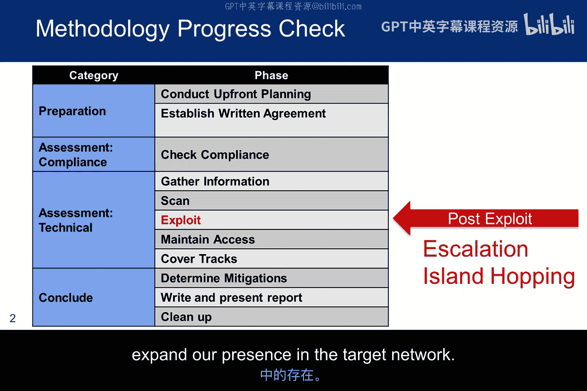
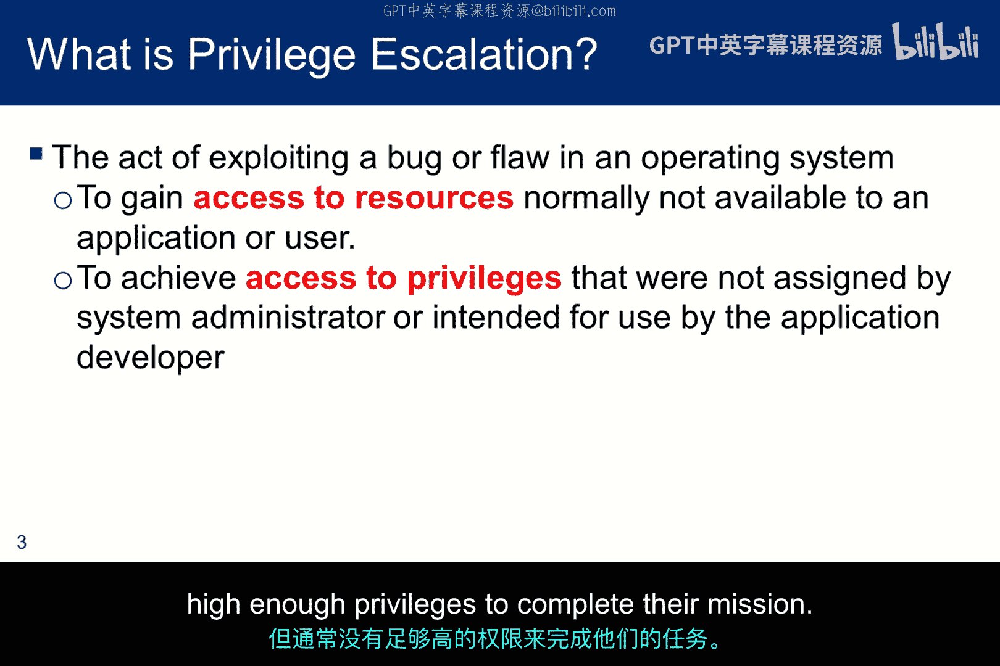
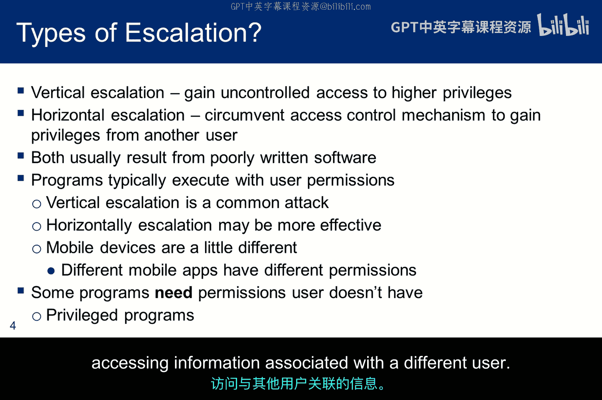
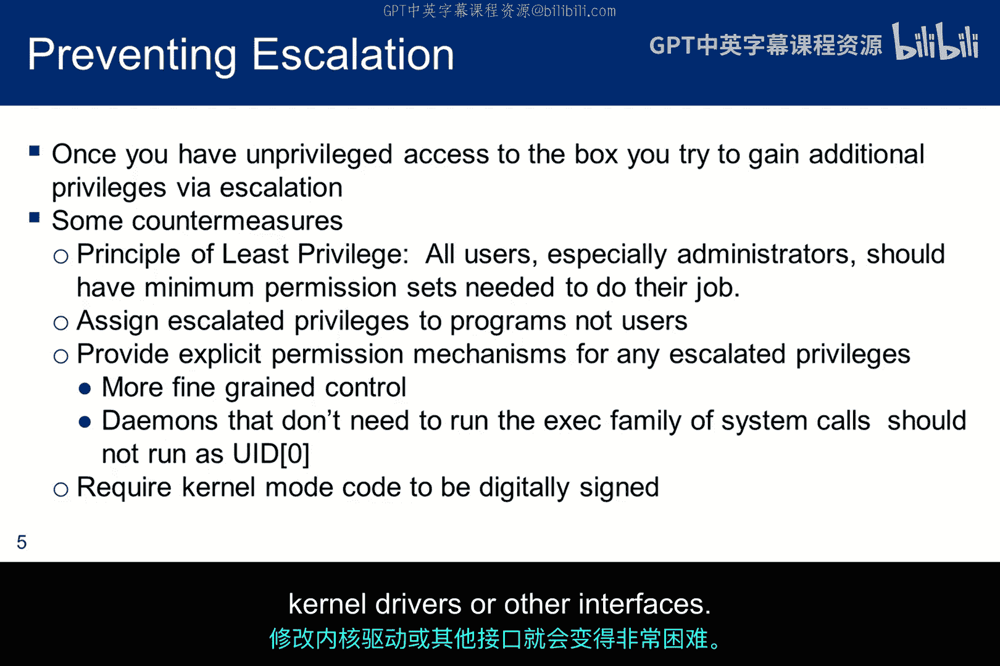
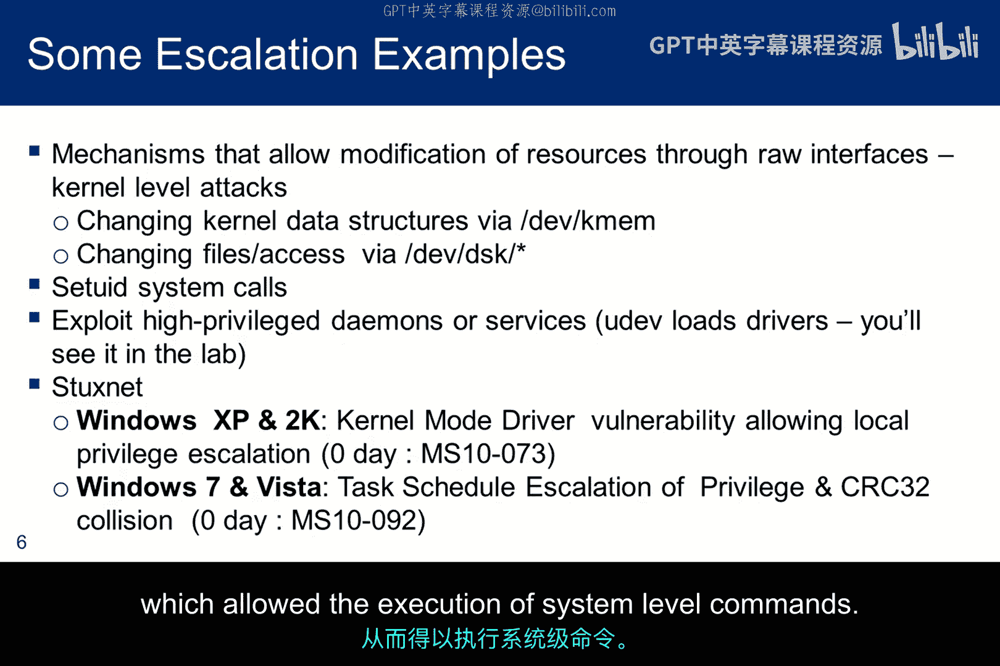
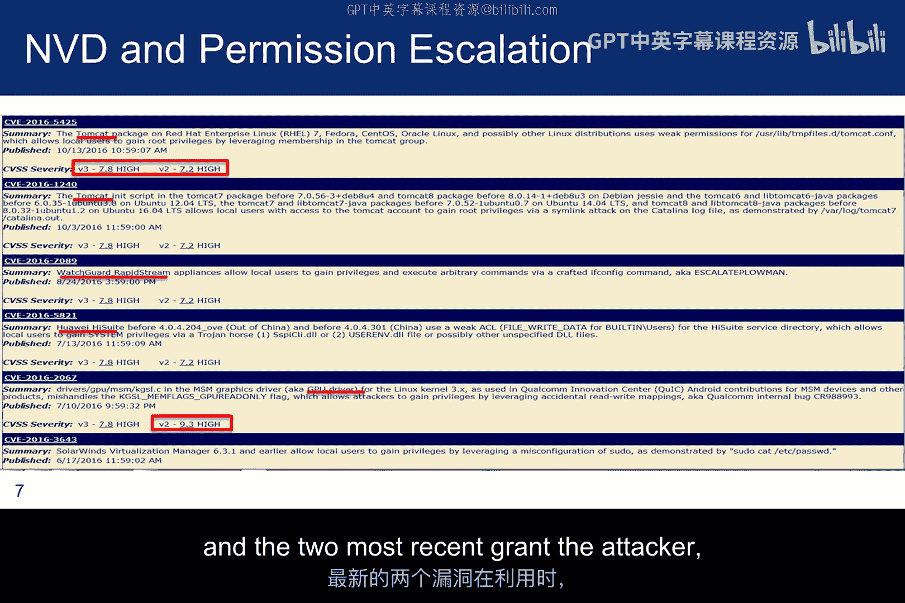
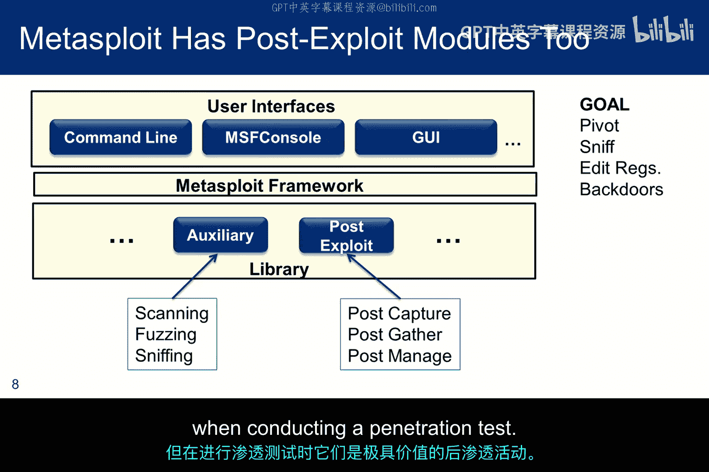
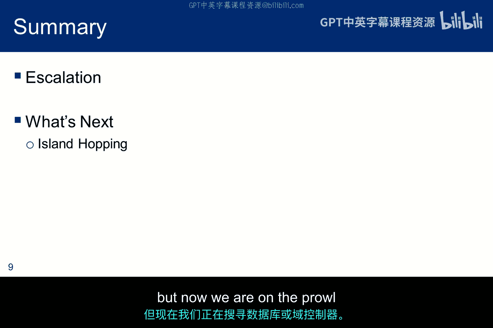

# 约翰霍普金斯大学《道德黑客入门｜Introduction to Ethical Hacking》中英字幕 p78 24_渗透后利用技术.zh_en -BV1xgu1z1Eau_p78-

Now that we have a foothold on the target， what are the follow on activities。

 Some of the key goals we will discuss are escalation of privileges。

 Piing to other machines on the network， maintaining long term access and covering your tracks。

Regarding our methodology， we are still in the exploit says。

 but executing what are typically called post exploit techniques to expand our presence in the target network。

This is a general description of privilege escalation。 It applies to both users and applications。

 The fundamental idea is one of gaining privileges that are not normally available to the user or app due to some kind of access control mechanism。

 but it also applies to hackers and ethical hackers who run an exploit at a lower privilege level than they need to proceed。

 Do O D interviewed multiple groups of red teams across every service， And in every case。

 privilege escalation was on the top of their list for most needed functionality。

They were able to get on a system， but often did not have high enough privileges to complete their mission。

Privilege escalation is the act of exploiting a bug in an application to gain access to resources which normally would have been blocked for an application or user with lower privileges。

 You are probably familiar with set U I D， which is one common attack factor。On PC platforms。

 all applications typically run with the same permissions， those of the user。

So escalation is a relatively narrow idea On mobile devices。

 The applications may not have all the same privileges。 That means that on mobile devices。

 application A may be able to get access to a resource R or another application C by attacking application B that has already been granted access to those services。

 This works because B does not enforce permission when a is able to access B's interfaces。

 verticalical escalation occurs when an attacker gets access to resources granted to more privileged accounts。

 For example， Ac administrative privileges for a banking application。

Horizontal escalation occurs when it is possible to access the resources granted to an account configured similarly to the attacker。

 For example， in an online banking application， accessing information associated with a different user。

The idea of escalation is that the original exploit provided the attacker with access to a device。

 but the attacker did not get enough privileges to do everything he wanted to do。 In many ways。

 this resembles an inside attack。 The user has access to the computer。

 but wants additional privileges for unjustified reasons。

 He can attempt either horizontal or vertical exploits。

One of the protections we implement to help guard against escalation is the principle of least privilege。

 This policy means you get the privileges you need to do your job， but nothing more。

 This helps reduce the attacker's ability to achieve horizontal escalation。

 If every account the attacker has access to has limited privileges， he can't escalate。

Along the same line， if we give privileges to an application rather than a user。

 horizontal escalation can't be achieved by assuming the privileges of another account。

The attacker might be able to run the privileged program from the compromised account。

 but he can't gain any more access than he had with the original account。

 Another mechanism that prevents both types of escalation is a policy that requires more fine grain control for elevated privileges。

No matter which account an attacker is using， he has to go through another access control mechanism to access higher level privileges。

If we don't give demons the right to use dangerous system calls。

 compromise services limit the attackers's access as well。 Of course。

 some demons will require access to system calls， and they can't be constrained。

 But if they don't require rude access， they shouldn't run as rude。 And finally。

 if it is required that kernelel mode code be signed。

 it is very complicated to make changes to colonel drivers or other interfaces。

This slide just provides a couple of examples of one vulnerabilities that might yield escalation opportunities。

 and two， some examples of escalation vulnerabilities found in the wild。

 Pla based escalation examples are primarily kernel level attacks that make modifications through raw interfaces。

 For example， modifying low level access to memory or disk。

 Se U I attacks are a kind of vertical escalation in which you gain elevated privileges during a short time that the set U I program has root privileges。

 and the attack activity provides longer term access to the privilege。 For example。

 starting in a shell with root privileges。 Similarlyly。

 if a demon is running with root privileges and it is compromised。

 the attacker may be able to get root。In Stuxnet，20 days were used to escalate privileges。

 although the earlier one was actually known by Microsoft， but not yet patched。 In the first case。

 a colonel mo driver for the keyboard was compromised。

That allowed the user to send data to the kernel accessed as kernel level data。 In the second。

 the attacker modified kernel level task files and was able to create a CRC 32 collision so that it did not appear to have been tampered with。

 which allowed the execution of system level commands。

At the time of this national vulnerability database search。

88 vulnerability records were identified containing the phrase。

 privilege escalation of the most recent， several had a high severity rating and the two most recent grant the attacker。

 system privileges when executed。 We will want to gain further access to the targets's internal networks by pivoting and covering our tracks as we progress from system to system。

 A pen tester may also opt to sniff packets for other potential victims。

Edit their registries to gain further information or access or set up a back door to maintain more permanent system access。

 Utilizing these techniques will ensure that we maintain some level of access and can potentially lead to deeper footholds into the targets's trusted infrastructure。

Metapite post exploitation modules allow penetration testers to gather data from exploited machines。

 including hashes， tokens， application passwords， and much more。

A post capture module like the Windows key log recorder module captures keystrokes on the compromised system。

 A reminder that you would want to ensure that you have migrated to an interactive process prior to capturing keystrokes。

A post gather module like the Windows and Linux credential collector module harvest passwords。

 hashes and tokens on the compromised host。 A post managed module like the Windows delete user module Des a specified user account from the compromise system in the exploit lab。

 We use a post exploit module to move up to a metroter shell。 While it is still limited。

 it improved our functionality。 The metalo framework includes hundreds of auxiliary modules that perform scanning。

 fuzzy， sniffing and much more。 Although these modules will not give you a shell。

 They are extremely valuable post exploit activities when conducting a penetration test。😊。

We have discussed post exploit modules and escalation。 Next， we want to discuss pivoting。

 sometimes called island hopping to other computers。 We may have gotten a foothold。

 but now we are on the prowl searching for the database or domain controller。

