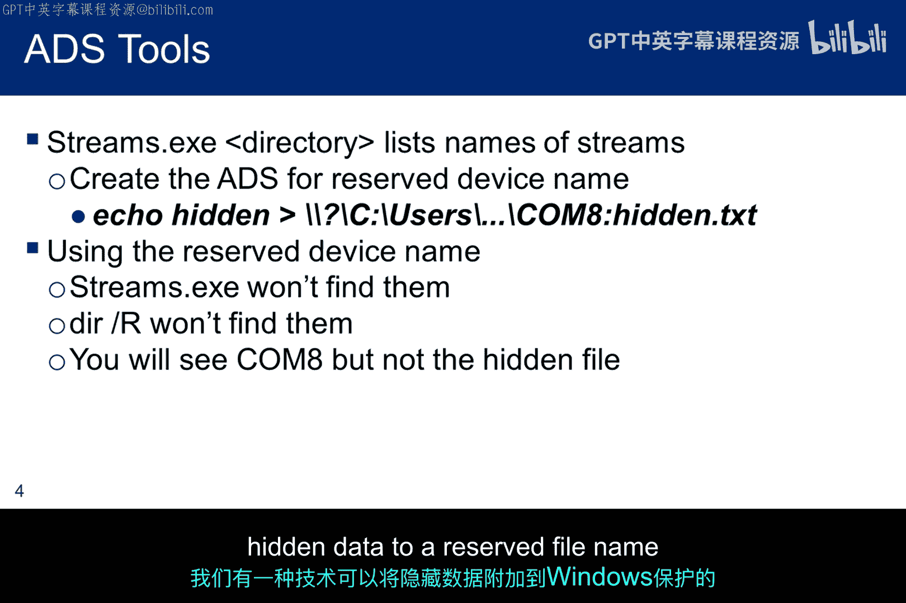
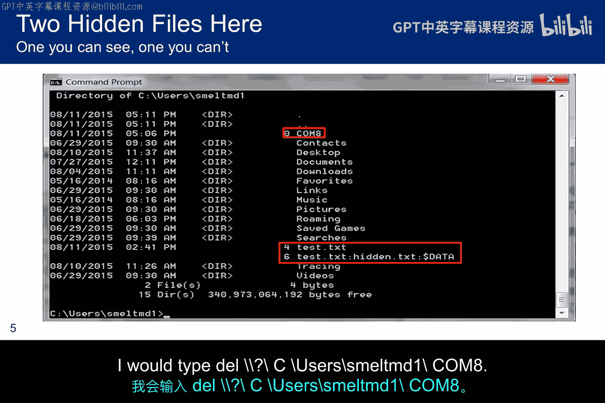
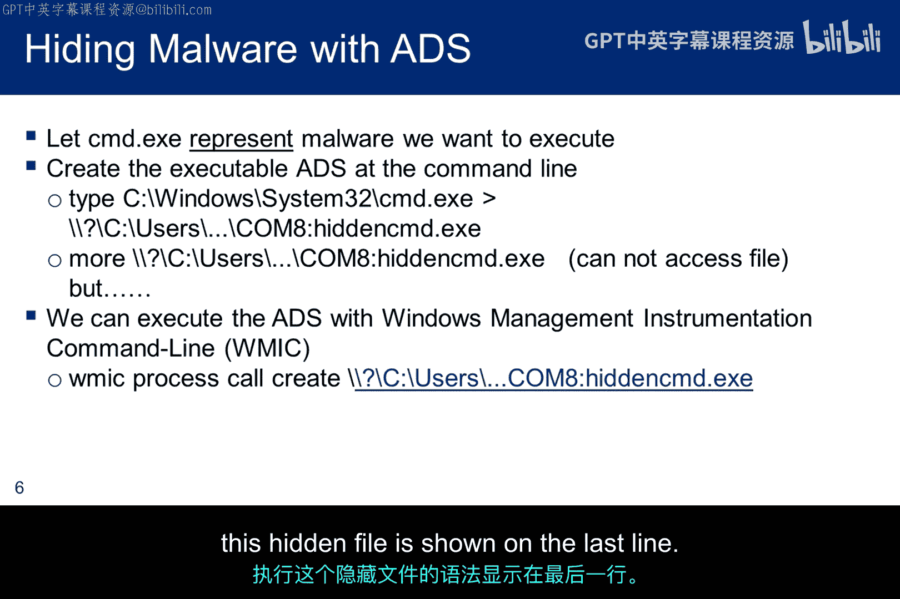
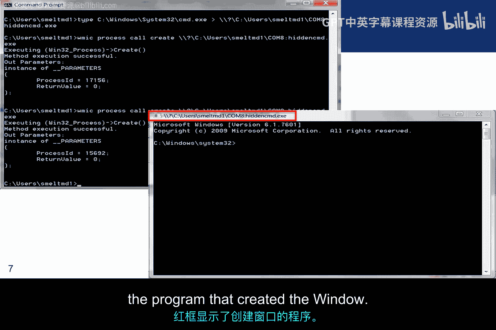
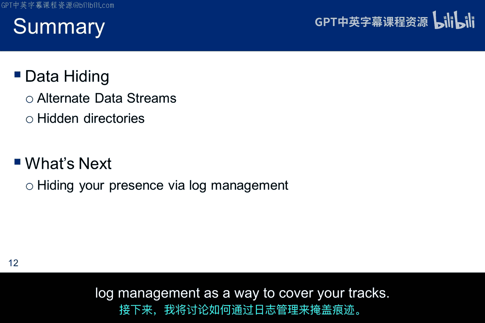

# 约翰霍普金斯大学《道德黑客入门｜Introduction to Ethical Hacking》中英字幕 p79 25_数据隐匿方法.zh_en -BV1xgu1z1Eau_p79-

Data hiding provides ways to hide information， for example。

 an attacker might want to marshal and or encrypt data on a target for subsequent exfiltration and at the same time want to avoid detection。

I will also provide an example of how data hiding might be leveraged to hide and executable。 This。

 in turn， brings up the notion of a root kit， which tries to hide itself from user and administrators。

 But that is the subject for another lecture and will not be addressed in this sub module。

The Macintosh file system stores its data in two parts。 The resource fork and the data fork。

 The data fork is where the data is actually contained。

 and the resource fork tells the operating system how to interpret the data fork。 In other words。

 it is metadata。 alternateter data streams。 Its the Microsoft approach for providing this kind of metadata。

 The ADS is a hidden stream that supplements the regular data stream。

 containing the main content of a data file。 That means the metadata doesn't always show up when you might think it would。

 This hidden stream may contain metadata for the file。

 such as the file access modification times and file attributes。

But Windows does not use that to interpret the data fork。 That is determined by the file extension。

 So what is important is we can actually put other information in the resource fork to hide it and use it in ways that it was not really intended to be used。

This slide shows a simple approach to creating an AD， S with notepad。

Hidden do text showed up when we requested directory content with the flash R option。

 but there are other techniques we can use to hide data a little more securely。

 One trick takes advantage of the device names。 These are special names identified in caps。

 and sometimes a digit， for example， Com 8。If we try to create Commate text with notepad。

 we will get an error message that says the name is reserved for Windows。

 and we should choose another name。 Basically， O S name parsing checks for these reserved names and protects them。

 But the expression back slash back slash question mark back slash turns off the O S parsing。

This expression tells the Windows API to disable all string paring and to send the string that follows it straight to the file system。

So if we invoke that， we can create and write reserve file names。

 The echo command will accept this expression， as will， the more command。

 So they allow us to create and read a file that Windows believes it owns。

There are tools designed to help with alternate data streams。 One is called streams do E X E。

 It examines the files and directories you specify in the command line and informs you of the name and size of any named streams it encounters within those files。

 However， streams do E X E makes use of an undocumented native function for retrieving the file stream information。

 so it isn't perfect， and it will not find data streams attached to reserve names like Com 8。

And when we use reserve names， D Ir s capital R won't identify the streams either。

 So we have a technique that allows us to attach hidden data to a reserved file name that Windows protects。

Here is a screenshot from my Windows machine that has two alternate data streams。

 One stream is attached to Com 8， and one is attached to test do text。

 You can see the D IR slash R works on one， but not the other。 By the way。

 if you decide to play with this。 Deleting an AD D S requires use of the same expression。

 backslash backslash question mark backslash to turn off parsing。 for example。

 to delete Com 8 in this directory， I would type D EL backslash backslash question mark backslash C backslash users backlash smelt M D1 backslash Com 8。

Now， I want to talk about using this idea to hide malware。

 So I will use the executable C D do E X E to represent a malicious executable。

 This program opens a window with a command pronk。 So when that happens。

 we will infer that malware could have been executed and taken malicious actions。

 Vi open a command prompt。The first step is to create a file with a reserve file name like Com 8。

 Next， we want to use the type command。 This command normally lists the contents of the file。

 If you enter type CD dot E X E， Windows will render to the screen。

 the ASI characters for each 8 bits in the executable。 But if you don't try to render it。

 it will be copied bit by bit。In the case shown， the command says。

 copy C D D X E to an alternate data stream attached to Com 8。

 and don't parse the file name to try to protect reserved words。Unfortunately。

 we can't use more to read the file， but we can cause it to execute using the Windows management instrumentation command line。

 The syntax to execute this hidden file is shown on the last line。

This screen shot shows the execution in the top left。 And when it runs。

 it opens the command prompt in the lower right。 And the red box shows the program that created the window。

When I ran this program on my machine connected to the J H A network。

 Carbon black detected unexpected activity and had identified the activity as potentially malicious。

 I started to get panicky encrypted emails from our security teams asking me about it。

 And they shared this screenshot。 I was surprised at Car Black identified this since it is not malicious at all。

 but it looks like it keys off the Windows management instrumentation executable。 A little history。

 Bi 9 was founded in 2002， and the company acquired Texasbased Carbon black in early 2014。

 and began using the combined name。 Since then， Carbon black product has seemed pretty high growth。

This is another screenshot from network security showing some of the processes running on my box。

 and again， Wmick is highlighted， even though it is linked to a harmless executable。

Linux doesn't really have a hiding mechanism like alternate data streams。

 but there are still some tricks we can use to hide data。 And I will talk about one of them。

 The idea is to create a directory with a name that might be overlooked。

We will create a directory named period space。 Since it starts with a period。 L S will not show it。

 L S T L A will show it， but it might be easily overlooked。

 especially if the directory is deep in the file structure and has a large number of dot files。

Here is a screen shot that shows the directory just described。

 You can see there are several dot files that help to hide it。

 The one we have created to hide data is at the top and could easily be missed without knowledge of Linux。

 It really does look like a normal directory。 And many users never look at their dot files other than the shell configuration file。

But if you do notice it and you don't know the name is Dot space。

 you can't even move into it or remove it without doing some analysis to figure out the directory name。

I have discussed the use of alternate data streams in obscure directories to hide data。 Next。

 I will discuss log management as a way to cover your tracks。

