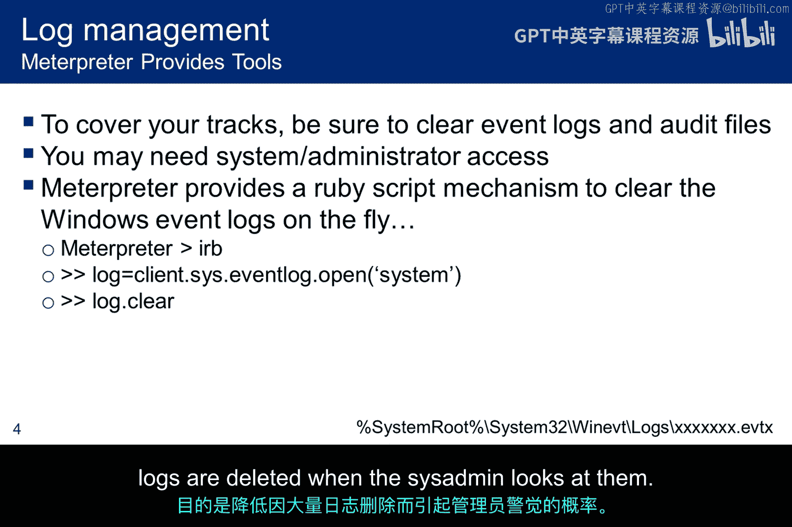
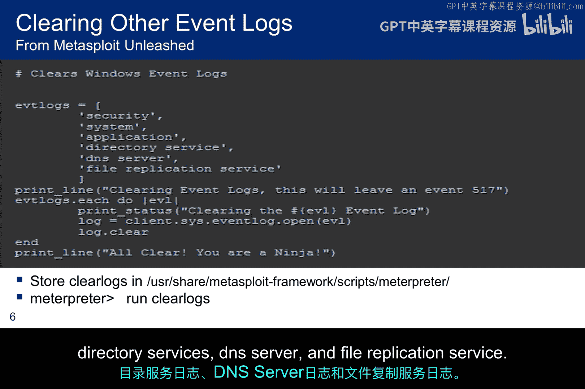
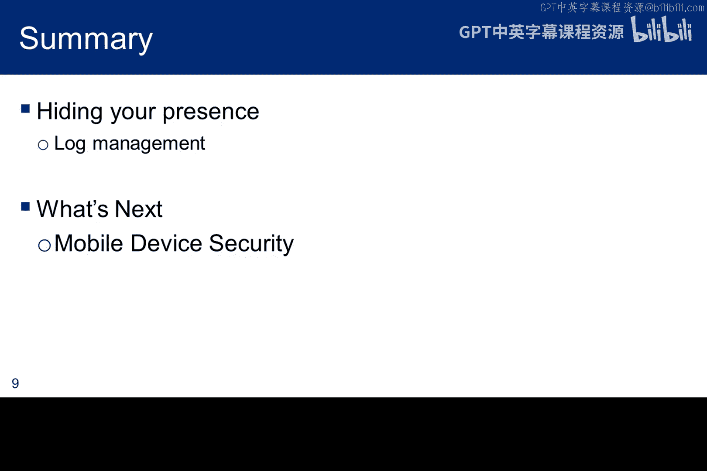

# 约翰霍普金斯大学《道德黑客入门｜Introduction to Ethical Hacking》中英字幕 p80 26_日志清除与痕迹隐藏.zh_en -BV1xgu1z1Eau_p80-

。This lecture will cover log management to hide your tracks。

 Root kits also provide an approach to hiding your presence。

 but that subject will be covered later with an entire module dedicated to the subject。

To hide your tracks， the first thing you should do is to disable auditing as soon as you have a foothold。

 This may not be successful， but when it is， you can move around the system without leaving any additional tracks。

 The idea is that going forward， you won't be tracked。

 but you still need to do some cleanup to make sure any tracks created during the exploit process are removed。

 This involves removing temporary files， clearing caches。

 deleting log entries and removing temporary users。 A note， though。

 if possible it is best if you don't delete the logs。

 that would most likely be noticed while we won't cover in this lecture。

 it is best to surgically remove the entries in the logs that have been added because of your effort to gain a presence on the system。

In our lab， we get a foothold and escalate， but at that point。

 we have not tried to look around the file system， especially the database。

 but we do want to explore the database。 So before we do that。

 we need to try to eliminate logging of database activity。 This slide shows some places to look。

 Certainly， there may be other logs that are created。

 but most of them should be covered with these checks。 First。

 check the default location for Mysql log to see if there is a log file there。 Second。

 check the standard system log files for Mysql entries。 Third。

 check Etsy MysqL Myot Cnf to see if any additional logs have been enabled。

 If this file is in a different location do a find on Myott C NF to find the Mysql configuration file。

4， run P S A U and Gr on MysqL to see if the Mysql demon was started with logging enabled。Fifth。

 run P S A U X and Gron log to see what other login might be enabled。6。

 Check the crab or Etsy in D Mysql D to see if there is any indication。

 login was started with the Mysql demon。 Check the symbolic links on the run level demons。

 In other words， Etsy slash R Cx do D files to see if they have any more information other than pointing to the Mysql demon。

 Check the log files in slash s live s Mysql。 These are binary logs which track SQl transactions and replications and should not record database access。

 but you should check the time and dates。 So you can confirm that the logs won't be accessed when you log into the database。

Now， moving on to Windows logs， if you get a meer shell。

 Matterer provides a mechanism to clear the logs using Ruby。 Basically。

 you start the Ruby interpreter from the Meterer shell and enter the commands to clear the logs on the fly。

IB starts a ruby shell。 Then we set the log variable to the log to be deleted In this case， system。

 and then just run the command Logged out clear。 This clears the system log。 Of course。

 there are many logs other than the system log that could be cleared。

 You can identify all the logs by looking at system 32 win E V T logs。

 and finding the dot E V T X files before removing a log you should understand it well enough that you are not clearing one that is unnecessary。

 We want to reduce the probability of detection that might occur if too many logs are deleted when the ciss admin looks at them。

This is a screen shot of the Windows log directory。 The system log is highlighted in the red box。

 But as you can see， there are many others to be reviewed。

It is also possible to clear multiple logs with the rubbi script shown here。

 which we will call clear logs。 After writing the script。

 we place it in slash user slash share slash meta framework slash scripts slash meer once it is there。

 and once we have a interpreter shell。 We just type run clear logs。

 And it will delete whatever logs we have specified in the script。 In this case。

 the logs are security system application， directory services。

 DN S server and file replication service。 The script will print out the name of each log as it is cleared。

Here are the screenshot of the system log before and after being cleared from the interpreter To get this view。

 you need to start the event viewer by right clicking on computer and selecting manage。

 then expand event viewer and Windows logs。We have reached the end of our ethical hacking methodology。

 more or less。 There are a few topics left that deal with preparing for the final set of client interactions。

 First， you need to analyze the results and develop recommendations for mitigating vulnerabilities and reducing risk。

 Second， you need to write the pen test report and develop a presentation of the results for the client。

 Finally， you need to clean up the system so that any artifacts of the pen testing process are gone。

 And the system status is as if it had never been touched。

 It should be fully operational and if back doors or in scope， they should have all been removed。

 Basically， you return it to a pristine state。This lecture addressed clearing logs。

 but other topics in the module were post exploitation techniques， escalation， Piing。

 persistence and data hiding。 Next， we will move on to mobile devices and explore the use of a pen testing tool against Android emulators。

