# 约翰霍普金斯大学《道德黑客入门｜Introduction to Ethical Hacking》中英字幕 p81 27_跳岛攻击与网络枢纽渗透.zh_en -BV1xgu1z1Eau_p81-

This lecture is about pivoting， and it might be one of the most important topics we cover。

 Our methodology has LED us through reconnaissance scanning and exploitation， but in many cases。

 we may only have a low privileged foothold on a system that does not play a significant role in accomplishing the mission。

 So our client may not find such an access as a viable threat。

 but the next step for both hackers and ethical hackers alike is to determine where else we can move in the network that will allow escalation of privileges or exfiltration of sensitive mission affecting information。

Here are four approaches to collecting island hopping information that I will discuss at a high level in this lecture。

 It is possible to leverage all four of these sources to collect information that will help identify potential targets and past。

 present and future connectivity to other devices that the initial victim has communicated with。

 In some of the slides that follow。 I discuss some O S capabilities that will allow you to collect information for island hopping when you have compromised a box。

 In most cases， the tools are dependent on the O S。 In the slides。

 the white text will provide Linux syntax and the yellow text will provide window syntax。

I F config is one example of an O S tool for displaying configuration information and controlling interfaces。

 Some uses for IF config include setting an interface's I P address and net mask finding a Mac address and disabling a given interface Also Linux systems often initialize their interfaces with shell scripts that call I S config as an interactive tool system administrators routinely use the utility to display and analyze network interface parameters。

 default gateways and DNS and Ws servers。The idea of identifying gateways is all about expanding our room。

 If the initial victim acts as a gateway， it can be thought of as a router that forwards packets to other computers on other networks。

 These routers can either be hard coded by the network administrator called a static route or learn dynamically via a routing protocol。

 What is important is we can collect information about other I P addresses， VPNs and remote devices。

If we know it is also acting as a VPN server， the machine will also have access and multiple connections to the back end enterprise。

 which can be leveraged for island hopping。 We can check to see if the device is acting as a router by checking the I P underscore forward switch on Linux or the I P enabled router switch on Windows。

 If it is providing I P forwarding。 It is assigned them we want to examine the route table in some detail。

 The routes give the router instructions on how to utilize the physical network infrastructure that is in place to get packets to their destination。

Regardless of the number of hops that they must take to get there。

 and we want to leverage that information。

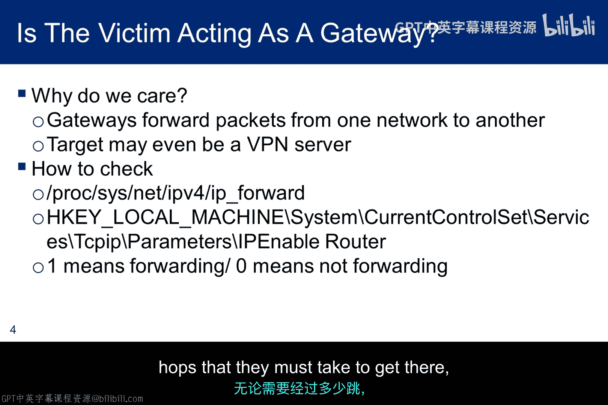

Any computer that uses TC P IP needs to make routing decisions。

 A routing table is used to control these decisions In terms of island hopping。

 routing tables will provide gateway I P addresses and allow you to identify new networks and host targets。

 This screenshot shows a Windows routing table。 The columns network destination and network mask together describe the network。

 For example， destination 1，92，1，68 dot 1 do 0 and network maskask 2，55，2，55，255。

0 can be written as a network 192 do 168 dot 1 dot 0 s 24。 The gateway column describes the next hop。

 In other words， it points to the gateway through which the network can be reached。

 The interface column indicates what locally available interface is responsible for reaching the gateway。

 In this example， Gway 1，92，168 dot 1 do1。 The Internet router can be reached through。

the local wireless network card with address 192168。13。 Lastly。

 the metric column indicates the associated cost of using the indicated route。

 This is useful for determining the efficiency of a certain route between two points in a network on link in the gateway column is just a route that's directly reachable。

 In other words， the ni is in direct contact with it on the same subnet。 So in the table 192168。

1 x x 24 is contacted by simply putting a packet on the network from 192168。1。

3 marked is going to 192168 do1 do xx。 The destination machine would see the packet and take it off the network directly。

 The routes that have gateway I listed must be contacted through the gateway。

0 do0 do0 do 0 is the default route。 In other words， the route used if there are no specific rule。

Elsewhere in the routing table， it requires a packet to be sent out from 192，168。

1 do3 to the gateway 192168。1 do1。 And the gateway would see that it is forwarded on to its destination。

 It is the last route evaluated when there are no more specific matches in the routing table。

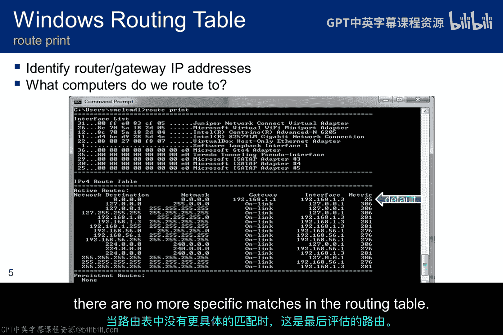

At the top， you see one of my Linux routing tables， which at the time was very sparse。

 It shows a slightly different format than the Windows routing table。

 although the functionality is the same in the PowerPoint version at the bottom。

 I have just listed categories of route types， to extend the discussion from the previous slide。

 Hot routes are specific I P addresses。 And as you move down to get the next routing rule。

 The table provides less specific routing information and bigger subnets until it finally hits the default route。

 So Linux routing cable entries store the following types of routes。 Hot routes。

 which is a route to a specific I P address， allowing routing to occur on a per I P address basis。

 The network I D is the I P address of the specified host and the network mask is 255，2，55，255，255。

 The second route type is local， which are routes for network I Ds that are directly attached。

IP packet's de for the directly attached networks are not forwarded to a router。

 but sent directly to the destination。 The gateway for local networks shows that if the destination is within the network range 192。

168，10，2，192，168，1 255， then the gateways 0，0，0，0。 The third route type is remote network Ids。

 which are routes for network Ids that are not directly attached。

 but are available across other routers。 The gateway field will contain the I P address of the local router in between the forwarding node and the remote network。

The fourth route type is a default route。 These are routes designed to be used when more specific network I D or host route is not found。

 The default route network I D is 0 do 0 do 0 do 0 with network mask 0 do 0 do 0 do 0 equivalent to on link and Windows。

When the default route is chosen because no better routes were found。

 the I P packet is forwarded to the I P address in the gateway column using the interface corresponding to the I P address in the interface column。

 You can get the I P of the interface。 the I F canfig。

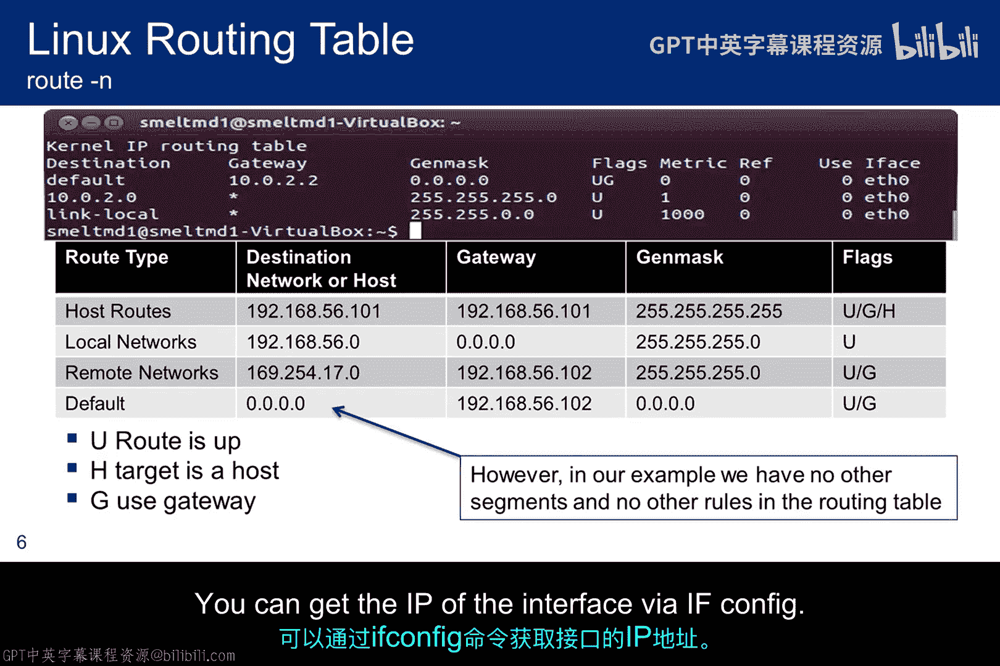

Address resolution protocol is used to find the Mac address for a network neighbor for a given IPV for address。

 As already discussed。 The tool output shown here is used to view arp table of the local machine。

 The command line entry is just ap with various switches。

 The ap table has been cached and the tool lists other hosts with which the current machine has communicated。

 providing valuable information for island hopping。 in Linux。

 T N disables D N S lookup to resolve host name and just uses numerical addresses。

 which provides a quieter scanning technique。 a passive rather than active scan。

 If you run ap for a typical network， you will see every one talks to the firewall。

 So you would have to move incrementally to the firewall and then to the internal network。

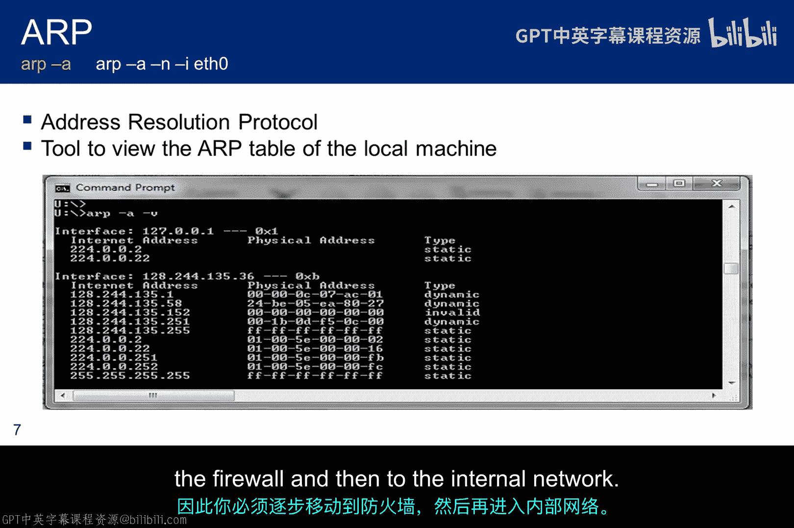

Netbis network basic input output system is a program that allows applications on different computers to communicate within a local area network。

 It was created by IBM for its early PC network。 was adopted by Microsoft and has since become a de facto industry standard in its primary capacity。

 It acts as a session layer protocol transported over TCPIP to provide name resolution to a computer and shared folders。

 Nebis over TCPIP resolves netbios names to I P addresses much like DNS。

The system also cachees intralan communication information。

 which can be viewed using a net Bis or TCP tool。 Ne Bios， When enabled。

 provides three distinct services for applications on different computers communicating via net Bis。

 First， a name service for name registration and resolution that's done on port 137 via UDP。Second。

 a datagram distribution service for connectionless communication。

 That's done on port 138 Also via UDP。 And finally。

 a session service for connection oriented communications done on port 1。

39 using TCP N stat on Windows can reveal information about the net bioos names and the remote or local machine name table。

 but only for one host。 NBT scan on Linux is a netbios name server scanner。

 which has the same functions as NT stat but it operates on a range of addresses instead of one NT scan shows the I P addresses。

 the netbios names the users that are logged in and the Mac addresses from the hosts that are running the net bio service on the network。

 some time ago， Microsoft introduce the ability to run SB directly over TC P I P with。

Out the net Bios layer， this direct TCP IP SMB runsville report 445。

 and is the preferred method for running SMB。 Nevertheless。

 the ability to look at net Bi information should be in your toolbox。

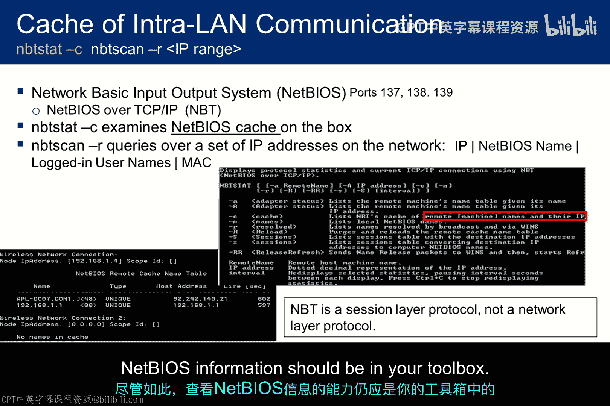

Looking at the history of the command line usage can yield valuable information about what a user has typed into his machine。

 A user may have accidentally typed a password under the command line and the history file would reveal it。

 For example， if you are working rapidly and think the last login information actually said wrong password。

 you might reenter your password and not realize you are already log in when something like this happens。

 It stays in the history file。 if the user hasn't thought to clear it or doesn't know how to clear it。

 command line history may also yield information about command line tools such as secure shell。

 secure FTP tnet， remote login R S H and connection information when accessing other computers。

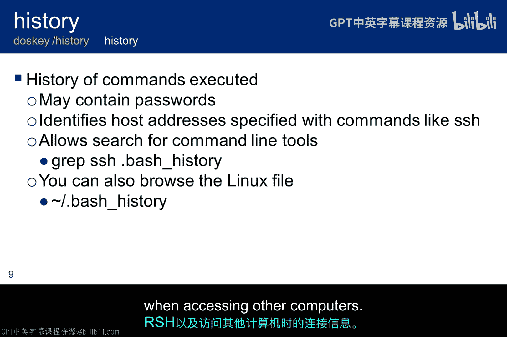

Netstt displays resource information about active network configurations。

 It may allow an attacker to identify local services for potential privilege escalation or identify established connections to other networks。

 possibly through the firewall。 It might even provide information that will help an attacker hijack a session。

 as this slide shows there are numerous options。 T N on Windows allows you to turn off name resolution to make the reconnaissance more passive and T B。

 which lists executables involved， requires admin privileges。

 So you have to run command prompt as an administrator to use it。

 As the next slide will illustrate the output provides local and remote I P addresses in the state of the connection。

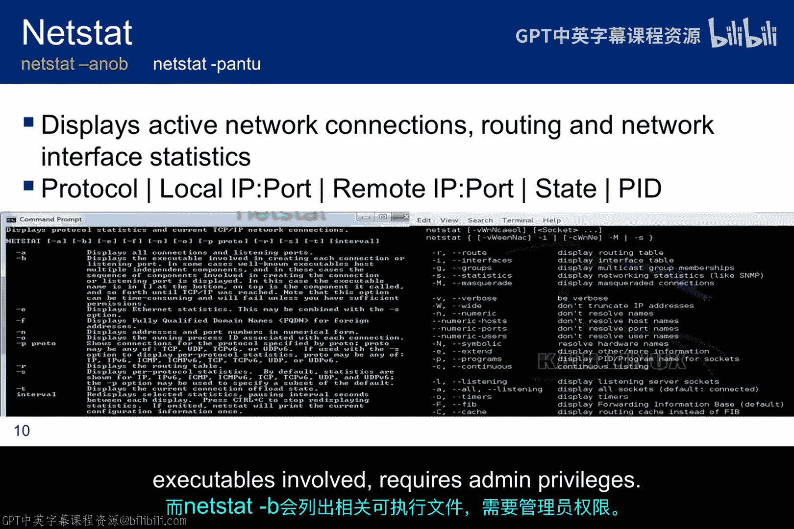

This is the Netstt output on my Windows machine。 T N displays active TCP connections。

 T A means all ports。 Ta O means include process I Ds。 Netstt， tech N O and Tless。

 Let you compare process I Ds and kill suspicious processes with unknown foreign addresses。

 For example， A C2 server。 At one point， I was using Kespersky antivirus。

 And I was connected to servers in the UK。 But I had to do some digging to make this determination。

 This kind of connection can be controlled to some degree by changing configuration options。

 But this is the kind of investigation that might be kicked off by Netstt。

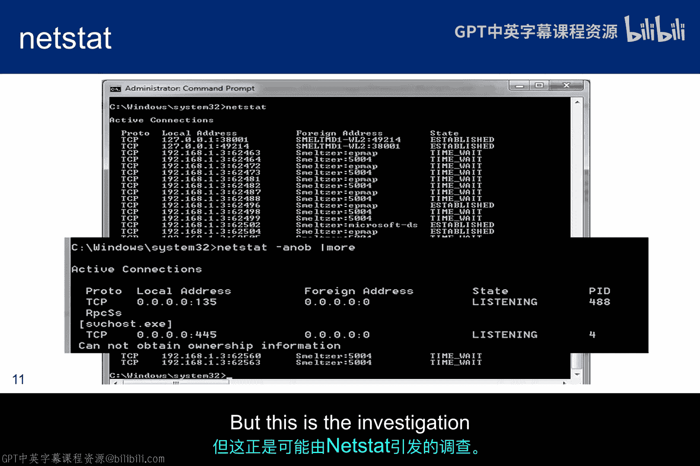

The net command on Windows will give you a view of network resources。

 computers that share those resources， and possibly allow you to connect to those resources。

 If there is not an access control mechanism in place。

 Ne is sometimes a useful tool for establishing a connection to print across a network。

 As with many of the tools we have discussed here， it provides a view of network connections and computers in the work group that allows sharing resources。

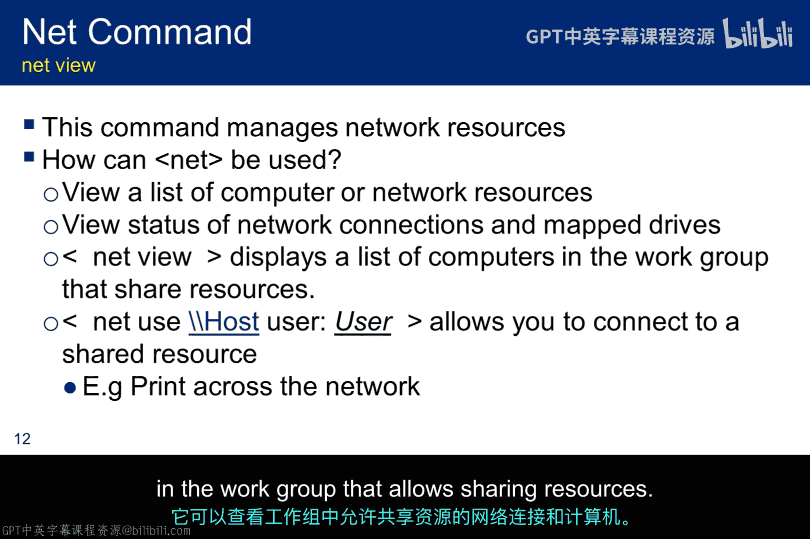

This screenshot is the help screen for net。 In this case， I also requested information on accounts。

 and you can see the command returned some administrative information for account management。

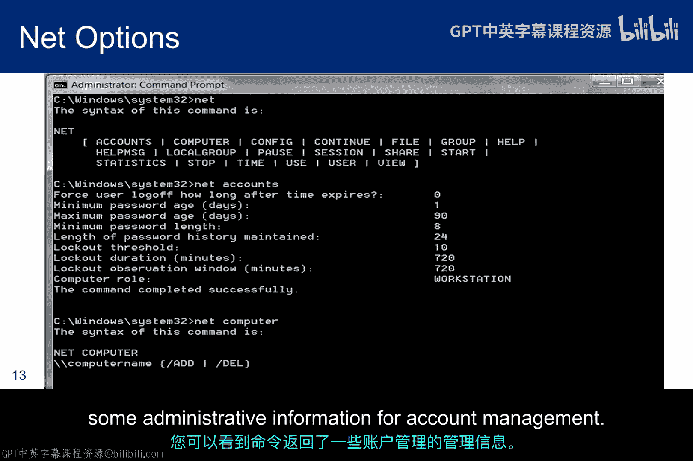

In 2013， Mandian， a corporation that specializes in forensics and investigation of security breaches。

 wrote a report on the Chinese advanced persistent threat and tried to identify the personas of the A T culprits。

 as part of that report。 Mandian identified a script used by those attackers as soon as they get access to a machine。

 You can see that several of the tools I have discussed here are included in this script。

 The obvious goal is to immediately capture as much information as possible that will assist them in getting access to other potential victims。

 including domain controllers that may be on the network。

 while I have not focused on Windows networks， The attacker's first goal is to find domain controllers。

 You might even find it interesting to test this script。 but don't do it。

 It will probably be identified or blocked by your organization's I D S or I P S。

 and you will probably have。Explaining to do the Man report is worth reading If you haven't already looked at it。

 It is currently found at Intelreport do manion dot com。

 If the report has been moved for some reason or the link is dead。

 you should be able to find it via a search on both Man and A T1。Once you have a foothold on a box。

 the ethical hacking process restarts。 You begin to do reconnaissance and scanning from the inside。

 Endm will usually be installed on a Linux machine and might even provide network scripting engine functionality。

 This is the case in our virtual hacking environment。

 but the available scripts on metaable are limited because the Linux build is old。

 You may be able to move scripts from the attack machine to the target and then run them from inside the firewall。

 Configuration errors can also be leveraged For many reasons。

 Administrs may reuse admin or domain controller access passwords。

While this is a serious security mistake， if the network is large。

 it eliminates the need for keeping track of multiple passwords or writing them down in a file that can be exfiled。

 The approach is a perfect example of the classic trade off of security versus ease of use。

 At any rate， once you have the admin password。 you should try it everywhere to see if it works。

 In many cases， it will。I have discussed several tools that help collect information that can be used when trying to pivot around a network。

Some may work。 Some may not， but it will allow you to start to map the network connectivity and identify subsequent internal targets that you want to explore。

 Next， I will talk about persistence and back doors。

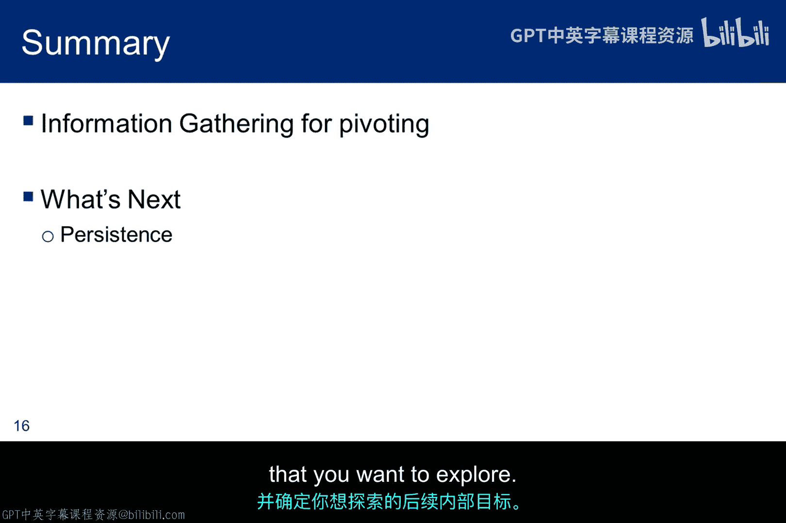