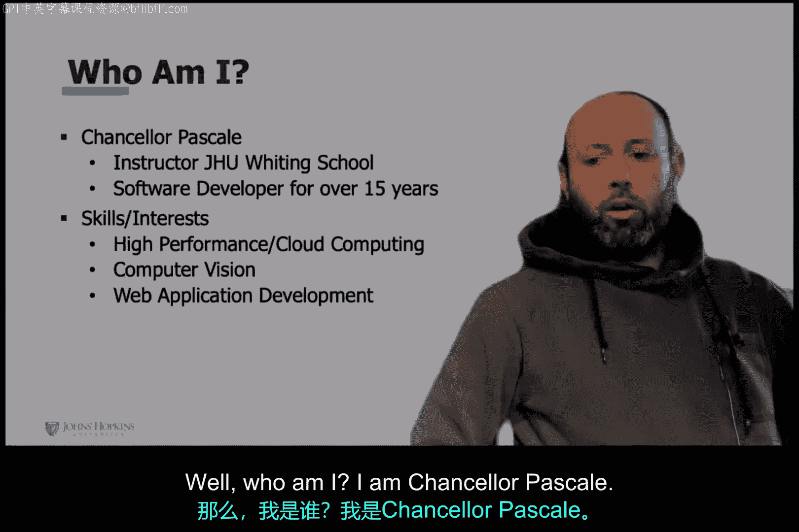
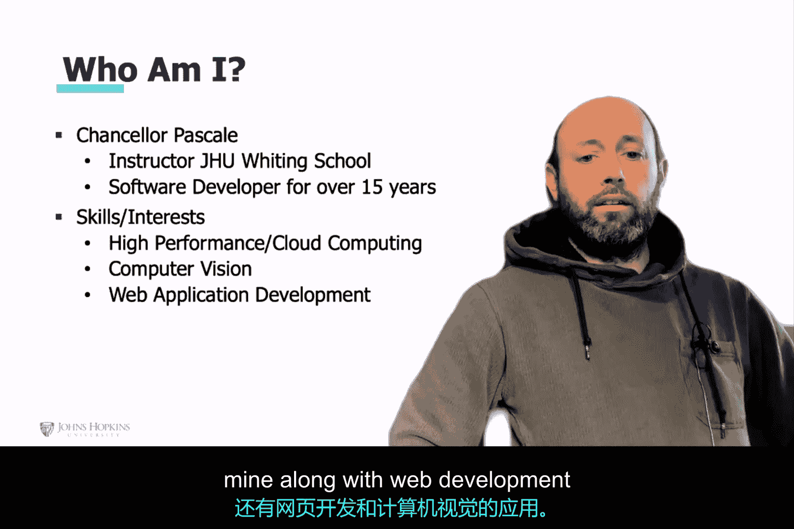
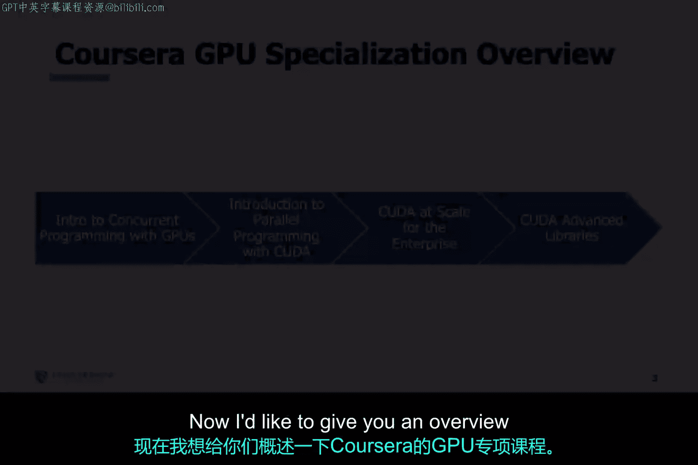
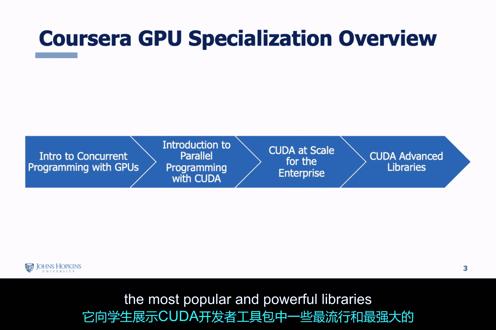
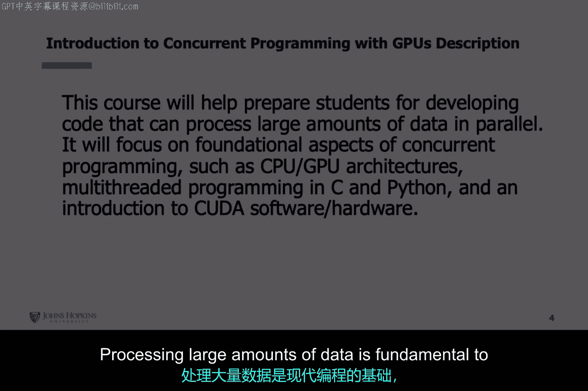
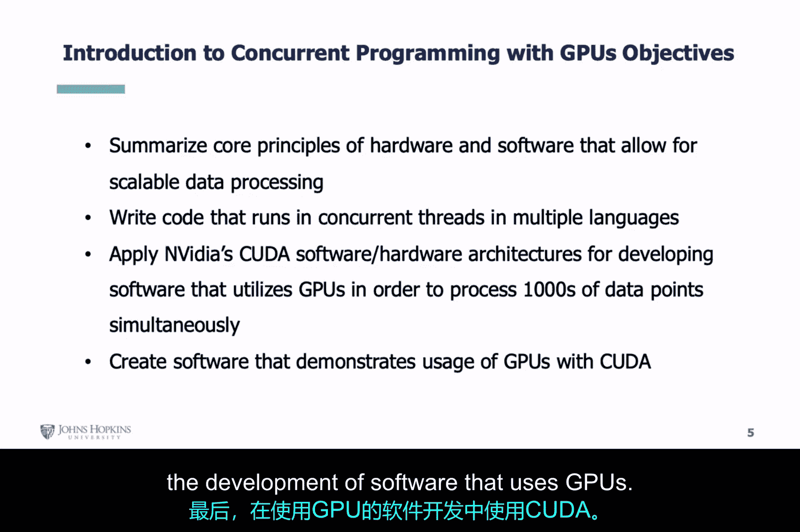

# 约翰霍普金斯大学《GPU编程（并发编程、并行编程、面向企业、CUDA高级库）｜GPU Programming》 p01 0_GPU编程专项课程综述.zh_en -BV1a1421r7vw_p1-

Welcome to the introductionuction to Concurrent programminging with GPU's course。

 which is part of the GPU programming specialization。Or who am I。

I am Chancellor Pascal。I have been an instructor for 10 years at the Johns Hopkins。University。

 Whiting School engineering， a software developer for 15 years。

Ht performance and cloud computing are interests of mine。

Along with web development and the application of computer vision Now I would like to give you an overview of the Coursera GP specialization。

The first course， which you are currently in， is introduction to concurren programming with GPs。

 which I will describe in more detail in the next slide。

The next course in this specialization is In to parallel programming with Kuda。

 This course focuses on the basic hardware and software capabilities that NviDdia GPs and the Kuda programming framework provide。

 The third course is Kuda at scale for the enterprise。

It goes into more complex capabilities of Kuta and how they can be applied to scale beyond the programmer's machine and on enterprise hardware。

The fourth and final course in the GPU specialization is KUuda Advanced Libraries。

It exposes to the student a number of the most popular and powerful libraries that come with the KUaDevelops toolkit。

Processing large amounts of data is fundamental to modern programming。

 and students will learn techniques for doing that in this course。

Concurrent parallel or multi thread programming will be the main focus。

 and students will be introduced to fundamental aspects of this type of software development。

CPUs and GPUs， also known as general purposese G processing units or GPGUs。

 allow for multiple threads to run at the same time。

For focusing on CPU parallel programming challenges。

 students will learn how to use C++ and Python 3 to process multiple pieces of data concurrently。

Finally， students will be introduced to the leading GPU programming hardware and software architectures NviIDdia and KUa。

The objectives for this course are。For scalable data processing。

 summarize hardware and software at core principles。In multiple programming languages。

 develop software that runs on numerous parallel threads。

Utilizing GPus apply Nvidious Cuda software and hardware architectures in creating code that processes thousands of data points simultaneously and efficiently。

 Finally， use KUa in the development of software that uses GPUus。

Well that's it for this presentation。Hopefully I started you to think about what you'd like to do in this course and the GP specialization in general。

