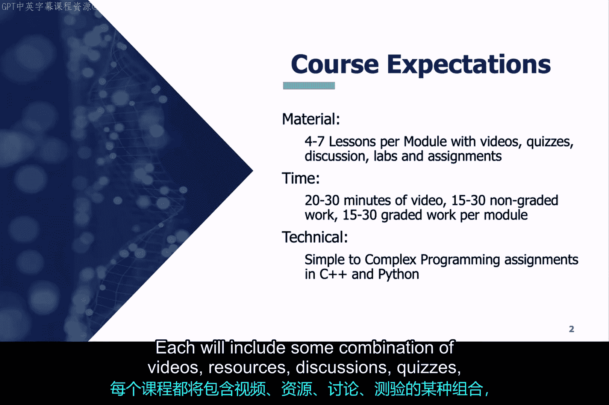
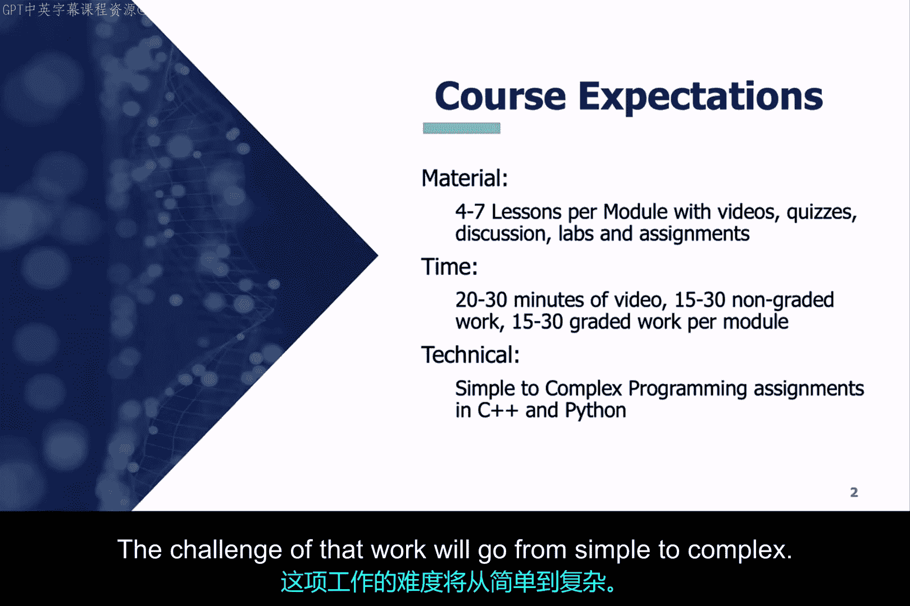
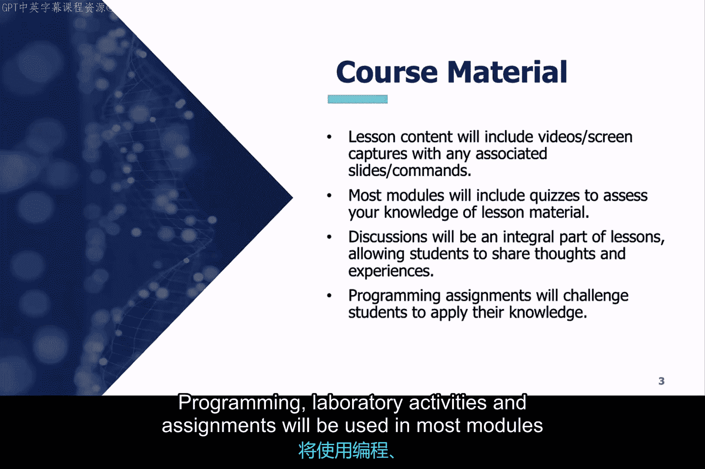
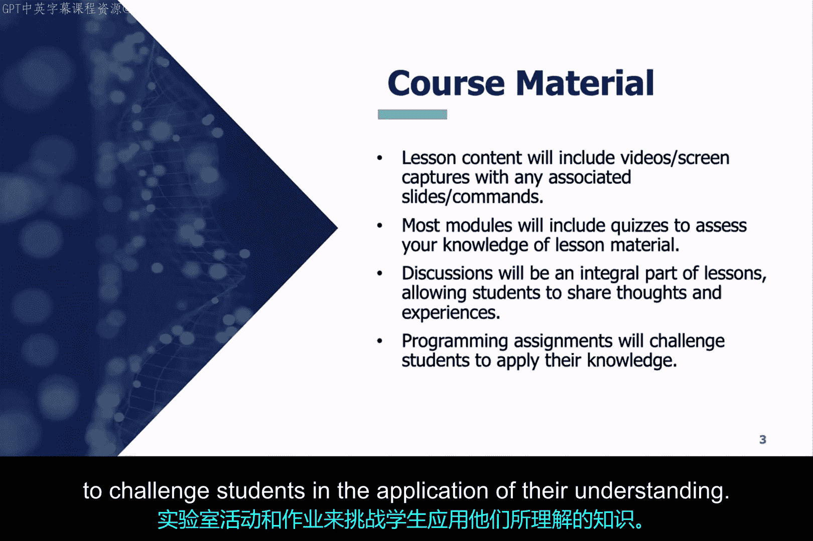
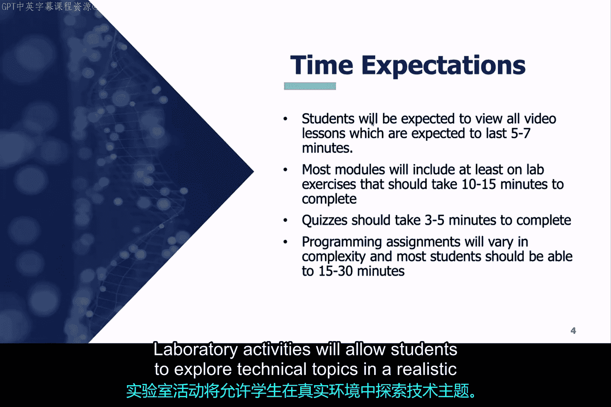
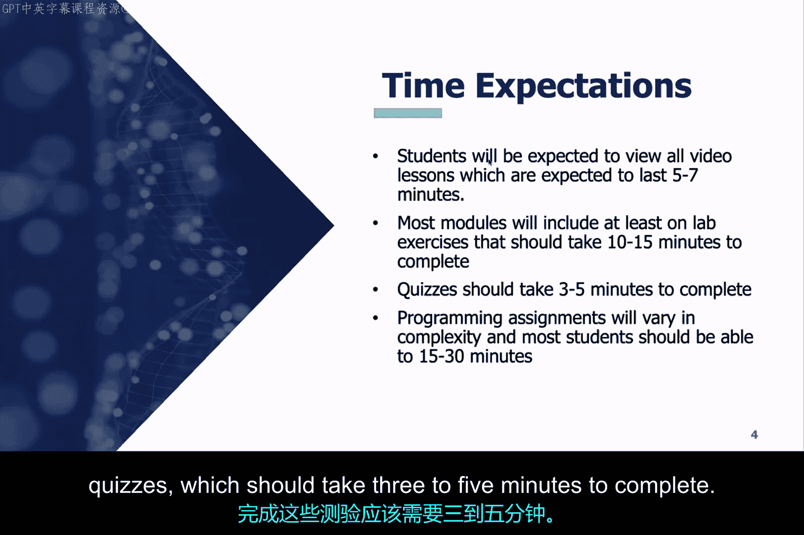
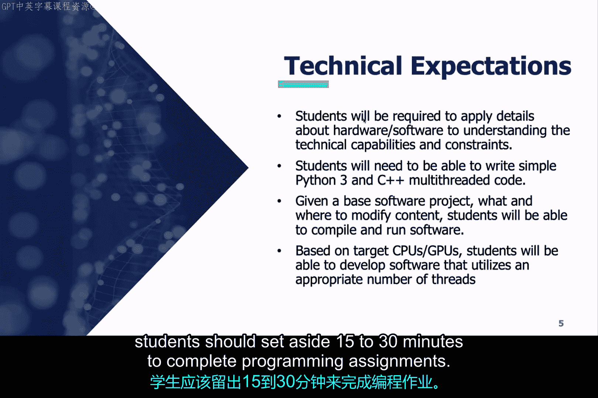
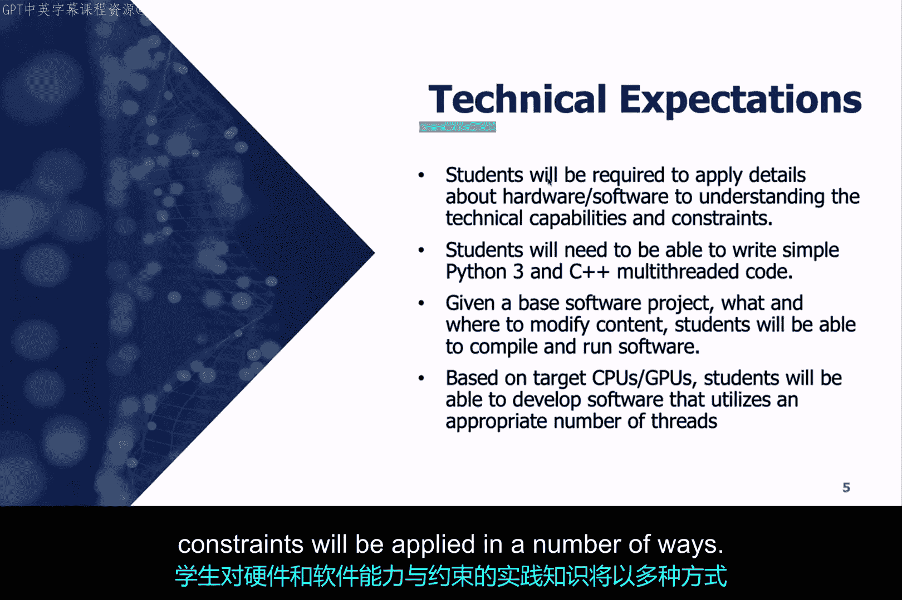
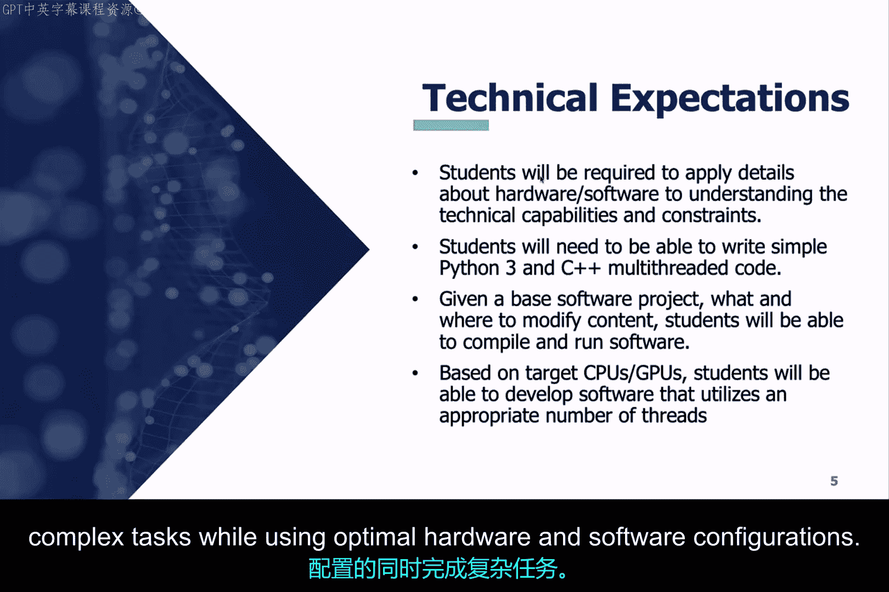

# 约翰霍普金斯大学《GPU编程（并发编程、并行编程、面向企业、CUDA高级库）｜GPU Programming》 p02 1_课程期望视频.zh_en -BV1a1421r7vw_p2-

In this video， we will go over the expectations for this course Intro to concurrent programming with GPUs。

There will be three categories of expectations for this course。Material， time and technical。

A module contains 4 to 7 lessons。 Each will include some combination of videos， resources， Disc。

 quizzes， laboratory activities and assignments。

Which will generally be technical。For each module， you should expect to spend up to 30 minutes viewing videos。

15 to 30 minutes on work that is not graded， discussions and lab activities and 30 minutes on graded assignments。

 though if it takes longer， there is nothing wrong with that。Finally。

 students will program in C++ and Python， the challenge of that work will go from simple to complex。

For each lesson， there will be video material in the form of slides or screen captures。

VoiceOver slide videos will be accompanied by PowerPoint slide files。Also。

 for those videos with screen captured content， the commands will be made available。

 quizzes will be included in many modules to assess the student's knowledge of lecture material。

To encourage collaboration and sharing of thoughts and experiences。

 discussions will be part of each module， and students should consider them as an integral part of their learning。

To challenge and assess students understanding of technical topics。

 programming laboratory activities and assignments will be used in most modules to challenge students in the application of their understanding。

Each lesson will include lecture and technical application videos that will be required to gain a more complete understanding of course topics。

These videos will last between 5 and 7 minutes。Daboratory activities will allow students to explore technical topics in a realistic environment。

 They will often take 10 to 15 minutes to gain a mastery of the work's focus。

For more theoretic or specific technical assessments， students will complete quizzes。

 which should take 3 to5 minutes to complete for each module。

 students should set aside 15 to 30 minutes to complete programming assignments。

Students' practical knowledge of hardware and software capabilities and constraints will be applied in a number of ways。

 General， this knowledge will be applied in programming activities and assignments。

 which will be written in C++ and Python。

They will often require application of multi threadreading libraries。

Activities and assignments will include the basic structure of a program that will be altered to demonstrate expected effects or required to be completed to implement a canonical algorithm。

As a result， students will be able to utilize CPUUs and GPUs to complete complex tasks。

While using optimal hardware and software configurations。

