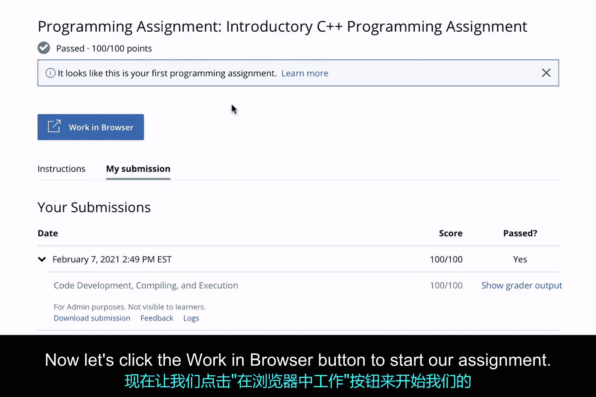
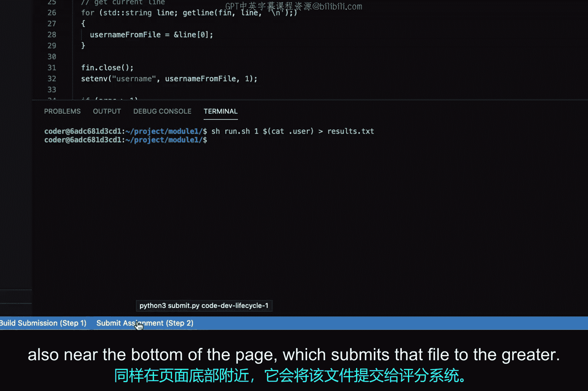
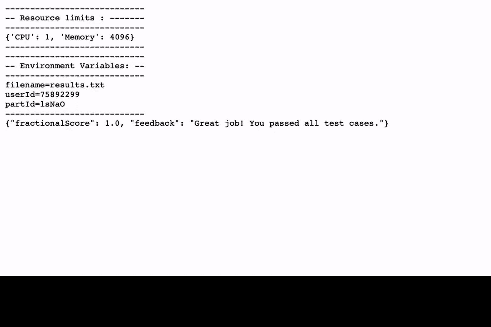

# 约翰霍普金斯大学《GPU编程（并发编程、并行编程、面向企业、CUDA高级库）｜GPU Programming》 p03 2_Coursera实验作业总览视频.zh_en -BV1a1421r7vw_p3-

This video will go over how to utilize the Coursera environment to do laboratory activities and programming assignments。

Below are six basic steps required to complete programming lab activities and assignments。

 all of them in the browser。First， you will identify the lab or assignment that you wish to work on。

Click the button with a name like Work in browser， which will launch the Visual Studio code editor in the Coursera Lab environment。

Second， if required， open the directory associated with your module。For example。

 the directory associated with this module would be named moduledule 1。Third。

 to get lab assignment specific instructions， read any Readme。 M D text file in that directory Four。

 edit any applicable code files， which will often have a CPP HP or PY extension。

The fifth step will be to open a terminal and use command line tools such as S H or make to clean。

 build and run your code one or more times until you are satisfied。

6ix and final step specific to assignments will be to edit the dot user and main code files。

To have the same value for your user， and then you can submit the assignment via buttons that will be at the bottom of your screen。

These buttons will indicate which order they should be pressed to take all required steps。

This is the page for your module1 programming assignment。

We will walk through all the steps that you need to take to complete the assignment。

Focusing on the assignment content， there is an area for progress notification。

 the button to start the lab activity， instructions on how to complete an assignment and submission results。

 Now， let's click the work in browser button to start our assignment。

Next， you will need to have the activity or assignments associated directory open in Vs code。

 If you do not see the module number， name near the top of the page。

You will need to click the file menu option from the menu bar from inside the drop down menu。

 select open。 This will bring up the open file or folder dialog near the top of the editor from the dialog。

 you can navigate up the directory structure by clicking the double period。For this project。

You will need to navigate to home。Cooldder。Project。Module 1。In add order， in the dialog。

 once you have found the folder or file you need to open。You can click the O button。

 The file or folder will open on the left side of the editor。

 You will now have all the files that you need to start on the lab or assignment for the current module。

The next thing you should do is read the readme M text file。

 which will include background material and a set of assignment instructions。

 You can look at the Run dot S H file， which is a script that is run to execute all steps of the assignment。

The make file is used to clean， build and run your work。

 You should not need to modify these two files， but instead should modify only code and other associated files。

If you are working on an assignment next， you should ensure that the user file。Reflects your user。

 which can be any name or login as long as it has no special characters。

Another place to add it prior to even starting to write the code for the rest of the assignment will be in your main code file In this case。

 assignment CPP。 you will need to modify the user name。

String constant to reflect the same name that you've placed in the dot user file。

By editing these two files， you will guarantee that your submission meets the first requirement of assignments username verification。

 When you execute your code either directly or through Rundo S H or the make command。

 you will need to pass the same username。 The next step to submit your code is to click the build submission step 1 button at the bottom of the page。

You will see a terminal window at the bottom of the page， which will clean。

 build and execute your current code and output to a file。

 which is used in the grading of the assignment。Please note any output in the terminal。

Then you will click the submit assignment step 2 button also near the bottom of the page。

Which submits that file to the greater。You can then look at the submission results in the assignment page。

They will be amber until they are completed being run by the grader。

When you open the submission results， you can see the grade， whether you passed。Any feedback？

Which is down here。And if you're in a situation where things aren't working。

 you really want to look a little bit further， go into the logs。

