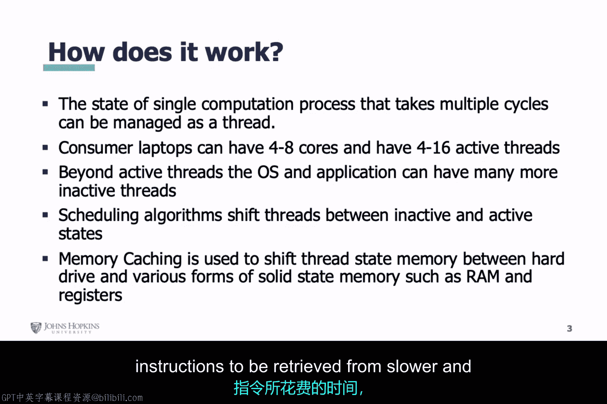
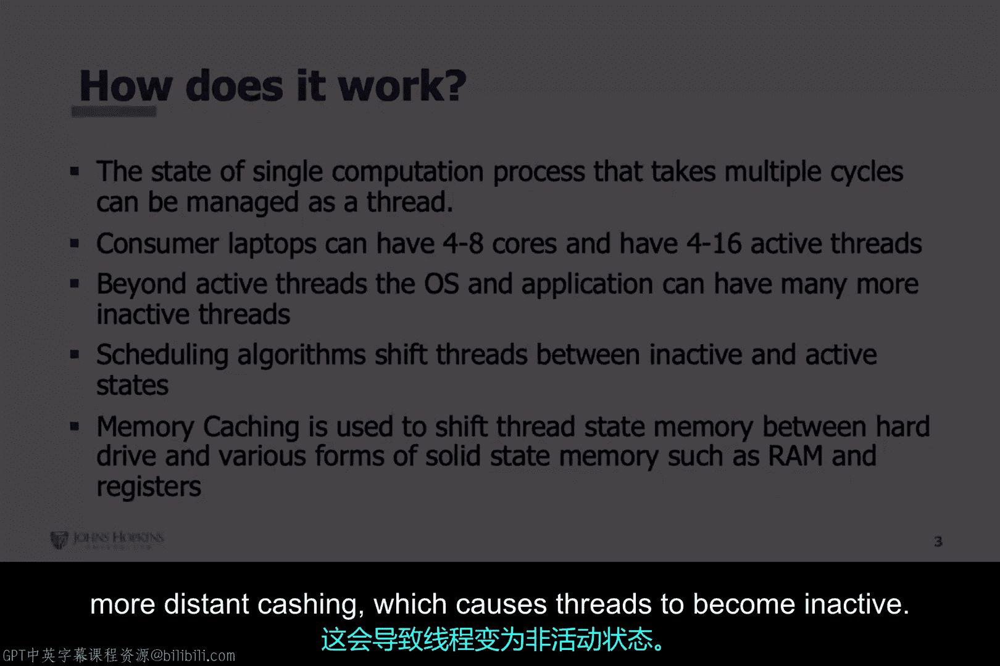
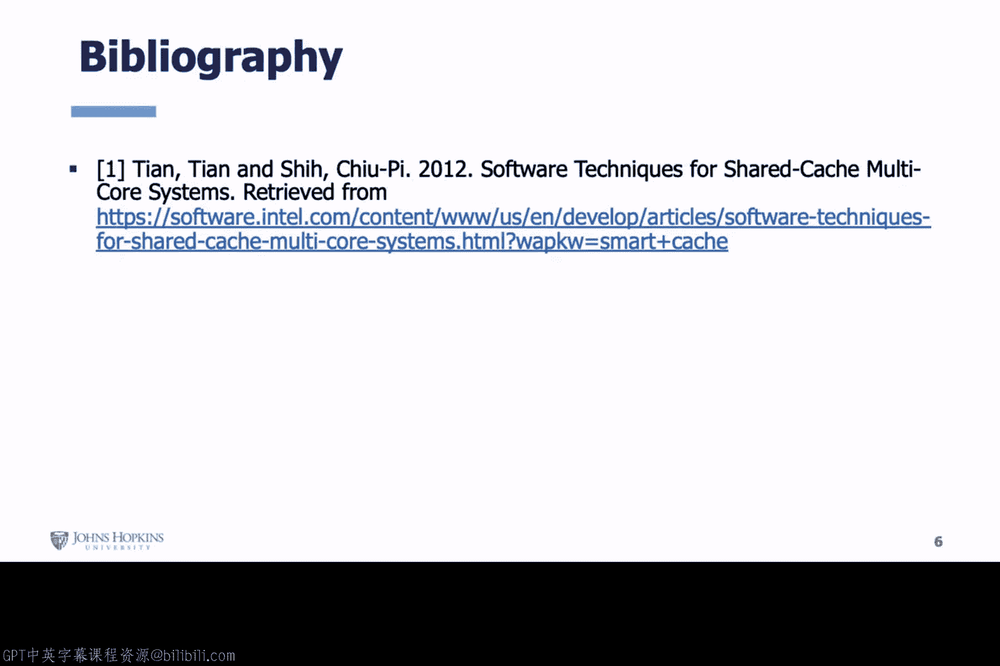

# 约翰霍普金斯大学《GPU编程（并发编程、并行编程、面向企业、CUDA高级库）｜GPU Programming》 p04 3_现实世界并行编程实践.zh_en -BV1a1421r7vw_p4-

Hello and welcome to the first lecture of Moule 2， Real world concurrent programminging。

Multi processing， concurrent， parallel and threaded programming are all synonymous。

Modern programming is built around maximizing the utilization of the multiple processors and cores of modern computers。

 and the best way to do that is via are running multiple processes and threads。

This is done without developer intervention by the operating system。

But you have the ability to improve the efficiency of your software by writing quality code with threads that process data independently。

Some highly complex tasks， such as artificial intelligence。

 audio video processing and signals processing can be written with multi processing of mind。

Bupp beware， as this can go awry。Parallel processing has been the basis of software that requires lots of computing power。

 but also allows for asynchronous interactions with the user。What is a thread。

 It is an independent collection of sequentially executed programming steps。

Think the program with multiple independent threads like train tracks that separate and come together at certain points。

When the tracks are apart， multiple trains can go as fast as they want， but when they are together。

 each train is limited by the speed of the train that is in front of it。With modern CPUs。

 think of laptops or consumer desktops， you will often have 4 to8 cores。

 and each core can have between one and four threads managed by the scheduler。

The heart of any OS's multi threaded capability is the scheduler。Which shuffles different programs。

 including operating system tasks。Between active and inactive states and moving them between cores。

 moving data around caches， etc cea。Computers have multiple levels of memory from the hard disk to registers shared between cores。

 They allow for common data amongst threads， even the instructions that multiple threads from the same program execute。

The goal of memory caching is to limit the amount of time that is spent waiting for data or instructions to be retrieved from slower and more distant caching。

Which causes threads to become inactive。

What we see in this diagram is a CPUU scheduler shifting between threads on different course。

In this case， presume that all four cores are on the same processor and share at least an L2 cache wire threads made inactive and shifted between cores。

They have their state changed due to cash misses， and the scheduler doesn't want to waste CPU cycles on waiting for data or instructions。

 So instead， it finds something that needs to be run and makes it active。There is， of course。

 lost time in switching between threads。So constantly switching has a cost as well。

Memory caches are hierarchical in nature。And they really work on the principle that memory that is physically closer is more performant。

Cashs are not just used for storing localized。Data and or instructions for a CPU。

But it is also used as the sharing mechanism between cores。

And as a way to store data and or instructions that limit the number of times that requests have to go to RAM or even hard drive space。

There are L3 caches。But apply a little less when we get to GPUs。I won't be discussed in detail here。

