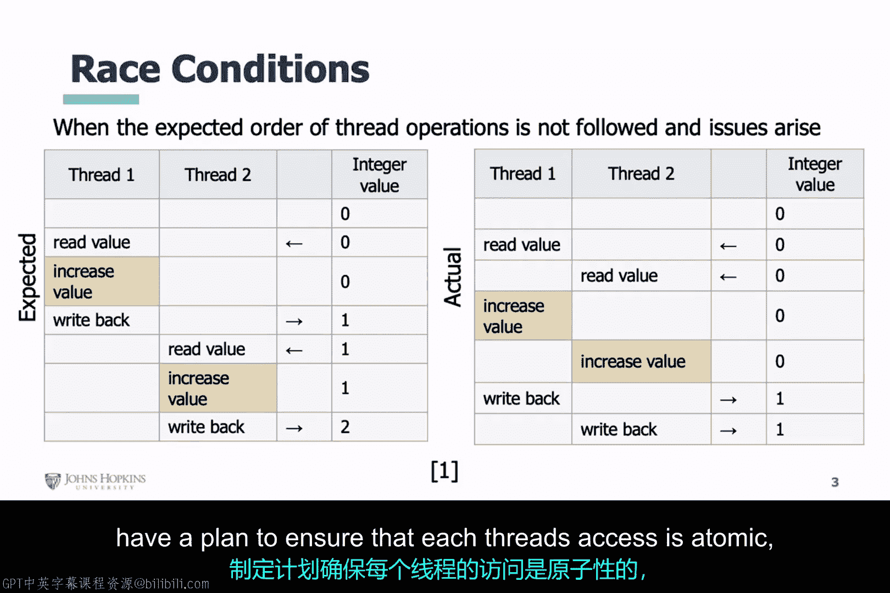
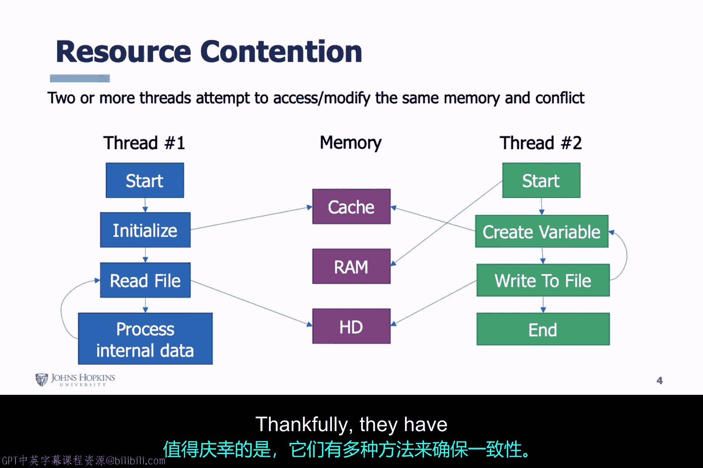
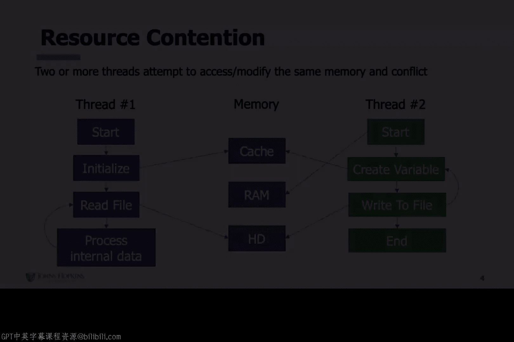
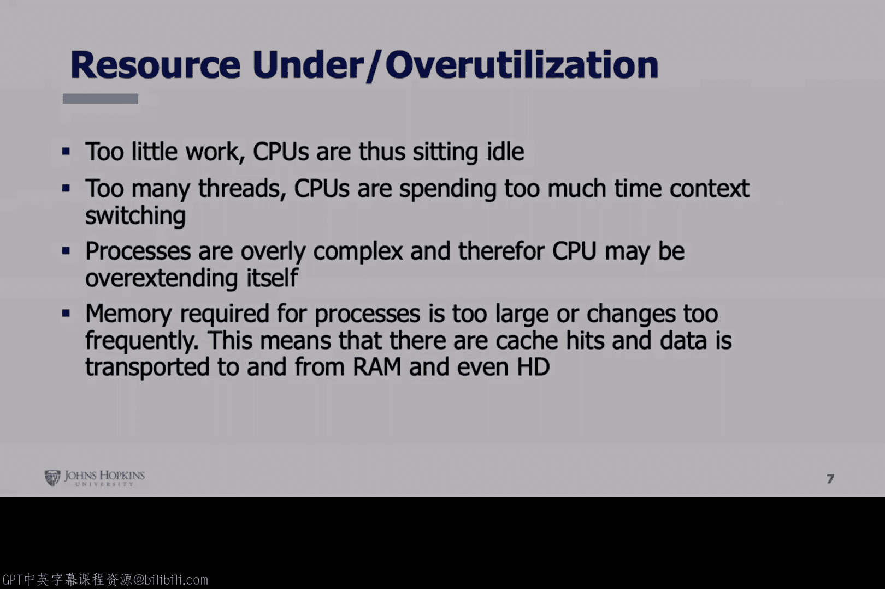

# 约翰霍普金斯大学《GPU编程（并发编程、并行编程、面向企业、CUDA高级库）｜GPU Programming》 p05 4_并发编程陷阱解析.zh_en -BV1a1421r7vw_p5-

Hello。😔，In this video， we will discuss issues that arise when writing multi threadreaded programs。

There are many issues that can occur if care isn't taken when writing concurrent programs。

They include race conditions， deadlock and live lock。Non optimal resource utilization。

In contention over resources。One of the most common pitfalls that you will encounter when writing multi threaded programs is a race condition。

This occurs when threads execute in a sequence different than intended。

And can have dire consequences。In this case， the programmer wanted the first thread to execute its three instructions。

And then the second thread to execute its three instructions。Unfortunately。

 the instructions were interleaved。And therefore， the final insure value is not what the developer wanted。

I want to make it clear that in this case， there isn't an incorrect final value。

Since each thread performed its instructions in a valid manner related to the shared variable。

It is often best to consider minimizing shared or global variables。Or if they are required。

 have a plan to ensure that each thread's access is atomic。

Which we will talk about later。

Similar to a race condition。But more related to memory and not the order of execution is resource contention。

The more threads and shared resources， the more often this will occur If the programmer hasn't given sufficient consideration to this happening。

This is a more asynchronous version of a race condition。

Which can extend from threads to completely separate machines。

What happens is that resources are needed to be accessed in different ways。

By different independent threads。And they access the same memory， file， etc。

And this can lead to conflict and constant rewriting of values。Consider the case of databases。

Where values need to be incremented， But each time a value is retrieved from the database。

 Another thread is accessing the same row。Now， it can happen that between the time that the first thread axises。

And updates the row。 and N threads do the same thing。

That numerous increments go uncounted since the last of value is what is counted。

This is a very significant issue with databases。Thankfully。

 they have numerous ways of ensuring consistency。

Deadlock is similar to resource contention。Except that one or more threads or processes require multiple shared resources。

And will not perform their action until they have access to all that they require。At the same time。

 they need other required resources。 They do not relinquish their hold on a shared resource。

What what threads？😔，Each have a shared and required resource and simultaneously are waiting for other resources and cannot proceed to the point when they can release them。

None of the participants in the deadlock will make it out of this situation。

The first response is to have threats drop their holds on resources。

But this will devolve into threads， dropping resources and then frantically trying to get all the resources that they can and possibly not helping at all。

Livelock is like deadlock， but each thread is actively doing something。

 but never makes it out of the overall process that requires multiple resources。

This can happen when a programming loop tests for access prior to making a final change。

And goes to sleep for a small or no time。 Consider a do while loop that doesn't change an externally visible display until it can save the value to a resource。

Numerous threads executing the same loop might come to the same wild test and not be able to access unnecessary variable and thus keep incrementing another variable。

This could result in a buffer or stack overflow or executing an instruction millions or even an infinite amount of times。

Or recursively executing the same code and locking up a program。

This can even happen if you incorrectly use some programming language asynchronous capabilities。

 so be careful。A slightly less worrisome issue is over or under utilizing the computational power of your machine or machines。

Though if this happens with a powerful system or replicated over a large cluster of computing resources。

 this can be expensive。So as the name should indicate Kate。

This is when you have too few or too many threads。And they have nothing to do。

 or the few threads are performing a series of computations that could be broken down and run in parallel and therefore more efficiently。

If too many threads are going from active to inactive status。Due to not having work to do。

 the cost for contact switching can outweigh the speed offered when many threads are being used。

This can be handled by scaling the number of threads based on the amount of data or CP utilization。

When threads are too few， they may be in constant use。And small memory leaks。

 or inefficiencies can compound。And CPU utilization may spike， which makes all running threads sour。

Also， if a thread requires a lot of data or lots of instructions。

 cache hits can occur more frequently， and therefore。

 the system will be slowed by data transfers to and from the cache or。Ram， or even in the worst case。

 the hard drive。

