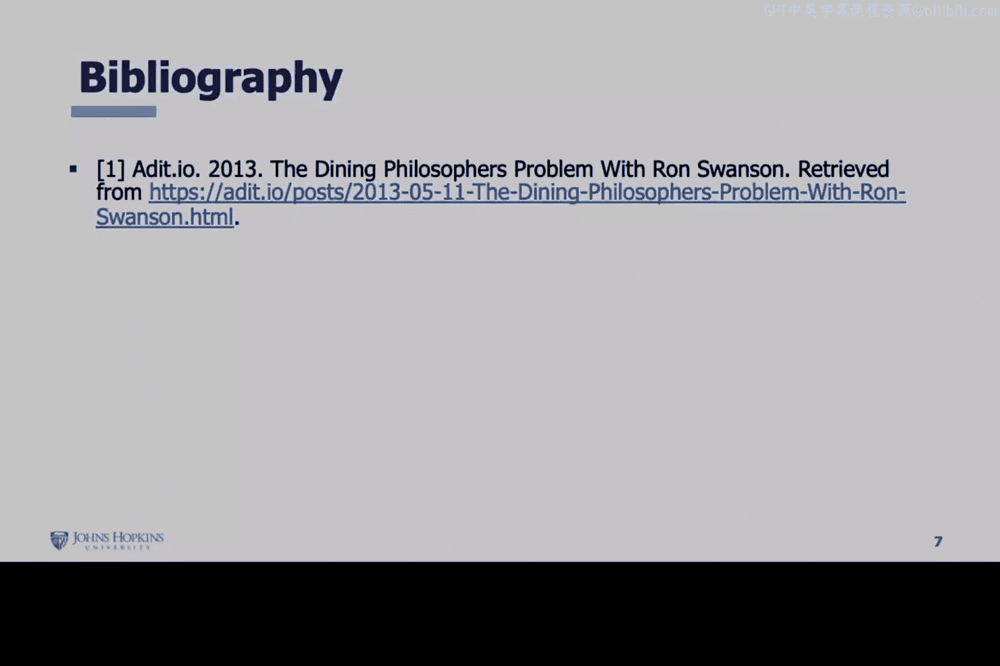

# 约翰霍普金斯大学《GPU编程（并发编程、并行编程、面向企业、CUDA高级库）｜GPU Programming》 p06 5_并发编程问题与算法展示.zh_en -BV1a1421r7vw_p6-

Well， and I hope you will enjoy this discussion on concurrent programming problems。

And algorithms to solve them。4 canonical challenges and algorithms。

In the world of parallel programming are dining philosophers。Producer， consumer。Sleeping barber。

And also， data and codes synchronization。Which is more of a parallel programming mechanism than a problem。

😔，Each of these are at the heart of different issues that you will encounter。

And a solution for them will solve numerous analogous issues。

So keep them in mind as a pattern to look for when programming with parallelism。

I hope you enjoy this depiction of the dining philosopher's problem using Ron Swanson from Parks and Rec。

This seems a little less scary than having Socrates in played out waiting to eat。

So each philosopher wants to eat， but they need two forks to be able to do this。

Don only ask me why they need two forks， but they do。They can only do one thing at a time。

 pick up a fork， eat eggs， or put a fork down， etc。

So they need to eat with both and in a naive implementation where a philosopher tries to pick up the left fork and then the right。

And then eat， and then put the left fork down， then put the right fork down。

This will fail since this will most probably result with each philosopher having one fork and being very angry。

 Does it seem familiar， It is a little bit of a few of the problems encountered in the previous video。

If you expect each philosopher to neatly and politely get forks and eat without ever trying to pick up the same fork。

T it is resource contention， with the fork being the resource。

If you have the philosophers hold their ground and never drop off work， then it is deadlock。

 almost literally。If each philosopher drops the fork， they hold and tries to get the other fork。

 then probably have live lock。Consider a way to solve this。

 Could the philosophers communicate to each other。Or have a central authority determine the order。

There are many solutions to this problem。But they aren't always easy。

 So think before you write the code。Prodcer， consumer or reader writer pattern。

Is a very common tool these days。A very common way that is used in message cues。

 which allow for data to be added sequentially， non sequentialequly in a streaming or batch fashion。

Then usersrs pull or subscribe to the message queue， and it returns data either in the order。

 it was placed in there。Or as it becomes available。One or more processes， call them producers。

Can then add data to be consumed by the consumers。If there is more data than the Q can handle。

 there are a number of strategies based on how the data is used。

If the more recent data is more important， then the Q will drop all this data。

If only a sub samplingampling of data is needed。Then data can be randomly dropped from the queue。

If all data is important， then newer data can be stored for access once space is available。

Think of it as slower and less costly。And consumers can be told to hold back from doing any more processing。

There is a chance of race conditions if the data structure or queue allows for overriding of values or the pointer index for the producer ends up being ahead of the index of the consumer。

And thus the producer may never end up with new data。The sleeping parvor is similar to producers。

 consumers。What order is not important。 The threads are trying their best to optimize the barber's work。

The waiting room is like the queue or data structure from the previous slide。

But the barber or barbers can only put one customer share at a time。

The waiting room is of a finite size。And two issues can occur。First。

 if the barbers are chatty and slow at cutting the hair。And there are lots of prospective customers。

We can have something like live lock or over utilization。

Where they stick their head in and see the waiting room full。And leave。

The second major case is that there are no customers。

 and the barbers should sit around sleeping and talking about how much better baseball was back in the day。

This is a situation of。Under utilization。There are solutions to this problem。For one or more barbers。

But when I think of this problem， I think about inverting the problem and having the number of customers in the waiting room determine the number of barbers。

Many， if not， most languages， provide a mechanism for synchronizing data or code。

This generally locks access to data or code。So use it with caution。 if you make all data synchronize。

 you end up with dead or livelock。 so if a thread attempts to access a synchronized piece of data。

 any thread that requires that data will wait。This is useful in ticketing systems where you want to lock access to code or data until it has been fully used by the previous holder of the call ticket。

S4s are implemented with Fox， but have a limited number of states to manage access to data or code more indirectly and allow for multiple accesses concurrently。

Think of this like seating categories for flights。Those in class 1A can be seated before those in one class B or two2。

Multiple individuals can board at the same time。Which should minimize the possibility of being blocked by other passengers。

The major note here is that there are rarely bulletproof solutions to multi threading problems。

But you can come up with a reasonable solution based on prioritization of coherent data access and acceptability of under or over utilization。

