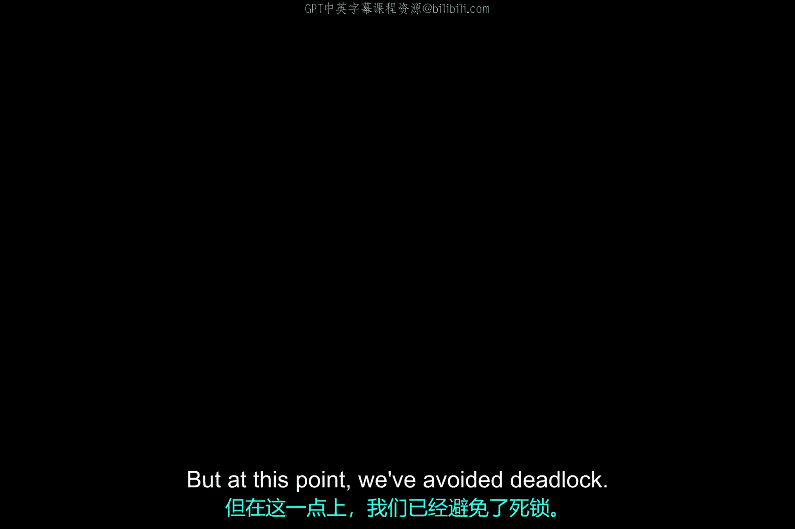

# 约翰霍普金斯大学《GPU编程（并发编程、并行编程、面向企业、CUDA高级库）｜GPU Programming》 p07 6_可选课题-饥饿小鸡问题.zh_en -BV1a1421r7vw_p7-

So the first thing we'll see here is the food that I'm going to give。The two big donkeys。

 which one you can see here。So these two donkeys act as if there are two large processes。In a CPU。

They're alternating where they're getting their food from。

 Sometimes they'll come over and bug you for resources。 But the point being that there are two cores。

And two donkeys。So， there should be enough。Processing power to have them do what they need to do。

 unfortunately， sometimes。The donkeys and the CPU processes may end up trying to take more than they have。

 but thankfully the scheduler will keep it such that。Most of the time。

 they are always active doing what they need。 This is a little bit different than what we'll see with the chickens。

 where there are many chickens。And there are。More constrained resources。

Here we see the chicken feed on the left in the chicken scratch on the right。

The chickens need the feed。To live， but really like the very sugary scratch。

 So it is used to distract them and keep them from damaging each other。

Here is a collection of chickens。 I mean， processes waiting to get some resources。

So while I go around， you will see different types of feeders or access points for resources and the water。

What I am doing now is only giving a few resources in specified slots in the feeder。

So each chicken acting as a process is trying its best to get the resource set at once。

Some chickens are waiting around for more resources to come。

 seeing that the fight that may ensue is not worth their effort。

Now I will place resources in one of the slots in the red theater and close the top。

Chickens will then attempt to get resources from any of the slot。

 and they will start to actually come into resource contention with each other as you see the one packing on the other。

Now I have placed resources in each of the slots of the feeder。

So you would imagine that there be more opportunity to feed， but there isn't。

 there isn't enough resources from the perspective of the chickens。

So we need to divide up the feed even more， such that the chickens are looking at each other less in fighting over resources。

They will continue to fish around looking for an open slot， in this case。

 the green feeders or the red feeders note that they have to be closer to each other because the resources are more readily available。

 but at this point we've avoided deadlock。

Now， to avoid live lock or over contention for resources or even suboptimal。Use of processes。

I will put scratch on the ground， which further separates the chickens and puts them even in less contact with each other。

And it gives them the thing they want the most。Thank you。

 And I hope that my chickens and donkeys have helped you think about。

Multi processingces in a new way。