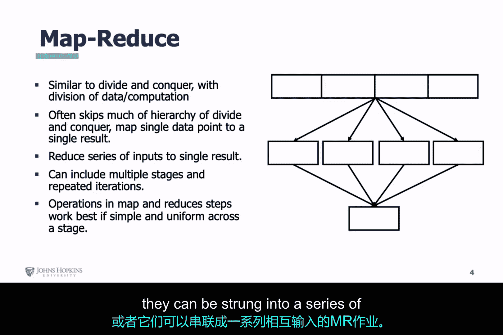
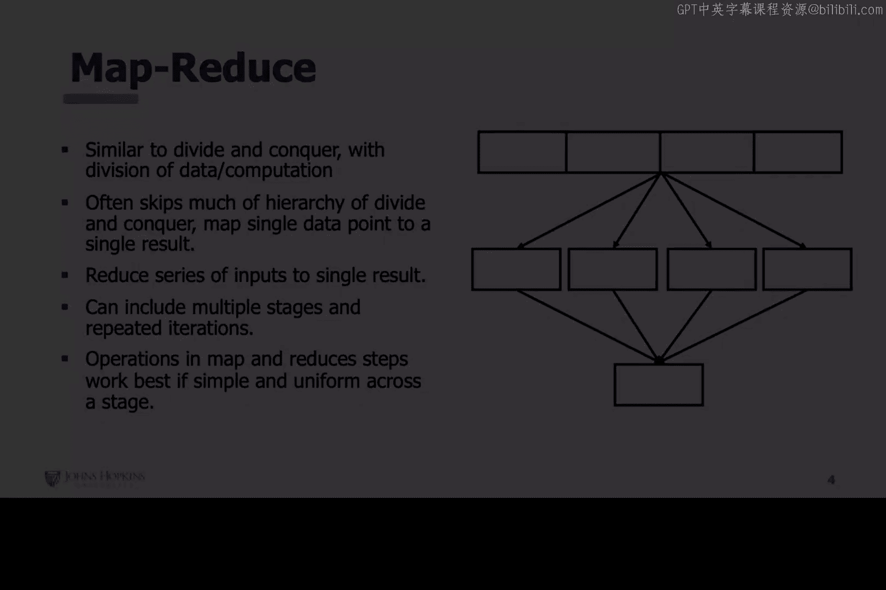
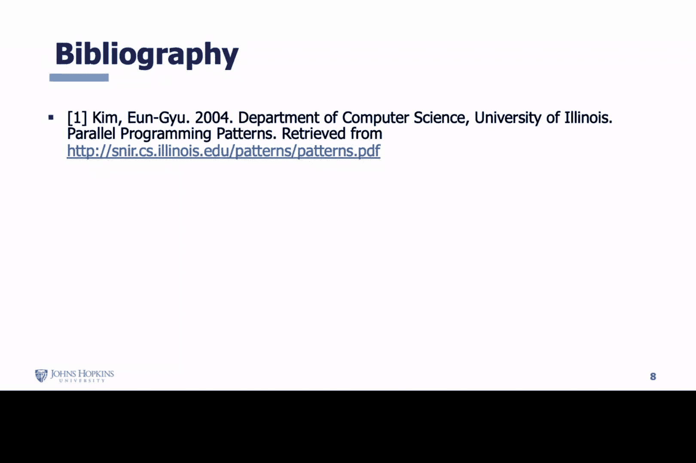

# 约翰霍普金斯大学《GPU编程（并发编程、并行编程、面向企业、CUDA高级库）｜GPU Programming》 p08 7_并发编程模式解析.zh_en -BV1a1421r7vw_p8-

Hello and welcome to this video that will discuss patterns that you will use in parallel programming。

Many of the solutions to parallel programming challenges fit into these five patterns。

 Dide and conquer， map， reduce the repository。Pipelines are workflows and recursion。

Learn to recognize that one of these patterns can be used in your program to make it more efficient。

 and you will save yourself a lifetime time， avoiding trying to reinvent the wheel。

One of the most common ways to solve computer science problems。

Even without concurrency is divide and conquer。You've probably seen how it can be used in search and sorting algorithms。

The basic idea is to split up the data until it is small enough to answer the larger question。

Order or equality。For the smaller amount of data。Once the thread has that answer。

 return that answer to a called it， and it will take the responses from all the smaller data sets and answer the question with less work。

This makes it back to the main calling context and should have taken less time than doing pairwise comparisons。

It's not always the best answer。Finding the same value in a set might take N comparisons。And thus。

 if this data set is not already sorted， you will pay an extra cost for the breaking down and bringing back together If recursion is not allowed or really inefficient。

Which is the case in Kuta， Then this should not be used frequently。Also。

 a program implementing this will need to be well designed and or maintain a complex state for all the various divides。

 etc。Maap produce can be thought of as a subset of div and conquer。

The main difference is that each time a map produced cycle is run。

 it immediately breaks down into individual data points。

 and the same operation is applied to all individual pieces of data。

Each mapper returns only one value。And the reducer has the job of taking in return values and reducing it to a single value。

An example would be testing if a value is in a set。

 each mapper would return a0 if the value passed to it was not the search for value。And one。

 if it is。The reducer would just add all the values and convert0 to false and greater than 0 to true。

The nice thing about this way of doing things is that it scales well regardless of the size of data and quality of computing resources。

Presuming the MRR system is well architected in communications is not slow。

What mappers and reducers do can be more complex， or they can be strung into a series of MRR jobs that feed into each other。

The repository pattern can be used when state needs to be maintained across multiple threads or processes。

Each process can run independently， and when it needs information or wants to change the overall state。

 it makes requests of the repository。The repository needs to ensure that data is maintained atomically within itself。

But processes are responsible for maintaining their own state。

Based on concerns of data consistency or staleness。

 this system may want to encourage more or less use of the repository since it is possible for a process to work on data for a while and want to update it。

 but doing so could overwrite the changes that were made based on a newer state。

Pipelines and workflows are similar。They are both represented as directed crafts without cycles。

Though that is not strictly the case， since workflow systems allow cycles。

 but data will still flow out of a note。Pipelines are workflows in which each step gets input from the previous step and outputs to a single future step。

Workflows often employ fan out and fan in patterns。

Where either the same input is output to different logical steps。

 or data is divided up and sent to the same logical code。

Note that map reduce and divide and conquer can be implemented using workflows。

 though neither are exclusive to the other programming languages handled divide and conquer and map reduce。

Especially now in a more functional programming way。

A key way to solving many complex problems can be via recursion。

Almost any problem can be solved recursively， though not always most efficiently。

Functional programming languages。And frameworks such as Lisp。

 closure and lowdash are built around some level of recursion。In these cases。

 data is divided into head and tail or first and rest。

Functions operate on the current data and call themselves with the rest。

Recursion does not always have to be handled in that way。It can be divided in a number of ways。

 including in a binary manner。Recursion requires management of state。

 since you need to ensure that it is an infinite。Which means that recursive algorithms need final states。

Often when only one or two pieces of data are inputs to a function。

Recursion is not advisable when you are using it on a large data across multiple local or distributed Cs。

Not on the same processor， and GP don't perform well in this pattern。

