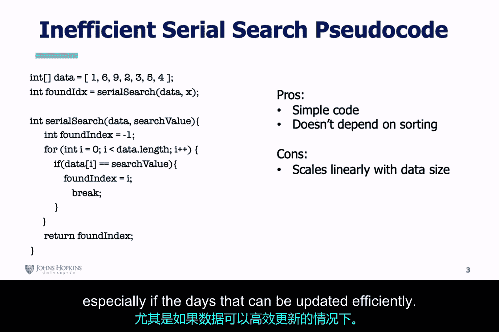
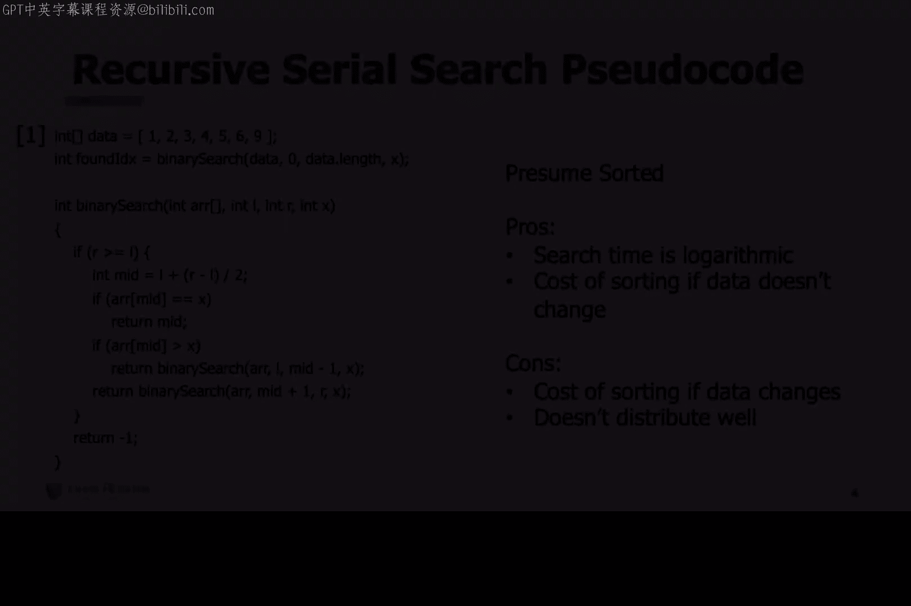
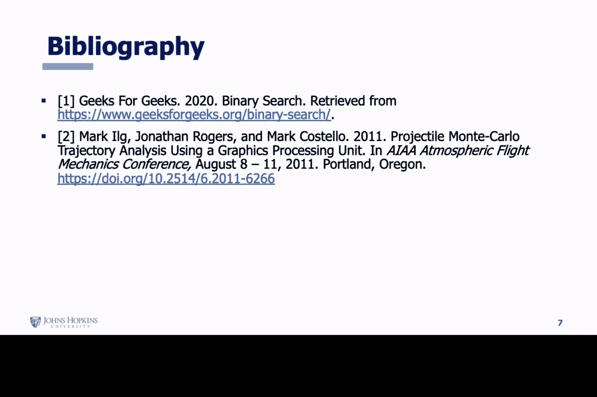

# 约翰霍普金斯大学《GPU编程（并发编程、并行编程、面向企业、CUDA高级库）｜GPU Programming》 p09 8_串行与并行代码及Flynn分类法.zh_en -BV1a1421r7vw_p9-

We are on to the video discussion of serial versus parallel code。

In the main way of describing how you can develop code for all situations。

To show how you can create code to search for a value in a data set。With serial and parallel means。

 we will use some pseudocode to illustrate how this can be done。

Search is one of the most canonical challenges of computing。

 so understanding good and bad ways to perform it can help define other analogous processes using sequential or concurrent programming。

Also， as a means of breaking down what happens and what types of programming work for what type of data。

We will investigate Flynn's taxonomy。In this code， you will recognize a very simple。

 sequential algorithm for finding the index of a search value in a dataset set。Simply stated。

 iterate through all values in the set。And if the search value is equal to the value。

That you are looking at return the index。 Otherwise， return negative one or not found。

 will be returned。So the good things are that is' pretty much the simplest implementation that you can imagine。

And there is no need to sort the data ahead of time， which can be costly。

The negative is that to find the index based on the data and the value past。

 you may need to search through all values in the data set。Linear search is not great。

 especially if to do a lot of search。That is why the cost of sort， along with a good。

Algorithm is preferred。We're hoping to get logarithically computed search based on dataset set size。

Even if there is a large initial cost to it。Especially if the dataset set can be updated。

Efficiently。

This is one of the more common implementations of search。

And it is using a divide and conquer solution。We will presume that， no matter what data is。

 it is always sorted， or this will not work。The code divides and conquers the search by picking midpoint。

 which are tested to see if they are equal to larger or smaller than the search value。If not equal。

 the function calls itself with the left or right subsets。

 each one being smaller than the calling function dataset set。If nothing is found， return negative 1。

The positive aspects of this implementation are that search becomes logarithmic。

 And if the cost of search is low relative to the following usage， a search。

 then it is worth the upfront cost。If the sort doesn't update efficiently or the data and or computation is distributed。

This becomes a very negative cost。The first thing you will notice about the parallel search is that it is more complex since you need to assign correct data to each thread。

In this case， that is by uniformly slicing of the data into subsets to evenly distribute the load to each thread。

Each thread only searches a small subset of data。 and if it finds X。

 then it needs to kill the other threads。Probably indirectly and return the index。

Good parts of this are that no sorting is required。

 and scaling can be managed by increasing the number of threats。

The natives are that if the number of threads。Is order of magnitude smaller than the data size？

This is just slightly more efficient than the inefficient serial search。Thread management isn't easy。

 and killing off other threads would be either dangerous or require well thought out logic。

This can be improved with pre sorting and binary search。

But then it inherits the issues with recursion。Where this shines is if you have lots of threads。

And that is where GP come in。More on that later。 But each。

 if each thread just needs to do a single comparison and only update a shared variable。

 if it is found， then you have a constant search time better than logarithmic。

So let's take a look at Flinn's taxonomy。The first two characters can either be S I or M I。

 single or multiple instruction。Which means。Do you perform the same logic or different logic on all data？

The second two characters can either be。SD or MD， single or multiple data。

Which means is the data complex or is it numerous and simple？

In the top left are sequential programs working on a single complex state。

Think of it as a program that executes a chess or non trivial game between two humans。Lots of parts。

 but the game probably can be decomposed。This isn't about searching for the next move。

 just managing state。The bottom right are problems。

Multiple different processes are doing different things。To lots of small pieces of data。

This is similar to running multiple filters on pixels in an image or images in a video or something similar。

Each operation may be completely independent of the other。 It may not make context。

 like previous images in a sequence or values for now nearby pixels。

Most CPUU based sequential programs are MI D。Since they have different processing steps。

That are meant to work on a single or few complex objects。

GPUs and other distributed programming solutions are often CD。

Since they aim to use numerous threads and processes running the same logic on large amounts of data。

Use this taxonomy to look at your data。And what you are trying to do。

And then when you determine which of the four is your category。Look at applicable languages。

 frameworks， hardware， etc。

