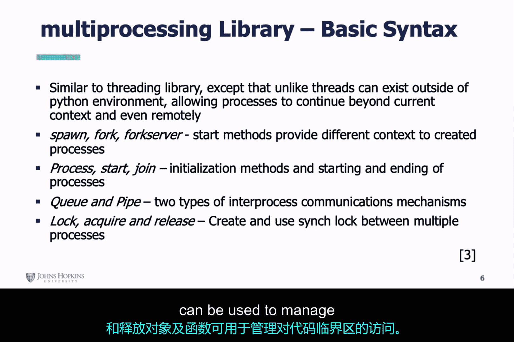
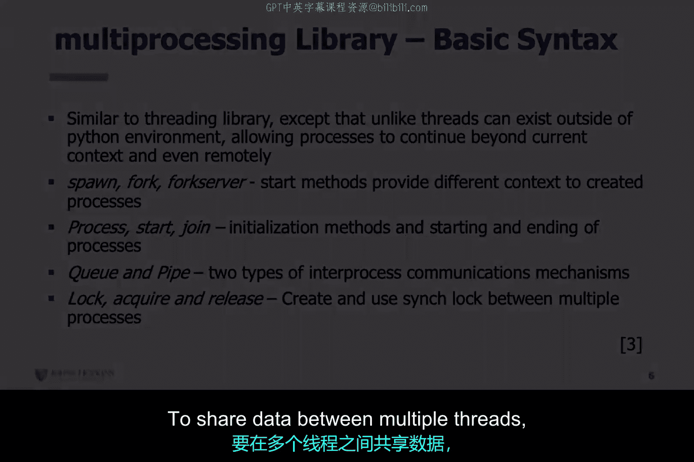
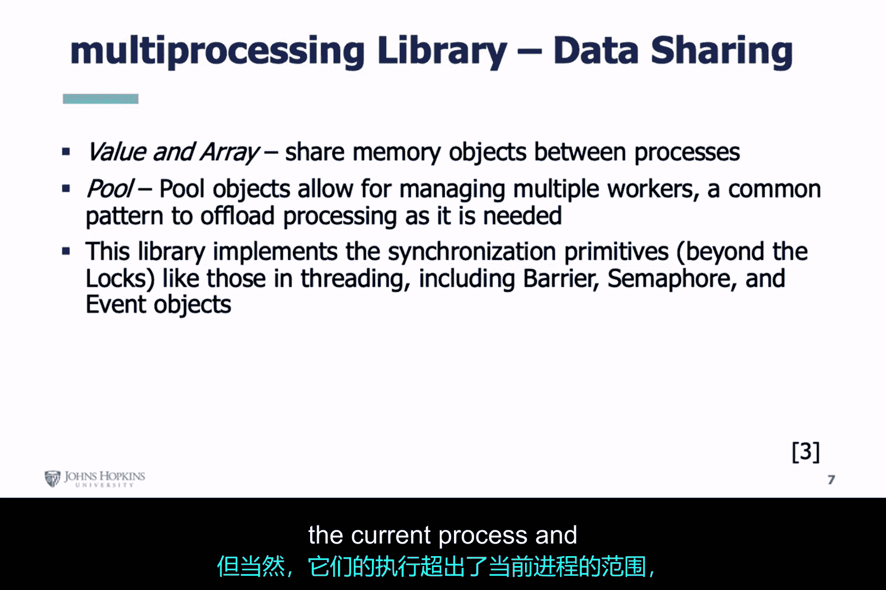
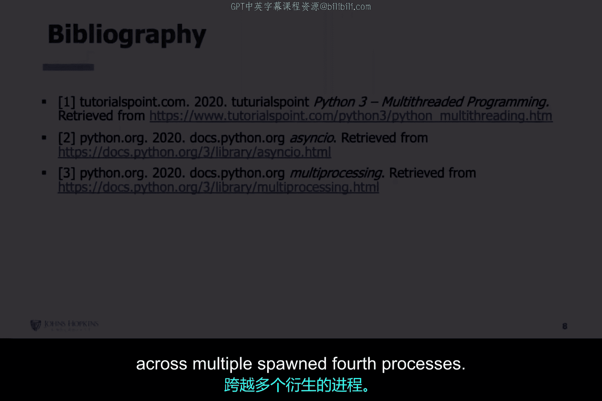

# 约翰霍普金斯大学《GPU编程（并发编程、并行编程、面向企业、CUDA高级库）｜GPU Programming》 p10 9_第1课 Python3并行编程语法与模式视频.zh_en -BV1a1421r7vw_p10-

Hello and welcome to the V lecture， describing how to perform parallel programming in the Python  III programming language。

There are three main libraries in the standard Python 3 programming language distribution。

Though numerous other libraries can be downloaded， that work similarly。

We will only go over these three since they are available out of the box and are very well supported。

The underscore thread and threading libraries are low and high level interfaces to Python 3 threads。

Asynnc Iio is a library implementing a number of core functionality for asynchronous executional code。

And lastly， multi processing is a library that aims to go beyond just threads for concurrent software。

To make use of the thread or threading libraries， just add an import statement at the top of your Python file for overall access。

Or at the top of your method for method level access to these libraries。

Threads are started with the start new thread method。

 which you pass the name of the function that the thread will execute。And then， the arguments。

And keyword arguments。That map to the args， K args of the name function。

This acts as shorthand for the run and start methods， which may be extra boiler plate coat。

When using the thread library， you can take the return value of the start new thread。

Method or similar function。Which is a handle on this started thread and lock， acquire lock。

 and then release the lock on a critical section of code。

This is a very common pattern of use for locks on critical sections of code。

Seven fours can be used to signal access to a variable。By default， a single thread at a time。

 or a bounded semapho can be used to allow a predefined number of threads to access a variable。

There is also a scheme for communication between threads using events and event handling。Lastly。

 a barrier can be placed in code to make sure that all active threads execute up to。

 but not beyond the barrier。Prior to all threads hitting the barrier。

This is a good way to synchronize data， especially if one or more variables need to have a coherent value across multiple threads。

Asychio is a common language construct among multiple languages。

Which allows in a very simple manner for management of asynchronous coat。Once imported。

 functions can use the async keyword to indicate they may be executed in an asynchronous fashion。

Think of this like the situation when your code wants to get information from a network server。

 but you don't need to have your whole system wait for the execution of one or more lines of code。

There is some guarantee that asyncct methods will eventually complete。

 and the library will handle this。Back in the Python two days。

 web applications that made time intensive processing in the middle of a call for data from your browser would either have to sit and wait or as Python 3 became more available。

Developers monkey patched this library into Python 2 code， but that wasn't very pretty。

To call the function and let it execute in its own thread。

 the calling code just needs to wrap the async method in the async Io run method。Alternatively。

 if you want the code to wait for the execution of an async method。

 the awake keyword is used common when sleeping a thread。

Some more advanced capabilities of as IO include creating tasks。Unlike the run call。

 that returns the method that is called by the thread， create task not only executes the co routine。

 but returns the task object that can be used to retrieve results。

A task can be used as part of a sequence of calls that can be executed in parallel with the gather method。

The sleep method is very important as it allows for executing threads。To wait。

A predetermined amount of time。 This is handy if your code is doing something aside from handle the result of a calculation。

But we'll want to wait for a result that is's eventually going to be returned。Also。

 if you want to have threads that have a loop that is executed as long as they exist。

 think of pulling a file system for change and then performing a calculation or showing the contents of a file in an application window。

The multi processing library is very powerful as it takes the idea of independent execution of threads inside of a Python3 context and allows for execution of code outside of the current calling process and even on a remote machine。

Spawn fork and fork server。All have three general goals。

 create new processes out of the current process， though they have different results。

Spawn is the most common version， create a new Python interpreter process， which be similar。

 but not the same as the current process， basically the Python interpreter。

Willll have the existing libraries。Fork is a more of a copy of the current process that it can change over time。

Fork Ser is the most elaborate。 It creates a server that， when called forks a new process。

 so it can be called repeatedly。It also handles any dead processes that may occur over time。

The constructor for our process is very similar to how you create threads in other libraries。

You pass keyword arguments to the target function to be executed in an arcs that will be passed to the associated method。

In the processes execution， you call start。 And when you want to halt the calling threads execution until the processor is done。

 call join。For processes to be able to communicate with each other。

 either a cue or pipe can be passed as an argument to the various processes。

Ces are sequentially accessed data structures， and pipes are two way mechanisms for communicating between two ends of a pipe。

It is possible to have more than two processes access the same end of the pipe。

But simultaneous Reed writes will corrupt the cue。So if you want multiple readrites between a parent and child process。

Or processes in this case， it may make more sense to have multiple cues。

Like with the two previously mentioned thread libraries。

 the lock acquire and release object and functions。

Can be used to manage access to critical sections of code。

To share data between multiple threads， you can use the value object for a single value object to be shared and array to share a collection of primitives。

 If you would like to spin up multiple processes for constantly completing work。

 A work or pool is a common pattern。 You create a pool object with a number of processes that you would like to have spawn。

Then each time you want to have a parallel execution by the pool， just perform functions on the pool。

 such as map。Which is a function。That you pass the function that you would like to perform the action on an array of values。

Then the pool of workers execute the function with a value in the array until the array has been completely mapped。

This form of functional programming is becoming more common。

 and programming languages are handling it more and more efficiently。

There are also other common primitives， like in the thread and threading libraries， But， of course。

 they execute beyond the scope of the current process。

And across multiple spawn forked processes。

