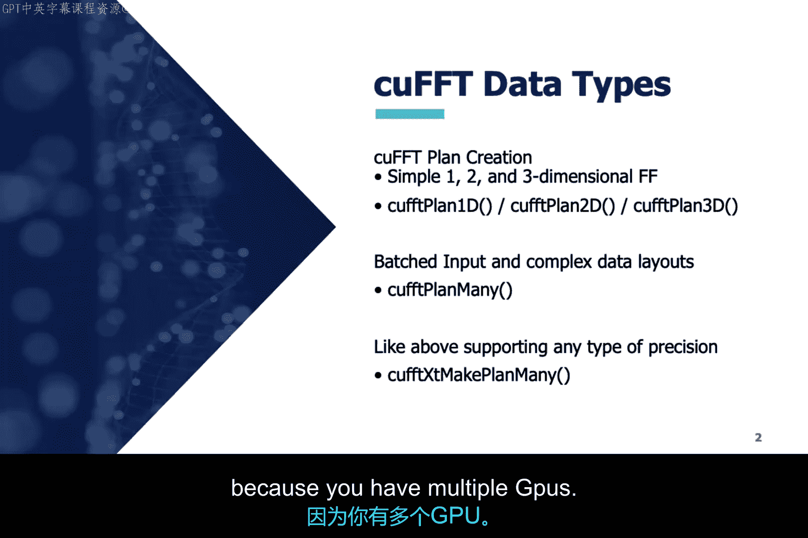
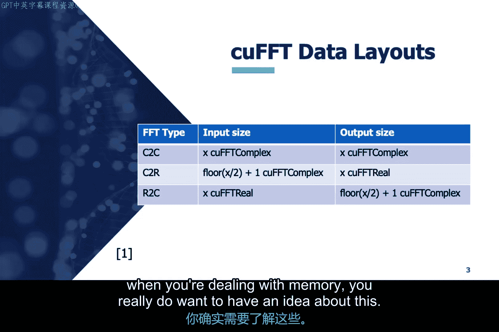

# 约翰霍普金斯大学《GPU编程（并发编程、并行编程、面向企业、CUDA高级库）｜GPU Programming》 p100 6_CUFFT数据类型详解视频.zh_en -BV1a1421r7vw_p100-

We're going to talk about data types for QFFD and they're very important because the operations are not simple。

 and so having data abstractions are very helpful。😔，So the primary QFFT。Data type is the plant。

How do you create one， you determine whether you're doing a  one。

2 or three dimensional Fastsated transform， and then based on that decision you call Q FFT plan 1D。

 2D or 3D respectively。Now if you want to batch a number of plans together。

 you use the QFFT plan many and the nice thing about that is that you can。

Deal with both real and complex data layouts。So then what happens if you have multiple GPs while we've gone over that somewhat before all？

Multi GPPU functions start with Q FftT X T。Make plan， which you've seen before。

And then you add the many， so that allows you to have multiple GP support。And batch across them。

 which youre pretty much going to have to do because you have。Multiple GPUs。

I want to show you again a more simple version of the input output data layouts。😔。

So when you go from complex to complex， your data types are QFFT complex， both input and output。

 and the size is both x。When you go complex to real， you start off with。X， the floor of x plus1。

 So it's a little bit more than half of the output size。

 which you're going from QFftT complex to QFftT real data types and real de complex。

 you start off with a input size of x。Of data types， Q FFT， realel， and the output is。

The floor of half of that plus one in QFT complex data types。Thisす。

May seem a lot to think about at first， but when you're dealing with memory。

 you really do want to have an idea about this。

