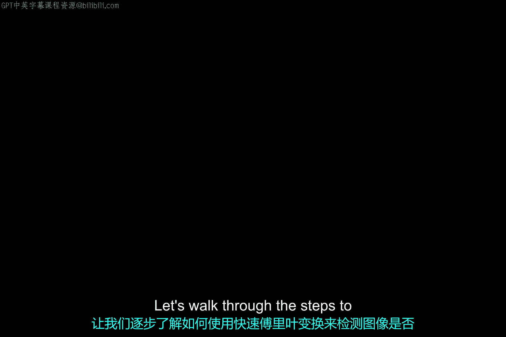
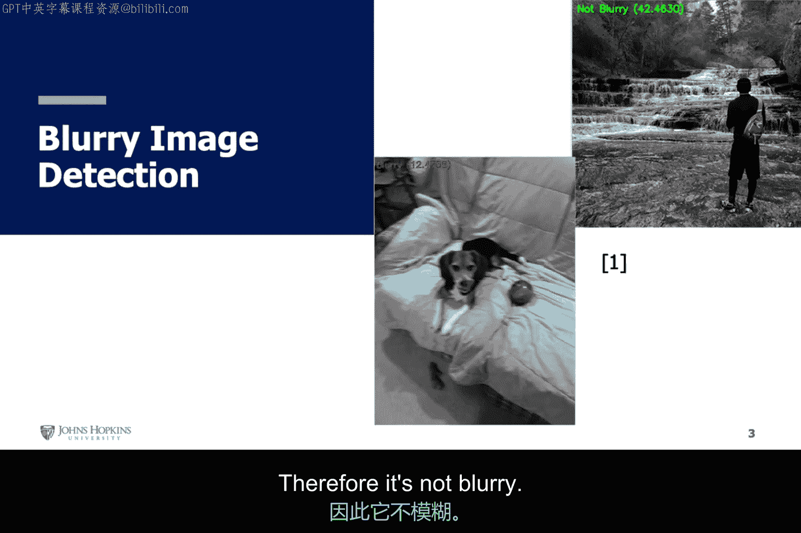
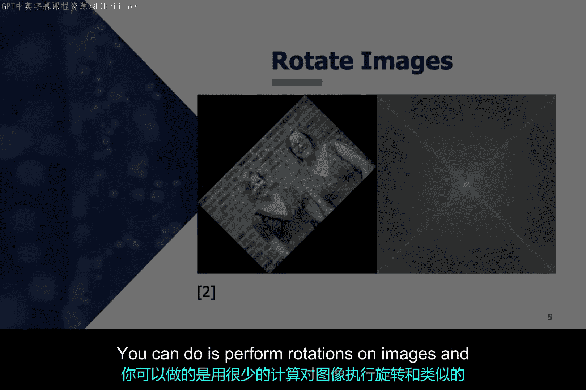
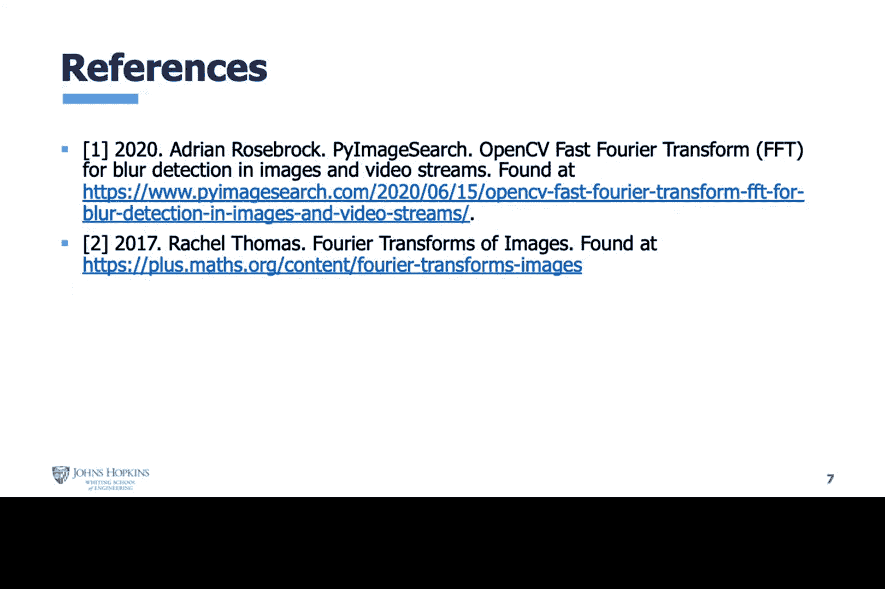

# 约翰霍普金斯大学《GPU编程（并发编程、并行编程、面向企业、CUDA高级库）｜GPU Programming》 p101 7_CUFFT图像处理技术视频.zh_en -BV1a1421r7vw_p101-

I'm going to go over the usage pattern and use cases for。Image and video processing using Q FFT。

 Let's walk through the steps to detect if an image is blurl using Fast transforms。

The first thing is always you're going to get the data。

 which means importing the image best far transform the image。You shift that fast forward。

To the center of the image。Remove any lower frequencies that you may see。

Inverse fast forward or transform。Back to the top left。

Then you fast further transformverse on the image itself。

Then you determine what the spectral maximum or magnitude of an image is。

You calculate the mean and if the mean is below a threshold， it is blurry。This is a lot of steps。

 What you need to know is that you you're transforming the image to the。Domain of signals。

You're moving that the center of that transform to the middle of the image because。Generally。

 the center of an image will be。m in focus。You've remove any lower frequencies to get rid of any dirty signal noise。

And then you move it back up to the top left so that you can detect bluriness in the image and it seems a little complicated but。

What you're trying to do is say， okay， I know what the magnitude generally of the image is。

I want to calculate all this signal values。And to， and generate the mean。

And that mean if it's below the spectral magnitude of the image。

 then you know that there is a blurriiness because。

It should should be similar to the magnitude of the image。Let's see what this looks like visually。

 so the image of the dog you'll notice has lots of similar patches of color。

 There's not distinctiveness in the grayscale image。So。Under that circumstance， the magnitude。

Would be really low， whereas the mean。Which is just taken across that would be relatively。

Similar and definitely above the magnitude。Now， in the image of the gentleman looking at the waterfall。

It's not blurry because there is the magnitude across the whole image and that indicates differences between one pixel and another are vastly different。

So you have lots of different colors。The mean maybe， you know。

 mean is always the middle value of all the magnitudes。But basically。

 what you'll see is that there aside from the gentleman himself。

 who doesn't have a lot of difference between him。And the other elements。

 there's lots of variation in color， so the deltas between pixels are higher。And so therefore。

 it's not blurry。 Another application of Fastparary transforms。

Was taking grayscale images like the one on the left。

And being able to construct a 3D rendering of it。 And that's because。Qu youll notice is。

 there's different signals and the intensities， and often。

The focal length of the image affects that signal。 So while you make the first signal notices in the reconstruction。

 you can see bricks。3 3D constructed。But the other thing is， because the focal length is different。

 the magnitude of the signal will be less or you can use that as a determination of the Z axis。

 such that the two women。Appear closer in the three reconstruction， as they are in reality。

you can do is perform rotations on images and similar transformations to images with very little calculation。

How would you apply something like this to video you're taking？A single frame of video。

And then transforming it to a collection or sequence of frames。 Well。

 the advantage you have is you're no longer when you're doing the fast rate transform Con with time。

 It's just like amplitude of signals or something along those lines。So。

Performing transforms that occur over time， like rotating an image。Say，360 degrees over。

A minute would be more easily calculated than taking each single pixel and moving it and doing those calculations。

The it's very easy for you to sort of do that thing that we saw with the audio where you turn this。

The image， you turn on its side， and you can look at peaks and you can do things like smoothing things out。

 which will allow you to， you know， especially over time。 you can do things like。Blur， independently。

 different parts。Of a video stream。And then a good example is to take that 3D rendering from a single image。

 and you can do that over time with each frame， what that would allow you to do is construct better a 3D rendering of it。

