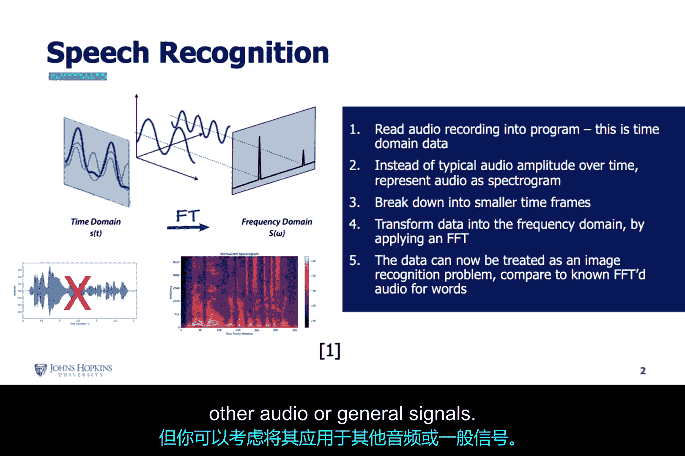
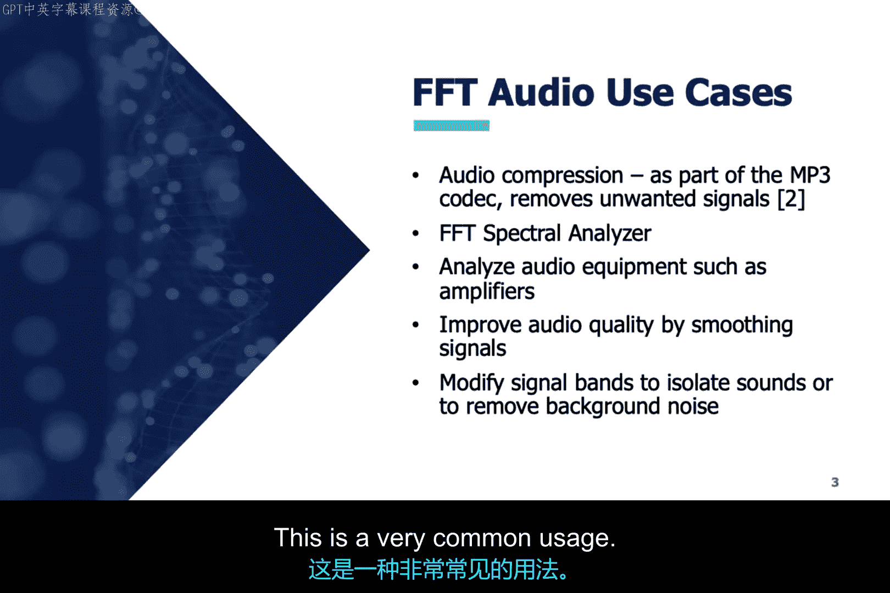

# 约翰霍普金斯大学《GPU编程（并发编程、并行编程、面向企业、CUDA高级库）｜GPU Programming》 p102 8_CUFFT音频信号处理视频.zh_en -BV1a1421r7vw_p102-

In this lecture， we're going to go over the use case of using Co FFT for dealing with audio or pure signal processing。

Now， let's walk through the use case of speech recognition。So yet again。

 fast Four your transforms take a signal that is in the time domain。To a afford transform。

Identify one or more。Signals that make up that。Time domain signal in the frequency domain。

And what you'll see is it's sort of like you're looking at the signal in a 90 degree。

 you're just seeing the height of the signal。And you will have multiple of these。

 so that's what it looks like in the frequency domain。Now， when you're dealing with speech。

 you often see something in the bottom left， which is a depiction of amplitude of audio。

 which is fine when we're looking at it， there are some things we want to do to smooth things out。

But when you're trying to identify patterns in audio using fast forward transforms。

 it's not helpful to use the amplitude because that sort of gets squashed when you do the forward transform。

So instead of that， you look at the audio recordings。As a spectrogram。

 and that's that sort of multicolored display next to。The amplitude audio signal。

And the nice thing about this is you can notice areas where there are chunks out of it。

 you can break it apart， and it transforms forward into the frequency domain much better。

Leps that you'll take in general are you're going to read in your audio into your program and note that this is necessarily going to be in the time domain。

😔，You take what is often represented as amplitude， and you change it into a visual medium。

 which is a spectrogram。And then you're going to find areas where there's little signal and you're going to like chop it up along those boundaries because that tends to be when someone's stop saying a word。

So when they've completed saying the word， that's a good boundary line。

 so you break those up and then you're going to pass these smaller bits of audio into a fast4 transform。

 so you forward transform it。And then because you now have something that's sort of it has a visual representation when it's transformed。

Forward， you can compare those peaks。And find matches。

 you can find confidences or percentage matches based on your scheme。So once you're done doing that。

 you can transform it back with those confidences， and then you can determine。

That that with a 90% or 95% confidence that this is the word that was said。

 So this is a common pattern， especially with speech recognition。

 but you can think about applying it to other audio or general signals。

What are some use cases for fast forward transforms in the audio or signal domain。

One of the biggest ones is audio compression。The MP3 codec， which compresses and de compresses。

Audio from higher quality recordings into recordings that are shared。 This is why like maybe。

A vinyl record sounds better in certain ways than an MP3 got off us。

 say Spotify or Apple music or something like that。

One of the things it does is it goes and takes away unneeded signals that add the to the size of a file。

 but don't actually add quality to the human ear。There's hardware spectral analyzers that use fast fire transforms。

You can look at audio equipment with a known input and output。

And use a fast forward transform to compare like the best audio versus the worst audio in a more。

Qualitative and quantitative manner。And then if you have a signal sometimes。

 especially with music smoothing out， what can be a very jaggedty signal can actually make it better for the human ear。

 Another thing you can do is when you're you're doing that pivot from the from the time domain to the frequency domain。

 you end up with。Different signals and different bands。

 and you can pull those bands out to either remove background noise or even pull out the audio for say。

 someone's vocals and remove away the band and then then go back and put in the band as a separate process so this is a very common usage。

