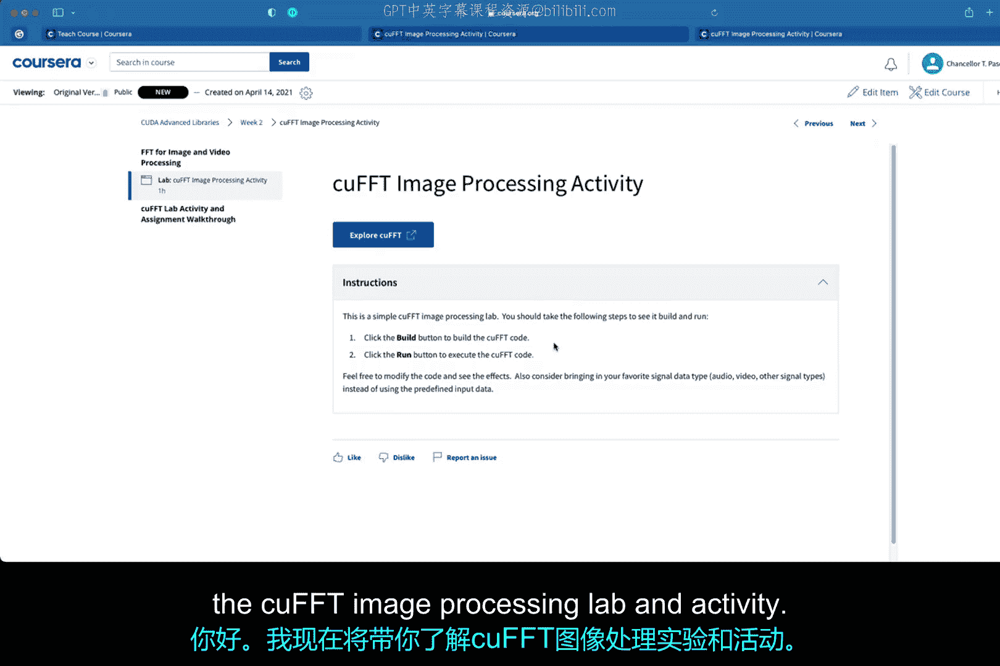
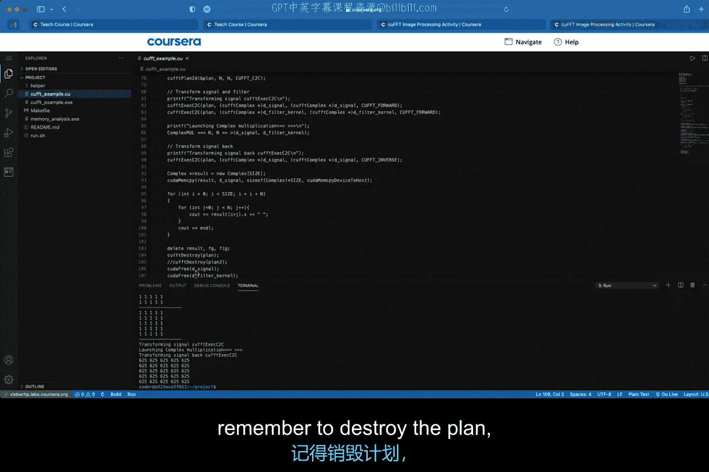
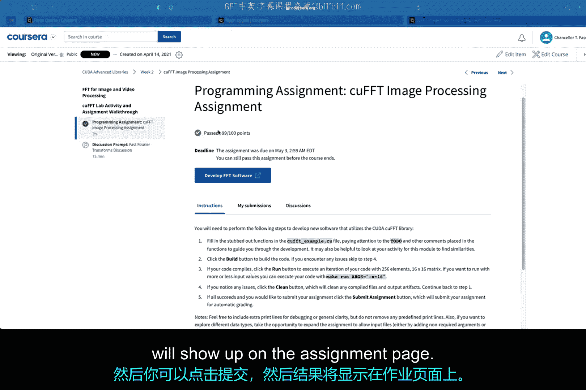
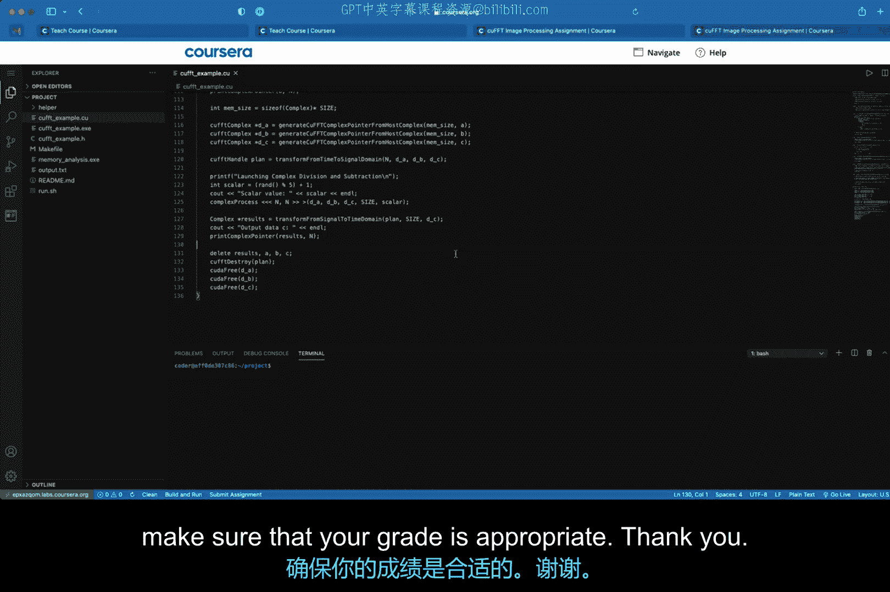

# 约翰霍普金斯大学《GPU编程（并发编程、并行编程、面向企业、CUDA高级库）｜GPU Programming》 p103 9_CUFFT库实验与作业总览视频.zh_en -BV1a1421r7vw_p103-

Hello， I'm going to walk you now through the Co FFT image processing lab and activity。

 so just like everything else。😔。

There are two buttons at minimum on the bottom of the Viual Studio code server。Build and run。

 And like the tool tip says。They run， make， clean build and make run respectively。

 So you'll click the build button。 You'll see the terminal come up。And then it will all built。

 and the way you'll know that is you'll see this Q FftTex dot EXc。 then you're going to click run。

Which creates。Two matrices and then performs Q FF T， Ford and inverse。Complex and complex。

Operations on them。 So let's really quickly look at the QFFT example code。So I tried to keep this。😔。

Quite simple。 It performs。AMatrix operation， a multiplication more than two。

As the operation it's done in the middle of the Q of5T4 transform and then。

You have to create the two signals， the signal input and the filter kernel。

 you're going to allocate memory and copy memory from device。To host in， in reverse。You create plan。

 that plan is of size n by N。😔，That's what the size that both matrices are that you're going to perform in the operational on and then it's a complex to complex transformation。

 so then you execute the complex complex with the signal transformation。

You do the same thing with the kernel， the forward transformation。 Then you perform。

A multiplication between those two operations。And then the product is placed into D signal。😔。

And then you do the inverse from that signal。And then you copy that。

Memory into the result pointer for a complex and you print it out。

 remember to destroy the plan and free all your memory。

So now let's move on to the programming assignment。As you should be familiar with。

 you will be given a。Cuta file and some to dos to tell you what to do。 I've organized the code。

 as I'll quickly show you。To be fairly easy to follow along with， you'll build it， you'll run it。

 note you can actually go into the。um。Run down S H and change the size of the matrix。

 and there's the dash n that specifies the size of one of the sides。 It's always a square matrix。

You can clean it at any point if you don't see the results you want。

 and then you can click submitit and then the results will show up。😔，<|OTHER|>On the assignment page。

 so now let's develop the code。

We have the assignments Visual Studio editor up。😔，Now。😔，Some things to note are。This make file。

 I wantt get to understand in at least a little bit more the content， so CxX is the compiler。

 which in our case is almost always MVCC， the CXX and LD flags are used for compilers and。

Loading dynamic libraries。um。You have your targets all which runs clean and build build。

 which looks for the content。Of QFFT example that U and compiles it using MVCC。

And one important note here is that。The linking to QFFT library along with KUa itself。

 and that's so when you include headers that they are linked appropriately， you can then run， we run。

QFftT dot EX with arguments and output to TxD。 So the contents of the QFFT example does C file。

Have a number of functions that I've defined the structure of what to dos like this complex scale or multipl takes to。

Complex。Values。Multiplies。😔，Then， both。By。😔，A scalealr and each other。Then the complex process。

Gets the value that ends up being put in for A and B。And sends that to that complex scalear molt。

Function， along with the scalar。The chry complex。Creates a pointer to a collection of complex。😔。

Data types of size， size。There's a function to print that complex pointer。There is a function。

For generating。😔，The complex pointer。From what is in the host here generating the device complex pointer based on another pointer。

This is because。Comflicts pointers can be。Created for device。Pointers based on a host device memory。

😔，And then the transform from time to signal。Domain function does。The forward transform。

And then the opposite is the transform form from signal to time domain。

 which does the fifier your transform。In an inverse mode。And then， you're going to have。The main。

 which pulls all this together， creates pointers for A and B， which are inputs。

Both in host memory and device memory， and then C is your output along the way。

 and then it tells you。What operations you need to do。 And as I always say。

 anything that has a print statement or a C out in this code should be maintained and should not be modified because。

Doing that makes sure that your grade is appropriate。

Thank you。