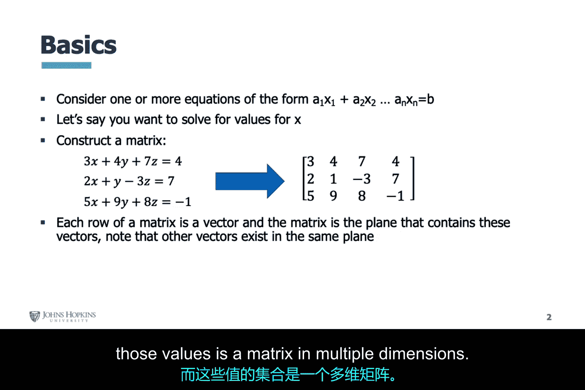
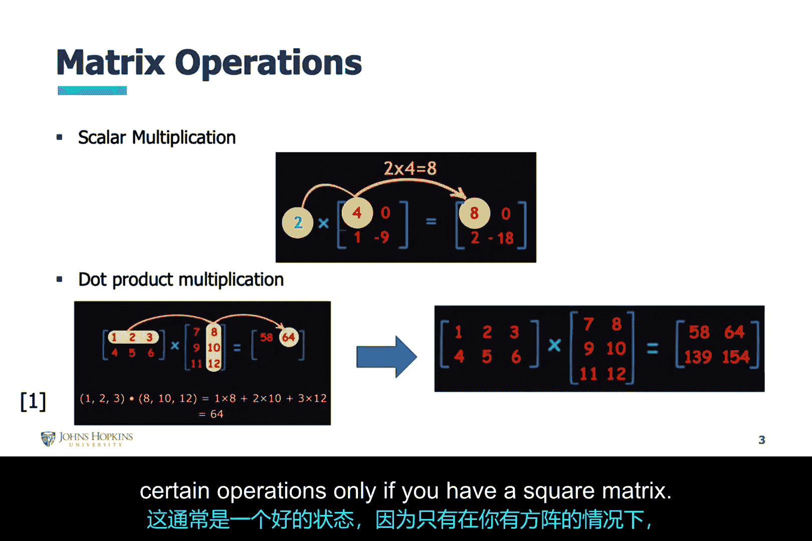
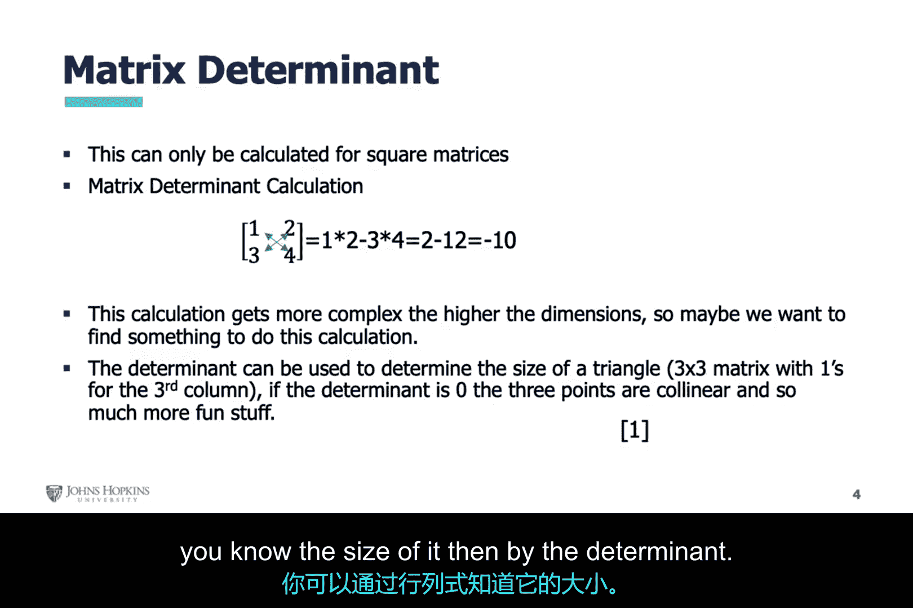

# 约翰霍普金斯大学《GPU编程（并发编程、并行编程、面向企业、CUDA高级库）｜GPU Programming》 p104 10_线性代数入门视频.zh_en -BV1a1421r7vw_p104-

So I'm going to give you a quick introduction to linearar algebra。

 this will not be a complete course， it's just a very small introduction enough to give you an understanding so that you can explore tools like KUubBLA NV+L and other KUa linearar algebra libraries。

 I would encourage you to look for resources like other Coursera courses。😔。

Or YouTube videos or even textbooks like Gilbert Strs linearard algebraro wrote book。

So now let's go over some very basic concepts。Consider the formulation of the description of a vector or a line。

As it' stated here with a a1 x1 to A and Xn。Equals a constant B。

Where x1 to xn are variables and A1 to AN are scalar values。

Often what you want to do is you're given a series of these。Equations。

 and you want to solve for each of those x or or variables。

So a common way to do that is to construct the matrix where you take all of the variables in the scalar multipliers and put them on the left。

Order them such that it's like x then y then z on the right side。

 you put the what that constant that that equals。The number of rows in the matrix is the number of equations。

 the number of columns， number of variables plus a constant。Now each row， as I've said before。

 is an equation， which means it。Describes a line or a vector。In the collection of。Those。Values。

Is a matrix in multiple dimensions。

So two common matrix operations is multiplying a matrix by a scalar or a constant value。

 so in this case you're multiplying the matrix by two。

 so all the values in that matrix get multiplied and correspondingly the result gets placed into the same size matrix dot product is the other type of multiplication you take two matrices and you multiply them So how we describe the size of matrices is rows and columns so in our example here we have a two by three matrix being dot product。

By a three by two。 So you end up with a two by two matrix。

 our dot product multiplication works for matrices is you go by the rows in the left。Matrix。

 and you multiply them by the right。Mattrix， so the columns， so in the case of the first row。

In the second position in the resultant。Mattrix， it is the first row times by the second column。

 So it's 1 times 8 plus 2 times 10 plus 3 times 12， which is 64。 and you proceed through。

 you end up with a square matrix， which is often a good place to be。

 because you can perform certain operations only if you have a square matrix。

One of the most common operations we performed on matrices with single matrices is。

That you calculate a determinant。This can only be done on square matrices now we show a2 by2 matrix here。

 but in reality it can be any square matrix 3 by3，4 by4。

It does get more complicated and there are ways to calculate it。

 but this is one of the reasons why people like。Computer to calculate these values because it can be really complex。

So what would you use a something I could determine it for。

 you can determine if three lines are colinear， which means that even though the scalarrs are different。

 they actually overlap and you know， just remember basic geometry is that，Any。

Line can be represented by different equations， but actually have。

The same trajectory start in the same place and into the same place。

So determine the size of a triangle， you can use determant Now if the determinant equals0。

 that means that at least two of the lines are colinear。If it's， greater than a less zero。

 that means that。All three lines are not cuar。 They start and end to different places。 they overlap。

So the intersect and therefore in multiple dimensions。

 you have a triangle and therefore you know the size of it then by the determinant。

