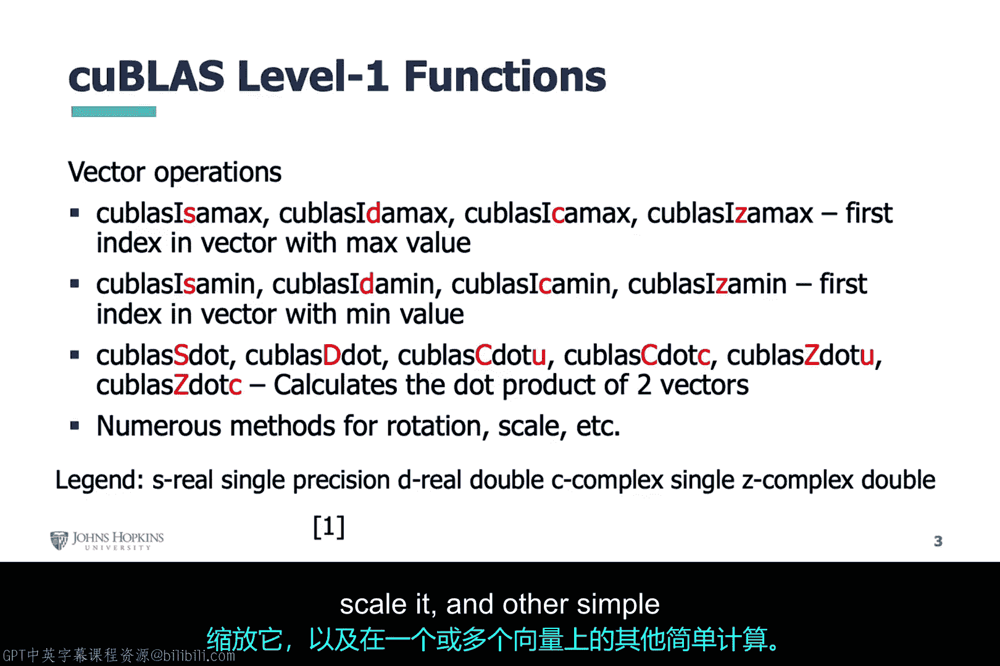
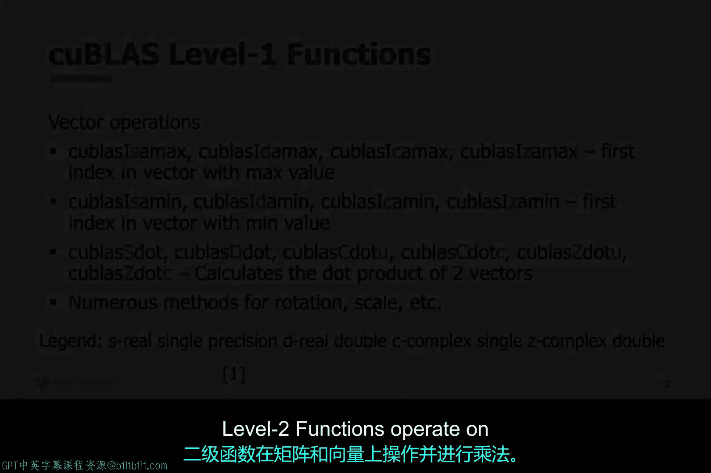
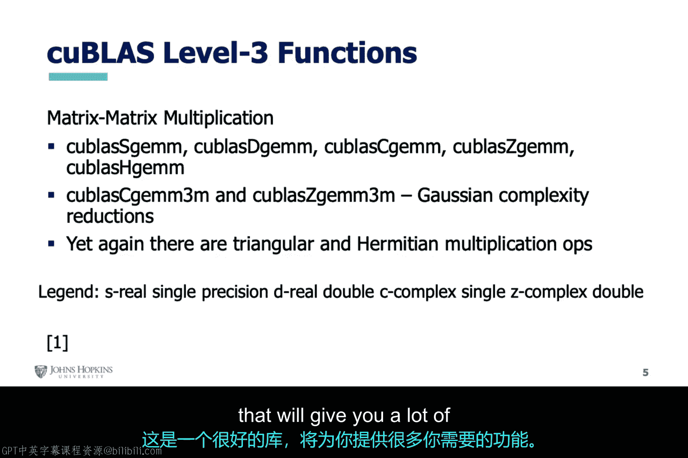
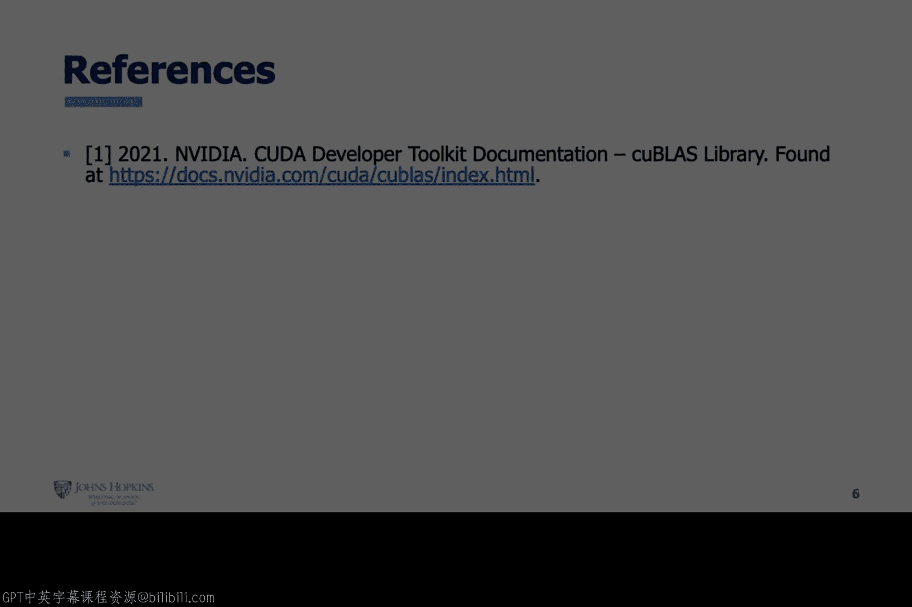

# 约翰霍普金斯大学《GPU编程（并发编程、并行编程、面向企业、CUDA高级库）｜GPU Programming》 p105 11_CUBLAS库语法详解视频.zh_en -BV1a1421r7vw_p105-

Going to dive into the syntax for the KUa Advance Library。4。😔，Larar algebra。

 the most common one and most widely used is coubla。So when you start programming and Coula。

 there are a number of helper functions that you'll need to understand。The first is Kubla C。

 which takes the pointer to a kubla handle T。Data type and it returns that handle but it's now initialized。

 and that means the underlying Kula library is also initialized。

 this is required before you do any follow on functions。

The last thing you do is always call the covalla destroy。

Because that releases any hardware or even some software resources that may be locked at that point。

If you want to use a non default stream， you're going to use the Kubla set stream in Kubla get stream with the set specifying。

That this handle will be put on this non default stream。

And then to get the stream back such that you want to put things onto that stream。

 you use the Get stream method。For colass， level 1 functions are functions that are operated on one or more vectors。

 So single equations。Not matrices。A thing to custom yourself with and you'll see this with other operations。

Are these highlighted in red， S D C and Z， and as legend sayss is for single precision。

 D is for double precision numbers， C is for complex so thoses numbers that include irrational components。

 and Z which is the same thing as C， except for those numbers are not integers。

 theyre double precision numbers。And so the functions for coublas is max or min。Or， you， for D。

 C and Z。They map like that。And they just find the maximum values。

 so the dot product functions Kubla S dot， Kubla D dot。And so forth。

Do the dot product of two vectors。 Notice that after the dot， there's the U C and the U is for。

Unsigned and C is for complex， there are also other numeric functions that can be performed。

 such as those that rotate a vector， scale it。

And other simple calculations on one or more vector。

Level 2 functions operate on matrix and vectors and do multiplication。 An example is Kubla， S D， C。

 or Z， GVM V， which is abandoned matrixtri to vector multiplication。 What you pass it is a handle。

The type of operation。 So if it's transposed， if it's non transposed， if it's permission mission。

M and N are the size of in the equation you see there， the capitala A。

 which is the matrix you're going to multiply so it's。The honor of rows and columns。K L and K。

 U are the diagonal size of。Your matrix with KL being the smaller of the two。

Alpha is a scalar that you multiply the product of a times by x。On out a is the。Is the matrix。

 L D A is a leading。Diaagonal for the matrix。And then x and increment X are the vector and the stride in the vector。

 if you don't have every。Value set in， in the， in the。Fector if you have a sparse vector。

It would be one if it's every value in the vector has a non null value。Now beta。

 y and ink C work the same way as Al， X and ink X， so this is pretty complex and just take the opportunity if you have experience with this to consider how you would use it。

Level 3 functions in coublas do multiplications of a matrix by a matrix。

One of the more common examples is a GMM。There are five variations of that matrix multiplication。

And the first four are based on both of the matrices having the same precision， whether it's single。

 double complex or double complex， and then H for hermission。

 and also add to 3M if you want a reduction Gaussian complexity。

There are other functions for doing certain types of triangular and hermission。

Multipplications that are not using G EMM。 So definitely look at the Nvidia Kuta Kubla documentation。

And。This is a good library that will give you a lot of the functionality that you need。

