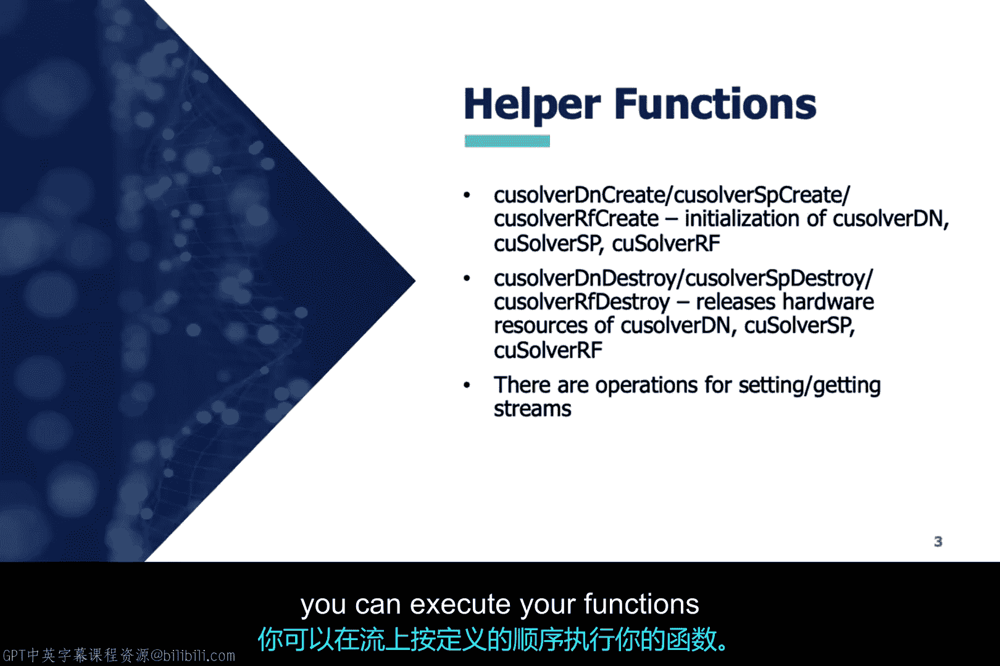
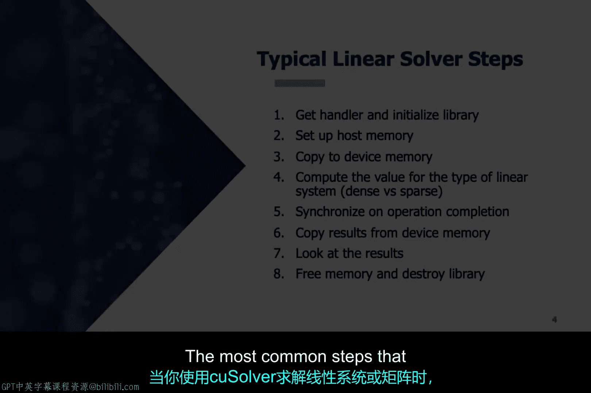
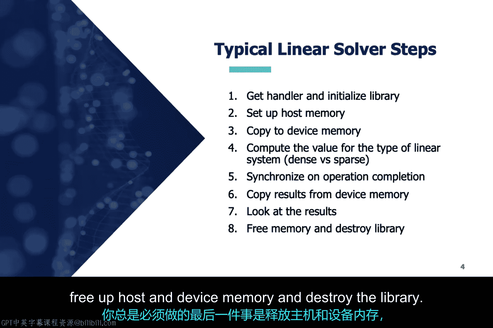

# 约翰霍普金斯大学《GPU编程（并发编程、并行编程、面向企业、CUDA高级库）｜GPU Programming》 p106 12_CUSOLVER库语法详解视频.zh_en -BV1a1421r7vw_p106-

Now we're going to go over the Kuda Advance library that solves。😔，For matrices and vectors。

 So a different problem， not doing matrix multiplication。

 but solving a series of equations in the form of one。Fector or multiple rows in a matrix。

So Kusalver is built around the idea of how you use the popular lipPA library。

 which is linearar algebra package。😔，It does too mean capabilities。

 it has the ability to decompose a matrix into smaller matrices。

 which then they themselves can be solved。It also solves matrices。

There is a single in a multi GP module。And then there are three main functionalities。😔，Kusal Verden。

 for solving dense matrices。Kusalver SP forsolving Sprse matrices。 So think of that。

A sparse matrix as being a matrix where less than half of the values have an actual value。

And then Kusalver RFf for doing those refactorizations or decompositions。

Just like with all other Kuda advanced libraries， there are a series of helper functions。

 there's always going to be a function that creates a handle。

 which in this case is Kusalver blank Cate， where the blank is either DN， S P。

 or Rf as described in the previous slide， a matching destroy functionality， which of course。

 is called Kusalver blank destroy with blank being DN， SP or R F。

Those release any hardware resources that have been claimed in the creation and use of the handle。

And then just like other libraries， there's going to be a mechanism using setting and getting to get a stream and use it。

Such that if you're using the non default Kuta stream， you can。Execute your functions。

In a defined sequence on a stream。 So the most common steps that you should take when you're using Kusalver to solve a。

Linear system or matrix are the following。You as always need to get a handle and then initialize it as we've described in the previous step。

😔，You're going to initialize host and device memory。Copy from hosted device memory that input matrix。

Then you execute using Kusalver on a sparse dense， or if you want to do a refactorization。

 you compute the value that is in device memory， you want to synchronize on that operation such that your application if it needs that data doesn't continue。

Then you're going to copy results from the device to the host。You can look at the results。😔。

Either via debugging or you can print the result out or you can write to a file。

And then the last thing you always have to do is free up。

 host and device memory and destroy the library。

