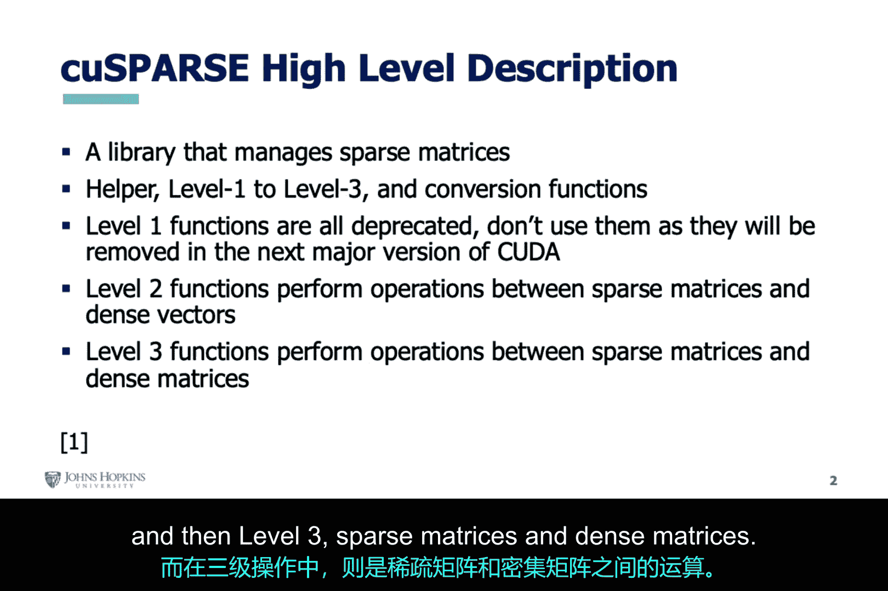
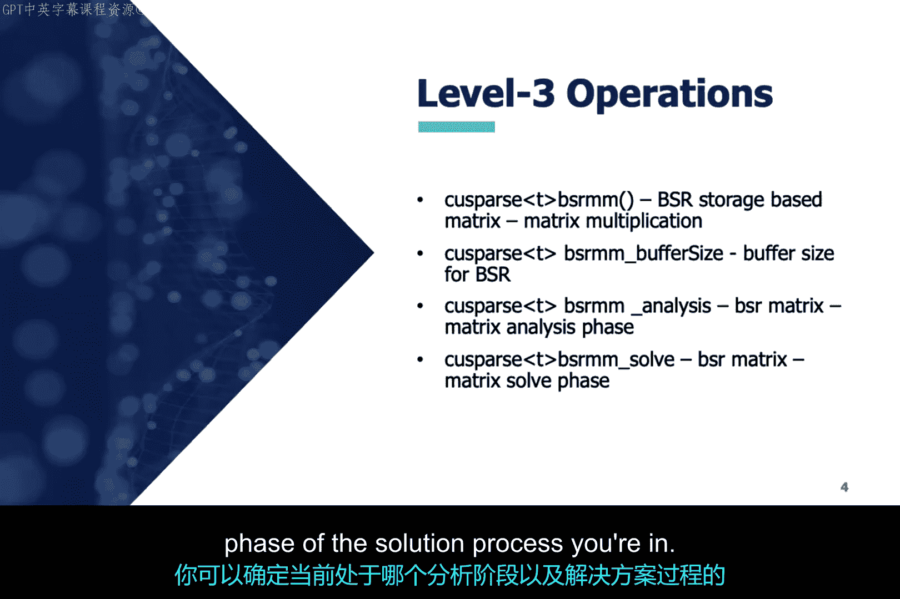
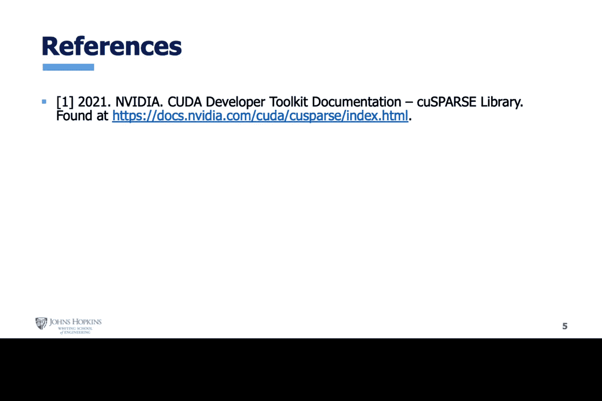

# 约翰霍普金斯大学《GPU编程（并发编程、并行编程、面向企业、CUDA高级库）｜GPU Programming》 p107 13_CUSPARSE库语法详解视频.zh_en -BV1a1421r7vw_p107-

Let we move on to matrix or linearar algebra。With。Sparrse matrices using the K Sprse library and its syntax。

So at a high level， Kus Sprse is a library for dealing with。Heper。Level 1 to level3。

And conversion functions for sparse matrices。Level one。

 you should really discontinue any use or never to think about using it because it will be deprecated and removed from kuta very soon。

Level 2 and level 3 functions always have。The sort of primary。Matrix， be sparse。

And then what you're multiplying by performing an operation is always dense。

You have in level 2 operations between sparse， matrices and dense vectors。And in level 3。

 sparse matrices and dense mates matrices。

So we're going go over some。Main level2 operations note that all these require BR storage。

Which is a way of compactly and fastly representing sparse matrices。

So not only do you have this BSRMV， which is the multiplication between a sparse。Matrix and a vector。

You also have a function to find the buffer size， so how much is needed to represent。The matrix。

You can determine the analysis phase and the solving of this matrix。Vector application。

Using that function， note the all'll start with Q sparse and that T is what we've seen before。

 which is。Ask for single。D for double， C for complex or Z for complex and double precision values。

 So level 3 operations of， as we've described before。

 our multiplications or other operations between sparse matrices。And dense matrices。

So it follows the same pattern of syntax， you have the cousparrse， the T。

 which is replaced by the type， whether it's S， D， C or Z。BSR for the type of storage。

 which is this compact and fast BR storage。Mm for multiplication of。

Of matrices or matrix matrix multiplication。Along with the actual operation to do that。

You also have a way of defining。The buffer size for the BSR for the sparse matrix。You can determine。

What analysis phase you are currently in and in what phase？Of the solution process you are in。

