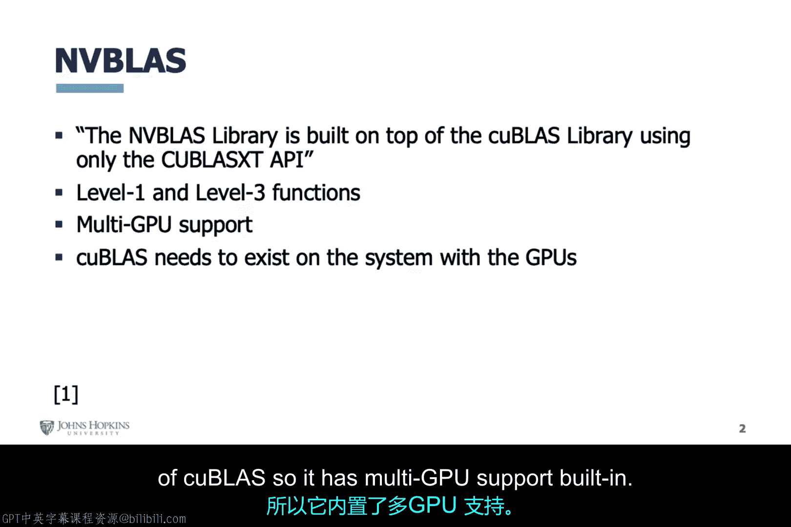
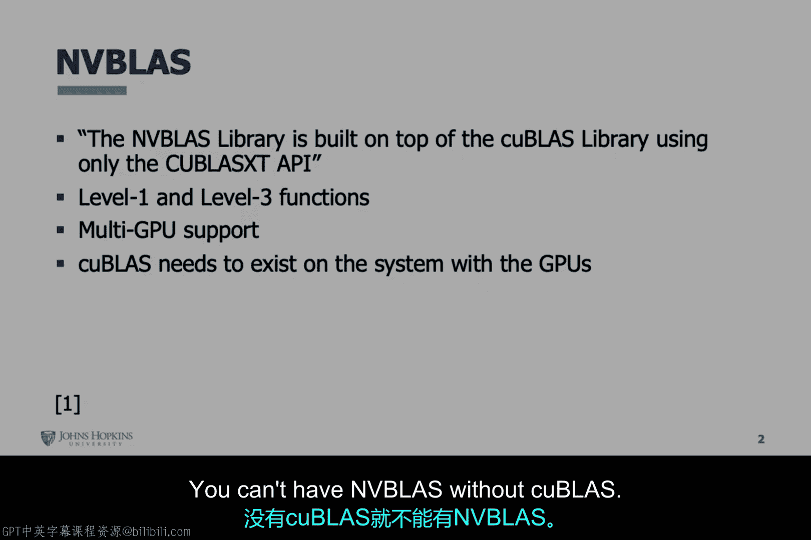
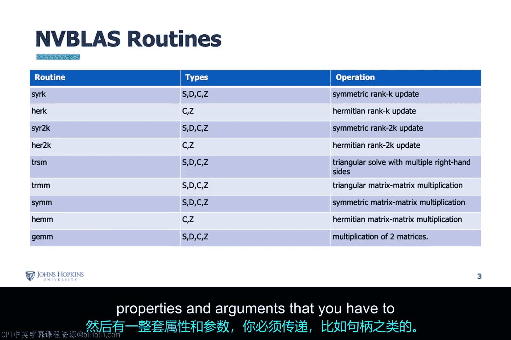

# 约翰霍普金斯大学《GPU编程（并发编程、并行编程、面向企业、CUDA高级库）｜GPU Programming》 p108 14_NVBLAS语法解析视频.zh_en -BV1a1421r7vw_p108-

Will now describe the envy blast syntax， which is built upon coubla。EnV Bla is built upon Kublas X E。

 which is the multi GP version of Kubla。It supports the same level 1 to level 3 functions。

That are in coubla。Of course， like I said before， it built using the multi GPU version of Kubla。

 so it has multi GPU support built in。

And you can't have envyla without cola。

So here is a really meaty slide with lots of。Information I think you should focus in on。

 so it shows the routines are available。In NV blast， so there are a bunch then with K。

 which are rank updates。S and H mean。Sysymmetricric in her mission。

And then RK is rank K or 2K means rank 2K update。😔，So it's a matter of the inputs and output sizes。

 note that you do not get support。😔，For single or double。Operations with her mission， type。

 updates or multiplications。 it only does complex and double precision complex numbers。Now。

 for matrix multiplication。There are really four types。

 there's triangular which take either the upper right or the lower right triangle of each of the matrix and does just multiplication。

You have symmetric matrix to matrix multiplication。

Which means that the two matrices are of the same size。You have the hermission。

 which like we said before， deals with complex and double precision complex numbers。

 and then you have like the generic。Matrix and matrix multiplication of two matrices。

 they can be different sizes。And the only other thing I didn't describe is this triangular solution of a matrix。

 so that's that TSM function。So there's lots of different functions。

 you have to consider what you're trying to do and find the appropriate function and there's a whole collection。

Of properties and arguments that you have to pass like handles and such。

