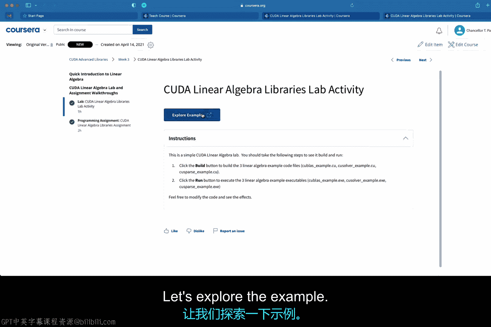
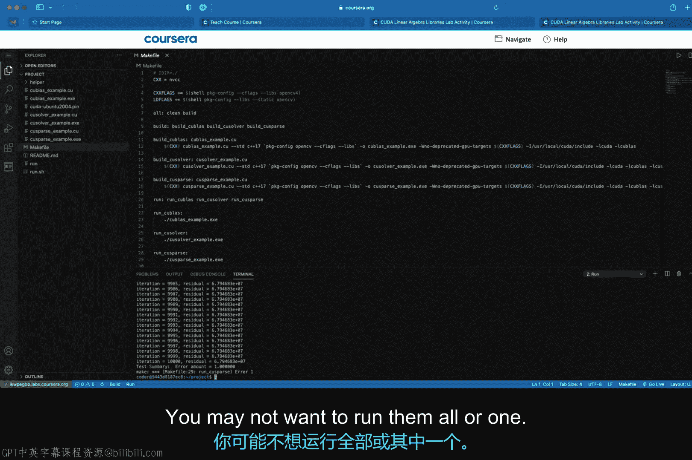
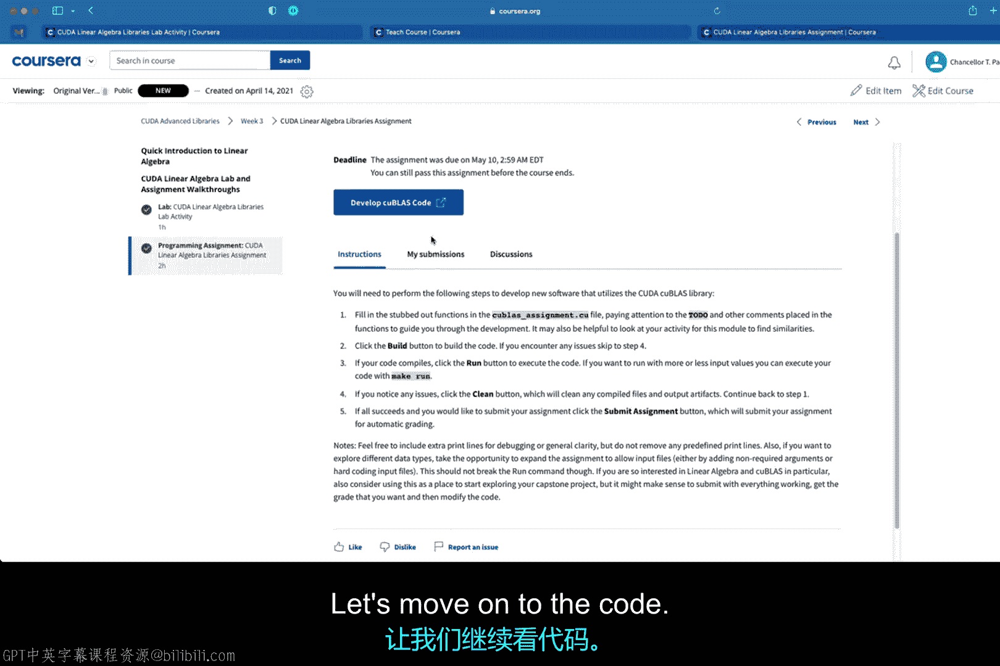
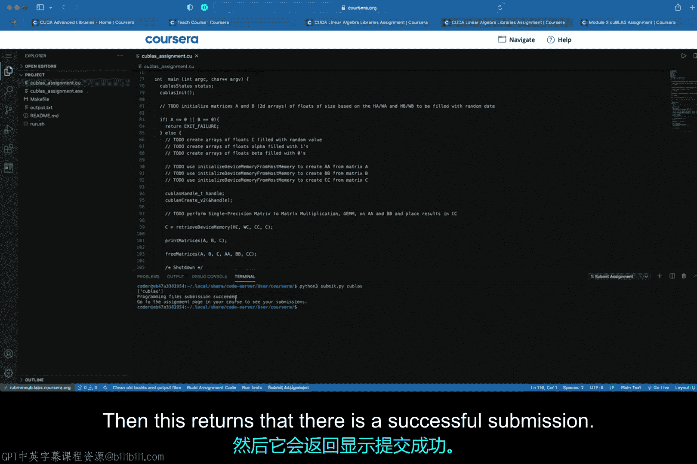

# 约翰霍普金斯大学《GPU编程（并发编程、并行编程、面向企业、CUDA高级库）｜GPU Programming》 p109 15_CUDA线性代数实验与作业综述视频.zh_en -BV1a1421r7vw_p109-

I want to very quickly go over。😔，The linear Out Libs lab， activity and assignment。

 So let's explore the example。

So。What you'll notice is that in the lab activity， there are。Parallel， Kla， Kusalver and Kus Sprse。

C files with examples of them running。Just look at them really quickly。

 it does whatever the operation is， it walks you through the steps。

And just so you have an idea about the make file， when you do make clean， build。

 you build all the examples。And then when you run them， it runs each of them individually。

 so we're going to click build。AndYou'll see that go three times。There might be some warnings。

 but there shouldn't be any errors and then you can click run。

So it's going to do each of the operations you may need to hit En。To have them go。

 it gives you some information about the carger， how many。

 you know the last one does live of iteration。Iterations and has a variety of results。

 so you can look through the output if you want。Do that really quickly， you can see there's 10。

000 iterations of one calculation， so you may not want to run them all or when。

Now let's move over to the algebra libraries' assignment。So for we actually look at the code。😔。

I'd like you to look at the instructions。D。😔，File that you're going to modify is this co blast assignment that CU。

It's stopped out in a number of places with functions and there should be two dos to tell you generally what you should do when you're done that。

 you should click the build button if things go fine。😔，Then you should run it。

 which runs the make run command。 if you have any issues， you're going to。Click the clean button。

 And the reason there is two buttons is。Because the fact is it's more complex and the fact that you have multiple executables。

I think you start with wanting get one through four over and over again， when you're done。

 click the submit assignment。As I frequently say。Am。

You know you don't want to modify any print or see out statements。

 but feel free to try different data types and expand upon the assignment。

 especially if this is an area you're interested in and would like to use KubLAs or something like that for your final project。

 so let's move on to the code。

So let's look at the Kubla assignment that C file， I've hidden certain。

Functions because they're not so important， you don't have to modify them。

 They're related to printing one or more。Marices and freeing up matrices。

 which aren't your responsibilities。 There's a function for initializing host memory based on the size。

Of the matrix that you want to create。Doing the same thing with device memory。

Retrevieving content from device memory and putting it into host memory。😔，And then。The main function。

 which has a lot to do as it tells you about。Initializing A and B as matrices。

Performing different operations， filling values。Creating device memory， performing operations。😔。

Cleaning everything up。So this isn't a super complex。Assignment。

I've done this so you have more time to do exploration or consider if you have interest in using Kublas for your final project。

So take advantage of that， note that there is the button for cleaning old build and getting rid of old artifacts。

The build for building your code， running tests， and then clicking submit assignment when you can click that。

Tternal come up and I'll say。Whether it' was successful or not mine was successful because I previously run and the output was there。

 you don't have to put output in there， but you should make sure there is an output to TxD available and then that this returns that there is a successful submission。

