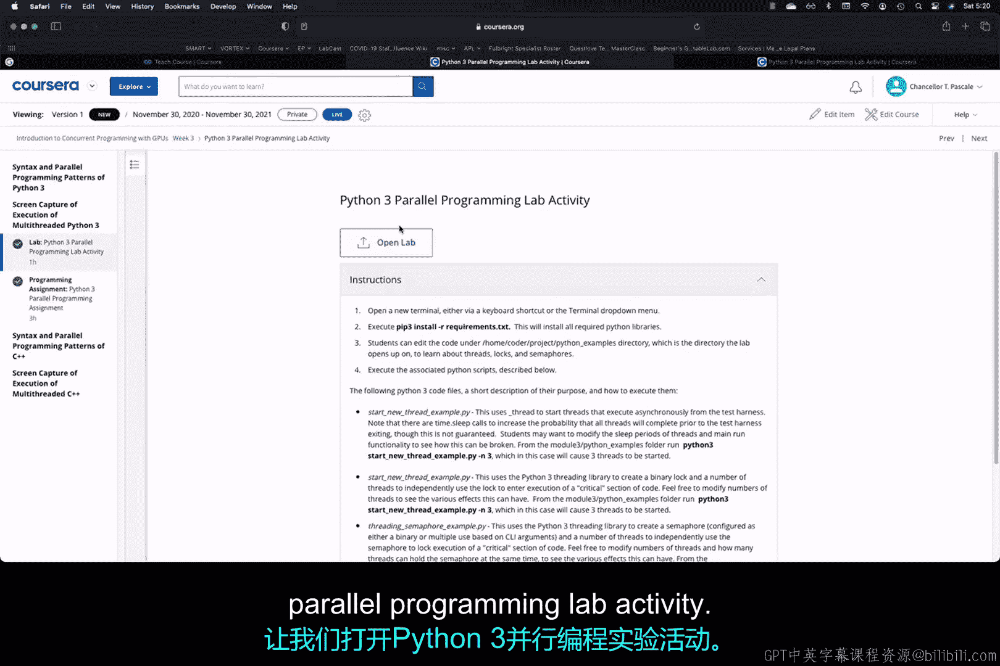
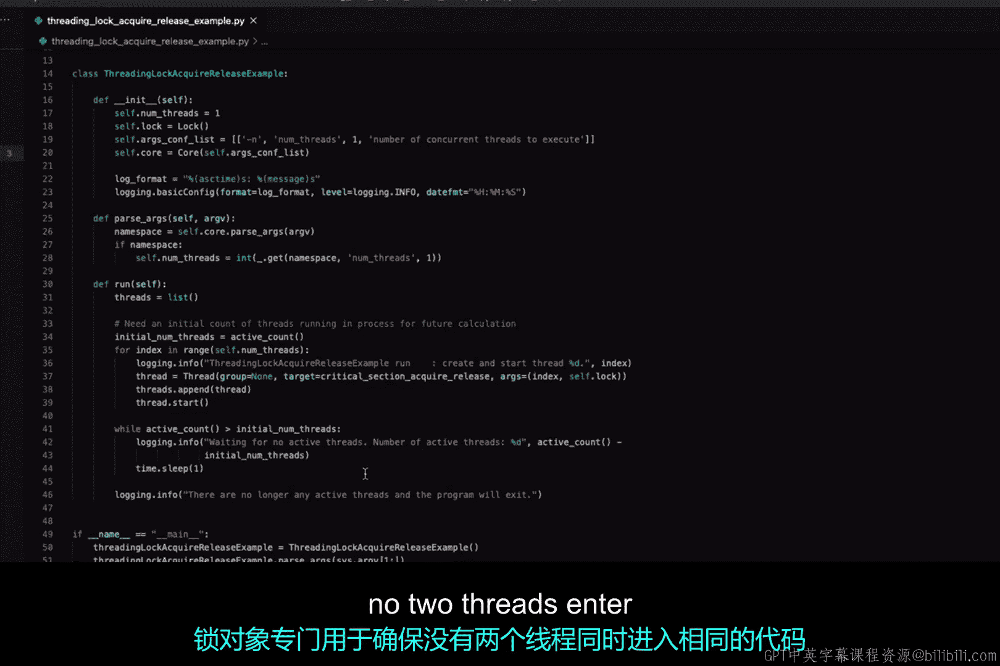
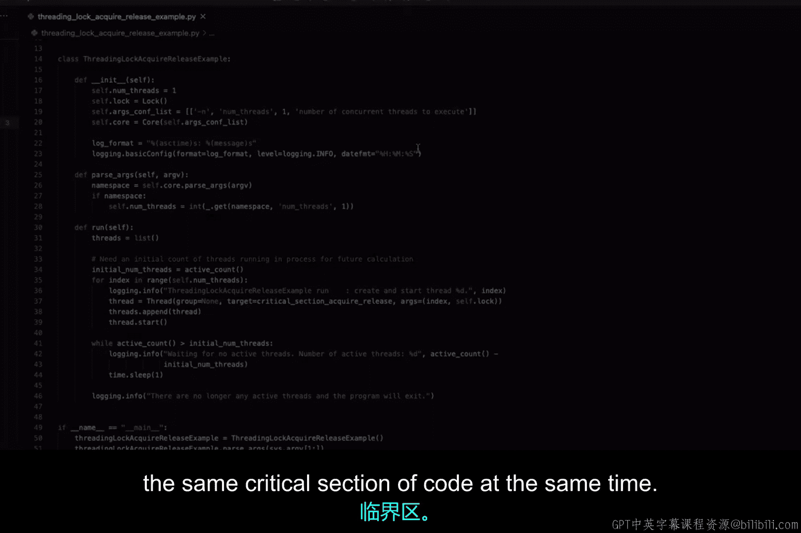
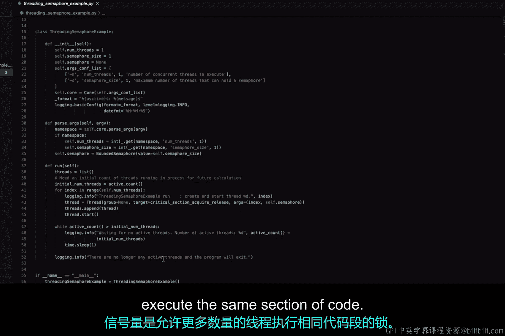

# 约翰霍普金斯大学《GPU编程（并发编程、并行编程、面向企业、CUDA高级库）｜GPU Programming》 p11 10_第2课 Python3实验项目结构视频讲座.zh_en -BV1a1421r7vw_p11-

All right， get ready to explore the Python 3 laboratory and assignment structure via this video lecture。

So let's open up the Python 3 parallel programming lab activity。

 so I'd like us to focus in on what is under Python examples in the root directory。

The basic structure of the Python  III programming labs。

Are some required but unimportant files such as the dot in it PY。

 Sometimes you'll see a pie cap and the requirements dot T X T。

Which is used for installing the appropriate libraries。

 The core functionality is across multiple py files， including Co。 py。

 and based on the lab activity you would like to explore or library。

The start new thread example that P Y threading lock acquire release example that P Y threading semapho example that P Y。

 the court at P Y has the purpose of holding a number of variables and functions。

That the other three example Python files use in common， so all these depend on chdo PY。

The main focus of the three parallel programming example files。For Python programming language。

Are on the base level programming libraries。Threading and thread。

 they will give avenues for exploration of threads， acquiring and releasing locks and semaphores。

Now that we have Corak PI open。We're going to discuss。Its two parts at the top。 there are two static。

 publicly available functions， thread function。And critical section acquire release。

Thread function basically does what the thread is supposed to do in this case。

 it outputs that it's starting and finishing and in between sleeps for one second。

The critical section acquire release does the operation of taking a sink object。And。😔。

Acquiring a lock on it。Doing some work， which is that thread function and then releasing the lock。

Note that the sync object can actually be either a lock or a semopho。

 We'll discuss this in more detail later。 So the core class is also described functions。

 It has a constructor， which is the Dunder in it。Which parses adds parsing capabilities for。

Arguments。Very useful for command line arguments。It has the parse as。

 which basically calls the parse as function for the Arg parse library and the add arg parse argument function。

 But what it does is it tells the parser of the command line arguments to add an argument。

 it takes four values， the flag。That is used in conjunction。

With the dash or double dash based on how you wantdo it， but that's sort of like the dash H for help。

 then destination variable for that argument， then any default values and then any descriptive text。

The basic thread example is in the start new thread example， that Py file。

The constructor sets up the core object to parse the dash N argument that is used to retrieve the number of threads that will be executed in parallel。

The run function is used to concurrently execute the same code， which。

 in this cases thread underscore function from qua up P Y  for each thread。

The parse args method sets up the core object of this class to process the past。

Comman line arguments for the number of threads。Variable。

The example for acquiring and releasing a lock in Python is in the threading lock acquire release example。

 dot Py file。This code should seem familiar to the previous file， this is purposeful。😔。

It was designed to fit into a simple pattern that can be updated or expanded while keeping functions organized coherently between different examples。

For each thread started in the run method， the created thread objects are executed in parallel。

 executing the same critical section of code。The lock object is used specifically to ensure that no two threads enter the same critical section of code at the same time。

Threading74 example that P Y holds the74 example code。The semapho example。

 shown here executes a user defined number of threads with a predefined number of ents into a critical section of code based on the size of the sephore。

Each thread executes the same critical section， acquire release function with a different type of synchronization object。

74s are locks that allow a larger number of threads to execute the same section of code。

