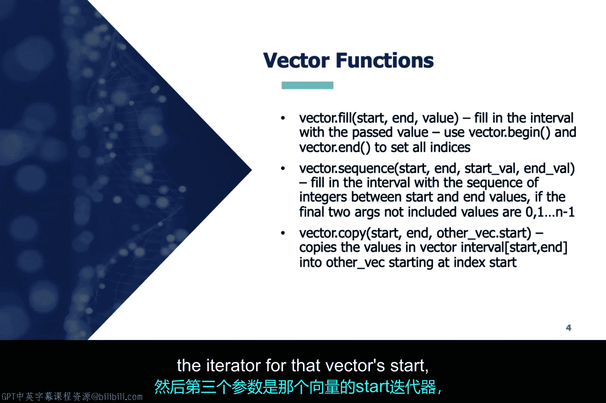
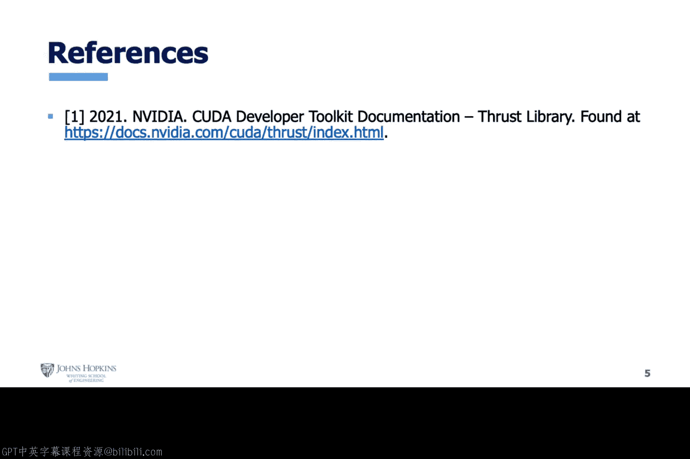

# 约翰霍普金斯大学《GPU编程（并发编程、并行编程、面向企业、CUDA高级库）｜GPU Programming》 p110 16_Thrust向量库语法视频.zh_en -BV1a1421r7vw_p110-

In this video， I will discuss the Thr library and its vector syntax。

So let's talk about what thrust is， it comes from a pattern that it's trying to meet。

 which is the capabilities of C++ STL and Bo libraries。It removes some of the need for you to。

Consider pointers and abstracts them away。😔，The main data type， though not the only one。

 is the vector， and within a vector there is a host vector and a device vector， of course。

 for host and device memory。It has this concept of an iterator， which。Allows。Applications。

 functions to。Iterate through all the values in a vector。And you can pass parts。

Of a vector or even specify the beginning and end as inputs to functions。

 especially those made with thrust。And thrust comes with tons of algorithms built into the library。

 so how do you create or construct a vector？😔，Well。

 the first thing is on all these functions you're going to see thrust and then double colon。

 if you use the C++ syntt of using and then the namespace thrust， you don't have to add that。

 but it's good， it's not the worst in the world to keep the namespace。

Then you remember theres a host and a device vector， the type， which in this case is an inure int。

The name， which is capital H， and then the size initially， which is4。

 and then you can set those values with the array notation。Vectors are statically sized initially。

 but they can be resized using the resize function。

 which if it's larger than the current size will add。Empty values at the end。

 and if you choose resize and it's smaller， then it will truncate any number beyond those initial site 2 in this case。

 those will be truncated。So。😔，Let's look at vector functions， we'll go over three main ones。

The vector fill function， takes the vector and fills it in all the values between start and end with the value with the in the third argument。

You can use the vector begin and vector and functions for start and end to fill all of a vector。

Fector sequence。Creates a sequence of whole digits。Placing them in。The indices start to end。

Based on the start and end value。And note that it's not an inclusive of the end value。

 So if you choose 0 to 10， it will go from 0 to 9。 You can have a number of situations where you have a smaller vector than your starting in。

Vues。You can have a larger and it will only fill in sort of at the minimum that it has to do。

Fector copy， copies from one vector to another。From the iterator at start to end。

 and then the third argument is the iterator for that vector's start。

 and it'll fill in as much as it can with those values。

