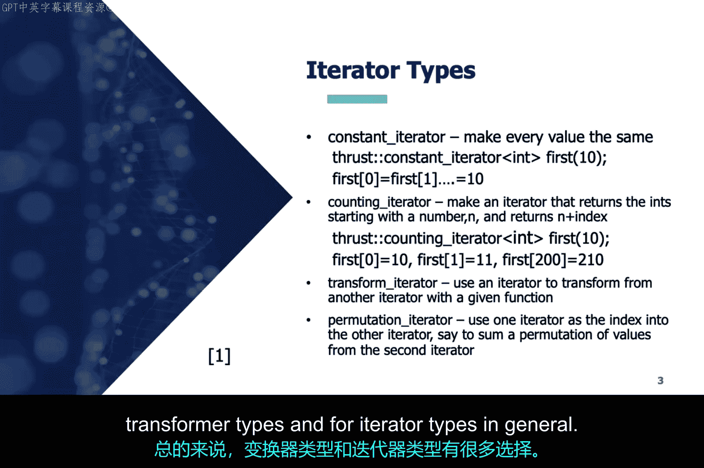
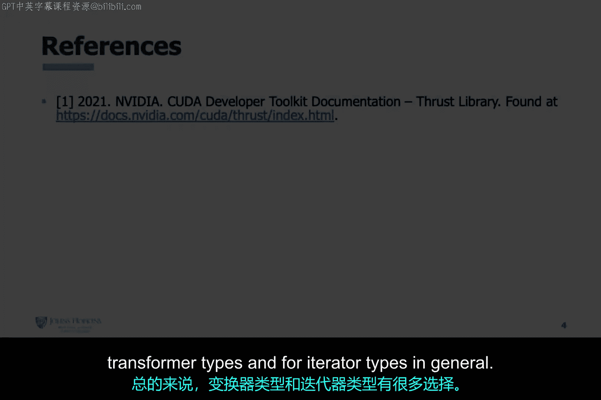

# 约翰霍普金斯大学《GPU编程（并发编程、并行编程、面向企业、CUDA高级库）｜GPU Programming》 p111 17_Thrust向量迭代器解析视频.zh_en -BV1a1421r7vw_p111-

Video will focus in on thrust vector data type。And specifically， is iteration， syntax。

 So what is an iterator。Well， the way I think about it is it abstracts away some of the most complex things about pointers and indexing them。

 and it handles the for loops and stuff like that really well。

Especially in the functions that call it or use it。

<|OTHER|>We've seen some of these functions recently in the copy sequence and fill。

And most vector operations in thrust have a start end， which you can pass an iterator or two。

If for some reason， you want to use。Sort of C C++ pointer indexing instead of an iterator。

 you can use a raw pointer cast to cast the vector into a pointer。

If you're used to using standard lists。Or your RAF code that uses it。

You can use an iterator within that to create a thrust vector and you can copy between standard library lists and thrust vectors。

 So there are different types of iterators。 Theres a constant iterator which basically in the construction you say the size creates an iterator that。

No matter。What index you give it from first0 to first 10， it will always return the same value。

 No matter what that is， if it's first 1 million， it will always return in same value。

A usage for that is if you want to multiply one。Vector。By a constant scalar。

 most operations you need to give it past another vector so you could then just。

Include that as the second vector， so in this case you'd multiply all the values in one vector by 10。

TheCoing iterator is sort of like a sequence。 you give it an initial value and then based on what index into that iterator you use。

 it will add that to that first value。 So for the case that you see here， first 10。The first value。

 zero value is。10。And then the 200 value is 210 because it's 10。

 and then the sequence continues for 200 more。The transform iterator， basically。

 you give it one iterator。And you get it transforms。 They multiply by 2。

 and it uses that function to create the second iterator。 And then the permutation iterator。

 you give it to。Iterators， the first。Is a collection of indexes into the second。

 So the position into the second。 and then based on。Which number you choose， it will sum them up。

Up to that point。So there's a lot of options for transformer types and for iterator types in general。

