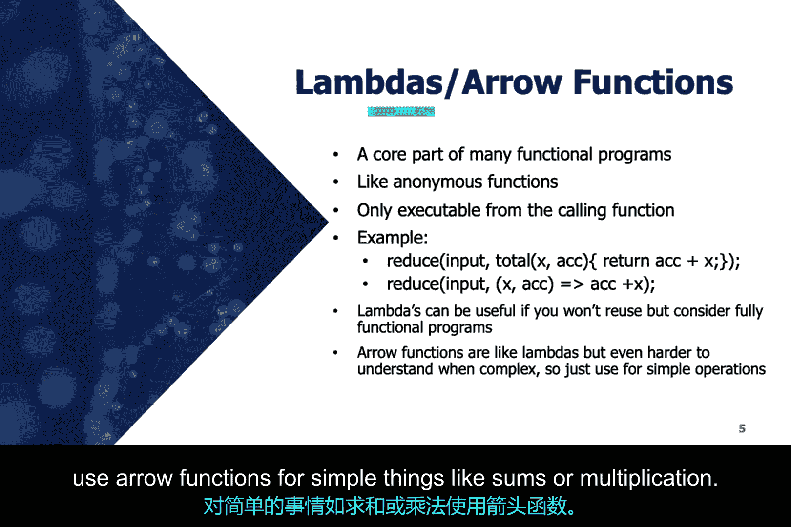
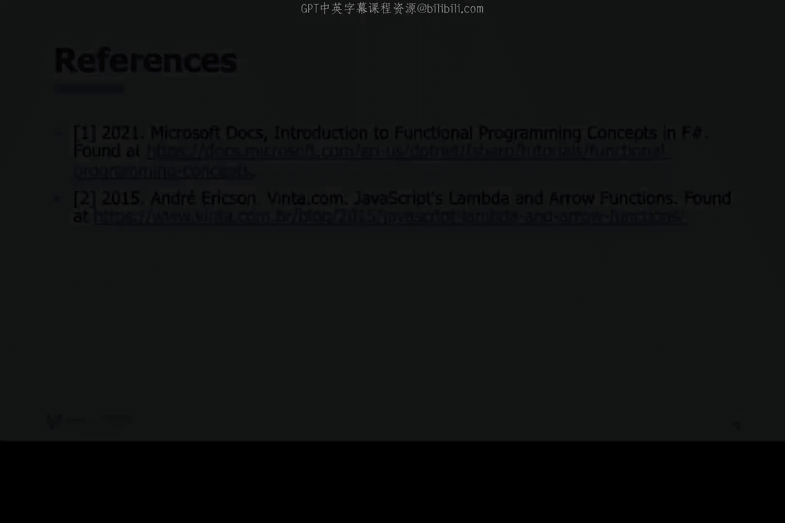

# 约翰霍普金斯大学《GPU编程（并发编程、并行编程、面向企业、CUDA高级库）｜GPU Programming》 p112 18_函数式编程范式视频.zh_en -BV1a1421r7vw_p112-

Now we're going to go over how in not just KUa or C C++。

 but in a number of languages you can do mapping， reducing and transforming of data。

 So the way you do this mapping， reducing and transforming in efficient way is through functional programming。

😔，These days， most languages support some form of functional programming。

 and there have always been languages like Lisp。And then for Java， there's closure and there's other。

Functional programming languages。And what it does is it makes your code cleaner。 And by that， I mean。

Your loops for things like four loops or while loops。Transforming data from one format into another。

Is much easier。And hopefully， if it's implemented correctly， it can be more performant。

But that's sort of based on the software， the hardware and what it does with well known algorithms。

 So some things to think about there are common in functional programming languages。

The first is that data objects are immutable and that once you instantiate an object and give it a value。

You do not modify that value。What you do is you perform an operation and as part of that operation you return new data。

 that thing you change the pointer to the name like the variable。And not the underlying data。

There's some languages that are built。With this always。Things like object C and languages like that。

Functions almost always return a pointer to the new data， so that's what you place into a variable。

You perform iteration not through loops， but often through recursion。

 which may seem strange given that we've talked so much about how recursion is bad on GPUs。

Functions tend to take the first and rest values of thee。

Data that's given to them what that means is you just pass in the vector， let's say。

 but the function that receives it deals with the first and the rest。

And what it does is it holds onto the first and calls itself with the rest。

 and that makes its way down the stack until。There's like something like a test for the size of rest and if it equals 0。

 then you return nothing or zero or null， something along those lines。

And the operation is performed un first。And each time you're taking the result of calling yourself the same function。

With rest and performing that operation and say multiplying it。

 you're multiplying first by whatever came out of rest or adding it。It's very recursive。

 and that just might be something you have to get used to that you've sort of broke the pattern of with kudo programming。

 Here's a list of some very common functions that are in。Thrust， but in other。

Functional programming paradigms。So。Each is common and what it does is it takes each value in input。

And performs an operation with it。 that does not mean。That the output is of the same size as input。

 you may be affecting something completely different。Map is different than each in that。

The input and output of the function have the same size。

 you're just performing the same operation on each。Item in input。Reduce takes an input。

Performs an operation， and places。That into a single value。

Accumulator is our ACC is the initial value that you will， you put in。

 Let's say you're doing addition。 You could start with something like1 or 5， and it would start。

Adding all the values and input and then adding five to that， that's the initial value。

Filter takes an input， and the app function defines if something is in the set or not。

 if it's in the set that is part of the output。Intersection， union and unique。

Are use buoyan logic to say， are these two vectors。What is， give me the super set。

 Give me those things that are common in those things that are unique between them。 E and says。

 only give me those。Items that are in both sets。A unique。Gives only those values that are unique。

 so it's like intersection， except for intersection can have multiple of the same value if they occur multiple times in the input arrays or vectors。

Op in those previous functions does not necessarily have to be a fully functional function that exists outside of the calling function。

 It can be a lambmbda or arrow function。And they're fairly similar they anonymous functions if you're used to things like Java or languages that allow you to have functions。

They are only used to be passed to another function。

They tend to only be executable from the calling function。😔，Now in the example， the first。😔。

Is a lambda， it has a that total is the name of the lambda it takes in。A value x。

 which is the value in the iterator at the time of its calling， so if you're at 0。In the iteration。

 then that would be the value at input index 0 and the accumulator。 and in this case。

You are returning the summation of。Accumulator and X。Arrow functions are similar。

 except for they don't necessarily have a name。They're very anonymous。

And they tend to really only want to be one line long。

<|OTHER|>Most programming languages don't allow arrow functions to be longer。

 so Lambdas can be more useful。A。But another to note is that。

Pretty much everything you do in an arrow function is more complex to do， and it's hard to read。

So I would say use lambmbdas for。Medium， complex functionality。

 Use external or normal functions for complex logic and use arrow functions for simple things like。

Sums or multiplication。

