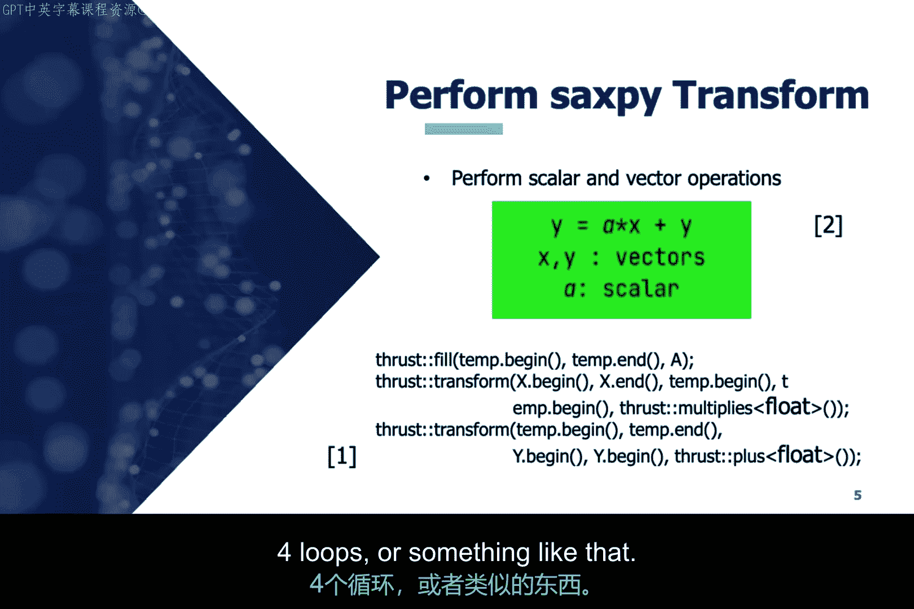
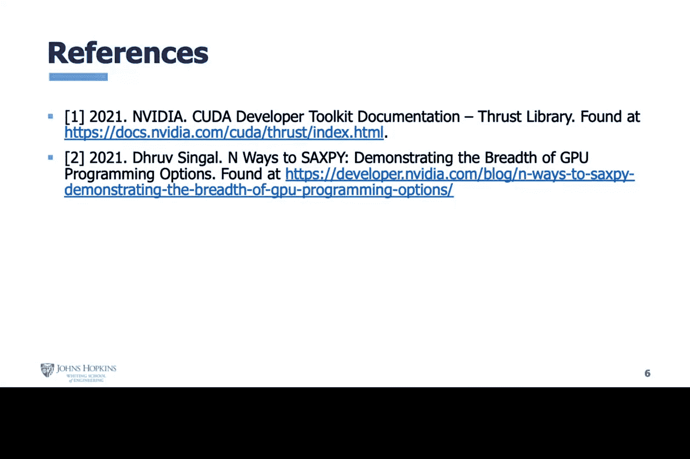

# 约翰霍普金斯大学《GPU编程（并发编程、并行编程、面向企业、CUDA高级库）｜GPU Programming》 p113 19_Thrust数据转换技术视频.zh_en -BV1a1421r7vw_p113-

The next topic we'll talk about is thrust。And its data transformation capabilities。

 their transformations are pretty powerful。 They allow you to form the same operation on an interval within a vector。

 always pass first and second argument， which are the start and an intervals or iterators into that vector。

 the last。Argument is always the operation。 Sometimes it's the third argument。

 sometimes it's different。 And in the cases where it's not the third operator。

 all those arguments between the third。And the last argument， non inclusive of the last argument are。

Arguments that are meant to support how you perform the operation。

So some examples of operations are negation， so taking an input array or vector and returning the inverse of it。

 so negative 1 negative2， negative 3 becomes 1，2，3， and so forth， modo。

 operators and things like that。So if you want to invert the values within a vector。

You use the Negate operator and note。You can actually。😔，Place the results into another。Vectctor。

 in this case， y and what you do is you give it the beginning and end iterator for the X input。

 you pass it the Y start operator。 So everything that comes out of this will start to be placed right at the beginning of the y。

Fector， and then you perform the operation， which in this case， is negating you。 That is an integer。

 Another interesting operation is performing modulo between。

Two vectors in placing the value in a third， so in our case， the two vectors will be x and z。X。

 every value in x will be moded a value at the same index in Z。 and then the value at that。

That comes out of that， we place in the Y vector at that index。So if think about it or you forgot。

 well， what is modulo？Well four modo 2 is0，3 modo 2 is1， so it's the remainder。

In whole integers from division。How you transform is by passing in the beginning and N index or iterator into x。

 the beginning of Z， So it says。Start doing this modo from the beginning of x and z so they're done pair Y and then place the value at the start of y and then the actual operation is the thrust modulus。

On integer values。The last transform we'll go over is what is called the saxpe transform。

What that means is you place as a result of multiplying a。Bye。X， so a being a scalar。

 x being a vector， and then adding in y， which is another vector， so pairwise。

Between index0 of x with y of of 0。And then the results go back into Y。

 so this is a very common transform code， we start by creating a temporary vector and placing at all the indexes a。

 which is just some scalar value。We perform the transform。Using a as being an end。

The temporary vector we just created， it's beginning and end。And multiplying it as a float。

 the x times the A or the A times the x。 So then we take the value of that and we need to add y and place it into y。

 So all the values are now in temp。So then you take1 beginning and end。

 and you perform a transform on that。Based on the why beginning being both。The value that we start。

 the transform on and where we start to place the results in and we perform the thrust plus operator on floats。

 so it might seem a little strange to take that many steps。

 and this probably isn't the cleanest example。Of it。

 but three lines of code to do something that would include at least two。

 four loops or something like that in normal programming seems pretty clean。

